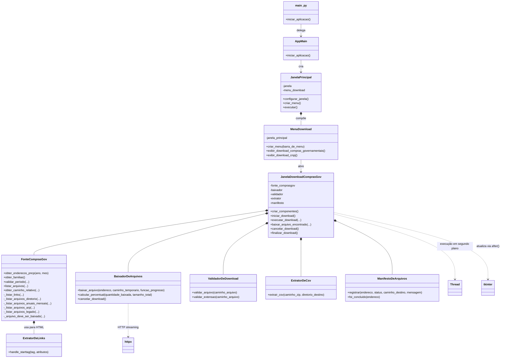
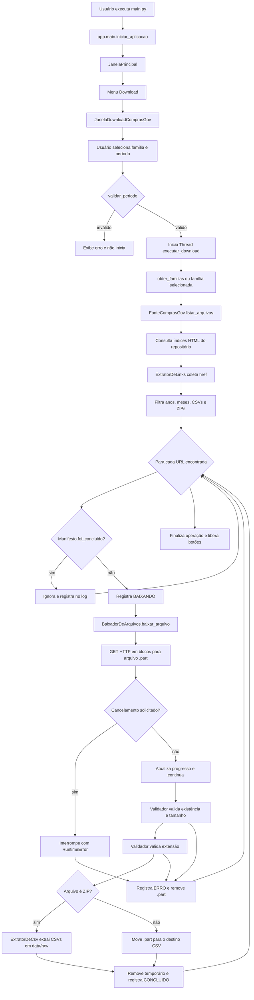

# Radar das Licitações

Aplicação Windows em Python para descoberta, download, validação e extração de dados públicos do ComprasGov. A interface é construída com `tkinter` e a comunicação HTTP utiliza `httpx`.

## Estado atual

A versão atual implementa a primeira etapa da ingestão:

- seleção da família de dados e do período na interface;
- descoberta de arquivos no repositório oficial do ComprasGov;
- download HTTP em blocos para arquivos temporários `.part`;
- cancelamento pelo usuário e atualização de progresso;
- validação de existência, tamanho e extensão (`.csv` ou `.zip`);
- extração dos CSVs contidos em arquivos ZIP;
- registro de status em `data/raw/comprasgov/manifesto_download.jsonl`;
- prevenção de novo download quando a URL já possui status `CONCLUIDO`.

Ainda não estão implementados o download de CNPJ, retry automático, hash, persistência em banco, staging, normalização e análise de preços com IA.

## Execução

Na raiz do projeto:

```powershell
python main.py
```

Também é possível instalar o projeto e usar o comando configurado em `pyproject.toml`:

```powershell
pip install -e .
radar-licitacoes
```

Requisitos: Python `>=3.11` e dependência `httpx>=0.27,<1.0`. O `tkinter` também deve estar disponível na instalação do Python.

## Arquitetura de diretórios

```text
.
├── main.py                              # Entrada para execução direta
├── pyproject.toml                       # Metadados, dependências e comando CLI
├── app/
│   ├── main.py                          # Inicialização interna
│   ├── configuracao.py                  # URLs, período e diretórios
│   ├── fontes/
│   │   └── fonte_comprasgov.py          # Descoberta e filtragem de URLs
│   ├── download/
│   │   ├── baixador_de_arquivos.py      # Download HTTP em blocos
│   │   ├── validador_de_download.py     # Validação do arquivo temporário
│   │   ├── extrator_de_csv.py            # Extração de CSV de ZIP
│   │   └── manifesto_de_arquivos.py     # Persistência de status em JSONL
│   └── interface/
│       ├── janela_principal.py          # Janela raiz e ciclo Tkinter
│       ├── menu_download.py              # Menu e abertura das operações
│       └── janela_download_comprasgov.py # Orquestração da operação
├── data/
│   ├── raw/comprasgov/                  # CSVs extraídos e manifesto
│   └── temporario/downloads/             # Arquivos .part durante o download
└── _Documentação/                        # Documentação complementar do projeto
```

## Desenho da arquitetura e correlação do código

O ponto central da aplicação é `JanelaDownloadComprasGov`. Ela coordena a interface e compõe os serviços especializados: `FonteComprasGov` descobre os arquivos; `BaixadorDeArquivos` transfere o conteúdo; `ValidadorDeDownload` verifica o temporário; `ExtratorDeCsv` trata ZIPs; e `ManifestoDeArquivos` registra a execução.



### Responsabilidade por módulo

| Módulo/classe | Responsabilidade | Métodos principais |
|---|---|---|
| `main.py` | Entrada para execução direta no Visual Studio. | `iniciar_aplicacao()` |
| `app.main` | Cria a janela principal e inicia o loop. | `iniciar_aplicacao()` |
| `JanelaPrincipal` | Janela raiz e barra de menus. | `configurar_janela()`, `criar_menu()`, `executar()` |
| `MenuDownload` | Constrói o menu e abre cada opção. | `criar_menu()`, `exibir_download_compras_governamentais()`, `exibir_download_cnpj()` |
| `JanelaDownloadComprasGov` | Controla parâmetros, thread, progresso, log e orquestração. | `iniciar_download()`, `executar_download()`, `baixar_arquivo_encontrado()` |
| `FonteComprasGov` | Consulta índices HTML, percorre famílias e filtra período/extensão. | `listar_arquivos()`, `validar_periodo()`, `obter_familias()` |
| `ExtratorDeLinks` | Extrai atributos `href` das páginas de índice. | `handle_starttag()` |
| `BaixadorDeArquivos` | Faz GET com streaming e grava no caminho temporário. | `baixar_arquivo()`, `cancelar_download()` |
| `ValidadorDeDownload` | Confirma arquivo não vazio e extensão suportada. | `validar_arquivo()`, `validar_extensao()` |
| `ExtratorDeCsv` | Localiza CSVs no ZIP e os grava no destino. | `extrair_csv()` |
| `ManifestoDeArquivos` | Mantém histórico JSON Lines thread-safe por URL. | `registrar()`, `foi_concluido()` |
| `app.configuracao` | Centraliza URL, diretórios, timeout e tamanho do bloco. | Constantes de configuração |

## Famílias de dados

`FonteComprasGov.obter_familias()` disponibiliza:

- `pncp`;
- `propostas`;
- `pesquisa_precos`;
- `arp`;
- `catalogo_cnbs`;
- `compras_legado`.

A opção `todas` percorre todas as famílias. A descoberta varia conforme a estrutura publicada: famílias anuais/mensais, `arp`, `compras_legado` e diretório direto de `catalogo_cnbs`.

## Fluxo de download



### Sequência de uma operação

1. `JanelaDownloadComprasGov.iniciar_download()` converte os campos para inteiros e valida o intervalo.
2. A operação é executada em uma `Thread`, mantendo a interface responsiva.
3. `executar_download()` seleciona uma ou todas as famílias e chama `FonteComprasGov.listar_arquivos()`.
4. A fonte consulta o índice HTTP, extrai links, percorre diretórios e filtra o período solicitado.
5. Para cada URL, `baixar_arquivo_encontrado()` verifica se já existe conclusão no manifesto.
6. O conteúdo é baixado por `BaixadorDeArquivos` para `data/temporario/downloads/<arquivo>.part`.
7. O progresso é enviado à interface por `janela.after()`, evitando atualização de widgets fora da thread principal.
8. O arquivo temporário é validado. ZIPs são extraídos por `ExtratorDeCsv`; CSVs são movidos diretamente para `data/raw/comprasgov`.
9. O manifesto recebe `CONCLUIDO` ou `ERRO`, com URL, destino e mensagem. O temporário é removido em caso de falha.
10. Ao terminar, `finalizar_download()` reabilita os controles da janela.

## Configuração e arquivos gerados

As constantes ficam em `app/configuracao.py`:

| Constante | Valor padrão | Uso |
|---|---:|---|
| `URL_BASE_COMPRASGOV` | repositório oficial | Raiz da descoberta |
| `ANO_INICIAL_DADOS` | `2025` | Ano padrão da fonte |
| `DIRETORIO_DADOS_BRUTOS` | `data/raw/comprasgov` | Destino dos dados |
| `DIRETORIO_DOWNLOAD_TEMPORARIO` | `data/temporario/downloads` | Arquivos parciais |
| `DIRETORIO_MANIFESTO` | `data/raw/comprasgov/manifesto_download.jsonl` | Histórico da operação |
| `TEMPO_LIMITE_DOWNLOAD` | `60.0` segundos | Timeout HTTP |
| `TAMANHO_BLOCO_DOWNLOAD` | `1 MiB` | Tamanho dos blocos HTTP |

Cada linha do manifesto contém `data_hora`, `endereco`, `status`, `caminho_destino` e `mensagem`. Os status usados atualmente são `BAIXANDO`, `CONCLUIDO` e `ERRO`.

## Limitações e próximos passos

- O botão de CNPJ apenas informa que a funcionalidade será implementada futuramente.
- O manifesto evita repetição por URL, mas não calcula hash nem compara versões do conteúdo.
- Não há retomada de arquivos `.part` nem política de retry automático.
- A extração usa apenas o nome do arquivo dentro do ZIP; arquivos com nomes repetidos podem sobrescrever o destino.
- Não há carga em Neon/PostgreSQL, tabelas `raw`/`staging`, normalização ou análise estatística.
- Uma evolução natural é adicionar testes automatizados, hash, retries, retomada, isolamento por família e preservação do caminho relativo publicado.

## Autor e responsável técnico

**Marcio Welb de Aguiar Silveira** é o autor e responsável técnico pelo projeto **Radar das Licitações**, uma solução orientada à rastreabilidade de dados públicos, à automação de processos governamentais e à construção de uma base confiável para análises de preços e apoio à tomada de decisão.

Sua atuação combina engenharia de software, arquitetura distribuída e inteligência artificial aplicada:

> **Senior Software Engineer** especializado em Digital Banking, plataformas de crédito e soluções para governo digital, com experiência em Clean Architecture, Domain-Driven Design (DDD), padrões SAGA, sistemas orientados a eventos e desenvolvimento AI-First. Atua com .NET e Python e também é praticante e instrutor de Aikido.

- **E-mail:** [marciowelb@outlook.com.br](mailto:marciowelb@outlook.com.br)
- **Telefone:** `55 (11) 98137-0755`

## Documentação complementar

- [Estrutura de diretórios e arquitetura](_Documentação/Arquitetura/Estrutura_Diretorios.md)
- [Dados do ComprasGov e layouts](_Documentação/Analise/Documentacao_Dados_ComprasGov.md)
- [Endpoints da API ComprasGov](_Documentação/Analise/Documentacao_API_ComprasGov_Endpoints.md)
- [Arquivos CNPJ, download e modelo de banco](_Documentação/Analise/Documentacao_CNPJ_Download_Layout_BancoDados.md)
