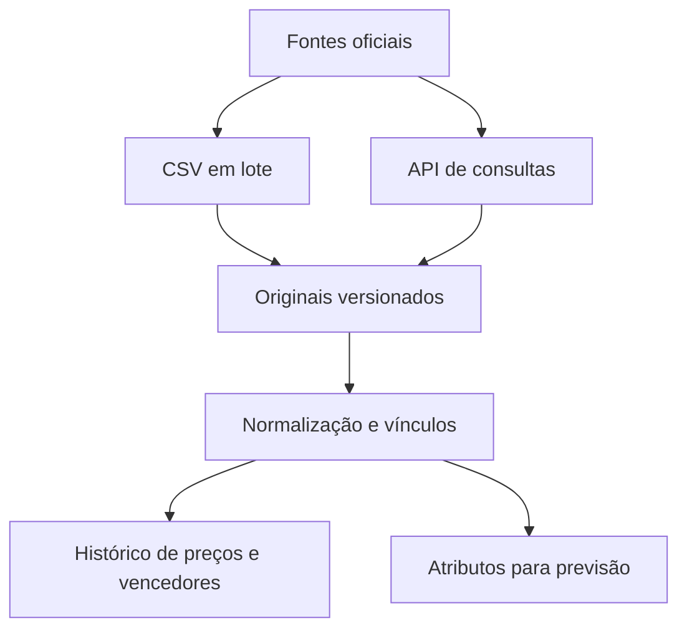
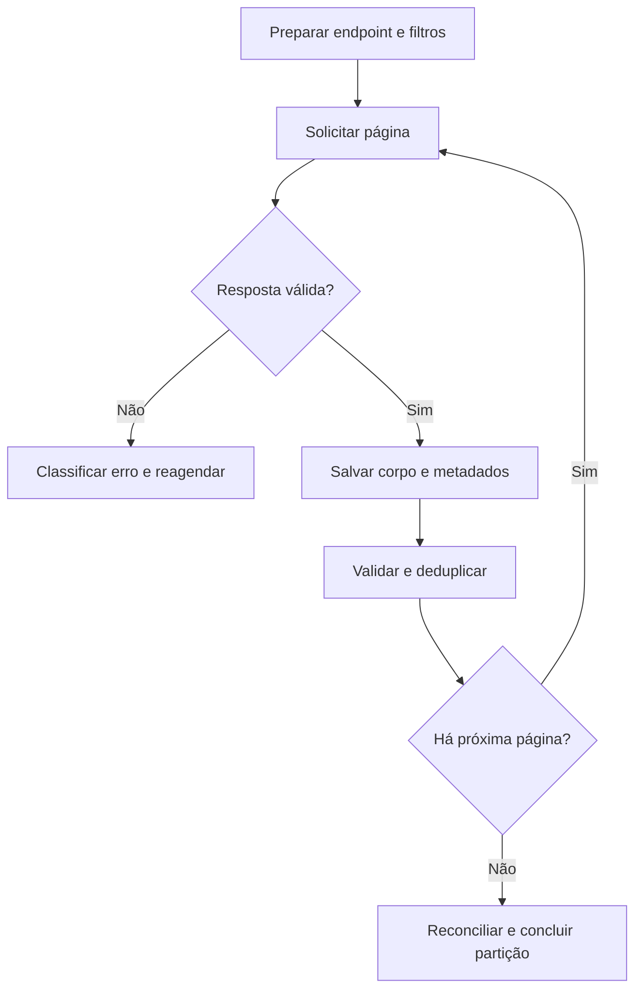
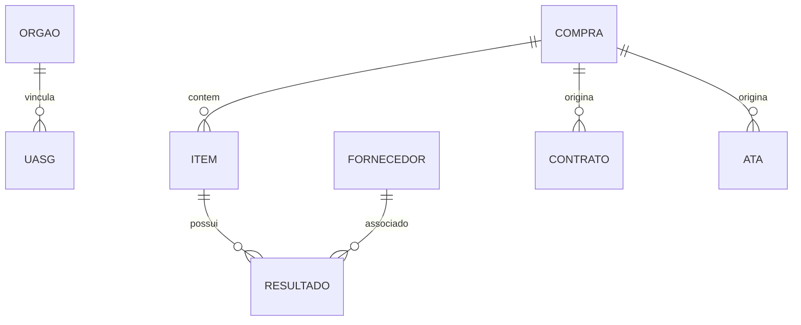

# TaxCoreBrazil — API de Dados Abertos do Compras.gov.br

**Versão da documentação:** 1.0  
**Data da análise:** 05/11/2026  
**Uso inicial:** download reproduzível, perfilamento e análise local de compras públicas.  
**Uso posterior:** referência para prompt de desenvolvimento do coletor, consultas, API e sistema de inteligência competitiva.

## 1. Escopo, fontes e método

Esta documentação complementa o levantamento dos CSVs ComprasGov. É um documento independente: não altera o arquivo anterior nem implementa o software. Cobre todas as operações declaradas no OpenAPI coletado, com parâmetros, requisitos, formatos e layouts de resposta. Inclui rotas auxiliares de administração para distinguir o que pertence ao coletor público e o que fica fora dele.

### 1.1 Fontes oficiais consultadas

| Fonte | Endereço | Uso |
|---|---|---|
| Página solicitada | https://www.gov.br/compras/pt-br/cidadao/portal-de-dados-abertos/explorador-de-dados | Ponto de entrada institucional |
| Aplicação incorporada nessa página | https://portaldadosabertos-dev.gestao.gov.br/sistema-embed.html | Interface do explorador e catálogo visual |
| Swagger oficial vinculado pelo portal | https://dadosabertos.compras.gov.br/swagger-ui/index.html | Interface da especificação |
| Contrato OpenAPI | https://dadosabertos.compras.gov.br/v3/api-docs | Fonte dos paths, parâmetros e esquemas |
| Configuração Swagger | https://dadosabertos.compras.gov.br/v3/api-docs/swagger-config | Confirma a localização do contrato |
| Página institucional de documentação interativa | https://www.gov.br/compras/pt-br/cidadao/portal-de-dados-abertos/documentacao-interativa-da-api-de-dados-abertos | Referência complementar |
| Repositório em lote | https://repositorio.dados.gov.br/seges/comprasgov/ | Alternativa para carga histórica em CSV/ZIP |

A interface está incorporada em um host cujo nome contém `-dev`. Isso é uma observação da URL publicada, não prova de homologação ou de ausência de validade. O backend declarado pelo OpenAPI é `https://dadosabertos.compras.gov.br`; a interface também utiliza um caminho relativo de proxy `/api-dados-abertos`. O coletor deverá usar a base oficial da API, sem depender dos nomes versionados dos arquivos JavaScript do explorador.

### 1.2 Evidências e limites

- **Contrato:** nomes, tipos, obrigatoriedade, enums e limites extraídos do OpenAPI oficial.
- **Observado:** respostas de pequenas consultas GET sem credenciais, descritas na seção de verificação.
- **Inferido/proposto:** interpretação pelo nome do campo, organização do coletor e regras de armazenamento.
- **Pendente:** comportamento sem documentação suficiente ou não verificado em execução.

Não foram testadas todas as rotas, todos os filtros, todas as modalidades ou o download integral. Não foram executadas rotas de login, gestão de usuários ou ALICE. O catálogo da interface tem contagens e subconjuntos que divergem do OpenAPI; para este inventário prevalece o contrato obtido em 05/11/2026. O contrato é um retrato temporal, não garantia de estabilidade.

**Identidade do contrato coletado:** OpenAPI `3.1.0`; título `API Compras.gov.br`; versão informada `1.0.0`; SHA-256 dos bytes originais `5386cf3a4f577397dcd9da282ed3a97c47b413282678a48f2eb14b80a3822167`.

## 2. Visão dos módulos e prioridade para download

| Módulo | Utilidade para o projeto | Estratégia inicial proposta |
|---|---|---|
| CATMAT | Identificação de materiais, especificações, unidades e hierarquia | Carregar dimensões; itens e características por páginas |
| CATSER | Identificação e classificação de serviços | Carregar hierarquia, serviços e unidades |
| UASG/órgãos | Dimensão institucional, geográfica e recorte de órgãos | Consultar situações true/false quando exigidas |
| Pesquisa de preços | Séries de preços e fornecedores, materiais e serviços | Enumerar códigos de catálogo e janelas de data |
| Contratações | Compras, itens e resultados sob contexto PNCP/Lei 14.133 | Janelas distintas por publicação, inclusão e resultado |
| Legado | Histórico de licitações, pregões e contratação direta | Ano ou janela de data conforme operação |
| ARP | Atas, itens, unidades, saldos/empenhos e adesões | Descobrir atas e consultar seus filhos |
| Contratos | Cabeçalhos, itens e vigências contratuais | Enumerar órgãos e janelas de vigência |
| PGC | Demanda planejada e agregações | Órgão + ano; ou catálogo + ano |
| Fornecedores | Cadastro de fornecedores | Ativos e inativos; guardar origem e data de observação |
| OCDS | Representação de contratações em padrão de interoperabilidade | Comprador + janela de releases |
| Indicadores | Uso/desempenho da própria API segundo a tag oficial | Não confundir com indicadores de preços ou adjudicação |
| ALICE | Integração autenticada para análises/tickets | Fora do coletor público inicial |
| Usuários/autenticação | Gestão de acesso do serviço | Fora da coleta de compras |

Não existe no contrato consultado um módulo de propostas concorrentes nem uma rota claramente documentada de sequência completa de lances. O CSV de propostas continua relevante para estudar participantes e classificação. A API não substitui automaticamente todas as famílias do repositório.



### 2.1 Contagem de operações do contrato

| Grupo oficial | Operações |
|---|---|
| 01 - CATÁLOGO - MATERIAL | 7 |
| 02 - CATÁLOGO - SERVIÇO | 8 |
| 03 - PESQUISA DE PREÇO - PREÇOS PRATICADOS | 8 |
| 04 - PGC | 6 |
| 05 - UASG | 4 |
| 06 - LEGADO | 13 |
| 07 - CONTRATAÇÕES | 6 |
| 08 - ARP | 8 |
| 09 - CONTRATOS | 5 |
| 10 - FORNECEDOR | 1 |
| 11 - OCDS | 1 |
| 97 - INDICADORES | 2 |
| 98 - ALICE | 3 |
| 99 - USUARIOS | 4 |
| AUTENTICACAO | 1 |

**Total:** 77 operações em 77 paths; 116 esquemas e 1150 propriedades declaradas. Propriedades repetidas em DTOs diferentes contam separadamente.

## 3. Contrato HTTP, autenticação e paginação

**Base oficial:** `https://dadosabertos.compras.gov.br`  
**Consultas:** GET com filtros na query string. Preservar caixa, sublinhados e grafia; a numeração faz parte do path.  
**Formato de leitura:** preferir `Accept: application/json` para consultas estruturadas; verificar o Content-Type real antes de interpretar o corpo.  
**Autenticação:** não há requisito global de segurança no contrato. As operações públicas de módulos não declaram bearer; usuários e ALICE declaram `bearerAuth` JWT. Algumas consultas públicas foram verificadas sem token. Isso não constitui garantia de acesso anônimo a qualquer rota futura.

O serviço declara várias respostas como `*/*` no OpenAPI, inclusive rotas com sufixo `_CSV`. Logo, o schema declarado não comprova formato efetivo. Rotas CSV devem ser implementadas por adaptador separado e verificadas quanto a cabeçalho, delimitador, paginação e tipo de conteúdo.

### 3.1 Envelope JSON comum

```json
{
  "resultado": [],
  "totalRegistros": 0,
  "totalPaginas": 0,
  "paginasRestantes": 0
}
```

O envelope foi confirmado em amostras de CATMAT, UASG, pesquisa de preços e contratações. OCDS, consultas por ID e outras operações podem declarar objetos ou arrays diferentes: seguir o schema de cada resposta.

| Parâmetro | Regra do contrato |
|---|---|
| `pagina` | Em geral padrão 1; mínimo 1 onde explicitado |
| `tamanhoPagina` | Onde declarado: padrão 10, mínimo 10 e máximo 500 |
| Rotas sem `tamanhoPagina` | Não enviar um parâmetro inventado; tamanho efetivo deve ser observado |
| Rotas por ID | Muitas não declaram paginação; observar arrays e multiplicidade |
| OCDS | Usa `page` e `offSet`, ambos com padrões próprios; semântica de `offSet` não explicada |
| CSV | Algumas rotas mantêm parâmetros de paginação; não pressupor exportação integral |

Não generalizar o limite 500 a rotas que não o declaram. Iniciar com 10 em validação; aumentar conforme contrato e desempenho. A API não documenta cursor, ordenação estável ou snapshot consistente. Paginação durante atualização da base pode repetir ou omitir registros; usar janelas, deduplicação e reconciliação.

### 3.2 Regras de tipos e normalização

- Identificadores, CPF/CNPJ, UASG e chaves compostas devem ser texto no modelo canônico, mesmo se algum DTO devolver número.
- **Risco confirmado:** a resposta da pesquisa de preços retorna `idCompra` como número com mais de 15 dígitos. Conversão comum de JSON em JavaScript para Number pode perder precisão acima de `2^53 - 1`. Converter para string depois da perda não recupera o valor. Usar parsing que preserve inteiros grandes, ou Python com inteiros exatos.
- Valores monetários e quantidades devem usar Decimal; a amostra contém notação exponencial como `0E-8`. Evitar float para armazenamento e cálculos financeiros.
- Preservar a representação original das datas. Existem timestamps com microssegundos sem timezone, e o OpenAPI apresenta alguns campos `date-time` com descrição `YYYY-MM-DD`; não truncar silenciosamente.
- Campo omitido, null, string vazia, zero e false são estados distintos. O contrato nem sempre declara nullable apesar de null observado.
- Não transformar todos os nomes camelCase em snake_case sem mapa e detecção de colisão.

### 3.3 Diferenças e inconsistências relevantes

| Ponto | Evidência e consequência |
|---|---|
| `dataAualizacaoPncp` | Grafia exata na listagem de contratações; outras rotas usam `dataAtualizacaoPncp` |
| Parâmetro `dataResultado` | É booleano em pesquisa de preços, não data |
| Datas obrigatórias variam | Compras por publicação; itens por inclusão; resultados por resultado; ARP/contratos por vigência |
| Consulta detalhe CSV | Em material/serviço detalhe, `codigoItemCatalogo` é opcional no CSV e obrigatório no JSON segundo o contrato; não assumir paridade |
| Filtro de classe de serviço | A rota de classe usa `statusGrupo`, conforme publicado, embora o nome pareça inconsistente |
| Grupos do explorador | Contagens estáticas não coincidem sempre com o contrato, por exemplo ARP e contratos |
| Legado e regime legal | Há filtro `pertence14133`; não assumir que todo registro de módulo legado pertence necessariamente a uma única lei |
| Parâmetro faltante | A requisição de UASG sem `statusUasg` retornou HTTP 404 na amostra, e não 400 |
| Resultado vazio | Consultas de contratações testadas com códigos 6 e 8 retornaram 200 e zero registros; isso não valida a semântica desses códigos nem ausência do fato em outras fontes |
| Esfera/poder | Alguns filtros usam nomes extensos e outros códigos; obedecer enum por operação e validar domínio |

## 4. Catálogo completo de endpoints

As tabelas desta seção refletem o contrato oficial. Descrições de parâmetros ausentes do contrato são marcadas como inferidas. `required=false` significa parâmetro opcional, não que toda combinação seja aceita. Regras de combinação e limites de intervalo não publicados permanecem pendentes.

### 01 - CATÁLOGO - MATERIAL

Catálogo de Materiais (CATMAT): Consulta itens de materiais com dados detalhados.

#### `GET /modulo-material/1_consultarGrupoMaterial`

Consultar grupos de materiais.

- **URL base + path:** `https://dadosabertos.compras.gov.br/modulo-material/1_consultarGrupoMaterial`
- **operationId:** `consultarGrupoMaterial`
- **Segurança declarada:** sem requisito de segurança declarado nesta operação
- **Uso no projeto:** consulta de dados; priorizar conforme plano de coleta

| Nome exato | Local | Obrigatório | Tipo | Padrão / limites / enum | Descrição |
|---|---|---|---|---|---|
| `pagina` | query | não | integer / int32 | {"default":1} | Inferido: Página solicitada. Início padrão 1 onde declarado. |
| `codigoGrupo` | query | não | integer / int64 | {} | Inferido: codigo Grupo. Significado inferido do nome; domínio/regra não detalhados no contrato. |
| `statusGrupo` | query | não | boolean | {} | Inferido: status Grupo. Significado inferido do nome; domínio/regra não detalhados no contrato. |

**Respostas declaradas:**

| HTTP | Descrição | Media type | Schema |
|---|---|---|---|
| 200 | OK | `*/*` | `GenericAPIResponseDTODmMaterialGrupoDTO` |

Consultar os layouts em **Dicionário de schemas**, pelos nomes: `GenericAPIResponseDTODmMaterialGrupoDTO`.

#### `GET /modulo-material/2_consultarClasseMaterial`

Consultar classes de materiais.

- **URL base + path:** `https://dadosabertos.compras.gov.br/modulo-material/2_consultarClasseMaterial`
- **operationId:** `consultarClasseMaterial`
- **Segurança declarada:** sem requisito de segurança declarado nesta operação
- **Uso no projeto:** consulta de dados; priorizar conforme plano de coleta

| Nome exato | Local | Obrigatório | Tipo | Padrão / limites / enum | Descrição |
|---|---|---|---|---|---|
| `pagina` | query | não | integer / int32 | {"default":1} | Inferido: Página solicitada. Início padrão 1 onde declarado. |
| `codigoGrupo` | query | não | integer / int64 | {} | Inferido: codigo Grupo. Significado inferido do nome; domínio/regra não detalhados no contrato. |
| `codigoClasse` | query | não | integer / int64 | {} | Inferido: codigo Classe. Significado inferido do nome; domínio/regra não detalhados no contrato. |
| `statusClasse` | query | não | boolean | {} | Inferido: status Classe. Significado inferido do nome; domínio/regra não detalhados no contrato. |
| `bps` | query | não | boolean | {"default":false} | Inferido: Filtro relacionado a BPS; regra detalhada ausente. Não usar como sinônimo de todos os materiais. |

**Respostas declaradas:**

| HTTP | Descrição | Media type | Schema |
|---|---|---|---|
| 200 | OK | `*/*` | `GenericAPIResponseDTODmMaterialClasseDTO` |

Consultar os layouts em **Dicionário de schemas**, pelos nomes: `GenericAPIResponseDTODmMaterialClasseDTO`.

#### `GET /modulo-material/3_consultarPdmMaterial`

Consultar PDM (Padrão Descritivo de Material).

- **URL base + path:** `https://dadosabertos.compras.gov.br/modulo-material/3_consultarPdmMaterial`
- **operationId:** `consultarPdmMaterial`
- **Segurança declarada:** sem requisito de segurança declarado nesta operação
- **Uso no projeto:** consulta de dados; priorizar conforme plano de coleta

| Nome exato | Local | Obrigatório | Tipo | Padrão / limites / enum | Descrição |
|---|---|---|---|---|---|
| `pagina` | query | não | integer / int32 | {"default":1,"minimum":1} | Inferido: Página solicitada. Início padrão 1 onde declarado. |
| `tamanhoPagina` | query | não | integer / int32 | {"default":10,"maximum":500,"minimum":10} | Inferido: Quantidade solicitada de registros por página. |
| `statusPdm` | query | não | boolean | {} | Inferido: status Pdm. Significado inferido do nome; domínio/regra não detalhados no contrato. |
| `codigoPdm` | query | não | integer / int64 | {} | Inferido: codigo Pdm. Significado inferido do nome; domínio/regra não detalhados no contrato. |
| `codigoGrupo` | query | não | integer / int64 | {} | Inferido: codigo Grupo. Significado inferido do nome; domínio/regra não detalhados no contrato. |
| `codigoClasse` | query | não | integer / int64 | {} | Inferido: codigo Classe. Significado inferido do nome; domínio/regra não detalhados no contrato. |
| `bps` | query | não | boolean | {"default":false} | Inferido: Filtro relacionado a BPS; regra detalhada ausente. Não usar como sinônimo de todos os materiais. |

**Respostas declaradas:**

| HTTP | Descrição | Media type | Schema |
|---|---|---|---|
| 200 | OK | `*/*` | `GenericAPIResponseDTODmMaterialPDMDTO` |

Consultar os layouts em **Dicionário de schemas**, pelos nomes: `GenericAPIResponseDTODmMaterialPDMDTO`.

#### `GET /modulo-material/4_consultarItemMaterial`

Consultar itens de material.

- **URL base + path:** `https://dadosabertos.compras.gov.br/modulo-material/4_consultarItemMaterial`
- **operationId:** `consultarItemMaterial`
- **Segurança declarada:** sem requisito de segurança declarado nesta operação
- **Uso no projeto:** consulta de dados; priorizar conforme plano de coleta

| Nome exato | Local | Obrigatório | Tipo | Padrão / limites / enum | Descrição |
|---|---|---|---|---|---|
| `pagina` | query | não | integer / int32 | {"default":1,"minimum":1} | Inferido: Página solicitada. Início padrão 1 onde declarado. |
| `tamanhoPagina` | query | não | integer / int32 | {"default":10,"maximum":500,"minimum":10} | Inferido: Quantidade solicitada de registros por página. |
| `codigoItem` | query | não | integer / int64 | {} | Inferido: codigo Item. Significado inferido do nome; domínio/regra não detalhados no contrato. |
| `codigoGrupo` | query | não | integer / int64 | {} | Inferido: codigo Grupo. Significado inferido do nome; domínio/regra não detalhados no contrato. |
| `codigoClasse` | query | não | integer / int64 | {} | Inferido: codigo Classe. Significado inferido do nome; domínio/regra não detalhados no contrato. |
| `codigoPdm` | query | não | integer / int64 | {} | Inferido: codigo Pdm. Significado inferido do nome; domínio/regra não detalhados no contrato. |
| `descricaoItem` | query | não | string | {} | Inferido: descricao Item. Significado inferido do nome; domínio/regra não detalhados no contrato. |
| `statusItem` | query | não | boolean | {} | Inferido: status Item. Significado inferido do nome; domínio/regra não detalhados no contrato. |
| `bps` | query | não | boolean | {"default":false} | Inferido: Filtro relacionado a BPS; regra detalhada ausente. Não usar como sinônimo de todos os materiais. |
| `codigo_ncm` | query | não | string | {} | Inferido: codigo ncm. Significado inferido do nome; domínio/regra não detalhados no contrato. |

**Respostas declaradas:**

| HTTP | Descrição | Media type | Schema |
|---|---|---|---|
| 200 | OK | `*/*` | `GenericAPIResponseDTODmMaterialItemDTO` |

Consultar os layouts em **Dicionário de schemas**, pelos nomes: `GenericAPIResponseDTODmMaterialItemDTO`.

#### `GET /modulo-material/5_consultarMaterialNaturezaDespesa`

Consultar natureza de despesa do material.

- **URL base + path:** `https://dadosabertos.compras.gov.br/modulo-material/5_consultarMaterialNaturezaDespesa`
- **operationId:** `consultarMaterialNaturezaDespesa`
- **Segurança declarada:** sem requisito de segurança declarado nesta operação
- **Uso no projeto:** consulta de dados; priorizar conforme plano de coleta

| Nome exato | Local | Obrigatório | Tipo | Padrão / limites / enum | Descrição |
|---|---|---|---|---|---|
| `pagina` | query | não | integer / int32 | {"default":1,"minimum":1} | Inferido: Página solicitada. Início padrão 1 onde declarado. |
| `tamanhoPagina` | query | não | integer / int32 | {"default":10,"maximum":500,"minimum":10} | Inferido: Quantidade solicitada de registros por página. |
| `codigoPdm` | query | não | integer / int64 | {} | Inferido: codigo Pdm. Significado inferido do nome; domínio/regra não detalhados no contrato. |
| `codigoNaturezaDespesa` | query | não | string | {} | Inferido: codigo Natureza Despesa. Significado inferido do nome; domínio/regra não detalhados no contrato. |
| `statusNaturezaDespesa` | query | não | boolean | {} | Inferido: status Natureza Despesa. Significado inferido do nome; domínio/regra não detalhados no contrato. |

**Respostas declaradas:**

| HTTP | Descrição | Media type | Schema |
|---|---|---|---|
| 200 | OK | `*/*` | `GenericAPIResponseDTODmMaterialNaturezaDespesaDTO` |

Consultar os layouts em **Dicionário de schemas**, pelos nomes: `GenericAPIResponseDTODmMaterialNaturezaDespesaDTO`.

#### `GET /modulo-material/6_consultarMaterialUnidadeFornecimento`

Consultar unidade de fornecimento do material.

- **URL base + path:** `https://dadosabertos.compras.gov.br/modulo-material/6_consultarMaterialUnidadeFornecimento`
- **operationId:** `consultarMaterialUnidadeFornecimento`
- **Segurança declarada:** sem requisito de segurança declarado nesta operação
- **Uso no projeto:** consulta de dados; priorizar conforme plano de coleta

| Nome exato | Local | Obrigatório | Tipo | Padrão / limites / enum | Descrição |
|---|---|---|---|---|---|
| `pagina` | query | não | integer / int32 | {"default":1,"minimum":1} | Inferido: Página solicitada. Início padrão 1 onde declarado. |
| `tamanhoPagina` | query | não | integer / int32 | {"default":10,"maximum":500,"minimum":10} | Inferido: Quantidade solicitada de registros por página. |
| `codigoPdm` | query | não | integer / int64 | {} | Inferido: codigo Pdm. Significado inferido do nome; domínio/regra não detalhados no contrato. |
| `statusUnidadeFornecimentoPdm` | query | não | boolean | {} | Inferido: status Unidade Fornecimento Pdm. Significado inferido do nome; domínio/regra não detalhados no contrato. |

**Respostas declaradas:**

| HTTP | Descrição | Media type | Schema |
|---|---|---|---|
| 200 | OK | `*/*` | `GenericAPIResponseDTODmMaterialUnidadeFornecimentoDTO` |

Consultar os layouts em **Dicionário de schemas**, pelos nomes: `GenericAPIResponseDTODmMaterialUnidadeFornecimentoDTO`.

#### `GET /modulo-material/7_consultarMaterialCaracteristicas`

Consultar características do material.

- **URL base + path:** `https://dadosabertos.compras.gov.br/modulo-material/7_consultarMaterialCaracteristicas`
- **operationId:** `consultarMaterialCaracteristicas`
- **Segurança declarada:** sem requisito de segurança declarado nesta operação
- **Uso no projeto:** consulta de dados; priorizar conforme plano de coleta

| Nome exato | Local | Obrigatório | Tipo | Padrão / limites / enum | Descrição |
|---|---|---|---|---|---|
| `pagina` | query | não | integer / int32 | {"default":1,"minimum":1} | Inferido: Página solicitada. Início padrão 1 onde declarado. |
| `tamanhoPagina` | query | não | integer / int32 | {"default":10,"maximum":500,"minimum":10} | Inferido: Quantidade solicitada de registros por página. |
| `codigoItem` | query | não | integer / int64 | {} | Inferido: codigo Item. Significado inferido do nome; domínio/regra não detalhados no contrato. |

**Respostas declaradas:**

| HTTP | Descrição | Media type | Schema |
|---|---|---|---|
| 200 | OK | `*/*` | `GenericAPIResponseDTODmMaterialCaracteristicasDTO` |

Consultar os layouts em **Dicionário de schemas**, pelos nomes: `GenericAPIResponseDTODmMaterialCaracteristicasDTO`.

### 02 - CATÁLOGO - SERVIÇO

Catálogo de Serviços (CATSER): Consulta serviços com informações detalhadas.

#### `GET /modulo-servico/1_consultarSecaoServico`

Consultar seções de serviços.

- **URL base + path:** `https://dadosabertos.compras.gov.br/modulo-servico/1_consultarSecaoServico`
- **operationId:** `consultarSecaoServico`
- **Segurança declarada:** sem requisito de segurança declarado nesta operação
- **Uso no projeto:** consulta de dados; priorizar conforme plano de coleta

| Nome exato | Local | Obrigatório | Tipo | Padrão / limites / enum | Descrição |
|---|---|---|---|---|---|
| `pagina` | query | não | integer / int32 | {"default":1} | Inferido: Página solicitada. Início padrão 1 onde declarado. |
| `codigoSecao` | query | não | integer / int64 | {} | Inferido: codigo Secao. Significado inferido do nome; domínio/regra não detalhados no contrato. |
| `statusSecao` | query | não | boolean | {} | Inferido: status Secao. Significado inferido do nome; domínio/regra não detalhados no contrato. |

**Respostas declaradas:**

| HTTP | Descrição | Media type | Schema |
|---|---|---|---|
| 200 | OK | `*/*` | `DmServicoSecaoAPIResponseDTO` |

Consultar os layouts em **Dicionário de schemas**, pelos nomes: `DmServicoSecaoAPIResponseDTO`.

#### `GET /modulo-servico/2_consultarDivisaoServico`

Consultar divisões de serviços.

- **URL base + path:** `https://dadosabertos.compras.gov.br/modulo-servico/2_consultarDivisaoServico`
- **operationId:** `consultarDivisaoServico`
- **Segurança declarada:** sem requisito de segurança declarado nesta operação
- **Uso no projeto:** consulta de dados; priorizar conforme plano de coleta

| Nome exato | Local | Obrigatório | Tipo | Padrão / limites / enum | Descrição |
|---|---|---|---|---|---|
| `pagina` | query | não | integer / int32 | {"default":1} | Inferido: Página solicitada. Início padrão 1 onde declarado. |
| `codigoSecao` | query | não | integer / int64 | {} | Inferido: codigo Secao. Significado inferido do nome; domínio/regra não detalhados no contrato. |
| `codigoDivisao` | query | não | integer / int64 | {} | Inferido: codigo Divisao. Significado inferido do nome; domínio/regra não detalhados no contrato. |
| `statusDivisao` | query | não | boolean | {} | Inferido: status Divisao. Significado inferido do nome; domínio/regra não detalhados no contrato. |

**Respostas declaradas:**

| HTTP | Descrição | Media type | Schema |
|---|---|---|---|
| 200 | OK | `*/*` | `DmServicoDivisaoAPIResponseDTO` |

Consultar os layouts em **Dicionário de schemas**, pelos nomes: `DmServicoDivisaoAPIResponseDTO`.

#### `GET /modulo-servico/3_consultarGrupoServico`

Consultar grupos de serviços.

- **URL base + path:** `https://dadosabertos.compras.gov.br/modulo-servico/3_consultarGrupoServico`
- **operationId:** `consultarGrupoServico`
- **Segurança declarada:** sem requisito de segurança declarado nesta operação
- **Uso no projeto:** consulta de dados; priorizar conforme plano de coleta

| Nome exato | Local | Obrigatório | Tipo | Padrão / limites / enum | Descrição |
|---|---|---|---|---|---|
| `pagina` | query | não | integer / int32 | {"default":1} | Inferido: Página solicitada. Início padrão 1 onde declarado. |
| `codigoDivisao` | query | não | integer / int64 | {} | Inferido: codigo Divisao. Significado inferido do nome; domínio/regra não detalhados no contrato. |
| `codigoGrupo` | query | não | integer / int64 | {} | Inferido: codigo Grupo. Significado inferido do nome; domínio/regra não detalhados no contrato. |
| `statusGrupo` | query | não | boolean | {} | Inferido: status Grupo. Significado inferido do nome; domínio/regra não detalhados no contrato. |

**Respostas declaradas:**

| HTTP | Descrição | Media type | Schema |
|---|---|---|---|
| 200 | OK | `*/*` | `DmServicoGrupoAPIResponseDTO` |

Consultar os layouts em **Dicionário de schemas**, pelos nomes: `DmServicoGrupoAPIResponseDTO`.

#### `GET /modulo-servico/4_consultarClasseServico`

Consultar classes de serviços.

- **URL base + path:** `https://dadosabertos.compras.gov.br/modulo-servico/4_consultarClasseServico`
- **operationId:** `consultarClasseServico`
- **Segurança declarada:** sem requisito de segurança declarado nesta operação
- **Uso no projeto:** consulta de dados; priorizar conforme plano de coleta

| Nome exato | Local | Obrigatório | Tipo | Padrão / limites / enum | Descrição |
|---|---|---|---|---|---|
| `pagina` | query | não | integer / int32 | {"default":1} | Inferido: Página solicitada. Início padrão 1 onde declarado. |
| `codigoGrupo` | query | não | integer / int64 | {} | Inferido: codigo Grupo. Significado inferido do nome; domínio/regra não detalhados no contrato. |
| `codigoClasse` | query | não | integer / int64 | {} | Inferido: codigo Classe. Significado inferido do nome; domínio/regra não detalhados no contrato. |
| `statusGrupo` | query | não | boolean | {} | Inferido: status Grupo. Significado inferido do nome; domínio/regra não detalhados no contrato. |

**Respostas declaradas:**

| HTTP | Descrição | Media type | Schema |
|---|---|---|---|
| 200 | OK | `*/*` | `DmServicoClasseAPIResponseDTO` |

Consultar os layouts em **Dicionário de schemas**, pelos nomes: `DmServicoClasseAPIResponseDTO`.

#### `GET /modulo-servico/5_consultarSubClasseServico`

Consultar subclasses de serviços.

- **URL base + path:** `https://dadosabertos.compras.gov.br/modulo-servico/5_consultarSubClasseServico`
- **operationId:** `consultarSubClasseServico`
- **Segurança declarada:** sem requisito de segurança declarado nesta operação
- **Uso no projeto:** consulta de dados; priorizar conforme plano de coleta

| Nome exato | Local | Obrigatório | Tipo | Padrão / limites / enum | Descrição |
|---|---|---|---|---|---|
| `pagina` | query | não | integer / int32 | {"default":1} | Inferido: Página solicitada. Início padrão 1 onde declarado. |
| `codigoClasse` | query | não | integer / int64 | {} | Inferido: codigo Classe. Significado inferido do nome; domínio/regra não detalhados no contrato. |
| `codigoSubclasse` | query | não | integer / int64 | {} | Inferido: codigo Subclasse. Significado inferido do nome; domínio/regra não detalhados no contrato. |
| `statusSubclasse` | query | não | boolean | {} | Inferido: status Subclasse. Significado inferido do nome; domínio/regra não detalhados no contrato. |

**Respostas declaradas:**

| HTTP | Descrição | Media type | Schema |
|---|---|---|---|
| 200 | OK | `*/*` | `DmServicoSubClasseAPIResponseDTO` |

Consultar os layouts em **Dicionário de schemas**, pelos nomes: `DmServicoSubClasseAPIResponseDTO`.

#### `GET /modulo-servico/6_consultarItemServico`

Consultar itens de serviço.

- **URL base + path:** `https://dadosabertos.compras.gov.br/modulo-servico/6_consultarItemServico`
- **operationId:** `consultarItemServico`
- **Segurança declarada:** sem requisito de segurança declarado nesta operação
- **Uso no projeto:** consulta de dados; priorizar conforme plano de coleta

| Nome exato | Local | Obrigatório | Tipo | Padrão / limites / enum | Descrição |
|---|---|---|---|---|---|
| `pagina` | query | não | integer / int32 | {"default":1,"minimum":1} | Inferido: Página solicitada. Início padrão 1 onde declarado. |
| `tamanhoPagina` | query | não | integer / int32 | {"default":10,"maximum":500,"minimum":10} | Inferido: Quantidade solicitada de registros por página. |
| `codigoSecao` | query | não | integer / int64 | {} | Inferido: codigo Secao. Significado inferido do nome; domínio/regra não detalhados no contrato. |
| `codigoDivisao` | query | não | integer / int64 | {} | Inferido: codigo Divisao. Significado inferido do nome; domínio/regra não detalhados no contrato. |
| `codigoGrupo` | query | não | integer / int64 | {} | Inferido: codigo Grupo. Significado inferido do nome; domínio/regra não detalhados no contrato. |
| `codigoClasse` | query | não | integer / int64 | {} | Inferido: codigo Classe. Significado inferido do nome; domínio/regra não detalhados no contrato. |
| `codigoSubclasse` | query | não | integer / int64 | {} | Inferido: codigo Subclasse. Significado inferido do nome; domínio/regra não detalhados no contrato. |
| `codigoCpc` | query | não | integer / int64 | {} | Inferido: codigo Cpc. Significado inferido do nome; domínio/regra não detalhados no contrato. |
| `codigoServico` | query | não | integer / int64 | {} | Inferido: codigo Servico. Significado inferido do nome; domínio/regra não detalhados no contrato. |
| `exclusivoCentralCompras` | query | não | boolean | {} | Inferido: exclusivo Central Compras. Significado inferido do nome; domínio/regra não detalhados no contrato. |
| `statusServico` | query | não | boolean | {} | Inferido: status Servico. Significado inferido do nome; domínio/regra não detalhados no contrato. |

**Respostas declaradas:**

| HTTP | Descrição | Media type | Schema |
|---|---|---|---|
| 200 | OK | `*/*` | `GenericAPIResponseDTODmServicoItemDTO` |

Consultar os layouts em **Dicionário de schemas**, pelos nomes: `GenericAPIResponseDTODmServicoItemDTO`.

#### `GET /modulo-servico/7_consultarUndMedidaServico`

Consultar unidades de medida de serviço.

- **URL base + path:** `https://dadosabertos.compras.gov.br/modulo-servico/7_consultarUndMedidaServico`
- **operationId:** `consultarUndMedidaServico`
- **Segurança declarada:** sem requisito de segurança declarado nesta operação
- **Uso no projeto:** consulta de dados; priorizar conforme plano de coleta

| Nome exato | Local | Obrigatório | Tipo | Padrão / limites / enum | Descrição |
|---|---|---|---|---|---|
| `pagina` | query | não | integer / int32 | {"default":1} | Inferido: Página solicitada. Início padrão 1 onde declarado. |
| `codigoServico` | query | não | integer / int64 | {} | Inferido: codigo Servico. Significado inferido do nome; domínio/regra não detalhados no contrato. |
| `statusUnidadeMedida` | query | não | boolean | {} | Inferido: status Unidade Medida. Significado inferido do nome; domínio/regra não detalhados no contrato. |

**Respostas declaradas:**

| HTTP | Descrição | Media type | Schema |
|---|---|---|---|
| 200 | OK | `*/*` | `DmServicoUndMedidaAPIResponseDTO` |

Consultar os layouts em **Dicionário de schemas**, pelos nomes: `DmServicoUndMedidaAPIResponseDTO`.

#### `GET /modulo-servico/8_consultarNaturezaDespesaServico`

Consultar natureza de despesa de serviço.

- **URL base + path:** `https://dadosabertos.compras.gov.br/modulo-servico/8_consultarNaturezaDespesaServico`
- **operationId:** `consultarNaturezaDespesaServico`
- **Segurança declarada:** sem requisito de segurança declarado nesta operação
- **Uso no projeto:** consulta de dados; priorizar conforme plano de coleta

| Nome exato | Local | Obrigatório | Tipo | Padrão / limites / enum | Descrição |
|---|---|---|---|---|---|
| `pagina` | query | não | integer / int32 | {"default":1} | Inferido: Página solicitada. Início padrão 1 onde declarado. |
| `codigoServico` | query | não | integer / int64 | {} | Inferido: codigo Servico. Significado inferido do nome; domínio/regra não detalhados no contrato. |
| `codigoNaturezaDespesa` | query | não | string | {} | Inferido: codigo Natureza Despesa. Significado inferido do nome; domínio/regra não detalhados no contrato. |
| `statusNaturezaDespesa` | query | não | boolean | {} | Inferido: status Natureza Despesa. Significado inferido do nome; domínio/regra não detalhados no contrato. |

**Respostas declaradas:**

| HTTP | Descrição | Media type | Schema |
|---|---|---|---|
| 200 | OK | `*/*` | `DmServicoNaturezaDespesaAPIResponseDTO` |

Consultar os layouts em **Dicionário de schemas**, pelos nomes: `DmServicoNaturezaDespesaAPIResponseDTO`.

### 03 - PESQUISA DE PREÇO - PREÇOS PRATICADOS

Consulta preços praticados nas compras públicas por códigos de itens do CATMAT e CATSER.

#### `GET /modulo-pesquisa-preco/1.1_consultarMaterial_CSV`

consultar Material CSV.

- **URL base + path:** `https://dadosabertos.compras.gov.br/modulo-pesquisa-preco/1.1_consultarMaterial_CSV`
- **operationId:** `consultarMaterialCSV`
- **Segurança declarada:** sem requisito de segurança declarado nesta operação
- **Uso no projeto:** consulta de dados; priorizar conforme plano de coleta

| Nome exato | Local | Obrigatório | Tipo | Padrão / limites / enum | Descrição |
|---|---|---|---|---|---|
| `pagina` | query | não | integer / int32 | {"default":1,"minimum":1} | Inferido: Página solicitada. Início padrão 1 onde declarado. |
| `tamanhoPagina` | query | não | integer / int32 | {"default":10,"maximum":500,"minimum":10} | Inferido: Quantidade solicitada de registros por página. |
| `tipo` | query | sim | string | {"enum":["codigoItemCatalogo","codigoPdm"]} | Inferido: Discriminador de código; observar enum específico desta operação. |
| `codigo` | query | sim | string | {} | Inferido: Código interpretado conforme tipo e operação. |
| `codigoUasg` | query | não | string | {} | Inferido: codigo Uasg. Significado inferido do nome; domínio/regra não detalhados no contrato. |
| `estado` | query | não | string | {} | Inferido: estado. Significado inferido do nome; domínio/regra não detalhados no contrato. |
| `codigoMunicipio` | query | não | integer / int32 | {} | Inferido: Código do município; namespace precisa ser verificado por módulo. |
| `dataResultado` | query | não | boolean | {"default":false} | Inferido: Booleano que altera o recorte temporal da pesquisa; regra exata não descrita no contrato. Não é um parâmetro de data. |
| `codigoClasse` | query | não | integer / int32 | {} | Inferido: codigo Classe. Significado inferido do nome; domínio/regra não detalhados no contrato. |
| `poder` | query | não | string | {} | Inferido: poder. Significado inferido do nome; domínio/regra não detalhados no contrato. |
| `esfera` | query | não | string | {} | Inferido: esfera. Significado inferido do nome; domínio/regra não detalhados no contrato. |
| `idCompra` | query | não | string | {} | Inferido: Identificador da compra; manter como texto no modelo interno. |
| `dataCompraInicio` | query | não | string | {} | YYYY-MM-DD |
| `dataCompraFim` | query | não | string | {} | YYYY-MM-DD |

**Respostas declaradas:**

| HTTP | Descrição | Media type | Schema |
|---|---|---|---|
| 200 | OK | `text/csv` | `string / byte` |

#### `GET /modulo-pesquisa-preco/1_consultarMaterial`

Consultar preços de materiais.

- **URL base + path:** `https://dadosabertos.compras.gov.br/modulo-pesquisa-preco/1_consultarMaterial`
- **operationId:** `consultarMaterial`
- **Segurança declarada:** sem requisito de segurança declarado nesta operação
- **Uso no projeto:** consulta de dados; priorizar conforme plano de coleta

| Nome exato | Local | Obrigatório | Tipo | Padrão / limites / enum | Descrição |
|---|---|---|---|---|---|
| `pagina` | query | não | integer / int32 | {"default":1,"minimum":1} | Inferido: Página solicitada. Início padrão 1 onde declarado. |
| `tamanhoPagina` | query | não | integer / int32 | {"default":10,"maximum":500,"minimum":10} | Inferido: Quantidade solicitada de registros por página. |
| `tipo` | query | sim | string | {"enum":["codigoItemCatalogo","codigoPdm"]} | Inferido: Discriminador de código; observar enum específico desta operação. |
| `codigo` | query | sim | string | {} | Inferido: Código interpretado conforme tipo e operação. |
| `codigoUasg` | query | não | string | {} | Inferido: codigo Uasg. Significado inferido do nome; domínio/regra não detalhados no contrato. |
| `estado` | query | não | string | {} | Inferido: estado. Significado inferido do nome; domínio/regra não detalhados no contrato. |
| `codigoMunicipio` | query | não | integer / int32 | {} | Inferido: Código do município; namespace precisa ser verificado por módulo. |
| `dataResultado` | query | não | boolean | {"default":false} | Inferido: Booleano que altera o recorte temporal da pesquisa; regra exata não descrita no contrato. Não é um parâmetro de data. |
| `codigoClasse` | query | não | integer / int32 | {} | Inferido: codigo Classe. Significado inferido do nome; domínio/regra não detalhados no contrato. |
| `poder` | query | não | string | {} | Inferido: poder. Significado inferido do nome; domínio/regra não detalhados no contrato. |
| `esfera` | query | não | string | {} | Inferido: esfera. Significado inferido do nome; domínio/regra não detalhados no contrato. |
| `idCompra` | query | não | string | {} | Inferido: Identificador da compra; manter como texto no modelo interno. |
| `dataCompraInicio` | query | não | string | {} | YYYY-MM-DD |
| `dataCompraFim` | query | não | string | {} | YYYY-MM-DD |

**Respostas declaradas:**

| HTTP | Descrição | Media type | Schema |
|---|---|---|---|
| 200 | OK | `*/*` | `GenericAPIResponseDTOFtPesqPrecoCompraMaterialDTO` |

Consultar os layouts em **Dicionário de schemas**, pelos nomes: `GenericAPIResponseDTOFtPesqPrecoCompraMaterialDTO`.

#### `GET /modulo-pesquisa-preco/2.1_consultarMaterialDetalhe_CSV`

consultar Material Detalhe CSV.

- **URL base + path:** `https://dadosabertos.compras.gov.br/modulo-pesquisa-preco/2.1_consultarMaterialDetalhe_CSV`
- **operationId:** `consultarMaterialDetalheCSV`
- **Segurança declarada:** sem requisito de segurança declarado nesta operação
- **Uso no projeto:** consulta de dados; priorizar conforme plano de coleta

| Nome exato | Local | Obrigatório | Tipo | Padrão / limites / enum | Descrição |
|---|---|---|---|---|---|
| `pagina` | query | não | integer / int32 | {"default":1,"minimum":1} | Inferido: Página solicitada. Início padrão 1 onde declarado. |
| `tamanhoPagina` | query | não | integer / int32 | {"default":10,"maximum":500,"minimum":10} | Inferido: Quantidade solicitada de registros por página. |
| `codigoItemCatalogo` | query | não | integer / int32 | {} | Inferido: codigo Item Catalogo. Significado inferido do nome; domínio/regra não detalhados no contrato. |
| `dataCompraInicio` | query | não | string | {} | YYYY-MM-DD |
| `dataCompraFim` | query | não | string | {} | YYYY-MM-DD |

**Respostas declaradas:**

| HTTP | Descrição | Media type | Schema |
|---|---|---|---|
| 200 | OK | `text/csv` | `string / byte` |

#### `GET /modulo-pesquisa-preco/2_consultarMaterialDetalhe`

Consultar detalhes de preços de materiais.

- **URL base + path:** `https://dadosabertos.compras.gov.br/modulo-pesquisa-preco/2_consultarMaterialDetalhe`
- **operationId:** `consultarMaterialDetalhe`
- **Segurança declarada:** sem requisito de segurança declarado nesta operação
- **Uso no projeto:** consulta de dados; priorizar conforme plano de coleta

| Nome exato | Local | Obrigatório | Tipo | Padrão / limites / enum | Descrição |
|---|---|---|---|---|---|
| `pagina` | query | não | integer / int32 | {"default":1,"minimum":1} | Inferido: Página solicitada. Início padrão 1 onde declarado. |
| `tamanhoPagina` | query | não | integer / int32 | {"default":10,"maximum":500,"minimum":10} | Inferido: Quantidade solicitada de registros por página. |
| `codigoItemCatalogo` | query | sim | integer / int32 | {} | Inferido: codigo Item Catalogo. Significado inferido do nome; domínio/regra não detalhados no contrato. |
| `dataCompraInicio` | query | não | string | {} | YYYY-MM-DD |
| `dataCompraFim` | query | não | string | {} | YYYY-MM-DD |

**Respostas declaradas:**

| HTTP | Descrição | Media type | Schema |
|---|---|---|---|
| 200 | OK | `*/*` | `GenericAPIResponseDTOFtPesqPrecoCompraMaterialDetalheDTO` |

Consultar os layouts em **Dicionário de schemas**, pelos nomes: `GenericAPIResponseDTOFtPesqPrecoCompraMaterialDetalheDTO`.

#### `GET /modulo-pesquisa-preco/3.1_consultarServico_CSV`

consultar Servico CSV.

- **URL base + path:** `https://dadosabertos.compras.gov.br/modulo-pesquisa-preco/3.1_consultarServico_CSV`
- **operationId:** `consultarServicoCSV`
- **Segurança declarada:** sem requisito de segurança declarado nesta operação
- **Uso no projeto:** consulta de dados; priorizar conforme plano de coleta

| Nome exato | Local | Obrigatório | Tipo | Padrão / limites / enum | Descrição |
|---|---|---|---|---|---|
| `pagina` | query | não | integer / int32 | {"default":1,"minimum":1} | Inferido: Página solicitada. Início padrão 1 onde declarado. |
| `tamanhoPagina` | query | não | integer / int32 | {"default":10,"maximum":500,"minimum":10} | Inferido: Quantidade solicitada de registros por página. |
| `codigoItemCatalogo` | query | sim | integer / int32 | {} | Inferido: codigo Item Catalogo. Significado inferido do nome; domínio/regra não detalhados no contrato. |
| `codigoUasg` | query | não | string | {} | Inferido: codigo Uasg. Significado inferido do nome; domínio/regra não detalhados no contrato. |
| `estado` | query | não | string | {} | Inferido: estado. Significado inferido do nome; domínio/regra não detalhados no contrato. |
| `codigoMunicipio` | query | não | integer / int32 | {} | Inferido: Código do município; namespace precisa ser verificado por módulo. |
| `dataResultado` | query | não | boolean | {"default":false} | Inferido: Booleano que altera o recorte temporal da pesquisa; regra exata não descrita no contrato. Não é um parâmetro de data. |
| `poder` | query | não | string | {} | Inferido: poder. Significado inferido do nome; domínio/regra não detalhados no contrato. |
| `esfera` | query | não | string | {} | Inferido: esfera. Significado inferido do nome; domínio/regra não detalhados no contrato. |
| `dataCompraInicio` | query | não | string | {} | YYYY-MM-DD |
| `dataCompraFim` | query | não | string | {} | YYYY-MM-DD |
| `idCompra` | query | não | string | {} | Inferido: Identificador da compra; manter como texto no modelo interno. |

**Respostas declaradas:**

| HTTP | Descrição | Media type | Schema |
|---|---|---|---|
| 200 | OK | `text/csv` | `string / byte` |

#### `GET /modulo-pesquisa-preco/3_consultarServico`

Consultar preços de serviços.

- **URL base + path:** `https://dadosabertos.compras.gov.br/modulo-pesquisa-preco/3_consultarServico`
- **operationId:** `consultarServico`
- **Segurança declarada:** sem requisito de segurança declarado nesta operação
- **Uso no projeto:** consulta de dados; priorizar conforme plano de coleta

| Nome exato | Local | Obrigatório | Tipo | Padrão / limites / enum | Descrição |
|---|---|---|---|---|---|
| `pagina` | query | não | integer / int32 | {"default":1,"minimum":1} | Inferido: Página solicitada. Início padrão 1 onde declarado. |
| `tamanhoPagina` | query | não | integer / int32 | {"default":10,"maximum":500,"minimum":10} | Inferido: Quantidade solicitada de registros por página. |
| `codigoItemCatalogo` | query | sim | integer / int32 | {} | Inferido: codigo Item Catalogo. Significado inferido do nome; domínio/regra não detalhados no contrato. |
| `codigoUasg` | query | não | string | {} | Inferido: codigo Uasg. Significado inferido do nome; domínio/regra não detalhados no contrato. |
| `estado` | query | não | string | {} | Inferido: estado. Significado inferido do nome; domínio/regra não detalhados no contrato. |
| `codigoMunicipio` | query | não | integer / int32 | {} | Inferido: Código do município; namespace precisa ser verificado por módulo. |
| `dataResultado` | query | não | boolean | {"default":false} | Inferido: Booleano que altera o recorte temporal da pesquisa; regra exata não descrita no contrato. Não é um parâmetro de data. |
| `poder` | query | não | string | {} | Inferido: poder. Significado inferido do nome; domínio/regra não detalhados no contrato. |
| `esfera` | query | não | string | {} | Inferido: esfera. Significado inferido do nome; domínio/regra não detalhados no contrato. |
| `dataCompraInicio` | query | não | string | {} | YYYY-MM-DD |
| `dataCompraFim` | query | não | string | {} | YYYY-MM-DD |
| `idCompra` | query | não | string | {} | Inferido: Identificador da compra; manter como texto no modelo interno. |

**Respostas declaradas:**

| HTTP | Descrição | Media type | Schema |
|---|---|---|---|
| 200 | OK | `*/*` | `GenericAPIResponseDTOFtPesqPrecoCompraServicoDTO` |

Consultar os layouts em **Dicionário de schemas**, pelos nomes: `GenericAPIResponseDTOFtPesqPrecoCompraServicoDTO`.

#### `GET /modulo-pesquisa-preco/4.1_consultarServicoDetalhe_CSV`

consultar Servico Detalhe CSV.

- **URL base + path:** `https://dadosabertos.compras.gov.br/modulo-pesquisa-preco/4.1_consultarServicoDetalhe_CSV`
- **operationId:** `consultarServicoDetalheCSV`
- **Segurança declarada:** sem requisito de segurança declarado nesta operação
- **Uso no projeto:** consulta de dados; priorizar conforme plano de coleta

| Nome exato | Local | Obrigatório | Tipo | Padrão / limites / enum | Descrição |
|---|---|---|---|---|---|
| `pagina` | query | não | integer / int32 | {"default":1,"minimum":1} | Inferido: Página solicitada. Início padrão 1 onde declarado. |
| `tamanhoPagina` | query | não | integer / int32 | {"default":10,"maximum":500,"minimum":10} | Inferido: Quantidade solicitada de registros por página. |
| `codigoItemCatalogo` | query | não | integer / int32 | {} | Inferido: codigo Item Catalogo. Significado inferido do nome; domínio/regra não detalhados no contrato. |
| `dataCompraInicio` | query | não | string | {} | YYYY-MM-DD |
| `dataCompraFim` | query | não | string | {} | YYYY-MM-DD |

**Respostas declaradas:**

| HTTP | Descrição | Media type | Schema |
|---|---|---|---|
| 200 | OK | `text/csv` | `string / byte` |

#### `GET /modulo-pesquisa-preco/4_consultarServicoDetalhe`

Consultar detalhes de preços de serviços.

- **URL base + path:** `https://dadosabertos.compras.gov.br/modulo-pesquisa-preco/4_consultarServicoDetalhe`
- **operationId:** `consultarServicoDetalhe`
- **Segurança declarada:** sem requisito de segurança declarado nesta operação
- **Uso no projeto:** consulta de dados; priorizar conforme plano de coleta

| Nome exato | Local | Obrigatório | Tipo | Padrão / limites / enum | Descrição |
|---|---|---|---|---|---|
| `pagina` | query | não | integer / int32 | {"default":1,"minimum":1} | Inferido: Página solicitada. Início padrão 1 onde declarado. |
| `tamanhoPagina` | query | não | integer / int32 | {"default":10,"maximum":500,"minimum":10} | Inferido: Quantidade solicitada de registros por página. |
| `codigoItemCatalogo` | query | sim | integer / int32 | {} | Inferido: codigo Item Catalogo. Significado inferido do nome; domínio/regra não detalhados no contrato. |
| `dataCompraInicio` | query | não | string | {} | YYYY-MM-DD |
| `dataCompraFim` | query | não | string | {} | YYYY-MM-DD |

**Respostas declaradas:**

| HTTP | Descrição | Media type | Schema |
|---|---|---|---|
| 200 | OK | `*/*` | `GenericAPIResponseDTOFtPesqPrecoCompraServicoDetalheDTO` |

Consultar os layouts em **Dicionário de schemas**, pelos nomes: `GenericAPIResponseDTOFtPesqPrecoCompraServicoDetalheDTO`.

### 04 - PGC

Consulta dados sobre Planejamento e Gerenciamento de Contratações (PGC).

#### `GET /modulo-pgc/1.1_consultarPgcDetalhe_CSV`

consultar Pgc Detalhe_CSV.

- **URL base + path:** `https://dadosabertos.compras.gov.br/modulo-pgc/1.1_consultarPgcDetalhe_CSV`
- **operationId:** `consultarPgcDetalhe_CSV`
- **Segurança declarada:** sem requisito de segurança declarado nesta operação
- **Uso no projeto:** consulta de dados; priorizar conforme plano de coleta

| Nome exato | Local | Obrigatório | Tipo | Padrão / limites / enum | Descrição |
|---|---|---|---|---|---|
| `pagina` | query | não | integer / int32 | {"default":1,"minimum":1} | Inferido: Página solicitada. Início padrão 1 onde declarado. |
| `tamanhoPagina` | query | não | integer / int32 | {"default":10,"maximum":500,"minimum":10} | Inferido: Quantidade solicitada de registros por página. |
| `orgao` | query | sim | string | {} | Inferido: orgao. Significado inferido do nome; domínio/regra não detalhados no contrato. |
| `anoPcaProjetoCompra` | query | sim | integer / int32 | {} | Inferido: ano Pca Projeto Compra. Significado inferido do nome; domínio/regra não detalhados no contrato. |
| `codigoUasg` | query | não | string | {} | Inferido: codigo Uasg. Significado inferido do nome; domínio/regra não detalhados no contrato. |

**Respostas declaradas:**

| HTTP | Descrição | Media type | Schema |
|---|---|---|---|
| 200 | OK | `text/csv` | `string / byte` |

#### `GET /modulo-pgc/1_consultarPgcDetalhe`

Consultar detalhes do PGC.

- **URL base + path:** `https://dadosabertos.compras.gov.br/modulo-pgc/1_consultarPgcDetalhe`
- **operationId:** `consultarPgcDetalhe`
- **Segurança declarada:** sem requisito de segurança declarado nesta operação
- **Uso no projeto:** consulta de dados; priorizar conforme plano de coleta

| Nome exato | Local | Obrigatório | Tipo | Padrão / limites / enum | Descrição |
|---|---|---|---|---|---|
| `pagina` | query | não | integer / int32 | {"default":1,"minimum":1} | Inferido: Página solicitada. Início padrão 1 onde declarado. |
| `tamanhoPagina` | query | não | integer / int32 | {"default":10,"maximum":500,"minimum":10} | Inferido: Quantidade solicitada de registros por página. |
| `orgao` | query | sim | string | {} | Inferido: orgao. Significado inferido do nome; domínio/regra não detalhados no contrato. |
| `anoPcaProjetoCompra` | query | sim | integer / int32 | {} | Inferido: ano Pca Projeto Compra. Significado inferido do nome; domínio/regra não detalhados no contrato. |
| `codigoUasg` | query | não | string | {} | Inferido: codigo Uasg. Significado inferido do nome; domínio/regra não detalhados no contrato. |

**Respostas declaradas:**

| HTTP | Descrição | Media type | Schema |
|---|---|---|---|
| 200 | OK | `*/*` | `GenericAPIResponseDTOFtPgcDetalheDTO` |

Consultar os layouts em **Dicionário de schemas**, pelos nomes: `GenericAPIResponseDTOFtPgcDetalheDTO`.

#### `GET /modulo-pgc/2.1_consultarPgcDetalheCatalogo_CSV`

consultar Pgc Detalhe Catalogo_CSV.

- **URL base + path:** `https://dadosabertos.compras.gov.br/modulo-pgc/2.1_consultarPgcDetalheCatalogo_CSV`
- **operationId:** `consultarPgcDetalheCatalogo_CSV`
- **Segurança declarada:** sem requisito de segurança declarado nesta operação
- **Uso no projeto:** consulta de dados; priorizar conforme plano de coleta

| Nome exato | Local | Obrigatório | Tipo | Padrão / limites / enum | Descrição |
|---|---|---|---|---|---|
| `pagina` | query | não | integer / int32 | {"default":1,"minimum":1} | Inferido: Página solicitada. Início padrão 1 onde declarado. |
| `tamanhoPagina` | query | não | integer / int32 | {"default":10,"maximum":500,"minimum":10} | Inferido: Quantidade solicitada de registros por página. |
| `anoPcaProjetoCompra` | query | sim | integer / int32 | {} | Inferido: ano Pca Projeto Compra. Significado inferido do nome; domínio/regra não detalhados no contrato. |
| `tipo` | query | sim | string | {"enum":["Servico","Material"]} | Inferido: Discriminador de código; observar enum específico desta operação. |
| `codigo` | query | sim | integer / int32 | {} | Código de classe para material ou código do grupo para serviço |

**Respostas declaradas:**

| HTTP | Descrição | Media type | Schema |
|---|---|---|---|
| 200 | OK | `text/csv` | `string / byte` |

#### `GET /modulo-pgc/2_consultarPgcDetalheCatalogo`

Consultar catálogo do PGC.

- **URL base + path:** `https://dadosabertos.compras.gov.br/modulo-pgc/2_consultarPgcDetalheCatalogo`
- **operationId:** `consultarPgcDetalheCatalogo`
- **Segurança declarada:** sem requisito de segurança declarado nesta operação
- **Uso no projeto:** consulta de dados; priorizar conforme plano de coleta

| Nome exato | Local | Obrigatório | Tipo | Padrão / limites / enum | Descrição |
|---|---|---|---|---|---|
| `pagina` | query | não | integer / int32 | {"default":1,"minimum":1} | Inferido: Página solicitada. Início padrão 1 onde declarado. |
| `tamanhoPagina` | query | não | integer / int32 | {"default":10,"maximum":500,"minimum":10} | Inferido: Quantidade solicitada de registros por página. |
| `anoPcaProjetoCompra` | query | sim | integer / int32 | {} | Inferido: ano Pca Projeto Compra. Significado inferido do nome; domínio/regra não detalhados no contrato. |
| `tipo` | query | sim | string | {"enum":["Servico","Material"]} | Inferido: Discriminador de código; observar enum específico desta operação. |
| `codigo` | query | sim | integer / int32 | {} | Código de classe para material ou código do grupo para serviço |

**Respostas declaradas:**

| HTTP | Descrição | Media type | Schema |
|---|---|---|---|
| 200 | OK | `*/*` | `GenericAPIResponseDTOFtPgcDetalheDTO` |

Consultar os layouts em **Dicionário de schemas**, pelos nomes: `GenericAPIResponseDTOFtPgcDetalheDTO`.

#### `GET /modulo-pgc/3.1_consultarPgcAgregacao_CSV`

consultar Pgc Agregacao_CSV.

- **URL base + path:** `https://dadosabertos.compras.gov.br/modulo-pgc/3.1_consultarPgcAgregacao_CSV`
- **operationId:** `consultarPgcAgregacao_CSV`
- **Segurança declarada:** sem requisito de segurança declarado nesta operação
- **Uso no projeto:** consulta de dados; priorizar conforme plano de coleta

| Nome exato | Local | Obrigatório | Tipo | Padrão / limites / enum | Descrição |
|---|---|---|---|---|---|
| `pagina` | query | não | integer / int32 | {"default":1} | Inferido: Página solicitada. Início padrão 1 onde declarado. |
| `orgao` | query | sim | string | {} | Inferido: orgao. Significado inferido do nome; domínio/regra não detalhados no contrato. |
| `ano` | query | sim | integer / int32 | {} | Inferido: ano. Significado inferido do nome; domínio/regra não detalhados no contrato. |

**Respostas declaradas:**

| HTTP | Descrição | Media type | Schema |
|---|---|---|---|
| 200 | OK | `text/csv` | `string / byte` |

#### `GET /modulo-pgc/3_consultarPgcAgregacao`

Consultar agregação do PGC.

- **URL base + path:** `https://dadosabertos.compras.gov.br/modulo-pgc/3_consultarPgcAgregacao`
- **operationId:** `consultarPgcAgregacao`
- **Segurança declarada:** sem requisito de segurança declarado nesta operação
- **Uso no projeto:** consulta de dados; priorizar conforme plano de coleta

| Nome exato | Local | Obrigatório | Tipo | Padrão / limites / enum | Descrição |
|---|---|---|---|---|---|
| `pagina` | query | não | integer / int32 | {"default":1} | Inferido: Página solicitada. Início padrão 1 onde declarado. |
| `orgao` | query | sim | string | {} | Inferido: orgao. Significado inferido do nome; domínio/regra não detalhados no contrato. |
| `ano` | query | sim | integer / int32 | {} | Inferido: ano. Significado inferido do nome; domínio/regra não detalhados no contrato. |

**Respostas declaradas:**

| HTTP | Descrição | Media type | Schema |
|---|---|---|---|
| 200 | OK | `*/*` | `GenericAPIResponseDTOFtPgcAgregacaoDTO` |

Consultar os layouts em **Dicionário de schemas**, pelos nomes: `GenericAPIResponseDTOFtPgcAgregacaoDTO`.

### 05 - UASG

Consulta dados sobre Unidades Administrativas de Serviços Gerais (UASG).

#### `GET /modulo-uasg/1.1_consultarUasg_CSV`

consultar Uasg CSV.

- **URL base + path:** `https://dadosabertos.compras.gov.br/modulo-uasg/1.1_consultarUasg_CSV`
- **operationId:** `consultarUasgCSV`
- **Segurança declarada:** sem requisito de segurança declarado nesta operação
- **Uso no projeto:** consulta de dados; priorizar conforme plano de coleta

| Nome exato | Local | Obrigatório | Tipo | Padrão / limites / enum | Descrição |
|---|---|---|---|---|---|
| `pagina` | query | não | integer / int32 | {"default":1} | Inferido: Página solicitada. Início padrão 1 onde declarado. |
| `codigoUasg` | query | não | string | {} | Inferido: codigo Uasg. Significado inferido do nome; domínio/regra não detalhados no contrato. |
| `usoSisg` | query | não | boolean | {} | Inferido: uso Sisg. Significado inferido do nome; domínio/regra não detalhados no contrato. |
| `cnpjCpfOrgao` | query | não | string | {} | Inferido: cnpj Cpf Orgao. Significado inferido do nome; domínio/regra não detalhados no contrato. |
| `cnpjCpfOrgaoVinculado` | query | não | string | {} | Inferido: cnpj Cpf Orgao Vinculado. Significado inferido do nome; domínio/regra não detalhados no contrato. |
| `cnpjCpfOrgaoSuperior` | query | não | string | {} | Inferido: cnpj Cpf Orgao Superior. Significado inferido do nome; domínio/regra não detalhados no contrato. |
| `siglaUf` | query | não | string | {} | Inferido: sigla Uf. Significado inferido do nome; domínio/regra não detalhados no contrato. |
| `statusUasg` | query | sim | boolean | {} | Inferido: Filtro de situação da UASG; obrigatório. |

**Respostas declaradas:**

| HTTP | Descrição | Media type | Schema |
|---|---|---|---|
| 200 | OK | `text/csv` | `string / byte` |

#### `GET /modulo-uasg/1_consultarUasg`

Consultar UASG.

- **URL base + path:** `https://dadosabertos.compras.gov.br/modulo-uasg/1_consultarUasg`
- **operationId:** `consultarUasg`
- **Segurança declarada:** sem requisito de segurança declarado nesta operação
- **Uso no projeto:** consulta de dados; priorizar conforme plano de coleta

| Nome exato | Local | Obrigatório | Tipo | Padrão / limites / enum | Descrição |
|---|---|---|---|---|---|
| `pagina` | query | não | integer / int32 | {"default":1} | Inferido: Página solicitada. Início padrão 1 onde declarado. |
| `codigoUasg` | query | não | string | {} | Inferido: codigo Uasg. Significado inferido do nome; domínio/regra não detalhados no contrato. |
| `usoSisg` | query | não | boolean | {} | Inferido: uso Sisg. Significado inferido do nome; domínio/regra não detalhados no contrato. |
| `cnpjCpfOrgao` | query | não | string | {} | Inferido: cnpj Cpf Orgao. Significado inferido do nome; domínio/regra não detalhados no contrato. |
| `cnpjCpfOrgaoVinculado` | query | não | string | {} | Inferido: cnpj Cpf Orgao Vinculado. Significado inferido do nome; domínio/regra não detalhados no contrato. |
| `cnpjCpfOrgaoSuperior` | query | não | string | {} | Inferido: cnpj Cpf Orgao Superior. Significado inferido do nome; domínio/regra não detalhados no contrato. |
| `siglaUf` | query | não | string | {} | Inferido: sigla Uf. Significado inferido do nome; domínio/regra não detalhados no contrato. |
| `statusUasg` | query | sim | boolean | {} | Inferido: Filtro de situação da UASG; obrigatório. |

**Respostas declaradas:**

| HTTP | Descrição | Media type | Schema |
|---|---|---|---|
| 200 | OK | `*/*` | `GenericAPIResponseDTODmCorpUasgDTO` |

Consultar os layouts em **Dicionário de schemas**, pelos nomes: `GenericAPIResponseDTODmCorpUasgDTO`.

#### `GET /modulo-uasg/2.1_consultarOrgao_CSV`

consultar Orgao CSV.

- **URL base + path:** `https://dadosabertos.compras.gov.br/modulo-uasg/2.1_consultarOrgao_CSV`
- **operationId:** `consultarOrgaoCSV`
- **Segurança declarada:** sem requisito de segurança declarado nesta operação
- **Uso no projeto:** consulta de dados; priorizar conforme plano de coleta

| Nome exato | Local | Obrigatório | Tipo | Padrão / limites / enum | Descrição |
|---|---|---|---|---|---|
| `pagina` | query | não | integer / int32 | {"default":1} | Inferido: Página solicitada. Início padrão 1 onde declarado. |
| `cnpjCpfOrgao` | query | não | string | {} | Inferido: cnpj Cpf Orgao. Significado inferido do nome; domínio/regra não detalhados no contrato. |
| `cnpjCpfOrgaoVinculado` | query | não | string | {} | Inferido: cnpj Cpf Orgao Vinculado. Significado inferido do nome; domínio/regra não detalhados no contrato. |
| `cnpjCpfOrgaoSuperior` | query | não | string | {} | Inferido: cnpj Cpf Orgao Superior. Significado inferido do nome; domínio/regra não detalhados no contrato. |
| `codigoOrgao` | query | não | integer / int32 | {} | Inferido: codigo Orgao. Significado inferido do nome; domínio/regra não detalhados no contrato. |
| `statusOrgao` | query | sim | boolean | {} | Inferido: Filtro de situação do órgão; obrigatório. |
| `usoSisg` | query | não | boolean | {} | Inferido: uso Sisg. Significado inferido do nome; domínio/regra não detalhados no contrato. |

**Respostas declaradas:**

| HTTP | Descrição | Media type | Schema |
|---|---|---|---|
| 200 | OK | `text/csv` | `string / byte` |

#### `GET /modulo-uasg/2_consultarOrgao`

Consultar órgãos.

- **URL base + path:** `https://dadosabertos.compras.gov.br/modulo-uasg/2_consultarOrgao`
- **operationId:** `consultarOrgao`
- **Segurança declarada:** sem requisito de segurança declarado nesta operação
- **Uso no projeto:** consulta de dados; priorizar conforme plano de coleta

| Nome exato | Local | Obrigatório | Tipo | Padrão / limites / enum | Descrição |
|---|---|---|---|---|---|
| `pagina` | query | não | integer / int32 | {"default":1} | Inferido: Página solicitada. Início padrão 1 onde declarado. |
| `cnpjCpfOrgao` | query | não | string | {} | Inferido: cnpj Cpf Orgao. Significado inferido do nome; domínio/regra não detalhados no contrato. |
| `cnpjCpfOrgaoVinculado` | query | não | string | {} | Inferido: cnpj Cpf Orgao Vinculado. Significado inferido do nome; domínio/regra não detalhados no contrato. |
| `cnpjCpfOrgaoSuperior` | query | não | string | {} | Inferido: cnpj Cpf Orgao Superior. Significado inferido do nome; domínio/regra não detalhados no contrato. |
| `codigoOrgao` | query | não | integer / int32 | {} | Inferido: codigo Orgao. Significado inferido do nome; domínio/regra não detalhados no contrato. |
| `statusOrgao` | query | sim | boolean | {} | Inferido: Filtro de situação do órgão; obrigatório. |
| `usoSisg` | query | não | boolean | {} | Inferido: uso Sisg. Significado inferido do nome; domínio/regra não detalhados no contrato. |

**Respostas declaradas:**

| HTTP | Descrição | Media type | Schema |
|---|---|---|---|
| 200 | OK | `*/*` | `GenericAPIResponseDTODmCorpOrgaoDTO` |

Consultar os layouts em **Dicionário de schemas**, pelos nomes: `GenericAPIResponseDTODmCorpOrgaoDTO`.

### 06 - LEGADO

Consulta licitações realizadas sob a Lei nº 8.666/1993 e leis anteriores à Lei nº 14.133/2021.

#### `GET /modulo-legado/1.1_consultarLicitacao_Id`

consultar Licitacao_Id.

- **URL base + path:** `https://dadosabertos.compras.gov.br/modulo-legado/1.1_consultarLicitacao_Id`
- **operationId:** `consultarLicitacao_Id`
- **Segurança declarada:** sem requisito de segurança declarado nesta operação
- **Uso no projeto:** consulta de dados; priorizar conforme plano de coleta

| Nome exato | Local | Obrigatório | Tipo | Padrão / limites / enum | Descrição |
|---|---|---|---|---|---|
| `id_compra` | query | sim | string | {} | Inferido: Identificador da compra na grafia desta rota. |
| `dt_alteracao` | query | não | string | {} | YYYY-MM-DD |

**Respostas declaradas:**

| HTTP | Descrição | Media type | Schema |
|---|---|---|---|
| 200 | OK | `*/*` | `GenericAPIResponseDTOTbVwLicitacaoDTO` |

Consultar os layouts em **Dicionário de schemas**, pelos nomes: `GenericAPIResponseDTOTbVwLicitacaoDTO`.

#### `GET /modulo-legado/1_consultarLicitacao`

Consultar licitações.

- **URL base + path:** `https://dadosabertos.compras.gov.br/modulo-legado/1_consultarLicitacao`
- **operationId:** `consultarLicitacao`
- **Segurança declarada:** sem requisito de segurança declarado nesta operação
- **Uso no projeto:** consulta de dados; priorizar conforme plano de coleta

| Nome exato | Local | Obrigatório | Tipo | Padrão / limites / enum | Descrição |
|---|---|---|---|---|---|
| `pagina` | query | não | integer / int32 | {"default":1,"minimum":1} | Inferido: Página solicitada. Início padrão 1 onde declarado. |
| `tamanhoPagina` | query | não | integer / int32 | {"default":10,"maximum":500,"minimum":10} | Inferido: Quantidade solicitada de registros por página. |
| `uasg` | query | não | integer / int32 | {} | Inferido: uasg. Significado inferido do nome; domínio/regra não detalhados no contrato. |
| `numero_aviso` | query | não | integer / int32 | {} | Inferido: numero aviso. Significado inferido do nome; domínio/regra não detalhados no contrato. |
| `modalidade` | query | não | integer / int32 | {} | Inferido: modalidade. Significado inferido do nome; domínio/regra não detalhados no contrato. |
| `data_publicacao_inicial` | query | sim | string | {} | YYYY-MM-DD |
| `data_publicacao_final` | query | sim | string | {} | YYYY-MM-DD |
| `pertence14133` | query | não | boolean | {} | Inferido: pertence14133. Significado inferido do nome; domínio/regra não detalhados no contrato. |

**Respostas declaradas:**

| HTTP | Descrição | Media type | Schema |
|---|---|---|---|
| 200 | OK | `*/*` | `GenericAPIResponseDTOTbVwLicitacaoDTO` |

Consultar os layouts em **Dicionário de schemas**, pelos nomes: `GenericAPIResponseDTOTbVwLicitacaoDTO`.

#### `GET /modulo-legado/2.1_consultarItemLicitacao_Id`

consultar Item Licitacao_Id.

- **URL base + path:** `https://dadosabertos.compras.gov.br/modulo-legado/2.1_consultarItemLicitacao_Id`
- **operationId:** `consultarItemLicitacao_Id`
- **Segurança declarada:** sem requisito de segurança declarado nesta operação
- **Uso no projeto:** consulta de dados; priorizar conforme plano de coleta

| Nome exato | Local | Obrigatório | Tipo | Padrão / limites / enum | Descrição |
|---|---|---|---|---|---|
| `id_compra` | query | sim | string | {} | Inferido: Identificador da compra na grafia desta rota. |
| `id_compra_item` | query | não | string | {} | Inferido: id compra item. Significado inferido do nome; domínio/regra não detalhados no contrato. |
| `dt_alteracao` | query | não | string | {} | YYYY-MM-DD |

**Respostas declaradas:**

| HTTP | Descrição | Media type | Schema |
|---|---|---|---|
| 200 | OK | `*/*` | `GenericAPIResponseDTOTbVwItemLicitacaoDTO` |

Consultar os layouts em **Dicionário de schemas**, pelos nomes: `GenericAPIResponseDTOTbVwItemLicitacaoDTO`.

#### `GET /modulo-legado/2_consultarItemLicitacao`

Consultar itens de licitação.

- **URL base + path:** `https://dadosabertos.compras.gov.br/modulo-legado/2_consultarItemLicitacao`
- **operationId:** `consultarItemLicitacao`
- **Segurança declarada:** sem requisito de segurança declarado nesta operação
- **Uso no projeto:** consulta de dados; priorizar conforme plano de coleta

| Nome exato | Local | Obrigatório | Tipo | Padrão / limites / enum | Descrição |
|---|---|---|---|---|---|
| `pagina` | query | não | integer / int32 | {"default":1,"minimum":1} | Inferido: Página solicitada. Início padrão 1 onde declarado. |
| `tamanhoPagina` | query | não | integer / int32 | {"default":10,"maximum":500,"minimum":10} | Inferido: Quantidade solicitada de registros por página. |
| `uasg` | query | não | integer / int32 | {} | Inferido: uasg. Significado inferido do nome; domínio/regra não detalhados no contrato. |
| `numero_aviso` | query | não | integer / int32 | {} | Inferido: numero aviso. Significado inferido do nome; domínio/regra não detalhados no contrato. |
| `modalidade` | query | sim | integer / int32 | {} | Inferido: modalidade. Significado inferido do nome; domínio/regra não detalhados no contrato. |
| `decreto_7174` | query | não | boolean | {} | Inferido: decreto 7174. Significado inferido do nome; domínio/regra não detalhados no contrato. |
| `codigo_item_material` | query | não | integer / int32 | {} | Inferido: codigo item material. Significado inferido do nome; domínio/regra não detalhados no contrato. |
| `codigo_item_servico` | query | não | integer / int32 | {} | Inferido: codigo item servico. Significado inferido do nome; domínio/regra não detalhados no contrato. |
| `cnpj_fornecedor` | query | não | string | {} | Inferido: cnpj fornecedor. Significado inferido do nome; domínio/regra não detalhados no contrato. |
| `cpfVencedor` | query | não | string | {} | Inferido: cpf Vencedor. Significado inferido do nome; domínio/regra não detalhados no contrato. |

**Respostas declaradas:**

| HTTP | Descrição | Media type | Schema |
|---|---|---|---|
| 200 | OK | `*/*` | `GenericAPIResponseDTOTbVwItemLicitacaoDTO` |

Consultar os layouts em **Dicionário de schemas**, pelos nomes: `GenericAPIResponseDTOTbVwItemLicitacaoDTO`.

#### `GET /modulo-legado/3.1_consultarPregoes_Id`

consultar Pregoes_Id.

- **URL base + path:** `https://dadosabertos.compras.gov.br/modulo-legado/3.1_consultarPregoes_Id`
- **operationId:** `consultarPregoes_Id`
- **Segurança declarada:** sem requisito de segurança declarado nesta operação
- **Uso no projeto:** consulta de dados; priorizar conforme plano de coleta

| Nome exato | Local | Obrigatório | Tipo | Padrão / limites / enum | Descrição |
|---|---|---|---|---|---|
| `id_compra` | query | sim | string | {} | Inferido: Identificador da compra na grafia desta rota. |
| `dt_alteracao` | query | não | string | {} | YYYY-MM-DD |

**Respostas declaradas:**

| HTTP | Descrição | Media type | Schema |
|---|---|---|---|
| 200 | OK | `*/*` | `GenericAPIResponseDTOTbVwPregaoDTO` |

Consultar os layouts em **Dicionário de schemas**, pelos nomes: `GenericAPIResponseDTOTbVwPregaoDTO`.

#### `GET /modulo-legado/3_consultarPregoes`

Consultar pregões.

- **URL base + path:** `https://dadosabertos.compras.gov.br/modulo-legado/3_consultarPregoes`
- **operationId:** `consultarPregoes`
- **Segurança declarada:** sem requisito de segurança declarado nesta operação
- **Uso no projeto:** consulta de dados; priorizar conforme plano de coleta

| Nome exato | Local | Obrigatório | Tipo | Padrão / limites / enum | Descrição |
|---|---|---|---|---|---|
| `pagina` | query | não | integer / int32 | {"default":1,"minimum":1} | Inferido: Página solicitada. Início padrão 1 onde declarado. |
| `tamanhoPagina` | query | não | integer / int32 | {"default":10,"maximum":500,"minimum":10} | Inferido: Quantidade solicitada de registros por página. |
| `co_uasg` | query | não | integer / int32 | {} | Inferido: co uasg. Significado inferido do nome; domínio/regra não detalhados no contrato. |
| `co_orgao` | query | não | integer / int32 | {} | Inferido: co orgao. Significado inferido do nome; domínio/regra não detalhados no contrato. |
| `numero` | query | não | integer / int32 | {} | Inferido: numero. Significado inferido do nome; domínio/regra não detalhados no contrato. |
| `ds_tipo_pregao_compra` | query | não | string | {} | Inferido: ds tipo pregao compra. Significado inferido do nome; domínio/regra não detalhados no contrato. |
| `dt_data_edital_inicial` | query | sim | string | {} | YYYY-MM-DD |
| `dt_data_edital_final` | query | sim | string | {} | YYYY-MM-DD |
| `pertence14133` | query | não | boolean | {} | Inferido: pertence14133. Significado inferido do nome; domínio/regra não detalhados no contrato. |

**Respostas declaradas:**

| HTTP | Descrição | Media type | Schema |
|---|---|---|---|
| 200 | OK | `*/*` | `GenericAPIResponseDTOTbVwPregaoDTO` |

Consultar os layouts em **Dicionário de schemas**, pelos nomes: `GenericAPIResponseDTOTbVwPregaoDTO`.

#### `GET /modulo-legado/4.1_consultarItensPregoes_Id`

consultar Itens Pregoes_Id.

- **URL base + path:** `https://dadosabertos.compras.gov.br/modulo-legado/4.1_consultarItensPregoes_Id`
- **operationId:** `consultarItensPregoes_Id`
- **Segurança declarada:** sem requisito de segurança declarado nesta operação
- **Uso no projeto:** consulta de dados; priorizar conforme plano de coleta

| Nome exato | Local | Obrigatório | Tipo | Padrão / limites / enum | Descrição |
|---|---|---|---|---|---|
| `id_compra` | query | sim | string | {} | Inferido: Identificador da compra na grafia desta rota. |
| `id_compra_item` | query | não | string | {} | Inferido: id compra item. Significado inferido do nome; domínio/regra não detalhados no contrato. |
| `dt_alteracao` | query | não | string | {} | YYYY-MM-DD |

**Respostas declaradas:**

| HTTP | Descrição | Media type | Schema |
|---|---|---|---|
| 200 | OK | `*/*` | `GenericAPIResponseDTOTbVwItensPregaoDTO` |

Consultar os layouts em **Dicionário de schemas**, pelos nomes: `GenericAPIResponseDTOTbVwItensPregaoDTO`.

#### `GET /modulo-legado/4_consultarItensPregoes`

Consultar itens de pregões.

- **URL base + path:** `https://dadosabertos.compras.gov.br/modulo-legado/4_consultarItensPregoes`
- **operationId:** `consultarItensPregoes`
- **Segurança declarada:** sem requisito de segurança declarado nesta operação
- **Uso no projeto:** consulta de dados; priorizar conforme plano de coleta

| Nome exato | Local | Obrigatório | Tipo | Padrão / limites / enum | Descrição |
|---|---|---|---|---|---|
| `pagina` | query | não | integer / int32 | {"default":1,"minimum":1} | Inferido: Página solicitada. Início padrão 1 onde declarado. |
| `tamanhoPagina` | query | não | integer / int32 | {"default":10,"maximum":500,"minimum":10} | Inferido: Quantidade solicitada de registros por página. |
| `co_uasg` | query | não | integer / int32 | {} | Inferido: co uasg. Significado inferido do nome; domínio/regra não detalhados no contrato. |
| `decreto_7174` | query | não | string | {} | Inferido: decreto 7174. Significado inferido do nome; domínio/regra não detalhados no contrato. |
| `fornecedor_vencedor` | query | não | string | {} | Inferido: fornecedor vencedor. Significado inferido do nome; domínio/regra não detalhados no contrato. |
| `dt_hom_inicial` | query | sim | string | {} | YYYY-MM-DD |
| `dt_hom_final` | query | sim | string | {} | YYYY-MM-DD |

**Respostas declaradas:**

| HTTP | Descrição | Media type | Schema |
|---|---|---|---|
| 200 | OK | `*/*` | `GenericAPIResponseDTOTbVwItensPregaoDTO` |

Consultar os layouts em **Dicionário de schemas**, pelos nomes: `GenericAPIResponseDTOTbVwItensPregaoDTO`.

#### `GET /modulo-legado/5.1_consultarCompraSemLicitacao_Id`

consultar Compra Sem Licitacao_Id.

- **URL base + path:** `https://dadosabertos.compras.gov.br/modulo-legado/5.1_consultarCompraSemLicitacao_Id`
- **operationId:** `consultarCompraSemLicitacao_Id`
- **Segurança declarada:** sem requisito de segurança declarado nesta operação
- **Uso no projeto:** consulta de dados; priorizar conforme plano de coleta

| Nome exato | Local | Obrigatório | Tipo | Padrão / limites / enum | Descrição |
|---|---|---|---|---|---|
| `idCompra` | query | sim | string | {} | Inferido: Identificador da compra; manter como texto no modelo interno. |

**Respostas declaradas:**

| HTTP | Descrição | Media type | Schema |
|---|---|---|---|
| 200 | OK | `*/*` | `GenericAPIResponseDTOTbVwComprasSemLicitacaoDTO` |

Consultar os layouts em **Dicionário de schemas**, pelos nomes: `GenericAPIResponseDTOTbVwComprasSemLicitacaoDTO`.

#### `GET /modulo-legado/5_consultarComprasSemLicitacao`

Consultar compras sem licitação.

- **URL base + path:** `https://dadosabertos.compras.gov.br/modulo-legado/5_consultarComprasSemLicitacao`
- **operationId:** `consultarComprasSemLicitacao`
- **Segurança declarada:** sem requisito de segurança declarado nesta operação
- **Uso no projeto:** consulta de dados; priorizar conforme plano de coleta

| Nome exato | Local | Obrigatório | Tipo | Padrão / limites / enum | Descrição |
|---|---|---|---|---|---|
| `pagina` | query | não | integer / int32 | {"default":1,"minimum":1} | Inferido: Página solicitada. Início padrão 1 onde declarado. |
| `tamanhoPagina` | query | não | integer / int32 | {"default":10,"maximum":500,"minimum":10} | Inferido: Quantidade solicitada de registros por página. |
| `dt_ano_aviso` | query | sim | integer / int32 | {} | Inferido: dt ano aviso. Significado inferido do nome; domínio/regra não detalhados no contrato. |
| `nu_aviso_licitacao` | query | não | integer / int64 | {} | Inferido: nu aviso licitacao. Significado inferido do nome; domínio/regra não detalhados no contrato. |
| `co_modalidade_licitacao` | query | não | integer / int32 | {} | Inferido: co modalidade licitacao. Significado inferido do nome; domínio/regra não detalhados no contrato. |
| `co_orgao` | query | não | string | {} | Inferido: co orgao. Significado inferido do nome; domínio/regra não detalhados no contrato. |
| `co_orgao_superior` | query | não | string | {} | Inferido: co orgao superior. Significado inferido do nome; domínio/regra não detalhados no contrato. |
| `co_uasg` | query | não | integer / int64 | {} | Inferido: co uasg. Significado inferido do nome; domínio/regra não detalhados no contrato. |
| `dtDeclaracaoDispensaInicial` | query | não | string | {} | YYYY-MM-DD |
| `dtDeclaracaoDispensaFinal` | query | não | string | {} | YYYY-MM-DD |
| `dtRatificacao` | query | não | string | {} | YYYY-MM-DD |
| `dtPublicacao` | query | não | string | {} | YYYY-MM-DD |
| `pertence14133` | query | não | boolean | {} | Inferido: pertence14133. Significado inferido do nome; domínio/regra não detalhados no contrato. |

**Respostas declaradas:**

| HTTP | Descrição | Media type | Schema |
|---|---|---|---|
| 200 | OK | `*/*` | `GenericAPIResponseDTOTbVwComprasSemLicitacaoDTO` |

Consultar os layouts em **Dicionário de schemas**, pelos nomes: `GenericAPIResponseDTOTbVwComprasSemLicitacaoDTO`.

#### `GET /modulo-legado/6.1_consultarItensComprasSemLicitacao_Id`

consultar Itens Compras Sem Licitacao_Id.

- **URL base + path:** `https://dadosabertos.compras.gov.br/modulo-legado/6.1_consultarItensComprasSemLicitacao_Id`
- **operationId:** `consultarItensComprasSemLicitacao_Id`
- **Segurança declarada:** sem requisito de segurança declarado nesta operação
- **Uso no projeto:** consulta de dados; priorizar conforme plano de coleta

| Nome exato | Local | Obrigatório | Tipo | Padrão / limites / enum | Descrição |
|---|---|---|---|---|---|
| `id_compra` | query | sim | string | {} | Inferido: Identificador da compra na grafia desta rota. |
| `id_compra_item` | query | não | string | {} | Inferido: id compra item. Significado inferido do nome; domínio/regra não detalhados no contrato. |
| `dt_alteracao` | query | não | string | {} | YYYY-MM-DD |

**Respostas declaradas:**

| HTTP | Descrição | Media type | Schema |
|---|---|---|---|
| 200 | OK | `*/*` | `GenericAPIResponseDTOTbVwCompraItensSemLicitacaoDTO` |

Consultar os layouts em **Dicionário de schemas**, pelos nomes: `GenericAPIResponseDTOTbVwCompraItensSemLicitacaoDTO`.

#### `GET /modulo-legado/6_consultarCompraItensSemLicitacao`

consultar Compra Itens Sem Licitacao.

- **URL base + path:** `https://dadosabertos.compras.gov.br/modulo-legado/6_consultarCompraItensSemLicitacao`
- **operationId:** `consultarCompraItensSemLicitacao`
- **Segurança declarada:** sem requisito de segurança declarado nesta operação
- **Uso no projeto:** consulta de dados; priorizar conforme plano de coleta

| Nome exato | Local | Obrigatório | Tipo | Padrão / limites / enum | Descrição |
|---|---|---|---|---|---|
| `pagina` | query | não | integer / int32 | {"default":1,"minimum":1} | Inferido: Página solicitada. Início padrão 1 onde declarado. |
| `tamanhoPagina` | query | não | integer / int32 | {"default":10,"maximum":500,"minimum":10} | Inferido: Quantidade solicitada de registros por página. |
| `co_uasg` | query | não | integer | {} | Inferido: co uasg. Significado inferido do nome; domínio/regra não detalhados no contrato. |
| `co_orgao` | query | não | string | {} | Inferido: co orgao. Significado inferido do nome; domínio/regra não detalhados no contrato. |
| `dt_ano_aviso_licitacao` | query | sim | integer / int32 | {} | Inferido: dt ano aviso licitacao. Significado inferido do nome; domínio/regra não detalhados no contrato. |
| `co_modalidade_licitacao` | query | não | integer / int32 | {} | Inferido: co modalidade licitacao. Significado inferido do nome; domínio/regra não detalhados no contrato. |
| `co_conjunto_materiais` | query | não | integer / int32 | {} | Inferido: co conjunto materiais. Significado inferido do nome; domínio/regra não detalhados no contrato. |
| `co_servico` | query | não | integer / int32 | {} | Inferido: co servico. Significado inferido do nome; domínio/regra não detalhados no contrato. |
| `nu_cpf_cnpj_fornecedor` | query | não | string | {} | Inferido: nu cpf cnpj fornecedor. Significado inferido do nome; domínio/regra não detalhados no contrato. |

**Respostas declaradas:**

| HTTP | Descrição | Media type | Schema |
|---|---|---|---|
| 200 | OK | `*/*` | `GenericAPIResponseDTOTbVwCompraItensSemLicitacaoDTO` |

Consultar os layouts em **Dicionário de schemas**, pelos nomes: `GenericAPIResponseDTOTbVwCompraItensSemLicitacaoDTO`.

#### `GET /modulo-legado/7_consultarRdc`

Consultar RDC (Regime Diferenciado de Contratações).

- **URL base + path:** `https://dadosabertos.compras.gov.br/modulo-legado/7_consultarRdc`
- **operationId:** `consultarRdc`
- **Segurança declarada:** sem requisito de segurança declarado nesta operação
- **Uso no projeto:** consulta de dados; priorizar conforme plano de coleta

| Nome exato | Local | Obrigatório | Tipo | Padrão / limites / enum | Descrição |
|---|---|---|---|---|---|
| `pagina` | query | não | integer / int32 | {"default":1,"minimum":1} | Inferido: Página solicitada. Início padrão 1 onde declarado. |
| `tamanhoPagina` | query | não | integer / int32 | {"default":10,"maximum":500,"minimum":10} | Inferido: Quantidade solicitada de registros por página. |
| `data_publicacao_min` | query | sim | string | {} | YYYY-MM-DD |
| `data_publicacao_max` | query | sim | string | {} | YYYY-MM-DD |
| `endereco_entrega_edital` | query | não | string | {} | Inferido: endereco entrega edital. Significado inferido do nome; domínio/regra não detalhados no contrato. |
| `forma_de_realizacao` | query | não | string | {} | Inferido: forma de realizacao. Significado inferido do nome; domínio/regra não detalhados no contrato. |
| `funcao_responsavel` | query | não | string | {} | Inferido: funcao responsavel. Significado inferido do nome; domínio/regra não detalhados no contrato. |
| `modalidade` | query | não | integer / int32 | {} | Inferido: modalidade. Significado inferido do nome; domínio/regra não detalhados no contrato. |
| `nome_responsavel` | query | não | string | {} | Inferido: nome responsavel. Significado inferido do nome; domínio/regra não detalhados no contrato. |
| `numero_aviso` | query | não | integer / int32 | {} | Inferido: numero aviso. Significado inferido do nome; domínio/regra não detalhados no contrato. |
| `objeto` | query | não | string | {} | Inferido: objeto. Significado inferido do nome; domínio/regra não detalhados no contrato. |
| `orgao` | query | não | integer / int32 | {} | Inferido: orgao. Significado inferido do nome; domínio/regra não detalhados no contrato. |
| `situacao_aviso` | query | não | string | {} | Inferido: situacao aviso. Significado inferido do nome; domínio/regra não detalhados no contrato. |
| `uasg` | query | não | integer / int32 | {} | Inferido: uasg. Significado inferido do nome; domínio/regra não detalhados no contrato. |
| `uf_uasg` | query | não | string | {} | Inferido: uf uasg. Significado inferido do nome; domínio/regra não detalhados no contrato. |
| `valor_estimado_total_max` | query | não | number | {} | Inferido: valor estimado total max. Significado inferido do nome; domínio/regra não detalhados no contrato. |
| `valor_estimado_total_min` | query | não | number | {} | Inferido: valor estimado total min. Significado inferido do nome; domínio/regra não detalhados no contrato. |
| `valor_homologado_total_max` | query | não | number | {} | Inferido: valor homologado total max. Significado inferido do nome; domínio/regra não detalhados no contrato. |
| `valor_homologado_total_min` | query | não | number | {} | Inferido: valor homologado total min. Significado inferido do nome; domínio/regra não detalhados no contrato. |

**Respostas declaradas:**

| HTTP | Descrição | Media type | Schema |
|---|---|---|---|
| 200 | OK | `*/*` | `GenericAPIResponseDTOTbVwRdcDTO` |

Consultar os layouts em **Dicionário de schemas**, pelos nomes: `GenericAPIResponseDTOTbVwRdcDTO`.

### 07 - CONTRATAÇÕES

Consulta contratações realizadas sob a Lei nº 14.133/2021.

#### `GET /modulo-contratacoes/1.1_consultarContratacoes_PNCP_14133_Id`

consultar Contratacoes_PNCP_14133_Id.

- **URL base + path:** `https://dadosabertos.compras.gov.br/modulo-contratacoes/1.1_consultarContratacoes_PNCP_14133_Id`
- **operationId:** `consultarContratacoes_PNCP_14133_Id`
- **Segurança declarada:** sem requisito de segurança declarado nesta operação
- **Uso no projeto:** consulta de dados; priorizar conforme plano de coleta

| Nome exato | Local | Obrigatório | Tipo | Padrão / limites / enum | Descrição |
|---|---|---|---|---|---|
| `tipo` | query | sim | string | {"enum":["idCompra","numeroControlePNCPCompra"]} | Inferido: Discriminador de código; observar enum específico desta operação. |
| `codigo` | query | sim | string | {} | Inferido: Código interpretado conforme tipo e operação. |
| `dataAtualizacaoPncp` | query | não | string | {} | YYYY-MM-DD |

**Respostas declaradas:**

| HTTP | Descrição | Media type | Schema |
|---|---|---|---|
| 200 | OK | `*/*` | `GenericAPIResponseDTOVwFtPNCPCompraDTO` |

Consultar os layouts em **Dicionário de schemas**, pelos nomes: `GenericAPIResponseDTOVwFtPNCPCompraDTO`.

#### `GET /modulo-contratacoes/1_consultarContratacoes_PNCP_14133`

Consultar contratações PNCP - Lei 14.133.

- **URL base + path:** `https://dadosabertos.compras.gov.br/modulo-contratacoes/1_consultarContratacoes_PNCP_14133`
- **operationId:** `consultarContratacoes_PNCP_14133`
- **Segurança declarada:** sem requisito de segurança declarado nesta operação
- **Uso no projeto:** consulta de dados; priorizar conforme plano de coleta

| Nome exato | Local | Obrigatório | Tipo | Padrão / limites / enum | Descrição |
|---|---|---|---|---|---|
| `pagina` | query | não | integer / int32 | {"default":1,"minimum":1} | Inferido: Página solicitada. Início padrão 1 onde declarado. |
| `tamanhoPagina` | query | não | integer / int32 | {"default":10,"maximum":500,"minimum":10} | Inferido: Quantidade solicitada de registros por página. |
| `unidadeOrgaoCodigoUnidade` | query | não | string | {} | Inferido: unidade Orgao Codigo Unidade. Significado inferido do nome; domínio/regra não detalhados no contrato. |
| `codigoOrgao` | query | não | integer / int32 | {} | Inferido: codigo Orgao. Significado inferido do nome; domínio/regra não detalhados no contrato. |
| `orgaoEntidadeCnpj` | query | não | string | {} | Inferido: orgao Entidade Cnpj. Significado inferido do nome; domínio/regra não detalhados no contrato. |
| `dataPublicacaoPncpInicial` | query | sim | string | {} | YYYY-MM-DD |
| `dataPublicacaoPncpFinal` | query | sim | string | {} | YYYY-MM-DD |
| `codigoModalidade` | query | sim | integer / int32 | {} | Inferido: Código de modalidade; não presumir equivalência entre PNCP e ComprasGov. |
| `unidadeOrgaoCodigoIbge` | query | não | integer | {} | Inferido: unidade Orgao Codigo Ibge. Significado inferido do nome; domínio/regra não detalhados no contrato. |
| `unidadeOrgaoUfSigla` | query | não | string | {} | Inferido: unidade Orgao Uf Sigla. Significado inferido do nome; domínio/regra não detalhados no contrato. |
| `dataAualizacaoPncp` | query | não | string | {} | YYYY-MM-DD |
| `amparoLegalCodigoPncp` | query | não | integer / int32 | {} | Inferido: amparo Legal Codigo Pncp. Significado inferido do nome; domínio/regra não detalhados no contrato. |
| `contratacaoExcluida` | query | não | boolean | {} | Inferido: contratacao Excluida. Significado inferido do nome; domínio/regra não detalhados no contrato. |

**Respostas declaradas:**

| HTTP | Descrição | Media type | Schema |
|---|---|---|---|
| 200 | OK | `*/*` | `GenericAPIResponseDTOVwFtPNCPCompraDTO` |

Consultar os layouts em **Dicionário de schemas**, pelos nomes: `GenericAPIResponseDTOVwFtPNCPCompraDTO`.

#### `GET /modulo-contratacoes/2.1_consultarItensContratacoes_PNCP_14133_Id`

consultar Itens Contratacoes_PNCP_14133_Id.

- **URL base + path:** `https://dadosabertos.compras.gov.br/modulo-contratacoes/2.1_consultarItensContratacoes_PNCP_14133_Id`
- **operationId:** `consultarItensContratacoes_PNCP_14133_Id`
- **Segurança declarada:** sem requisito de segurança declarado nesta operação
- **Uso no projeto:** consulta de dados; priorizar conforme plano de coleta

| Nome exato | Local | Obrigatório | Tipo | Padrão / limites / enum | Descrição |
|---|---|---|---|---|---|
| `tipo` | query | sim | string | {"enum":["idCompra","numeroControlePNCPCompra"]} | Inferido: Discriminador de código; observar enum específico desta operação. |
| `codigo` | query | sim | string | {} | Inferido: Código interpretado conforme tipo e operação. |
| `idCompraItem` | query | não | string | {} | Inferido: Identificador do item; manter como texto. |
| `dataAtualizacaoPncp` | query | não | string | {} | YYYY-MM-DD |

**Respostas declaradas:**

| HTTP | Descrição | Media type | Schema |
|---|---|---|---|
| 200 | OK | `*/*` | `GenericAPIResponseDTOVwFtPNCPCompraItemDTO` |

Consultar os layouts em **Dicionário de schemas**, pelos nomes: `GenericAPIResponseDTOVwFtPNCPCompraItemDTO`.

#### `GET /modulo-contratacoes/2_consultarItensContratacoes_PNCP_14133`

Consultar itens de contratações PNCP.

- **URL base + path:** `https://dadosabertos.compras.gov.br/modulo-contratacoes/2_consultarItensContratacoes_PNCP_14133`
- **operationId:** `consultarItensContratacoes_PNCP_14133`
- **Segurança declarada:** sem requisito de segurança declarado nesta operação
- **Uso no projeto:** consulta de dados; priorizar conforme plano de coleta

| Nome exato | Local | Obrigatório | Tipo | Padrão / limites / enum | Descrição |
|---|---|---|---|---|---|
| `pagina` | query | não | integer / int32 | {"default":1,"minimum":1} | Inferido: Página solicitada. Início padrão 1 onde declarado. |
| `tamanhoPagina` | query | não | integer / int32 | {"default":10,"maximum":500,"minimum":10} | Inferido: Quantidade solicitada de registros por página. |
| `unidadeOrgaoCodigoUnidade` | query | não | string | {} | Inferido: unidade Orgao Codigo Unidade. Significado inferido do nome; domínio/regra não detalhados no contrato. |
| `orgaoEntidadeCnpj` | query | não | string | {} | Inferido: orgao Entidade Cnpj. Significado inferido do nome; domínio/regra não detalhados no contrato. |
| `situacaoCompraItem` | query | não | string | {} | Inferido: situacao Compra Item. Significado inferido do nome; domínio/regra não detalhados no contrato. |
| `materialOuServico` | query | não | string | {} | Inferido: material Ou Servico. Significado inferido do nome; domínio/regra não detalhados no contrato. |
| `codigoClasse` | query | não | integer / int32 | {} | Inferido: codigo Classe. Significado inferido do nome; domínio/regra não detalhados no contrato. |
| `codigoGrupo` | query | não | integer / int32 | {} | Inferido: codigo Grupo. Significado inferido do nome; domínio/regra não detalhados no contrato. |
| `codItemCatalogo` | query | não | integer / int32 | {} | Inferido: cod Item Catalogo. Significado inferido do nome; domínio/regra não detalhados no contrato. |
| `temResultado` | query | não | boolean | {} | Inferido: tem Resultado. Significado inferido do nome; domínio/regra não detalhados no contrato. |
| `codFornecedor` | query | não | string | {} | Inferido: cod Fornecedor. Significado inferido do nome; domínio/regra não detalhados no contrato. |
| `dataInclusaoPncpInicial` | query | sim | string | {} | YYYY-MM-DD |
| `dataInclusaoPncpFinal` | query | sim | string | {} | YYYY-MM-DD |
| `dataAtualizacaoPncp` | query | não | string | {} | Inferido: data Atualizacao Pncp. Significado inferido do nome; domínio/regra não detalhados no contrato. |
| `bps` | query | não | boolean | {"default":false} | Inferido: Filtro relacionado a BPS; regra detalhada ausente. Não usar como sinônimo de todos os materiais. |
| `margemPreferenciaNormal` | query | não | boolean | {} | Inferido: margem Preferencia Normal. Significado inferido do nome; domínio/regra não detalhados no contrato. |
| `codigoNCM` | query | não | string | {} | Inferido: codigo NCM. Significado inferido do nome; domínio/regra não detalhados no contrato. |
| `codigoPdm` | query | não | string | {} | Inferido: codigo Pdm. Significado inferido do nome; domínio/regra não detalhados no contrato. |

**Respostas declaradas:**

| HTTP | Descrição | Media type | Schema |
|---|---|---|---|
| 200 | OK | `*/*` | `GenericAPIResponseDTOVwFtPNCPCompraItemDTO` |

Consultar os layouts em **Dicionário de schemas**, pelos nomes: `GenericAPIResponseDTOVwFtPNCPCompraItemDTO`.

#### `GET /modulo-contratacoes/3.1_consultarResultadoItensContratacoes_PNCP_14133_Id`

consultar Resultado Itens Contratacoes_PNCP_14133_Id.

- **URL base + path:** `https://dadosabertos.compras.gov.br/modulo-contratacoes/3.1_consultarResultadoItensContratacoes_PNCP_14133_Id`
- **operationId:** `consultarResultadoItensContratacoes_PNCP_14133_Id`
- **Segurança declarada:** sem requisito de segurança declarado nesta operação
- **Uso no projeto:** consulta de dados; priorizar conforme plano de coleta

| Nome exato | Local | Obrigatório | Tipo | Padrão / limites / enum | Descrição |
|---|---|---|---|---|---|
| `tipo` | query | sim | string | {"enum":["idCompra","numeroControlePNCPCompra"]} | Inferido: Discriminador de código; observar enum específico desta operação. |
| `codigo` | query | sim | string | {} | Inferido: Código interpretado conforme tipo e operação. |
| `idCompraItem` | query | não | string | {} | Inferido: Identificador do item; manter como texto. |
| `dataAtualizacaoPncp` | query | não | string | {} | YYYY-MM-DD |

**Respostas declaradas:**

| HTTP | Descrição | Media type | Schema |
|---|---|---|---|
| 200 | OK | `*/*` | `GenericAPIResponseDTOVwDmPNCPItemResultadoDTO` |

Consultar os layouts em **Dicionário de schemas**, pelos nomes: `GenericAPIResponseDTOVwDmPNCPItemResultadoDTO`.

#### `GET /modulo-contratacoes/3_consultarResultadoItensContratacoes_PNCP_14133`

Consultar resultado de itens de contratações.

- **URL base + path:** `https://dadosabertos.compras.gov.br/modulo-contratacoes/3_consultarResultadoItensContratacoes_PNCP_14133`
- **operationId:** `consultarResultadoItensContratacoes_PNCP_14133`
- **Segurança declarada:** sem requisito de segurança declarado nesta operação
- **Uso no projeto:** consulta de dados; priorizar conforme plano de coleta

| Nome exato | Local | Obrigatório | Tipo | Padrão / limites / enum | Descrição |
|---|---|---|---|---|---|
| `pagina` | query | não | integer / int32 | {"default":1,"minimum":1} | Inferido: Página solicitada. Início padrão 1 onde declarado. |
| `tamanhoPagina` | query | não | integer / int32 | {"default":10,"maximum":500,"minimum":10} | Inferido: Quantidade solicitada de registros por página. |
| `unidadeOrgaoCodigoUnidade` | query | não | string | {} | Inferido: unidade Orgao Codigo Unidade. Significado inferido do nome; domínio/regra não detalhados no contrato. |
| `orgaoEntidadeCnpj` | query | não | string | {} | Inferido: orgao Entidade Cnpj. Significado inferido do nome; domínio/regra não detalhados no contrato. |
| `niFornecedor` | query | não | string | {} | Inferido: Identificação do fornecedor. Não perder zeros à esquerda. |
| `codigoPais` | query | não | string | {} | Inferido: codigo Pais. Significado inferido do nome; domínio/regra não detalhados no contrato. |
| `porteFornecedorId` | query | não | integer / int32 | {} | Inferido: porte Fornecedor Id. Significado inferido do nome; domínio/regra não detalhados no contrato. |
| `naturezaJuridicaId` | query | não | string | {} | Inferido: natureza Juridica Id. Significado inferido do nome; domínio/regra não detalhados no contrato. |
| `situacaoCompraItemResultadoId` | query | não | integer | {} | Inferido: situacao Compra Item Resultado Id. Significado inferido do nome; domínio/regra não detalhados no contrato. |
| `valorUnitarioHomologadoInicial` | query | não | number | {} | Inferido: valor Unitario Homologado Inicial. Significado inferido do nome; domínio/regra não detalhados no contrato. |
| `valorUnitarioHomologadoFinal` | query | não | number | {} | Inferido: valor Unitario Homologado Final. Significado inferido do nome; domínio/regra não detalhados no contrato. |
| `valorTotalHomologadoInicial` | query | não | number | {} | Inferido: valor Total Homologado Inicial. Significado inferido do nome; domínio/regra não detalhados no contrato. |
| `valorTotalHomologadoFinal` | query | não | number | {} | Inferido: valor Total Homologado Final. Significado inferido do nome; domínio/regra não detalhados no contrato. |
| `dataResultadoPncpInicial` | query | sim | string | {} | YYYY-MM-DD |
| `dataResultadoPncpFinal` | query | sim | string | {} | YYYY-MM-DD |
| `aplicacaoMargemPreferencia` | query | não | boolean | {} | Inferido: aplicacao Margem Preferencia. Significado inferido do nome; domínio/regra não detalhados no contrato. |
| `aplicacaoBeneficioMeepp` | query | não | boolean | {} | Inferido: aplicacao Beneficio Meepp. Significado inferido do nome; domínio/regra não detalhados no contrato. |
| `aplicacaoCriterioDesempate` | query | não | boolean | {} | Inferido: aplicacao Criterio Desempate. Significado inferido do nome; domínio/regra não detalhados no contrato. |

**Respostas declaradas:**

| HTTP | Descrição | Media type | Schema |
|---|---|---|---|
| 200 | OK | `*/*` | `GenericAPIResponseDTOVwDmPNCPItemResultadoDTO` |

Consultar os layouts em **Dicionário de schemas**, pelos nomes: `GenericAPIResponseDTOVwDmPNCPItemResultadoDTO`.

### 08 - ARP

Consulta Atas de Registro de Preços (ARP) e seus respectivos itens.

#### `GET /modulo-arp/1.1_consultarARP_Id`

consultar ARP_Id.

- **URL base + path:** `https://dadosabertos.compras.gov.br/modulo-arp/1.1_consultarARP_Id`
- **operationId:** `consultarARP_Id`
- **Segurança declarada:** sem requisito de segurança declarado nesta operação
- **Uso no projeto:** consulta de dados; priorizar conforme plano de coleta

| Nome exato | Local | Obrigatório | Tipo | Padrão / limites / enum | Descrição |
|---|---|---|---|---|---|
| `numeroControlePncpAta` | query | sim | string | {} | Inferido: numero Controle Pncp Ata. Significado inferido do nome; domínio/regra não detalhados no contrato. |
| `dataAtualizacao` | query | não | string | {} | YYYY-MM-DD |

**Respostas declaradas:**

| HTTP | Descrição | Media type | Schema |
|---|---|---|---|
| 200 | OK | `*/*` | `GenericAPIResponseDTOVwFtArpDTO` |

Consultar os layouts em **Dicionário de schemas**, pelos nomes: `GenericAPIResponseDTOVwFtArpDTO`.

#### `GET /modulo-arp/1.2_consultarARP_FimVigencia`

consultar ARP_Fim Vigencia.

- **URL base + path:** `https://dadosabertos.compras.gov.br/modulo-arp/1.2_consultarARP_FimVigencia`
- **operationId:** `consultarARP_FimVigencia`
- **Segurança declarada:** sem requisito de segurança declarado nesta operação
- **Uso no projeto:** consulta de dados; priorizar conforme plano de coleta

| Nome exato | Local | Obrigatório | Tipo | Padrão / limites / enum | Descrição |
|---|---|---|---|---|---|
| `pagina` | query | não | integer / int32 | {"default":1,"minimum":1} | Inferido: Página solicitada. Início padrão 1 onde declarado. |
| `tamanhoPagina` | query | não | integer / int32 | {"default":10,"maximum":500,"minimum":10} | Inferido: Quantidade solicitada de registros por página. |
| `codigoUnidadeGerenciadora` | query | não | string | {} | Inferido: codigo Unidade Gerenciadora. Significado inferido do nome; domínio/regra não detalhados no contrato. |
| `codigoModalidadeCompra` | query | não | string | {} | Inferido: codigo Modalidade Compra. Significado inferido do nome; domínio/regra não detalhados no contrato. |
| `numeroAtaRegistroPreco` | query | não | string | {} | Inferido: numero Ata Registro Preco. Significado inferido do nome; domínio/regra não detalhados no contrato. |
| `dataVigenciaFinalMin` | query | sim | string | {} | YYYY-MM-DD |
| `dataVigenciaFinalMax` | query | sim | string | {} | YYYY-MM-DD |
| `dataAssinaturaInicial` | query | não | string | {} | YYYY-MM-DD |
| `dataAssinaturaFinal` | query | não | string | {} | YYYY-MM-DD |

**Respostas declaradas:**

| HTTP | Descrição | Media type | Schema |
|---|---|---|---|
| 200 | OK | `*/*` | `GenericAPIResponseDTOVwFtArpDTO` |

Consultar os layouts em **Dicionário de schemas**, pelos nomes: `GenericAPIResponseDTOVwFtArpDTO`.

#### `GET /modulo-arp/1_consultarARP`

Consultar Atas de Registro de Preços.

- **URL base + path:** `https://dadosabertos.compras.gov.br/modulo-arp/1_consultarARP`
- **operationId:** `consultarARP`
- **Segurança declarada:** sem requisito de segurança declarado nesta operação
- **Uso no projeto:** consulta de dados; priorizar conforme plano de coleta

| Nome exato | Local | Obrigatório | Tipo | Padrão / limites / enum | Descrição |
|---|---|---|---|---|---|
| `pagina` | query | não | integer / int32 | {"default":1,"minimum":1} | Inferido: Página solicitada. Início padrão 1 onde declarado. |
| `tamanhoPagina` | query | não | integer / int32 | {"default":10,"maximum":500,"minimum":10} | Inferido: Quantidade solicitada de registros por página. |
| `codigoUnidadeGerenciadora` | query | não | string | {} | Inferido: codigo Unidade Gerenciadora. Significado inferido do nome; domínio/regra não detalhados no contrato. |
| `codigoModalidadeCompra` | query | não | string | {} | Inferido: codigo Modalidade Compra. Significado inferido do nome; domínio/regra não detalhados no contrato. |
| `numeroAtaRegistroPreco` | query | não | string | {} | Inferido: numero Ata Registro Preco. Significado inferido do nome; domínio/regra não detalhados no contrato. |
| `dataVigenciaInicialMin` | query | sim | string | {} | YYYY-MM-DD |
| `dataVigenciaInicialMax` | query | sim | string | {} | YYYY-MM-DD |
| `dataAssinaturaInicial` | query | não | string | {} | YYYY-MM-DD |
| `dataAssinaturaFinal` | query | não | string | {} | YYYY-MM-DD |

**Respostas declaradas:**

| HTTP | Descrição | Media type | Schema |
|---|---|---|---|
| 200 | OK | `*/*` | `GenericAPIResponseDTOVwFtArpDTO` |

Consultar os layouts em **Dicionário de schemas**, pelos nomes: `GenericAPIResponseDTOVwFtArpDTO`.

#### `GET /modulo-arp/2.1_consultarARPItem_Id`

consultar ARPItem_Id.

- **URL base + path:** `https://dadosabertos.compras.gov.br/modulo-arp/2.1_consultarARPItem_Id`
- **operationId:** `consultarARPItem_Id`
- **Segurança declarada:** sem requisito de segurança declarado nesta operação
- **Uso no projeto:** consulta de dados; priorizar conforme plano de coleta

| Nome exato | Local | Obrigatório | Tipo | Padrão / limites / enum | Descrição |
|---|---|---|---|---|---|
| `numeroControlePncpAta` | query | sim | string | {} | Inferido: numero Controle Pncp Ata. Significado inferido do nome; domínio/regra não detalhados no contrato. |
| `dataAtualizacao` | query | não | string | {} | YYYY-MM-DD |

**Respostas declaradas:**

| HTTP | Descrição | Media type | Schema |
|---|---|---|---|
| 200 | OK | `*/*` | `GenericAPIResponseDTOVwFtArpItemDTO` |

Consultar os layouts em **Dicionário de schemas**, pelos nomes: `GenericAPIResponseDTOVwFtArpItemDTO`.

#### `GET /modulo-arp/2_consultarARPItem`

Consultar itens da ARP.

- **URL base + path:** `https://dadosabertos.compras.gov.br/modulo-arp/2_consultarARPItem`
- **operationId:** `consultarARPItem`
- **Segurança declarada:** sem requisito de segurança declarado nesta operação
- **Uso no projeto:** consulta de dados; priorizar conforme plano de coleta

| Nome exato | Local | Obrigatório | Tipo | Padrão / limites / enum | Descrição |
|---|---|---|---|---|---|
| `pagina` | query | não | integer / int32 | {"default":1,"minimum":1} | Inferido: Página solicitada. Início padrão 1 onde declarado. |
| `tamanhoPagina` | query | não | integer / int32 | {"default":10,"maximum":500,"minimum":10} | Inferido: Quantidade solicitada de registros por página. |
| `codigoUnidadeGerenciadora` | query | não | integer / int32 | {} | Inferido: codigo Unidade Gerenciadora. Significado inferido do nome; domínio/regra não detalhados no contrato. |
| `codigoModalidadeCompra` | query | não | string | {} | Inferido: codigo Modalidade Compra. Significado inferido do nome; domínio/regra não detalhados no contrato. |
| `dataVigenciaInicialMin` | query | sim | string | {} | YYYY-MM-DD |
| `dataVigenciaInicialMax` | query | sim | string | {} | YYYY-MM-DD |
| `dataAssinaturaInicial` | query | não | string | {} | YYYY-MM-DD |
| `dataAssinaturaFinal` | query | não | string | {} | YYYY-MM-DD |
| `numeroItem` | query | não | string | {} | Inferido: numero Item. Significado inferido do nome; domínio/regra não detalhados no contrato. |
| `codigoItem` | query | não | integer / int32 | {} | Inferido: codigo Item. Significado inferido do nome; domínio/regra não detalhados no contrato. |
| `tipoItem` | query | não | string | {} | Inferido: tipo Item. Significado inferido do nome; domínio/regra não detalhados no contrato. |
| `niFornecedor` | query | não | string | {} | Inferido: Identificação do fornecedor. Não perder zeros à esquerda. |
| `codigoPdm` | query | não | integer / int32 | {} | Inferido: codigo Pdm. Significado inferido do nome; domínio/regra não detalhados no contrato. |
| `numeroCompra` | query | não | string | {} | Inferido: numero Compra. Significado inferido do nome; domínio/regra não detalhados no contrato. |

**Respostas declaradas:**

| HTTP | Descrição | Media type | Schema |
|---|---|---|---|
| 200 | OK | `*/*` | `GenericAPIResponseDTOVwFtArpItemDTO` |

Consultar os layouts em **Dicionário de schemas**, pelos nomes: `GenericAPIResponseDTOVwFtArpItemDTO`.

#### `GET /modulo-arp/3_consultarUnidadesItem`

consultar Unidades Item.

- **URL base + path:** `https://dadosabertos.compras.gov.br/modulo-arp/3_consultarUnidadesItem`
- **operationId:** `consultarUnidadesItem`
- **Segurança declarada:** sem requisito de segurança declarado nesta operação
- **Uso no projeto:** consulta de dados; priorizar conforme plano de coleta

| Nome exato | Local | Obrigatório | Tipo | Padrão / limites / enum | Descrição |
|---|---|---|---|---|---|
| `pagina` | query | não | integer / int32 | {"default":1,"minimum":1} | Inferido: Página solicitada. Início padrão 1 onde declarado. |
| `tamanhoPagina` | query | não | integer / int32 | {"default":10,"maximum":500,"minimum":10} | Inferido: Quantidade solicitada de registros por página. |
| `numeroAta` | query | sim | string | {} | Inferido: numero Ata. Significado inferido do nome; domínio/regra não detalhados no contrato. |
| `unidadeGerenciadora` | query | sim | string | {} | Inferido: unidade Gerenciadora. Significado inferido do nome; domínio/regra não detalhados no contrato. |
| `numeroItem` | query | sim | string | {} | Inferido: numero Item. Significado inferido do nome; domínio/regra não detalhados no contrato. |
| `dataAtualizacao` | query | não | string | {} | YYYY-MM-DD |

**Respostas declaradas:**

| HTTP | Descrição | Media type | Schema |
|---|---|---|---|
| 200 | OK | `*/*` | `VwFtArpUnidadesItemAPIResponseDTO` |

Consultar os layouts em **Dicionário de schemas**, pelos nomes: `VwFtArpUnidadesItemAPIResponseDTO`.

#### `GET /modulo-arp/4_consultarEmpenhosSaldoItem`

consultar Empenhos Item.

- **URL base + path:** `https://dadosabertos.compras.gov.br/modulo-arp/4_consultarEmpenhosSaldoItem`
- **operationId:** `consultarEmpenhosItem`
- **Segurança declarada:** sem requisito de segurança declarado nesta operação
- **Uso no projeto:** consulta de dados; priorizar conforme plano de coleta

| Nome exato | Local | Obrigatório | Tipo | Padrão / limites / enum | Descrição |
|---|---|---|---|---|---|
| `pagina` | query | não | integer / int32 | {"default":1,"minimum":1} | Inferido: Página solicitada. Início padrão 1 onde declarado. |
| `tamanhoPagina` | query | não | integer / int32 | {"default":10,"maximum":500,"minimum":10} | Inferido: Quantidade solicitada de registros por página. |
| `numeroAta` | query | sim | string | {} | Inferido: numero Ata. Significado inferido do nome; domínio/regra não detalhados no contrato. |
| `unidadeGerenciadora` | query | sim | string | {} | Inferido: unidade Gerenciadora. Significado inferido do nome; domínio/regra não detalhados no contrato. |
| `dataAtualizacao` | query | não | string | {} | YYYY-MM-DD |

**Respostas declaradas:**

| HTTP | Descrição | Media type | Schema |
|---|---|---|---|
| 200 | OK | `*/*` | `VwArpEmpenhosItemAPI` |

Consultar os layouts em **Dicionário de schemas**, pelos nomes: `VwArpEmpenhosItemAPI`.

#### `GET /modulo-arp/5_consultarAdesoesItem`

consultar Adesoes Item.

- **URL base + path:** `https://dadosabertos.compras.gov.br/modulo-arp/5_consultarAdesoesItem`
- **operationId:** `consultarAdesoesItem`
- **Segurança declarada:** sem requisito de segurança declarado nesta operação
- **Uso no projeto:** consulta de dados; priorizar conforme plano de coleta

| Nome exato | Local | Obrigatório | Tipo | Padrão / limites / enum | Descrição |
|---|---|---|---|---|---|
| `pagina` | query | não | integer / int32 | {"default":1,"minimum":1} | Inferido: Página solicitada. Início padrão 1 onde declarado. |
| `tamanhoPagina` | query | não | integer / int32 | {"default":10,"maximum":500,"minimum":10} | Inferido: Quantidade solicitada de registros por página. |
| `numeroAta` | query | sim | string | {} | Inferido: numero Ata. Significado inferido do nome; domínio/regra não detalhados no contrato. |
| `unidadeGerenciadora` | query | sim | string | {} | Inferido: unidade Gerenciadora. Significado inferido do nome; domínio/regra não detalhados no contrato. |
| `numeroItem` | query | sim | string | {} | Inferido: numero Item. Significado inferido do nome; domínio/regra não detalhados no contrato. |
| `unidade` | query | não | string | {} | Inferido: unidade. Significado inferido do nome; domínio/regra não detalhados no contrato. |
| `dataAtualizacao` | query | não | string | {} | YYYY-MM-DD |

**Respostas declaradas:**

| HTTP | Descrição | Media type | Schema |
|---|---|---|---|
| 200 | OK | `*/*` | `GenericAPIResponseDTOVwFtArpAdesoesItemDTO` |

Consultar os layouts em **Dicionário de schemas**, pelos nomes: `GenericAPIResponseDTOVwFtArpAdesoesItemDTO`.

### 09 - CONTRATOS

Consulta contratos e seus respectivos itens.

#### `GET /modulo-contratos/1.1_consultarContratos_Id`

consultar Contratos_Id.

- **URL base + path:** `https://dadosabertos.compras.gov.br/modulo-contratos/1.1_consultarContratos_Id`
- **operationId:** `consultarContratos_Id`
- **Segurança declarada:** sem requisito de segurança declarado nesta operação
- **Uso no projeto:** consulta de dados; priorizar conforme plano de coleta

| Nome exato | Local | Obrigatório | Tipo | Padrão / limites / enum | Descrição |
|---|---|---|---|---|---|
| `codigo` | query | sim | string | {} | Inferido: Código interpretado conforme tipo e operação. |
| `tipo` | query | sim | string | {"enum":["idCompra","numeroControlePncpContrato"]} | Inferido: Discriminador de código; observar enum específico desta operação. |

**Respostas declaradas:**

| HTTP | Descrição | Media type | Schema |
|---|---|---|---|
| 200 | OK | `*/*` | `GenericAPIResponseDTOVwFtContratoDTO` |

Consultar os layouts em **Dicionário de schemas**, pelos nomes: `GenericAPIResponseDTOVwFtContratoDTO`.

#### `GET /modulo-contratos/1.2_consultarContratos_FimVigencia`

consultar Contratos_Fim Vigencia.

- **URL base + path:** `https://dadosabertos.compras.gov.br/modulo-contratos/1.2_consultarContratos_FimVigencia`
- **operationId:** `consultarContratos_FimVigencia`
- **Segurança declarada:** sem requisito de segurança declarado nesta operação
- **Uso no projeto:** consulta de dados; priorizar conforme plano de coleta

| Nome exato | Local | Obrigatório | Tipo | Padrão / limites / enum | Descrição |
|---|---|---|---|---|---|
| `pagina` | query | não | integer / int32 | {"default":1,"minimum":1} | Inferido: Página solicitada. Início padrão 1 onde declarado. |
| `tamanhoPagina` | query | não | integer / int32 | {"default":10,"maximum":500,"minimum":10} | Inferido: Quantidade solicitada de registros por página. |
| `codigoOrgao` | query | sim | string | {} | Inferido: codigo Orgao. Significado inferido do nome; domínio/regra não detalhados no contrato. |
| `codigoUnidadeGestora` | query | não | string | {} | Inferido: codigo Unidade Gestora. Significado inferido do nome; domínio/regra não detalhados no contrato. |
| `codigoUnidadeGestoraOrigemContrato` | query | não | string | {} | Inferido: codigo Unidade Gestora Origem Contrato. Significado inferido do nome; domínio/regra não detalhados no contrato. |
| `codigoUnidadeRealizadoraCompra` | query | não | string | {} | Inferido: codigo Unidade Realizadora Compra. Significado inferido do nome; domínio/regra não detalhados no contrato. |
| `numeroContrato` | query | não | string | {} | Inferido: numero Contrato. Significado inferido do nome; domínio/regra não detalhados no contrato. |
| `codigoModalidadeCompra` | query | não | string | {} | Inferido: codigo Modalidade Compra. Significado inferido do nome; domínio/regra não detalhados no contrato. |
| `codigoTipo` | query | não | string | {} | Inferido: codigo Tipo. Significado inferido do nome; domínio/regra não detalhados no contrato. |
| `codigoCategoria` | query | não | string | {} | Inferido: codigo Categoria. Significado inferido do nome; domínio/regra não detalhados no contrato. |
| `niFornecedor` | query | não | string | {} | Inferido: Identificação do fornecedor. Não perder zeros à esquerda. |
| `dataVigenciaFinalMin` | query | sim | string | {} | YYYY-MM-DD |
| `dataVigenciaFinalMax` | query | sim | string | {} | YYYY-MM-DD |

**Respostas declaradas:**

| HTTP | Descrição | Media type | Schema |
|---|---|---|---|
| 200 | OK | `*/*` | `GenericAPIResponseDTOVwFtContratoDTO` |

Consultar os layouts em **Dicionário de schemas**, pelos nomes: `GenericAPIResponseDTOVwFtContratoDTO`.

#### `GET /modulo-contratos/1_consultarContratos`

Consultar contratos.

- **URL base + path:** `https://dadosabertos.compras.gov.br/modulo-contratos/1_consultarContratos`
- **operationId:** `consultarContratos`
- **Segurança declarada:** sem requisito de segurança declarado nesta operação
- **Uso no projeto:** consulta de dados; priorizar conforme plano de coleta

| Nome exato | Local | Obrigatório | Tipo | Padrão / limites / enum | Descrição |
|---|---|---|---|---|---|
| `pagina` | query | não | integer / int32 | {"default":1,"minimum":1} | Inferido: Página solicitada. Início padrão 1 onde declarado. |
| `tamanhoPagina` | query | não | integer / int32 | {"default":10,"maximum":500,"minimum":10} | Inferido: Quantidade solicitada de registros por página. |
| `codigoOrgao` | query | sim | string | {} | Inferido: codigo Orgao. Significado inferido do nome; domínio/regra não detalhados no contrato. |
| `codigoUnidadeGestora` | query | não | string | {} | Inferido: codigo Unidade Gestora. Significado inferido do nome; domínio/regra não detalhados no contrato. |
| `codigoUnidadeGestoraOrigemContrato` | query | não | string | {} | Inferido: codigo Unidade Gestora Origem Contrato. Significado inferido do nome; domínio/regra não detalhados no contrato. |
| `codigoUnidadeRealizadoraCompra` | query | não | string | {} | Inferido: codigo Unidade Realizadora Compra. Significado inferido do nome; domínio/regra não detalhados no contrato. |
| `numeroContrato` | query | não | string | {} | Inferido: numero Contrato. Significado inferido do nome; domínio/regra não detalhados no contrato. |
| `codigoModalidadeCompra` | query | não | string | {} | Inferido: codigo Modalidade Compra. Significado inferido do nome; domínio/regra não detalhados no contrato. |
| `codigoTipo` | query | não | string | {} | Inferido: codigo Tipo. Significado inferido do nome; domínio/regra não detalhados no contrato. |
| `codigoCategoria` | query | não | string | {} | Inferido: codigo Categoria. Significado inferido do nome; domínio/regra não detalhados no contrato. |
| `niFornecedor` | query | não | string | {} | Inferido: Identificação do fornecedor. Não perder zeros à esquerda. |
| `dataVigenciaInicialMin` | query | sim | string | {} | YYYY-MM-DD |
| `dataVigenciaInicialMax` | query | sim | string | {} | YYYY-MM-DD |

**Respostas declaradas:**

| HTTP | Descrição | Media type | Schema |
|---|---|---|---|
| 200 | OK | `*/*` | `GenericAPIResponseDTOVwFtContratoDTO` |

Consultar os layouts em **Dicionário de schemas**, pelos nomes: `GenericAPIResponseDTOVwFtContratoDTO`.

#### `GET /modulo-contratos/2.1_consultarContratosItem_Id`

consultar Contratos Item_Id.

- **URL base + path:** `https://dadosabertos.compras.gov.br/modulo-contratos/2.1_consultarContratosItem_Id`
- **operationId:** `consultarContratosItem_Id`
- **Segurança declarada:** sem requisito de segurança declarado nesta operação
- **Uso no projeto:** consulta de dados; priorizar conforme plano de coleta

| Nome exato | Local | Obrigatório | Tipo | Padrão / limites / enum | Descrição |
|---|---|---|---|---|---|
| `tipo` | query | sim | string | {"enum":["idCompra","numeroControlePncpContrato"]} | Inferido: Discriminador de código; observar enum específico desta operação. |
| `codigo` | query | sim | string | {} | Inferido: Código interpretado conforme tipo e operação. |

**Respostas declaradas:**

| HTTP | Descrição | Media type | Schema |
|---|---|---|---|
| 200 | OK | `*/*` | `GenericAPIResponseDTOVwFtContratoItemDTO` |

Consultar os layouts em **Dicionário de schemas**, pelos nomes: `GenericAPIResponseDTOVwFtContratoItemDTO`.

#### `GET /modulo-contratos/2_consultarContratosItem`

Consultar itens de contratos.

- **URL base + path:** `https://dadosabertos.compras.gov.br/modulo-contratos/2_consultarContratosItem`
- **operationId:** `consultarContratosItem`
- **Segurança declarada:** sem requisito de segurança declarado nesta operação
- **Uso no projeto:** consulta de dados; priorizar conforme plano de coleta

| Nome exato | Local | Obrigatório | Tipo | Padrão / limites / enum | Descrição |
|---|---|---|---|---|---|
| `pagina` | query | não | integer / int32 | {"default":1,"minimum":1} | Inferido: Página solicitada. Início padrão 1 onde declarado. |
| `tamanhoPagina` | query | não | integer / int32 | {"default":10,"maximum":500,"minimum":10} | Inferido: Quantidade solicitada de registros por página. |
| `codigoOrgao` | query | sim | string | {} | Inferido: codigo Orgao. Significado inferido do nome; domínio/regra não detalhados no contrato. |
| `codigoUnidadeGestora` | query | não | string | {} | Inferido: codigo Unidade Gestora. Significado inferido do nome; domínio/regra não detalhados no contrato. |
| `codigoUnidadeGestoraOrigemContrato` | query | não | string | {} | Inferido: codigo Unidade Gestora Origem Contrato. Significado inferido do nome; domínio/regra não detalhados no contrato. |
| `codigoUnidadeRealizadoraCompra` | query | não | string | {} | Inferido: codigo Unidade Realizadora Compra. Significado inferido do nome; domínio/regra não detalhados no contrato. |
| `numeroContrato` | query | não | string | {} | Inferido: numero Contrato. Significado inferido do nome; domínio/regra não detalhados no contrato. |
| `codigoModalidadeCompra` | query | não | string | {} | Inferido: codigo Modalidade Compra. Significado inferido do nome; domínio/regra não detalhados no contrato. |
| `tipoItem` | query | não | string | {} | Inferido: tipo Item. Significado inferido do nome; domínio/regra não detalhados no contrato. |
| `codigoItem` | query | não | integer / int32 | {} | Inferido: codigo Item. Significado inferido do nome; domínio/regra não detalhados no contrato. |
| `niFornecedor` | query | não | string | {} | Inferido: Identificação do fornecedor. Não perder zeros à esquerda. |
| `dataVigenciaInicialMin` | query | sim | string | {} | YYYY-MM-DD |
| `dataVigenciaInicialMax` | query | sim | string | {} | YYYY-MM-DD |
| `poder` | query | não | string | {"enum":["Executivo","Legislativo","Judiciário"]} | Inferido: poder. Significado inferido do nome; domínio/regra não detalhados no contrato. |
| `esfera` | query | não | string | {"enum":["Federal","Estadual","Municipal"]} | Inferido: esfera. Significado inferido do nome; domínio/regra não detalhados no contrato. |
| `idCompra` | query | não | string | {} | Inferido: Identificador da compra; manter como texto no modelo interno. |

**Respostas declaradas:**

| HTTP | Descrição | Media type | Schema |
|---|---|---|---|
| 200 | OK | `*/*` | `GenericAPIResponseDTOVwFtContratoItemDTO` |

Consultar os layouts em **Dicionário de schemas**, pelos nomes: `GenericAPIResponseDTOVwFtContratoItemDTO`.

### 10 - FORNECEDOR

Consulta fornecedores registrados.

#### `GET /modulo-fornecedor/1_consultarFornecedor`

Consultar fornecedores.

- **URL base + path:** `https://dadosabertos.compras.gov.br/modulo-fornecedor/1_consultarFornecedor`
- **operationId:** `consultarFornecedor`
- **Segurança declarada:** sem requisito de segurança declarado nesta operação
- **Uso no projeto:** consulta de dados; priorizar conforme plano de coleta

| Nome exato | Local | Obrigatório | Tipo | Padrão / limites / enum | Descrição |
|---|---|---|---|---|---|
| `pagina` | query | não | integer / int32 | {"default":1,"minimum":1} | Inferido: Página solicitada. Início padrão 1 onde declarado. |
| `tamanhoPagina` | query | não | integer / int32 | {"default":10,"maximum":500,"minimum":10} | Inferido: Quantidade solicitada de registros por página. |
| `cnpj` | query | não | string | {} | Inferido: cnpj. Significado inferido do nome; domínio/regra não detalhados no contrato. |
| `cpf` | query | não | string | {} | Inferido: cpf. Significado inferido do nome; domínio/regra não detalhados no contrato. |
| `naturezaJuridicaId` | query | não | integer / int64 | {} | Inferido: natureza Juridica Id. Significado inferido do nome; domínio/regra não detalhados no contrato. |
| `porteEmpresaId` | query | não | integer / int64 | {} | Inferido: porte Empresa Id. Significado inferido do nome; domínio/regra não detalhados no contrato. |
| `codigoCnae` | query | não | integer | {} | Inferido: codigo Cnae. Significado inferido do nome; domínio/regra não detalhados no contrato. |
| `ativo` | query | sim | boolean | {} | Inferido: Filtro de situação do fornecedor; obrigatório. Para inventário, avaliar true e false. |

**Respostas declaradas:**

| HTTP | Descrição | Media type | Schema |
|---|---|---|---|
| 200 | OK | `*/*` | `GenericAPIResponseDTOVwFtFornecedorDTO` |

Consultar os layouts em **Dicionário de schemas**, pelos nomes: `GenericAPIResponseDTOVwFtFornecedorDTO`.

### 11 - OCDS

Consulta contratações no formato OCDS (Open Contracting Data Standard).

#### `GET /modulo-ocds/1_releases`

Consultar releases OCDS.

- **URL base + path:** `https://dadosabertos.compras.gov.br/modulo-ocds/1_releases`
- **operationId:** `releases`
- **Segurança declarada:** sem requisito de segurança declarado nesta operação
- **Uso no projeto:** consulta de dados; priorizar conforme plano de coleta

| Nome exato | Local | Obrigatório | Tipo | Padrão / limites / enum | Descrição |
|---|---|---|---|---|---|
| `page` | query | não | integer / int32 | {"default":1} | Inferido: Página no módulo OCDS. |
| `offSet` | query | não | integer / int32 | {"default":10} | Inferido: Parâmetro específico do OCDS; semântica e limite não detalhados no contrato. Não equiparar automaticamente a offset de registros. |
| `buyerID` | query | sim | string | {} | BR-CNPJ |
| `releaseStartDate` | query | sim | string | {} | YYYY-MM-DD |
| `releaseEndDate` | query | sim | string | {} | YYYY-MM-DD |

**Respostas declaradas:**

| HTTP | Descrição | Media type | Schema |
|---|---|---|---|
| 200 | OK | `*/*` | `VwOCDSApiResponseDTO` |

Consultar os layouts em **Dicionário de schemas**, pelos nomes: `VwOCDSApiResponseDTO`.

### 97 - INDICADORES

Este módulo expõe endpoints de indicadores de uso e desempenho da API Compras V2.

#### `GET /modulo-indicadores/1_consultarIndicadoresConsolidados`

consultar Indicadores Consolidados.

- **URL base + path:** `https://dadosabertos.compras.gov.br/modulo-indicadores/1_consultarIndicadoresConsolidados`
- **operationId:** `consultarIndicadoresConsolidados`
- **Segurança declarada:** sem requisito de segurança declarado nesta operação
- **Uso no projeto:** consulta de dados; priorizar conforme plano de coleta

Não há parâmetros de path/query declarados.

**Respostas declaradas:**

| HTTP | Descrição | Media type | Schema |
|---|---|---|---|
| 200 | OK | `*/*` | `GenericAPIResponseDTOVwKpisGeralDTO` |

Consultar os layouts em **Dicionário de schemas**, pelos nomes: `GenericAPIResponseDTOVwKpisGeralDTO`.

#### `GET /modulo-indicadores/2_consultarIndicadoresPorPeriodo`

consultar Indicadores Por Periodo.

- **URL base + path:** `https://dadosabertos.compras.gov.br/modulo-indicadores/2_consultarIndicadoresPorPeriodo`
- **operationId:** `consultarIndicadoresPorPeriodo`
- **Segurança declarada:** sem requisito de segurança declarado nesta operação
- **Uso no projeto:** consulta de dados; priorizar conforme plano de coleta

| Nome exato | Local | Obrigatório | Tipo | Padrão / limites / enum | Descrição |
|---|---|---|---|---|---|
| `pagina` | query | não | integer / int32 | {"default":1,"minimum":1} | Inferido: Página solicitada. Início padrão 1 onde declarado. |
| `tamanhoPagina` | query | não | integer / int32 | {"default":10,"maximum":500,"minimum":10} | Inferido: Quantidade solicitada de registros por página. |
| `ano` | query | sim | integer / int32 | {} | Inferido: ano. Significado inferido do nome; domínio/regra não detalhados no contrato. |
| `mes` | query | não | integer / int32 | {} | Inferido: mes. Significado inferido do nome; domínio/regra não detalhados no contrato. |

**Respostas declaradas:**

| HTTP | Descrição | Media type | Schema |
|---|---|---|---|
| 200 | OK | `*/*` | `GenericAPIResponseDTOVwKpisConsolidadosDTO` |

Consultar os layouts em **Dicionário de schemas**, pelos nomes: `GenericAPIResponseDTOVwKpisConsolidadosDTO`.

### 98 - ALICE

Serviços de integração Analisador de Licitações, Contratos e Editais (Alice) e Compras.gov.

#### `GET /alice/avisos-restritos`

avisos Restritos.

- **URL base + path:** `https://dadosabertos.compras.gov.br/alice/avisos-restritos`
- **operationId:** `avisosRestritos`
- **Segurança declarada:** bearerAuth JWT
- **Uso no projeto:** auxiliar/restrito; fora da coleta pública inicial

| Nome exato | Local | Obrigatório | Tipo | Padrão / limites / enum | Descrição |
|---|---|---|---|---|---|
| `dataInicioIntervalo` | query | sim | string | {} | DD/MM/YYYY HH:MM:SS |
| `dataFimIntervalo` | query | sim | string | {} | DD/MM/YYYY HH:MM:SS |

**Respostas declaradas:**

| HTTP | Descrição | Media type | Schema |
|---|---|---|---|
| 200 | OK | `*/*` | `array<AnaliseAliceSemItensResponseDTO>` |

Consultar os layouts em **Dicionário de schemas**, pelos nomes: `AnaliseAliceSemItensResponseDTO`.

#### `GET /alice/compras`

Consultar compras ALICE.

- **URL base + path:** `https://dadosabertos.compras.gov.br/alice/compras`
- **operationId:** `compras`
- **Segurança declarada:** bearerAuth JWT
- **Uso no projeto:** auxiliar/restrito; fora da coleta pública inicial

| Nome exato | Local | Obrigatório | Tipo | Padrão / limites / enum | Descrição |
|---|---|---|---|---|---|
| `chavesCompra` | query | sim | array<string> | {} | Inferido: chaves Compra. Significado inferido do nome; domínio/regra não detalhados no contrato. |

**Respostas declaradas:**

| HTTP | Descrição | Media type | Schema |
|---|---|---|---|
| 200 | OK | `*/*` | `array<AnaliseAliceSemItensResponseDTO>` |

Consultar os layouts em **Dicionário de schemas**, pelos nomes: `AnaliseAliceSemItensResponseDTO`.

#### `GET /alice/tickets`

Consultar tickets ALICE.

- **URL base + path:** `https://dadosabertos.compras.gov.br/alice/tickets`
- **operationId:** `tickets`
- **Segurança declarada:** bearerAuth JWT
- **Uso no projeto:** auxiliar/restrito; fora da coleta pública inicial

| Nome exato | Local | Obrigatório | Tipo | Padrão / limites / enum | Descrição |
|---|---|---|---|---|---|
| `tickets` | query | sim | array<string> | {} | Inferido: tickets. Significado inferido do nome; domínio/regra não detalhados no contrato. |

**Respostas declaradas:**

| HTTP | Descrição | Media type | Schema |
|---|---|---|---|
| 200 | OK | `*/*` | `array<AnaliseAliceComItensResponseDTO>` |

Consultar os layouts em **Dicionário de schemas**, pelos nomes: `AnaliseAliceComItensResponseDTO`.

### 99 - USUARIOS

Serviço de gestão de usuários.

#### `PATCH /usuarios/atualizar/{id}`

atualizar.

- **URL base + path:** `https://dadosabertos.compras.gov.br/usuarios/atualizar/{id}`
- **operationId:** `atualizar`
- **Segurança declarada:** bearerAuth JWT
- **Uso no projeto:** auxiliar/restrito; fora da coleta pública inicial

| Nome exato | Local | Obrigatório | Tipo | Padrão / limites / enum | Descrição |
|---|---|---|---|---|---|
| `id` | path | sim | integer / int32 | {} | Inferido: id. Significado inferido do nome; domínio/regra não detalhados no contrato. |

**Corpo de requisição:** obrigatório=True.

- `application/json` → `UsuariosDTO`.

**Respostas declaradas:**

| HTTP | Descrição | Media type | Schema |
|---|---|---|---|
| 200 | OK | `*/*` | `UsuariosResponseDTO` |

Consultar os layouts em **Dicionário de schemas**, pelos nomes: `UsuariosResponseDTO`.

#### `GET /usuarios/consultar`

consultar.

- **URL base + path:** `https://dadosabertos.compras.gov.br/usuarios/consultar`
- **operationId:** `consultar`
- **Segurança declarada:** bearerAuth JWT
- **Uso no projeto:** auxiliar/restrito; fora da coleta pública inicial

| Nome exato | Local | Obrigatório | Tipo | Padrão / limites / enum | Descrição |
|---|---|---|---|---|---|
| `id` | query | não | integer / int32 | {} | Inferido: id. Significado inferido do nome; domínio/regra não detalhados no contrato. |

**Respostas declaradas:**

| HTTP | Descrição | Media type | Schema |
|---|---|---|---|
| 200 | OK | `*/*` | `array<UsuariosResponseDTO>` |

Consultar os layouts em **Dicionário de schemas**, pelos nomes: `UsuariosResponseDTO`.

#### `POST /usuarios/criar`

criar.

- **URL base + path:** `https://dadosabertos.compras.gov.br/usuarios/criar`
- **operationId:** `criar`
- **Segurança declarada:** bearerAuth JWT
- **Uso no projeto:** auxiliar/restrito; fora da coleta pública inicial

Não há parâmetros de path/query declarados.

**Corpo de requisição:** obrigatório=True.

- `application/json` → `UsuariosDTO`.

**Respostas declaradas:**

| HTTP | Descrição | Media type | Schema |
|---|---|---|---|
| 200 | OK | `*/*` | `UsuariosDTOResponse` |

Consultar os layouts em **Dicionário de schemas**, pelos nomes: `UsuariosDTOResponse`.

#### `PATCH /usuarios/resetSenha/{id}`

reset Senha.

- **URL base + path:** `https://dadosabertos.compras.gov.br/usuarios/resetSenha/{id}`
- **operationId:** `resetSenha`
- **Segurança declarada:** bearerAuth JWT
- **Uso no projeto:** auxiliar/restrito; fora da coleta pública inicial

| Nome exato | Local | Obrigatório | Tipo | Padrão / limites / enum | Descrição |
|---|---|---|---|---|---|
| `id` | path | sim | integer / int32 | {} | Inferido: id. Significado inferido do nome; domínio/regra não detalhados no contrato. |

**Respostas declaradas:**

| HTTP | Descrição | Media type | Schema |
|---|---|---|---|
| 200 | OK | `*/*` | `string` |

### AUTENTICACAO

Descrição do serviço de autenticação de usuários

#### `POST /autenticacao/login`

login.

- **URL base + path:** `https://dadosabertos.compras.gov.br/autenticacao/login`
- **operationId:** `login`
- **Segurança declarada:** sem requisito de segurança declarado nesta operação
- **Uso no projeto:** auxiliar/restrito; fora da coleta pública inicial

Não há parâmetros de path/query declarados.

**Corpo de requisição:** obrigatório=True.

- `application/json` → `AutenticacaoDTO`.

**Respostas declaradas:**

| HTTP | Descrição | Media type | Schema |
|---|---|---|---|
| 200 | OK | `*/*` | `string` |

## 5. Verificação prática por amostragem

Consultas GET pequenas, sem autenticação, realizadas em 05/11/2026. Resultados são uma observação do momento, não um SLA. Nenhuma consulta em massa foi executada.

| Teste | HTTP | Resultado observado | URL executada |
|---|---|---|---|
| catalogo_p1 | 200 | registros=1; páginas=1; registros nesta página=1 | [consulta](https://dadosabertos.compras.gov.br/modulo-material/4_consultarItemMaterial?pagina=1&tamanhoPagina=10&codigoItem=393604) |
| catalogo_p2 | 200 | registros=1; páginas=1; registros nesta página=0 | [consulta](https://dadosabertos.compras.gov.br/modulo-material/4_consultarItemMaterial?pagina=2&tamanhoPagina=10&codigoItem=393604) |
| uasg | 200 | registros=1; páginas=1; registros nesta página=1 | [consulta](https://dadosabertos.compras.gov.br/modulo-uasg/1_consultarUasg?pagina=1&codigoUasg=153038&statusUasg=true) |
| precos | 200 | registros=1; páginas=1; registros nesta página=1 | [consulta](https://dadosabertos.compras.gov.br/modulo-pesquisa-preco/1_consultarMaterial?pagina=1&tamanhoPagina=10&tipo=codigoItemCatalogo&codigo=460314&dataCompraInicio=2026-10-01&dataCompraFim=2026-10-02) |
| pncp | 200 | registros=0; páginas=0; registros nesta página=0 | [consulta](https://dadosabertos.compras.gov.br/modulo-contratacoes/1_consultarContratacoes_PNCP_14133?pagina=1&tamanhoPagina=10&dataPublicacaoPncpInicial=2026-10-01&dataPublicacaoPncpFinal=2026-10-01&codigoModalidade=6) |
| csv | 200 | CSV recebido; cabeçalho e primeira página inspecionados | [consulta](https://dadosabertos.compras.gov.br/modulo-pesquisa-preco/1.1_consultarMaterial_CSV?pagina=1&tamanhoPagina=10&tipo=codigoItemCatalogo&codigo=460314&dataCompraInicio=2026-10-01&dataCompraFim=2026-10-02) |
| invalid_required | 404 | {"statusCode":404,"message":"Resource not found"} | [consulta](https://dadosabertos.compras.gov.br/modulo-uasg/1_consultarUasg?pagina=1) |
| pncp_modalidade8 | 200 | registros=0; páginas=0; registros nesta página=0 | [consulta](https://dadosabertos.compras.gov.br/modulo-contratacoes/1_consultarContratacoes_PNCP_14133?pagina=1&tamanhoPagina=10&dataPublicacaoPncpInicial=2026-10-01&dataPublicacaoPncpFinal=2026-10-01&codigoModalidade=8) |

### 5.1 Amostra JSON real — material de catálogo

```json
{
  "resultado": [
    {
      "codigoItem": 393604,
      "codigoGrupo": 59,
      "nomeGrupo": "COMPONENTES DE EQUIPAMENTOS ELÉTRICOS E ELETRÔNICOS",
      "codigoClasse": 5905,
      "nomeClasse": "RESISTORES",
      "codigoPdm": 1,
      "nomePdm": "RESISTOR CARBONO",
      "descricaoItem": "RESISTOR CARBONO, RESISTÊNCIA NOMINAL: 56 KOHM, POTÊNCIA NOMINAL: 1/4 W, TIPO: FIXO , APLICAÇÃO: ELETRÔNICA ",
      "statusItem": true,
      "itemSustentavel": false,
      "codigo_ncm": null,
      "descricao_ncm": null,
      "aplica_margem_preferencia": null,
      "dataHoraAtualizacao": "2021-10-16T09:43:08.030221"
    }
  ],
  "totalRegistros": 1,
  "totalPaginas": 1,
  "paginasRestantes": 0
}
```

### 5.2 Layout CSV observado — pesquisa de preços de material

Esta exportação devolveu CSV separado por ponto e vírgula. A ordem abaixo foi observada apenas nesta rota; não generalizar a outras exportações.

```text
idCompra;idItemCompra;forma;modalidade;criterioJulgamento;numeroItemCompra;descricaoItem;codigoItemCatalogo;nomeUnidadeMedida;siglaUnidadeMedida;nomeUnidadeFornecimento;siglaUnidadeFornecimento;capacidadeUnidadeFornecimento;quantidade;precoUnitario;percentualMaiorDesconto;niFornecedor;nomeFornecedor;marca;codigoUasg;nomeUasg;codigoMunicipio;municipio;estado;codigoOrgao;nomeOrgao;poder;esfera;dataCompra;dataHoraAtualizacaoCompra;dataHoraAtualizacaoItem;dataResultado;dataHoraAtualizacaoUasg;codigoClasse;nomeClasse;codigoPdm;nomePdm
```

### 5.3 O que os testes não comprovam

O teste da segunda página de catálogo usou um filtro com um único resultado e confirmou página vazia além do total. Não valida toda a navegação de uma consulta grande. Não foram confirmados limites práticos de requisição, tamanho máximo de janela, cache, SLA, cadência de atualização, comportamento de filtros de alteração, nem consistência durante mudanças concorrentes.

## 6. Exemplos de consulta para o início do trabalho

Exemplos testados são identificados; os demais são templates baseados no contrato e precisam de valores reais. Não embutir identificadores arbitrários no software como se fossem universais.

### 6.1 CATMAT — exemplo testado

```bash
curl --get 'https://dadosabertos.compras.gov.br/modulo-material/4_consultarItemMaterial' \
  --data-urlencode 'pagina=1' \
  --data-urlencode 'tamanhoPagina=10' \
  --data-urlencode 'codigoItem=393604' \
  --header 'Accept: application/json'
```

### 6.2 Histórico de preços — exemplo testado

```bash
curl --get 'https://dadosabertos.compras.gov.br/modulo-pesquisa-preco/1_consultarMaterial' \
  --data-urlencode 'pagina=1' \
  --data-urlencode 'tamanhoPagina=10' \
  --data-urlencode 'tipo=codigoItemCatalogo' \
  --data-urlencode 'codigo=460314' \
  --data-urlencode 'dataCompraInicio=2026-10-01' \
  --data-urlencode 'dataCompraFim=2026-10-02' \
  --header 'Accept: application/json'
```

O código do catálogo e a unidade precisam ser comparáveis antes de agregar preços. Este exemplo é uma consulta delimitada, não a carga de todos os materiais.

### 6.3 Consulta encadeada por identificador — template

```text
GET /modulo-contratacoes/1.1_consultarContratacoes_PNCP_14133_Id
    ?tipo=idCompra&codigo={idCompra}

GET /modulo-contratacoes/2.1_consultarItensContratacoes_PNCP_14133_Id
    ?tipo=idCompra&codigo={idCompra}

GET /modulo-contratacoes/3.1_consultarResultadoItensContratacoes_PNCP_14133_Id
    ?tipo=idCompra&codigo={idCompra}&idCompraItem={idCompraItem}
```

Codificar os parâmetros com URL encoding, sobretudo números de controle com `/`. Se usar controle PNCP, a enum desta família é `numeroControlePNCPCompra`; em contratos é `numeroControlePncpContrato`. Não uniformizar a caixa no envio.

## 7. Plano de download inicial

### 7.1 Decisão por fonte

| Necessidade | Fonte preferida inicialmente | Justificativa/limite |
|---|---|---|
| Carga histórica ampla dos seis conjuntos já publicados em lote | CSV/ZIP | Evita milhões de consultas por código ou ID; preservar versões |
| Campos complementares de catálogo | API CATMAT/CATSER | Características, unidades e hierarquias |
| Órgãos, UASGs e cadastro de fornecedores | API | Dimensões de referência; considerar situações distintas |
| PGC, contratos e detalhes de ARP | API | Amplia o conjunto além dos CSVs já mapeados |
| Consultas específicas por compra/item | API por ID | Enriquecimento e reconciliação |
| Participantes e classificação de propostas | Repositório de propostas | Não há rota equivalente explícita no contrato levantado |
| Atualização incremental | API, somente após validar filtros | Data de evento não equivale a data de alteração |

### 7.2 Ordem proposta

1. Salvar o contrato OpenAPI da execução e registrar seu hash; detectar mudanças antes de coletar.
2. Carregar órgãos e UASGs; contemplar true/false nos filtros obrigatórios e medir sobreposição.
3. Carregar CATMAT/CATSER e tabelas auxiliares, sem misturar seus namespaces.
4. Usar CSVs para a base histórica de compras, itens, preços, resultados e propostas quando disponíveis.
5. Explorar API em janelas pequenas, reconciliar resultados com CSV e confirmar filtros e chaves.
6. Carregar PGC por órgão/ano; contratos por órgão/vigência; ARP por vigência e detalhes por ata/item.
7. Montar atualização recorrente com sobreposição de janelas, revisita histórica e preservação de versões.

### 7.3 Particionamento por módulo

| Família | Eixo de partição indicado pelos parâmetros | Cuidados |
|---|---|---|
| Contratações | Datas de publicação + modalidade obrigatória | Enumerar domínio de modalidade confirmado, não inventar códigos |
| Itens de contratação | Datas de inclusão | Itens podem ser incluídos/alterados depois da compra |
| Resultados | Datas do resultado | Não substitui coleta de revisões/cancelamentos antigos |
| Pesquisa de preços | Catálogo/PDM + datas | Catálogo obrigatório nas listagens principais; ampla extração pode ser cara |
| PGC detalhe | Órgão e ano do PCA | Plano não é contrato celebrado |
| PGC catálogo | Ano, tipo e código de classe/grupo | Material usa classe; serviço usa grupo, conforme descrição do contrato |
| Legado | Ano, publicação, edital ou homologação conforme rota | Eixos temporais não intercambiáveis |
| ARP e contratos | Vigência inicial ou final | Não é data de publicação nem de atualização |
| OCDS | Comprador + datas de release | offSet e envelope exigem adaptador próprio |

O contrato não declara o maior intervalo aceito. Usar um dia ou uma semana para diagnóstico é decisão do coletor, não limite oficial. Não anunciar carga completa quando só um subconjunto de modalidades, órgãos, catálogos ou situações foi consultado.

### 7.4 Algoritmo de paginação proposto



Para envelopes conhecidos: começar em 1, salvar a página de forma atômica e continuar conforme `totalPaginas`, verificando também conteúdo e contagem. Se o total mudar, registrar a instabilidade e reconciliar; não marcar a janela completa silenciosamente. Usar limite de páginas e detector de conteúdo repetido para evitar loop. Resposta vazia inesperada antes do fim é motivo de diagnóstico, não conclusão automática.

Para consultas por ID e OCDS, usar adaptadores do formato declarado. Para CSV, verificar por amostragem se cada página corresponde ao JSON e não repetir cabeçalho ao consolidar.

### 7.5 Tratamento de falhas

| Condição | Tratamento proposto |
|---|---|
| Timeout ou falha de conexão | Retentar com backoff exponencial, jitter e limite |
| HTTP 429 | Respeitar Retry-After quando presente; reduzir concorrência |
| HTTP 5xx | Retentar de forma limitada; manter partição pendente |
| HTTP 400/404 | Inspecionar filtros obrigatórios, nomes e corpo; não retentar indefinidamente |
| HTTP 401/403 | Identificar requisito de acesso; não buscar credenciais para coleta pública |
| HTTP 200 com HTML ou erro no corpo | Rejeitar como resposta de dados e registrar diagnóstico |
| JSON diferente do schema | Preservar original e colocar normalização em quarentena |
| Página repetida ou total inconsistente | Interromper/reconciliar a janela; não duplicar |

O OpenAPI encontrado documenta majoritariamente HTTP 200; os demais códigos acima são política proposta, não garantia de respostas específicas. Não há taxa de chamadas ou SLA publicado no contrato consultado. Começar com uma ou duas requisições simultâneas é escolha conservadora configurável, não quota oficial.

## 8. Persistência e rastreabilidade propostas

### 8.1 Arquivos e camadas

| Caminho proposto | Conteúdo |
|---|---|
| `TaxCoreBrazil/data/api/raw/{modulo}/{particao}/{execucao}/` | Corpos HTTP originais por página/consulta |
| `TaxCoreBrazil/data/api/staging/` | Parsing e normalização temporários |
| `TaxCoreBrazil/data/curated/{entidade}/` | Parquet e entidades canônicas |
| `TaxCoreBrazil/metadata/openapi/{hash}/` | Contrato e perfil de operação |
| `TaxCoreBrazil/metadata/manifests/` | Checkpoints e evidência de completude |
| `TaxCoreBrazil/data/quarantine/` | Falhas de esquema e registros rejeitados |

Pastas sugeridas para o futuro coletor; não foram preenchidas com uma cópia integral da API nesta análise.

### 8.2 Metadados por requisição

Registrar `run_id`, módulo, method/path, query canônica, hash da query, janela, página, tamanho solicitado, instante UTC, duração, HTTP status, Content-Type, ETag/Last-Modified quando presentes, hash do corpo, bytes, schema hash, contagens informadas/observadas, tentativa, erro, caminho local e versão do parser. Não guardar Authorization, cookies ou senhas no manifesto.

Reexecução deve reaproveitar páginas concluídas da mesma execução quando consistente; uma nova consulta ao mesmo filtro em outro momento constitui nova observação, pois a fonte é mutável.

### 8.3 Chaves candidatas e integração com CSV

| Entidade | Chave candidata | Observação |
|---|---|---|
| Compra | `idCompra` e/ou controle PNCP | Validar unicidade por fonte e versão |
| Item | `idCompraItem` | Nem todo DTO apresenta o mesmo nome/tipo |
| Resultado | Identificador do resultado ou item + fornecedor + sequência | Pode haver múltiplos resultados/cancelamentos |
| Fornecedor | País + tipo de pessoa + identificação normalizada | Não supor que todas as identificações são CNPJ |
| Ata | `numeroControlePncpAta` | Número da ata sozinho pode repetir entre unidades |
| Item de ata | Ata + item + fornecedor/classificação quando necessário | Verificar granularidade |
| Contrato | Controle PNCP do contrato e identificadores próprios | Uma compra pode originar vários contratos |
| Material | Namespace CATMAT + código | Distinguir de código de serviço |
| Serviço | Namespace CATSER + código | Preservar histórico de status |
| UASG | Código UASG | Vínculos institucionais podem mudar |

Não unir por semelhança de nomes. JSON camelCase e CSV snake_case não são automaticamente equivalentes: mapear campo por campo. Não somar valores de compra, item, resultado, proposta, ata e contrato como se fossem fatos independentes. Valores registrados/homologados não comprovam pagamento.

## 9. Análise de preços, vencedores e previsão

Para o primeiro produto, produzir histórico por item comparável, órgão, período e fornecedor, mostrando fonte e tamanho da amostra. Separar preço estimado, homologado, registrado e contratado.

Comparabilidade depende de especificação, tipo de catálogo, unidade, capacidade, quantidade, região, data e critério. Catálogo é um ponto de partida, não garantia de equivalência. Quantidade de fornecedores cadastrados não é quantidade de concorrentes em uma disputa.

A API de resultados apoia identificação dos fornecedores contemplados, mas não informa sozinha o universo completo de participantes. Para taxa de vitória e previsão de concorrentes, integrar propostas e validar a cobertura. Ausência de resultado não é necessariamente derrota, e resultado cancelado não deve ser contado como vitória vigente.



Modelo conceitual proposto; não confirma integridade referencial do acervo. Planejamento PGC, propostas e dimensões de catálogo podem ser incorporados em entidades próprias.

Para previsão, separar preço final, chance de participação e vitória condicional à participação. Usar somente informação conhecida antes da disputa, validação temporal e intervalos calibrados. Classificação, valores homologados e lances finais da própria disputa são alvos ou informação posterior. As respostas atuais não reconstituem automaticamente o estado público de uma data passada; snapshots devem começar desde a coleta.

## 10. Critérios de aceite para o futuro prompt

1. Ler esta documentação e o contrato vigente; gerar relatório de diferenças antes de implementar chamadas.
2. Implementar registro de endpoints e adaptadores por envelope/formato, sem pressupor paginação única.
3. Validar parâmetros obrigatórios, enums e limites antes do envio; conservar a grafia do servidor.
4. Realizar pequena consulta de cada família priorizada e salvar evidências de resposta.
5. Demonstrar preservação de inteiros grandes, zeros, Decimal, null e timestamps com microssegundos.
6. Baixar todas as páginas de uma janela de teste e reconciliar contagens sem duplicação.
7. Interromper e retomar sem perda de rastreabilidade; testar mudança de schema e falha recuperável.
8. Medir cobertura por catálogo, órgão, modalidade, situação e período antes de afirmar completude.
9. Documentar joins comprovados, duplicidades, órfãos e equivalência com CSV.
10. Entregar primeiro o coletor e perfil de qualidade; desenvolver UI e modelos preditivos após validação dos dados.

### 10.1 Decisões ainda abertas

Ambiente e disco, período histórico, recorte federal ou nacional, categorias prioritárias, tolerância à desatualização, banco operacional e tecnologia da aplicação. Python + Parquet + DuckDB é uma opção de análise inicial; não é requisito imposto pela API.

### 10.2 Perguntas a encerrar com evidência

Limites de taxa, janela e volume; atualização real por módulo; ordenação; semântica de filtros de alteração; códigos de modalidade por contexto; campos de situação/exclusão; timestamps e timezone; permissões de ALICE; paridade CSV/JSON; precisão e tipo real de IDs; totalização em consultas durante mudanças concorrentes.

## 11. Dicionário completo de schemas

Cada tabela preserva nomes e tipos do OpenAPI. A coluna de descrição distingue texto oficial e interpretação inferida. Restrições e exemplos de schema são preservados no JSON da última coluna; exemplos `0` não são prova de valor real, validade ou preenchimento. Onde não há `required`, o contrato não declara propriedades obrigatórias: isso não significa que os campos sempre serão preenchidos, nem que null foi modelado corretamente.

Os envelopes referenciam DTOs de registro: seguir o nome do tipo, inclusive `array<DTO>`. Campos nested apontam para outros schemas nesta seção. Os schemas de autenticação/usuários/ALICE são documentados apenas como inventário e não devem virar coleta do MVP.

### Schema `UsuariosDTO`

**Obrigatórios declarados:** nenhum listado.

| Campo exato | Tipo / referência | Descrição | Restrições e exemplo do contrato |
|---|---|---|---|
| `nome` | `string` | Inferido: nome. Significado inferido do nome; domínio/regra não detalhados no contrato. | `{}` |
| `cpfCnpj` | `string` | Inferido: cpf Cnpj. Significado inferido do nome; domínio/regra não detalhados no contrato. | `{}` |
| `email` | `string` | Inferido: email. Significado inferido do nome; domínio/regra não detalhados no contrato. | `{}` |
| `telefone` | `string` | Inferido: telefone. Significado inferido do nome; domínio/regra não detalhados no contrato. | `{}` |
| `administrador` | `boolean` | Inferido: administrador. Significado inferido do nome; domínio/regra não detalhados no contrato. | `{}` |
| `dataInclusao` | `string / date-time` | Inferido: data Inclusao. Significado inferido do nome; domínio/regra não detalhados no contrato. | `{}` |
| `dataAtualizacao` | `string / date-time` | Inferido: data Atualizacao. Significado inferido do nome; domínio/regra não detalhados no contrato. | `{}` |
| `dataDelecaoSuspensao` | `string / date-time` | Inferido: data Delecao Suspensao. Significado inferido do nome; domínio/regra não detalhados no contrato. | `{}` |
| `excluidoSuspenso` | `boolean` | Inferido: excluido Suspenso. Significado inferido do nome; domínio/regra não detalhados no contrato. | `{}` |
| `razaoExclusaoSuspensao` | `string` | Inferido: razao Exclusao Suspensao. Significado inferido do nome; domínio/regra não detalhados no contrato. | `{}` |

### Schema `UsuariosDTOResponse`

**Obrigatórios declarados:** nenhum listado.

| Campo exato | Tipo / referência | Descrição | Restrições e exemplo do contrato |
|---|---|---|---|
| `nome` | `string` | Inferido: nome. Significado inferido do nome; domínio/regra não detalhados no contrato. | `{}` |
| `cpfCnpj` | `string` | Inferido: cpf Cnpj. Significado inferido do nome; domínio/regra não detalhados no contrato. | `{}` |
| `email` | `string` | Inferido: email. Significado inferido do nome; domínio/regra não detalhados no contrato. | `{}` |
| `telefone` | `string` | Inferido: telefone. Significado inferido do nome; domínio/regra não detalhados no contrato. | `{}` |
| `administrador` | `boolean` | Inferido: administrador. Significado inferido do nome; domínio/regra não detalhados no contrato. | `{}` |
| `dataInclusao` | `string / date-time` | Inferido: data Inclusao. Significado inferido do nome; domínio/regra não detalhados no contrato. | `{}` |
| `dataAtualizacao` | `string / date-time` | Inferido: data Atualizacao. Significado inferido do nome; domínio/regra não detalhados no contrato. | `{}` |
| `dataDelecaoSuspensao` | `string / date-time` | Inferido: data Delecao Suspensao. Significado inferido do nome; domínio/regra não detalhados no contrato. | `{}` |
| `excluidoSuspenso` | `boolean` | Inferido: excluido Suspenso. Significado inferido do nome; domínio/regra não detalhados no contrato. | `{}` |
| `razaoExclusaoSuspensao` | `string` | Inferido: razao Exclusao Suspensao. Significado inferido do nome; domínio/regra não detalhados no contrato. | `{}` |
| `login` | `string` | Inferido: login. Significado inferido do nome; domínio/regra não detalhados no contrato. | `{}` |
| `senha` | `string` | Inferido: senha. Significado inferido do nome; domínio/regra não detalhados no contrato. | `{}` |

### Schema `AutenticacaoDTO`

**Obrigatórios declarados:** nenhum listado.

| Campo exato | Tipo / referência | Descrição | Restrições e exemplo do contrato |
|---|---|---|---|
| `login` | `string` | Inferido: login. Significado inferido do nome; domínio/regra não detalhados no contrato. | `{}` |
| `senha` | `string` | Inferido: senha. Significado inferido do nome; domínio/regra não detalhados no contrato. | `{}` |

### Schema `UsuariosResponseDTO`

**Obrigatórios declarados:** nenhum listado.

| Campo exato | Tipo / referência | Descrição | Restrições e exemplo do contrato |
|---|---|---|---|
| `id` | `integer / int32` | Inferido: id. Significado inferido do nome; domínio/regra não detalhados no contrato. | `{}` |
| `nome` | `string` | Inferido: nome. Significado inferido do nome; domínio/regra não detalhados no contrato. | `{}` |
| `cpfCnpj` | `string` | Inferido: cpf Cnpj. Significado inferido do nome; domínio/regra não detalhados no contrato. | `{}` |
| `email` | `string` | Inferido: email. Significado inferido do nome; domínio/regra não detalhados no contrato. | `{}` |
| `telefone` | `string` | Inferido: telefone. Significado inferido do nome; domínio/regra não detalhados no contrato. | `{}` |
| `login` | `string` | Inferido: login. Significado inferido do nome; domínio/regra não detalhados no contrato. | `{}` |
| `administrador` | `boolean` | Inferido: administrador. Significado inferido do nome; domínio/regra não detalhados no contrato. | `{}` |
| `dataInclusao` | `string / date-time` | Inferido: data Inclusao. Significado inferido do nome; domínio/regra não detalhados no contrato. | `{}` |
| `dataAtualizacao` | `string / date-time` | Inferido: data Atualizacao. Significado inferido do nome; domínio/regra não detalhados no contrato. | `{}` |
| `dataDelecaoSuspensao` | `string / date-time` | Inferido: data Delecao Suspensao. Significado inferido do nome; domínio/regra não detalhados no contrato. | `{}` |
| `excluidoSuspenso` | `boolean` | Inferido: excluido Suspenso. Significado inferido do nome; domínio/regra não detalhados no contrato. | `{}` |
| `razaoExclusaoSuspensao` | `string` | Inferido: razao Exclusao Suspensao. Significado inferido do nome; domínio/regra não detalhados no contrato. | `{}` |

### Schema `DmCorpOrgaoDTO`

**Obrigatórios declarados:** nenhum listado.

| Campo exato | Tipo / referência | Descrição | Restrições e exemplo do contrato |
|---|---|---|---|
| `codigoOrgao` | `integer / int32` | Inferido: codigo Orgao. Significado inferido do nome; domínio/regra não detalhados no contrato. | `{"example":0}` |
| `nomeOrgao` | `string` | Inferido: nome Orgao. Significado inferido do nome; domínio/regra não detalhados no contrato. | `{}` |
| `nomeMnemonicoOrgao` | `string` | Inferido: nome Mnemonico Orgao. Significado inferido do nome; domínio/regra não detalhados no contrato. | `{}` |
| `cnpjCpfOrgao` | `string` | Inferido: cnpj Cpf Orgao. Significado inferido do nome; domínio/regra não detalhados no contrato. | `{}` |
| `codigoOrgaoVinculado` | `integer / int32` | Inferido: codigo Orgao Vinculado. Significado inferido do nome; domínio/regra não detalhados no contrato. | `{"example":0}` |
| `cnpjCpfOrgaoVinculado` | `string` | Inferido: cnpj Cpf Orgao Vinculado. Significado inferido do nome; domínio/regra não detalhados no contrato. | `{}` |
| `nomeOrgaoVinculado` | `string` | Inferido: nome Orgao Vinculado. Significado inferido do nome; domínio/regra não detalhados no contrato. | `{}` |
| `codigoOrgaoSuperior` | `integer / int32` | Inferido: codigo Orgao Superior. Significado inferido do nome; domínio/regra não detalhados no contrato. | `{"example":0}` |
| `cnpjCpfOrgaoSuperior` | `string` | Inferido: cnpj Cpf Orgao Superior. Significado inferido do nome; domínio/regra não detalhados no contrato. | `{}` |
| `nomeOrgaoSuperior` | `string` | Inferido: nome Orgao Superior. Significado inferido do nome; domínio/regra não detalhados no contrato. | `{}` |
| `codigoTipoAdministracao` | `integer / int32` | Inferido: codigo Tipo Administracao. Significado inferido do nome; domínio/regra não detalhados no contrato. | `{"example":0}` |
| `nomeTipoAdministracao` | `string` | Inferido: nome Tipo Administracao. Significado inferido do nome; domínio/regra não detalhados no contrato. | `{}` |
| `poder` | `string` | Inferido: poder. Significado inferido do nome; domínio/regra não detalhados no contrato. | `{}` |
| `esfera` | `string` | Inferido: esfera. Significado inferido do nome; domínio/regra não detalhados no contrato. | `{}` |
| `usoSisg` | `boolean` | Inferido: uso Sisg. Significado inferido do nome; domínio/regra não detalhados no contrato. | `{}` |
| `statusOrgao` | `boolean` | Inferido: Filtro de situação do órgão; obrigatório. | `{}` |
| `dataHoraMovimento` | `string / date-time` | Oficial: YYYY-MM-DD | `{"example":"2024-01-15T10:30:00"}` |

### Schema `GenericAPIResponseDTODmCorpOrgaoDTO`

**Obrigatórios declarados:** nenhum listado.

| Campo exato | Tipo / referência | Descrição | Restrições e exemplo do contrato |
|---|---|---|---|
| `resultado` | `array<DmCorpOrgaoDTO>` | Oficial: Lista de resultados da consulta | `{}` |
| `totalRegistros` | `integer / int64` | Oficial: Total de registros encontrados | `{"example":0}` |
| `totalPaginas` | `integer / int64` | Oficial: Total de páginas | `{"example":0}` |
| `paginasRestantes` | `integer / int64` | Oficial: Páginas restantes | `{"example":0}` |

### Schema `DmCorpUasgDTO`

**Obrigatórios declarados:** nenhum listado.

| Campo exato | Tipo / referência | Descrição | Restrições e exemplo do contrato |
|---|---|---|---|
| `codigoUasg` | `string` | Inferido: codigo Uasg. Significado inferido do nome; domínio/regra não detalhados no contrato. | `{}` |
| `nomeUasg` | `string` | Inferido: nome Uasg. Significado inferido do nome; domínio/regra não detalhados no contrato. | `{}` |
| `usoSisg` | `boolean` | Inferido: uso Sisg. Significado inferido do nome; domínio/regra não detalhados no contrato. | `{}` |
| `adesaoSiasg` | `boolean` | Inferido: adesao Siasg. Significado inferido do nome; domínio/regra não detalhados no contrato. | `{}` |
| `siglaUf` | `string` | Inferido: sigla Uf. Significado inferido do nome; domínio/regra não detalhados no contrato. | `{}` |
| `codigoMunicipio` | `integer / int32` | Inferido: Código do município; namespace precisa ser verificado por módulo. | `{"example":0}` |
| `codigoMunicipioIbge` | `integer / int32` | Inferido: codigo Municipio Ibge. Significado inferido do nome; domínio/regra não detalhados no contrato. | `{"example":0}` |
| `nomeMunicipioIbge` | `string` | Inferido: nome Municipio Ibge. Significado inferido do nome; domínio/regra não detalhados no contrato. | `{}` |
| `codigoUnidadePolo` | `integer / int32` | Inferido: codigo Unidade Polo. Significado inferido do nome; domínio/regra não detalhados no contrato. | `{"example":0}` |
| `nomeUnidadePolo` | `string` | Inferido: nome Unidade Polo. Significado inferido do nome; domínio/regra não detalhados no contrato. | `{}` |
| `codigoUnidadeEspelho` | `integer / int32` | Inferido: codigo Unidade Espelho. Significado inferido do nome; domínio/regra não detalhados no contrato. | `{"example":0}` |
| `nomeUnidadeEspelho` | `string` | Inferido: nome Unidade Espelho. Significado inferido do nome; domínio/regra não detalhados no contrato. | `{}` |
| `uasgCadastradora` | `boolean` | Inferido: uasg Cadastradora. Significado inferido do nome; domínio/regra não detalhados no contrato. | `{}` |
| `cnpjCpfUasg` | `string` | Inferido: cnpj Cpf Uasg. Significado inferido do nome; domínio/regra não detalhados no contrato. | `{}` |
| `codigoOrgao` | `integer / int32` | Inferido: codigo Orgao. Significado inferido do nome; domínio/regra não detalhados no contrato. | `{"example":0}` |
| `cnpjCpfOrgao` | `string` | Inferido: cnpj Cpf Orgao. Significado inferido do nome; domínio/regra não detalhados no contrato. | `{}` |
| `cnpjCpfOrgaoVinculado` | `string` | Inferido: cnpj Cpf Orgao Vinculado. Significado inferido do nome; domínio/regra não detalhados no contrato. | `{}` |
| `cnpjCpfOrgaoSuperior` | `string` | Inferido: cnpj Cpf Orgao Superior. Significado inferido do nome; domínio/regra não detalhados no contrato. | `{}` |
| `codigoSiorg` | `string` | Inferido: codigo Siorg. Significado inferido do nome; domínio/regra não detalhados no contrato. | `{}` |
| `statusUasg` | `boolean` | Inferido: Filtro de situação da UASG; obrigatório. | `{}` |
| `dataImplantacaoSidec` | `string / date-time` | Inferido: data Implantacao Sidec. Significado inferido do nome; domínio/regra não detalhados no contrato. | `{}` |
| `dataHoraMovimento` | `string / date-time` | Oficial: YYYY-MM-DD | `{"example":"2024-01-15T10:30:00"}` |

### Schema `GenericAPIResponseDTODmCorpUasgDTO`

**Obrigatórios declarados:** nenhum listado.

| Campo exato | Tipo / referência | Descrição | Restrições e exemplo do contrato |
|---|---|---|---|
| `resultado` | `array<DmCorpUasgDTO>` | Oficial: Lista de resultados da consulta | `{}` |
| `totalRegistros` | `integer / int64` | Oficial: Total de registros encontrados | `{"example":0}` |
| `totalPaginas` | `integer / int64` | Oficial: Total de páginas | `{"example":0}` |
| `paginasRestantes` | `integer / int64` | Oficial: Páginas restantes | `{"example":0}` |

### Schema `DmServicoNaturezaDespesaAPIResponseDTO`

**Obrigatórios declarados:** nenhum listado.

| Campo exato | Tipo / referência | Descrição | Restrições e exemplo do contrato |
|---|---|---|---|
| `resultado` | `array<DmServicoNaturezaDespesaDTO>` | Inferido: Lista de registros desta página. | `{}` |
| `totalRegistros` | `integer / int64` | Oficial: Total de registros encontrados | `{"example":0}` |
| `totalPaginas` | `integer / int64` | Oficial: Total de páginas | `{"example":0}` |
| `paginasRestantes` | `integer / int64` | Oficial: Páginas restantes | `{"example":0}` |

### Schema `DmServicoNaturezaDespesaDTO`

**Obrigatórios declarados:** nenhum listado.

| Campo exato | Tipo / referência | Descrição | Restrições e exemplo do contrato |
|---|---|---|---|
| `codigoServico` | `integer / int64` | Inferido: codigo Servico. Significado inferido do nome; domínio/regra não detalhados no contrato. | `{"example":0}` |
| `codigoNaturezaDespesa` | `string` | Inferido: codigo Natureza Despesa. Significado inferido do nome; domínio/regra não detalhados no contrato. | `{}` |
| `nomeNaturezaDespesa` | `string` | Inferido: nome Natureza Despesa. Significado inferido do nome; domínio/regra não detalhados no contrato. | `{}` |
| `statusNaturezaDespesa` | `boolean` | Inferido: status Natureza Despesa. Significado inferido do nome; domínio/regra não detalhados no contrato. | `{}` |

### Schema `DmServicoUndMedidaAPIResponseDTO`

**Obrigatórios declarados:** nenhum listado.

| Campo exato | Tipo / referência | Descrição | Restrições e exemplo do contrato |
|---|---|---|---|
| `resultado` | `array<DmServicoUndMedidaDTO>` | Inferido: Lista de registros desta página. | `{}` |
| `totalRegistros` | `integer / int64` | Oficial: Total de registros encontrados | `{"example":0}` |
| `totalPaginas` | `integer / int64` | Oficial: Total de páginas | `{"example":0}` |
| `paginasRestantes` | `integer / int64` | Oficial: Páginas restantes | `{"example":0}` |

### Schema `DmServicoUndMedidaDTO`

**Obrigatórios declarados:** nenhum listado.

| Campo exato | Tipo / referência | Descrição | Restrições e exemplo do contrato |
|---|---|---|---|
| `codigoServico` | `integer / int64` | Inferido: codigo Servico. Significado inferido do nome; domínio/regra não detalhados no contrato. | `{"example":0}` |
| `siglaUnidadeMedida` | `string` | Inferido: sigla Unidade Medida. Significado inferido do nome; domínio/regra não detalhados no contrato. | `{}` |
| `nomeUnidadeMedida` | `string` | Inferido: nome Unidade Medida. Significado inferido do nome; domínio/regra não detalhados no contrato. | `{}` |
| `statusUnidadeMedida` | `boolean` | Inferido: status Unidade Medida. Significado inferido do nome; domínio/regra não detalhados no contrato. | `{}` |

### Schema `DmServicoItemDTO`

**Obrigatórios declarados:** nenhum listado.

| Campo exato | Tipo / referência | Descrição | Restrições e exemplo do contrato |
|---|---|---|---|
| `codigoSecao` | `integer / int64` | Inferido: codigo Secao. Significado inferido do nome; domínio/regra não detalhados no contrato. | `{"example":0}` |
| `nomeSecao` | `string` | Inferido: nome Secao. Significado inferido do nome; domínio/regra não detalhados no contrato. | `{}` |
| `codigoDivisao` | `integer / int64` | Inferido: codigo Divisao. Significado inferido do nome; domínio/regra não detalhados no contrato. | `{"example":0}` |
| `nomeDivisao` | `string` | Inferido: nome Divisao. Significado inferido do nome; domínio/regra não detalhados no contrato. | `{}` |
| `codigoGrupo` | `integer / int64` | Inferido: codigo Grupo. Significado inferido do nome; domínio/regra não detalhados no contrato. | `{"example":0}` |
| `nomeGrupo` | `string` | Inferido: nome Grupo. Significado inferido do nome; domínio/regra não detalhados no contrato. | `{}` |
| `codigoClasse` | `integer / int64` | Inferido: codigo Classe. Significado inferido do nome; domínio/regra não detalhados no contrato. | `{"example":0}` |
| `nomeClasse` | `string` | Inferido: nome Classe. Significado inferido do nome; domínio/regra não detalhados no contrato. | `{}` |
| `codigoSubclasse` | `integer / int64` | Inferido: codigo Subclasse. Significado inferido do nome; domínio/regra não detalhados no contrato. | `{"example":0}` |
| `nomeSubclasse` | `string` | Inferido: nome Subclasse. Significado inferido do nome; domínio/regra não detalhados no contrato. | `{}` |
| `codigoServico` | `integer / int64` | Inferido: codigo Servico. Significado inferido do nome; domínio/regra não detalhados no contrato. | `{"example":0}` |
| `nomeServico` | `string` | Inferido: nome Servico. Significado inferido do nome; domínio/regra não detalhados no contrato. | `{}` |
| `codigoCpc` | `integer / int64` | Inferido: codigo Cpc. Significado inferido do nome; domínio/regra não detalhados no contrato. | `{"example":0}` |
| `exclusivoCentralCompras` | `boolean` | Inferido: exclusivo Central Compras. Significado inferido do nome; domínio/regra não detalhados no contrato. | `{}` |
| `statusServico` | `boolean` | Inferido: status Servico. Significado inferido do nome; domínio/regra não detalhados no contrato. | `{}` |
| `dataHoraAtualizacao` | `string / date-time` | Oficial: YYYY-MM-DD | `{"example":"2024-01-15T10:30:00"}` |

### Schema `GenericAPIResponseDTODmServicoItemDTO`

**Obrigatórios declarados:** nenhum listado.

| Campo exato | Tipo / referência | Descrição | Restrições e exemplo do contrato |
|---|---|---|---|
| `resultado` | `array<DmServicoItemDTO>` | Oficial: Lista de resultados da consulta | `{}` |
| `totalRegistros` | `integer / int64` | Oficial: Total de registros encontrados | `{"example":0}` |
| `totalPaginas` | `integer / int64` | Oficial: Total de páginas | `{"example":0}` |
| `paginasRestantes` | `integer / int64` | Oficial: Páginas restantes | `{"example":0}` |

### Schema `DmServicoSubClasseAPIResponseDTO`

**Obrigatórios declarados:** nenhum listado.

| Campo exato | Tipo / referência | Descrição | Restrições e exemplo do contrato |
|---|---|---|---|
| `resultado` | `array<DmServicoSubClasseDTO>` | Inferido: Lista de registros desta página. | `{}` |
| `totalRegistros` | `integer / int64` | Oficial: Total de registros encontrados | `{"example":0}` |
| `totalPaginas` | `integer / int64` | Oficial: Total de páginas | `{"example":0}` |
| `paginasRestantes` | `integer / int64` | Oficial: Páginas restantes | `{"example":0}` |

### Schema `DmServicoSubClasseDTO`

**Obrigatórios declarados:** nenhum listado.

| Campo exato | Tipo / referência | Descrição | Restrições e exemplo do contrato |
|---|---|---|---|
| `codigoClasse` | `integer / int64` | Inferido: codigo Classe. Significado inferido do nome; domínio/regra não detalhados no contrato. | `{"example":0}` |
| `nomeClasse` | `string` | Inferido: nome Classe. Significado inferido do nome; domínio/regra não detalhados no contrato. | `{}` |
| `codigoSubclasse` | `integer / int64` | Inferido: codigo Subclasse. Significado inferido do nome; domínio/regra não detalhados no contrato. | `{"example":0}` |
| `nomeSubclasse` | `string` | Inferido: nome Subclasse. Significado inferido do nome; domínio/regra não detalhados no contrato. | `{}` |
| `statusSubclasse` | `boolean` | Inferido: status Subclasse. Significado inferido do nome; domínio/regra não detalhados no contrato. | `{}` |
| `dataHoraAtualizacao` | `string / date-time` | Oficial: YYYY-MM-DD | `{"example":"2024-01-15T10:30:00"}` |

### Schema `DmServicoClasseAPIResponseDTO`

**Obrigatórios declarados:** nenhum listado.

| Campo exato | Tipo / referência | Descrição | Restrições e exemplo do contrato |
|---|---|---|---|
| `resultado` | `array<DmServicoClasseDTO>` | Inferido: Lista de registros desta página. | `{}` |
| `totalRegistros` | `integer / int64` | Oficial: Total de registros encontrados | `{"example":0}` |
| `totalPaginas` | `integer / int64` | Oficial: Total de páginas | `{"example":0}` |
| `paginasRestantes` | `integer / int64` | Oficial: Páginas restantes | `{"example":0}` |

### Schema `DmServicoClasseDTO`

**Obrigatórios declarados:** nenhum listado.

| Campo exato | Tipo / referência | Descrição | Restrições e exemplo do contrato |
|---|---|---|---|
| `codigoGrupo` | `integer / int64` | Inferido: codigo Grupo. Significado inferido do nome; domínio/regra não detalhados no contrato. | `{"example":0}` |
| `nomeGrupo` | `string` | Inferido: nome Grupo. Significado inferido do nome; domínio/regra não detalhados no contrato. | `{}` |
| `codigoClasse` | `integer / int64` | Inferido: codigo Classe. Significado inferido do nome; domínio/regra não detalhados no contrato. | `{"example":0}` |
| `nomeClasse` | `string` | Inferido: nome Classe. Significado inferido do nome; domínio/regra não detalhados no contrato. | `{}` |
| `statusGrupo` | `boolean` | Inferido: status Grupo. Significado inferido do nome; domínio/regra não detalhados no contrato. | `{}` |
| `dataHoraAtualizacao` | `string / date-time` | Oficial: YYYY-MM-DD | `{"example":"2024-01-15T10:30:00"}` |

### Schema `DmServicoGrupoAPIResponseDTO`

**Obrigatórios declarados:** nenhum listado.

| Campo exato | Tipo / referência | Descrição | Restrições e exemplo do contrato |
|---|---|---|---|
| `resultado` | `array<DmServicoGrupoDTO>` | Inferido: Lista de registros desta página. | `{}` |
| `totalRegistros` | `integer / int64` | Oficial: Total de registros encontrados | `{"example":0}` |
| `totalPaginas` | `integer / int64` | Oficial: Total de páginas | `{"example":0}` |
| `paginasRestantes` | `integer / int64` | Oficial: Páginas restantes | `{"example":0}` |

### Schema `DmServicoGrupoDTO`

**Obrigatórios declarados:** nenhum listado.

| Campo exato | Tipo / referência | Descrição | Restrições e exemplo do contrato |
|---|---|---|---|
| `nomeSecao` | `string` | Inferido: nome Secao. Significado inferido do nome; domínio/regra não detalhados no contrato. | `{}` |
| `codigoDivisao` | `integer / int64` | Inferido: codigo Divisao. Significado inferido do nome; domínio/regra não detalhados no contrato. | `{"example":0}` |
| `nomeDivisao` | `string` | Inferido: nome Divisao. Significado inferido do nome; domínio/regra não detalhados no contrato. | `{}` |
| `codigoGrupo` | `integer / int64` | Inferido: codigo Grupo. Significado inferido do nome; domínio/regra não detalhados no contrato. | `{"example":0}` |
| `nomeGrupo` | `string` | Inferido: nome Grupo. Significado inferido do nome; domínio/regra não detalhados no contrato. | `{}` |
| `statusGrupo` | `boolean` | Inferido: status Grupo. Significado inferido do nome; domínio/regra não detalhados no contrato. | `{}` |
| `dataHoraAtualizacao` | `string / date-time` | Oficial: YYYY-MM-DD | `{"example":"2024-01-15T10:30:00"}` |

### Schema `DmServicoDivisaoAPIResponseDTO`

**Obrigatórios declarados:** nenhum listado.

| Campo exato | Tipo / referência | Descrição | Restrições e exemplo do contrato |
|---|---|---|---|
| `resultado` | `array<DmServicoDivisaoDTO>` | Inferido: Lista de registros desta página. | `{}` |
| `totalRegistros` | `integer / int64` | Oficial: Total de registros encontrados | `{"example":0}` |
| `totalPaginas` | `integer / int64` | Oficial: Total de páginas | `{"example":0}` |
| `paginasRestantes` | `integer / int64` | Oficial: Páginas restantes | `{"example":0}` |

### Schema `DmServicoDivisaoDTO`

**Obrigatórios declarados:** nenhum listado.

| Campo exato | Tipo / referência | Descrição | Restrições e exemplo do contrato |
|---|---|---|---|
| `codigoSecao` | `integer / int64` | Inferido: codigo Secao. Significado inferido do nome; domínio/regra não detalhados no contrato. | `{"example":0}` |
| `nomeSecao` | `string` | Inferido: nome Secao. Significado inferido do nome; domínio/regra não detalhados no contrato. | `{}` |
| `codigoDivisao` | `integer / int64` | Inferido: codigo Divisao. Significado inferido do nome; domínio/regra não detalhados no contrato. | `{"example":0}` |
| `nomeDivisao` | `string` | Inferido: nome Divisao. Significado inferido do nome; domínio/regra não detalhados no contrato. | `{}` |
| `statusDivisao` | `boolean` | Inferido: status Divisao. Significado inferido do nome; domínio/regra não detalhados no contrato. | `{}` |
| `dataHoraAtualizacao` | `string / date-time` | Oficial: YYYY-MM-DD | `{"example":"2024-01-15T10:30:00"}` |

### Schema `DmServicoSecaoAPIResponseDTO`

**Obrigatórios declarados:** nenhum listado.

| Campo exato | Tipo / referência | Descrição | Restrições e exemplo do contrato |
|---|---|---|---|
| `resultado` | `array<DmServicoSecaoDTO>` | Inferido: Lista de registros desta página. | `{}` |
| `totalRegistros` | `integer / int64` | Oficial: Total de registros encontrados | `{"example":0}` |
| `totalPaginas` | `integer / int64` | Oficial: Total de páginas | `{"example":0}` |
| `paginasRestantes` | `integer / int64` | Oficial: Páginas restantes | `{"example":0}` |

### Schema `DmServicoSecaoDTO`

**Obrigatórios declarados:** nenhum listado.

| Campo exato | Tipo / referência | Descrição | Restrições e exemplo do contrato |
|---|---|---|---|
| `codigoSecao` | `integer / int64` | Inferido: codigo Secao. Significado inferido do nome; domínio/regra não detalhados no contrato. | `{"example":0}` |
| `nomeSecao` | `string` | Inferido: nome Secao. Significado inferido do nome; domínio/regra não detalhados no contrato. | `{}` |
| `statusSecao` | `boolean` | Inferido: status Secao. Significado inferido do nome; domínio/regra não detalhados no contrato. | `{}` |
| `dataHoraAtualizacao` | `string / date-time` | Oficial: YYYY-MM-DD | `{"example":"2024-01-15T10:30:00"}` |

### Schema `FtPgcAgregacaoDTO`

**Obrigatórios declarados:** nenhum listado.

| Campo exato | Tipo / referência | Descrição | Restrições e exemplo do contrato |
|---|---|---|---|
| `orgao` | `string` | Inferido: orgao. Significado inferido do nome; domínio/regra não detalhados no contrato. | `{}` |
| `ano` | `integer / int32` | Inferido: ano. Significado inferido do nome; domínio/regra não detalhados no contrato. | `{"example":0}` |
| `poder` | `string` | Inferido: poder. Significado inferido do nome; domínio/regra não detalhados no contrato. | `{}` |
| `esfera` | `string` | Inferido: esfera. Significado inferido do nome; domínio/regra não detalhados no contrato. | `{}` |
| `dataHoraPublicacaoPncp` | `string / date-time` | Oficial: YYYY-MM-DD | `{"example":"2024-01-15T10:30:00"}` |
| `dataHoraAtualizacao` | `string / date-time` | Oficial: YYYY-MM-DD | `{"example":"2024-01-15T10:30:00"}` |
| `quantidadeTotalItens` | `number` | Inferido: quantidade Total Itens. Significado inferido do nome; domínio/regra não detalhados no contrato. | `{}` |
| `valorTotalEstimado` | `number` | Inferido: valor Total Estimado. Significado inferido do nome; domínio/regra não detalhados no contrato. | `{}` |

### Schema `GenericAPIResponseDTOFtPgcAgregacaoDTO`

**Obrigatórios declarados:** nenhum listado.

| Campo exato | Tipo / referência | Descrição | Restrições e exemplo do contrato |
|---|---|---|---|
| `resultado` | `array<FtPgcAgregacaoDTO>` | Oficial: Lista de resultados da consulta | `{}` |
| `totalRegistros` | `integer / int64` | Oficial: Total de registros encontrados | `{"example":0}` |
| `totalPaginas` | `integer / int64` | Oficial: Total de páginas | `{"example":0}` |
| `paginasRestantes` | `integer / int64` | Oficial: Páginas restantes | `{"example":0}` |

### Schema `FtPgcDetalheDTO`

**Obrigatórios declarados:** nenhum listado.

| Campo exato | Tipo / referência | Descrição | Restrições e exemplo do contrato |
|---|---|---|---|
| `codigoUasg` | `string` | Inferido: codigo Uasg. Significado inferido do nome; domínio/regra não detalhados no contrato. | `{}` |
| `nomeUasg` | `string` | Inferido: nome Uasg. Significado inferido do nome; domínio/regra não detalhados no contrato. | `{}` |
| `orgao` | `string` | Inferido: orgao. Significado inferido do nome; domínio/regra não detalhados no contrato. | `{}` |
| `numeroArtefato` | `integer / int32` | Inferido: numero Artefato. Significado inferido do nome; domínio/regra não detalhados no contrato. | `{"example":0}` |
| `anoArtefato` | `integer / int32` | Inferido: ano Artefato. Significado inferido do nome; domínio/regra não detalhados no contrato. | `{"example":0}` |
| `codigoEstadoArtefato` | `integer / int32` | Inferido: codigo Estado Artefato. Significado inferido do nome; domínio/regra não detalhados no contrato. | `{"example":0}` |
| `codigoCategoriaArtefato` | `integer / int32` | Inferido: codigo Categoria Artefato. Significado inferido do nome; domínio/regra não detalhados no contrato. | `{"example":0}` |
| `descricaoArtefato` | `string` | Inferido: descricao Artefato. Significado inferido do nome; domínio/regra não detalhados no contrato. | `{}` |
| `codigoTipoArtefato` | `number` | Inferido: codigo Tipo Artefato. Significado inferido do nome; domínio/regra não detalhados no contrato. | `{}` |
| `ordemDfd` | `integer / int32` | Inferido: ordem Dfd. Significado inferido do nome; domínio/regra não detalhados no contrato. | `{"example":0}` |
| `descricaoObjetoDfd` | `string` | Inferido: descricao Objeto Dfd. Significado inferido do nome; domínio/regra não detalhados no contrato. | `{}` |
| `nivelPrioridadeDfd` | `integer / int32` | Inferido: nivel Prioridade Dfd. Significado inferido do nome; domínio/regra não detalhados no contrato. | `{"example":0}` |
| `dataPrevistaFormalizacaoDemanda` | `string / date-time` | Oficial: YYYY-MM-DD | `{"example":"2024-01-15T10:30:00"}` |
| `codigoAreaDfd` | `string` | Inferido: codigo Area Dfd. Significado inferido do nome; domínio/regra não detalhados no contrato. | `{}` |
| `tipoItem` | `string` | Inferido: tipo Item. Significado inferido do nome; domínio/regra não detalhados no contrato. | `{}` |
| `itemSustentavel` | `boolean` | Inferido: item Sustentavel. Significado inferido do nome; domínio/regra não detalhados no contrato. | `{}` |
| `codigoGrupoMaterial` | `integer / int32` | Inferido: codigo Grupo Material. Significado inferido do nome; domínio/regra não detalhados no contrato. | `{"example":0}` |
| `nomeGrupoMaterial` | `string` | Inferido: nome Grupo Material. Significado inferido do nome; domínio/regra não detalhados no contrato. | `{}` |
| `codigoClasseMaterial` | `integer / int32` | Inferido: codigo Classe Material. Significado inferido do nome; domínio/regra não detalhados no contrato. | `{"example":0}` |
| `nomeClasseMaterial` | `string` | Inferido: nome Classe Material. Significado inferido do nome; domínio/regra não detalhados no contrato. | `{}` |
| `codigoPdmMaterial` | `integer / int32` | Inferido: codigo Pdm Material. Significado inferido do nome; domínio/regra não detalhados no contrato. | `{"example":0}` |
| `nomePdmMaterial` | `string` | Inferido: nome Pdm Material. Significado inferido do nome; domínio/regra não detalhados no contrato. | `{}` |
| `codigoSecaoServico` | `integer / int32` | Inferido: codigo Secao Servico. Significado inferido do nome; domínio/regra não detalhados no contrato. | `{"example":0}` |
| `nomeSecaoServico` | `string` | Inferido: nome Secao Servico. Significado inferido do nome; domínio/regra não detalhados no contrato. | `{}` |
| `codigoDivisaoServico` | `integer / int32` | Inferido: codigo Divisao Servico. Significado inferido do nome; domínio/regra não detalhados no contrato. | `{"example":0}` |
| `nomeDivisaoServico` | `string` | Inferido: nome Divisao Servico. Significado inferido do nome; domínio/regra não detalhados no contrato. | `{}` |
| `codigoGrupoServico` | `integer / int32` | Inferido: codigo Grupo Servico. Significado inferido do nome; domínio/regra não detalhados no contrato. | `{"example":0}` |
| `nomeGrupoServico` | `string` | Inferido: nome Grupo Servico. Significado inferido do nome; domínio/regra não detalhados no contrato. | `{}` |
| `codigoClasseServico` | `integer / int32` | Inferido: codigo Classe Servico. Significado inferido do nome; domínio/regra não detalhados no contrato. | `{"example":0}` |
| `nomeClasseServico` | `string` | Inferido: nome Classe Servico. Significado inferido do nome; domínio/regra não detalhados no contrato. | `{}` |
| `codigoSubclasseServico` | `integer / int32` | Inferido: codigo Subclasse Servico. Significado inferido do nome; domínio/regra não detalhados no contrato. | `{"example":0}` |
| `nomeSubclasseServico` | `string` | Inferido: nome Subclasse Servico. Significado inferido do nome; domínio/regra não detalhados no contrato. | `{}` |
| `codigoItemCatalogo` | `string` | Inferido: codigo Item Catalogo. Significado inferido do nome; domínio/regra não detalhados no contrato. | `{}` |
| `descricaoItemCatalogo` | `string` | Inferido: descricao Item Catalogo. Significado inferido do nome; domínio/regra não detalhados no contrato. | `{}` |
| `siglaUnidadeFornecimento` | `string` | Inferido: sigla Unidade Fornecimento. Significado inferido do nome; domínio/regra não detalhados no contrato. | `{}` |
| `nomeUnidadeFornecimento` | `string` | Inferido: nome Unidade Fornecimento. Significado inferido do nome; domínio/regra não detalhados no contrato. | `{}` |
| `quantidadeItem` | `number` | Inferido: quantidade Item. Significado inferido do nome; domínio/regra não detalhados no contrato. | `{}` |
| `valorUnitarioItem` | `number` | Inferido: valor Unitario Item. Significado inferido do nome; domínio/regra não detalhados no contrato. | `{}` |
| `valorTotalItem` | `number` | Inferido: valor Total Item. Significado inferido do nome; domínio/regra não detalhados no contrato. | `{}` |
| `tituloProjetoCompra` | `string` | Inferido: titulo Projeto Compra. Significado inferido do nome; domínio/regra não detalhados no contrato. | `{}` |
| `descricaoProjetoCompra` | `string` | Inferido: descricao Projeto Compra. Significado inferido do nome; domínio/regra não detalhados no contrato. | `{}` |
| `anoPcaProjetoCompra` | `integer / int32` | Inferido: ano Pca Projeto Compra. Significado inferido do nome; domínio/regra não detalhados no contrato. | `{"example":0}` |
| `dataInicioProcessoCompra` | `string / date-time` | Oficial: YYYY-MM-DD | `{"example":"2024-01-15T10:30:00"}` |
| `dataFimProcessoCompra` | `string / date-time` | Oficial: YYYY-MM-DD | `{"example":"2024-01-15T10:30:00"}` |
| `duracaoProcessoCompra` | `integer / int32` | Inferido: duracao Processo Compra. Significado inferido do nome; domínio/regra não detalhados no contrato. | `{"example":0}` |
| `numeroItemPncp` | `integer / int32` | Inferido: numero Item Pncp. Significado inferido do nome; domínio/regra não detalhados no contrato. | `{"example":0}` |
| `statusContratacaoExecucao` | `integer / int32` | Inferido: status Contratacao Execucao. Significado inferido do nome; domínio/regra não detalhados no contrato. | `{"example":0}` |
| `dataHoraPublicacaoPncp` | `string / date-time` | Oficial: YYYY-MM-DD | `{"example":"2024-01-15T10:30:00"}` |
| `dataHoraAtualizacaoArtefato` | `string / date-time` | Oficial: YYYY-MM-DD | `{"example":"2024-01-15T10:30:00"}` |
| `dataHoraAtualizacaoProjetoCompra` | `string / date-time` | Oficial: YYYY-MM-DD | `{"example":"2024-01-15T10:30:00"}` |
| `dataHoraAtualizacaoDfd` | `string / date-time` | Oficial: YYYY-MM-DD | `{"example":"2024-01-15T10:30:00"}` |
| `dataHoraAtualizacaoItem` | `string / date-time` | Oficial: YYYY-MM-DD | `{"example":"2024-01-15T10:30:00"}` |

### Schema `GenericAPIResponseDTOFtPgcDetalheDTO`

**Obrigatórios declarados:** nenhum listado.

| Campo exato | Tipo / referência | Descrição | Restrições e exemplo do contrato |
|---|---|---|---|
| `resultado` | `array<FtPgcDetalheDTO>` | Oficial: Lista de resultados da consulta | `{}` |
| `totalRegistros` | `integer / int64` | Oficial: Total de registros encontrados | `{"example":0}` |
| `totalPaginas` | `integer / int64` | Oficial: Total de páginas | `{"example":0}` |
| `paginasRestantes` | `integer / int64` | Oficial: Páginas restantes | `{"example":0}` |

### Schema `FtPesqPrecoCompraServicoDetalheDTO`

**Obrigatórios declarados:** nenhum listado.

| Campo exato | Tipo / referência | Descrição | Restrições e exemplo do contrato |
|---|---|---|---|
| `idCompra` | `string` | Inferido: Identificador da compra; manter como texto no modelo interno. | `{}` |
| `idItemCompra` | `integer` | Inferido: id Item Compra. Significado inferido do nome; domínio/regra não detalhados no contrato. | `{}` |
| `numeroItemCompra` | `integer / int32` | Inferido: numero Item Compra. Significado inferido do nome; domínio/regra não detalhados no contrato. | `{"example":0}` |
| `codigoItemCatalogo` | `integer / int32` | Inferido: codigo Item Catalogo. Significado inferido do nome; domínio/regra não detalhados no contrato. | `{"example":0}` |
| `objetoCompra` | `string` | Inferido: objeto Compra. Significado inferido do nome; domínio/regra não detalhados no contrato. | `{}` |
| `descricaoDetalhadaItem` | `string` | Inferido: descricao Detalhada Item. Significado inferido do nome; domínio/regra não detalhados no contrato. | `{}` |
| `dataAtualizacaoFato` | `string / date-time` | Inferido: data Atualizacao Fato. Significado inferido do nome; domínio/regra não detalhados no contrato. | `{}` |

### Schema `GenericAPIResponseDTOFtPesqPrecoCompraServicoDetalheDTO`

**Obrigatórios declarados:** nenhum listado.

| Campo exato | Tipo / referência | Descrição | Restrições e exemplo do contrato |
|---|---|---|---|
| `resultado` | `array<FtPesqPrecoCompraServicoDetalheDTO>` | Oficial: Lista de resultados da consulta | `{}` |
| `totalRegistros` | `integer / int64` | Oficial: Total de registros encontrados | `{"example":0}` |
| `totalPaginas` | `integer / int64` | Oficial: Total de páginas | `{"example":0}` |
| `paginasRestantes` | `integer / int64` | Oficial: Páginas restantes | `{"example":0}` |

### Schema `FtPesqPrecoCompraServicoDTO`

**Obrigatórios declarados:** nenhum listado.

| Campo exato | Tipo / referência | Descrição | Restrições e exemplo do contrato |
|---|---|---|---|
| `idCompra` | `string` | Inferido: Identificador da compra; manter como texto no modelo interno. | `{}` |
| `idItemCompra` | `integer` | Inferido: id Item Compra. Significado inferido do nome; domínio/regra não detalhados no contrato. | `{}` |
| `forma` | `string` | Inferido: forma. Significado inferido do nome; domínio/regra não detalhados no contrato. | `{}` |
| `modalidade` | `integer / int32` | Inferido: modalidade. Significado inferido do nome; domínio/regra não detalhados no contrato. | `{"example":0}` |
| `criterioJulgamento` | `string` | Inferido: criterio Julgamento. Significado inferido do nome; domínio/regra não detalhados no contrato. | `{}` |
| `numeroItemCompra` | `integer / int32` | Inferido: numero Item Compra. Significado inferido do nome; domínio/regra não detalhados no contrato. | `{"example":0}` |
| `descricaoItem` | `string` | Inferido: descricao Item. Significado inferido do nome; domínio/regra não detalhados no contrato. | `{}` |
| `codigoItemCatalogo` | `integer / int32` | Inferido: codigo Item Catalogo. Significado inferido do nome; domínio/regra não detalhados no contrato. | `{"example":0}` |
| `nomeUnidadeMedida` | `string` | Inferido: nome Unidade Medida. Significado inferido do nome; domínio/regra não detalhados no contrato. | `{}` |
| `siglaUnidadeMedida` | `string` | Inferido: sigla Unidade Medida. Significado inferido do nome; domínio/regra não detalhados no contrato. | `{}` |
| `quantidade` | `number` | Inferido: quantidade. Significado inferido do nome; domínio/regra não detalhados no contrato. | `{}` |
| `precoUnitario` | `number` | Inferido: preco Unitario. Significado inferido do nome; domínio/regra não detalhados no contrato. | `{}` |
| `percentualMaiorDesconto` | `number` | Inferido: percentual Maior Desconto. Significado inferido do nome; domínio/regra não detalhados no contrato. | `{}` |
| `niFornecedor` | `string` | Inferido: Identificação do fornecedor. Não perder zeros à esquerda. | `{}` |
| `nomeFornecedor` | `string` | Inferido: nome Fornecedor. Significado inferido do nome; domínio/regra não detalhados no contrato. | `{}` |
| `codigoUasg` | `string` | Inferido: codigo Uasg. Significado inferido do nome; domínio/regra não detalhados no contrato. | `{}` |
| `nomeUasg` | `string` | Inferido: nome Uasg. Significado inferido do nome; domínio/regra não detalhados no contrato. | `{}` |
| `codigoMunicipio` | `integer / int32` | Inferido: Código do município; namespace precisa ser verificado por módulo. | `{"example":0}` |
| `municipio` | `string` | Inferido: municipio. Significado inferido do nome; domínio/regra não detalhados no contrato. | `{}` |
| `estado` | `string` | Inferido: estado. Significado inferido do nome; domínio/regra não detalhados no contrato. | `{}` |
| `codigoOrgao` | `integer / int32` | Inferido: codigo Orgao. Significado inferido do nome; domínio/regra não detalhados no contrato. | `{"example":0}` |
| `nomeOrgao` | `string` | Inferido: nome Orgao. Significado inferido do nome; domínio/regra não detalhados no contrato. | `{}` |
| `poder` | `string` | Inferido: poder. Significado inferido do nome; domínio/regra não detalhados no contrato. | `{}` |
| `esfera` | `string` | Inferido: esfera. Significado inferido do nome; domínio/regra não detalhados no contrato. | `{}` |
| `dataCompra` | `string / date` | Oficial: YYYY-MM-DD | `{"example":"2024-01-15"}` |
| `dataHoraAtualizacaoCompra` | `string / date-time` | Oficial: YYYY-MM-DD | `{"example":"2024-01-15T10:30:00"}` |
| `dataHoraAtualizacaoItem` | `string / date-time` | Oficial: YYYY-MM-DD | `{"example":"2024-01-15T10:30:00"}` |
| `dataResultado` | `string / date` | Oficial: YYYY-MM-DD | `{"example":"2024-01-1"}` |
| `dataHoraAtualizacaoUasg` | `string / date-time` | Oficial: YYYY-MM-DD | `{"example":"2024-01-15T10:30:00"}` |
| `objetoCompra` | `string` | Inferido: objeto Compra. Significado inferido do nome; domínio/regra não detalhados no contrato. | `{}` |
| `descricaoDetalhadaItem` | `string` | Inferido: descricao Detalhada Item. Significado inferido do nome; domínio/regra não detalhados no contrato. | `{}` |
| `dataAtualizacaoFato` | `string / date-time` | Inferido: data Atualizacao Fato. Significado inferido do nome; domínio/regra não detalhados no contrato. | `{}` |

### Schema `GenericAPIResponseDTOFtPesqPrecoCompraServicoDTO`

**Obrigatórios declarados:** nenhum listado.

| Campo exato | Tipo / referência | Descrição | Restrições e exemplo do contrato |
|---|---|---|---|
| `resultado` | `array<FtPesqPrecoCompraServicoDTO>` | Oficial: Lista de resultados da consulta | `{}` |
| `totalRegistros` | `integer / int64` | Oficial: Total de registros encontrados | `{"example":0}` |
| `totalPaginas` | `integer / int64` | Oficial: Total de páginas | `{"example":0}` |
| `paginasRestantes` | `integer / int64` | Oficial: Páginas restantes | `{"example":0}` |

### Schema `FtPesqPrecoCompraMaterialDetalheDTO`

**Obrigatórios declarados:** nenhum listado.

| Campo exato | Tipo / referência | Descrição | Restrições e exemplo do contrato |
|---|---|---|---|
| `idCompra` | `string` | Inferido: Identificador da compra; manter como texto no modelo interno. | `{}` |
| `idItemCompra` | `integer` | Inferido: id Item Compra. Significado inferido do nome; domínio/regra não detalhados no contrato. | `{}` |
| `numeroItemCompra` | `integer / int32` | Inferido: numero Item Compra. Significado inferido do nome; domínio/regra não detalhados no contrato. | `{"example":0}` |
| `codigoItemCatalogo` | `integer / int32` | Inferido: codigo Item Catalogo. Significado inferido do nome; domínio/regra não detalhados no contrato. | `{"example":0}` |
| `objetoCompra` | `string` | Inferido: objeto Compra. Significado inferido do nome; domínio/regra não detalhados no contrato. | `{}` |
| `descricaoDetalhadaItem` | `string` | Inferido: descricao Detalhada Item. Significado inferido do nome; domínio/regra não detalhados no contrato. | `{}` |
| `dataAtualizacaoFato` | `string / date-time` | Oficial: YYYY-MM-DD | `{"example":"2024-01-15T10:30:00"}` |

### Schema `GenericAPIResponseDTOFtPesqPrecoCompraMaterialDetalheDTO`

**Obrigatórios declarados:** nenhum listado.

| Campo exato | Tipo / referência | Descrição | Restrições e exemplo do contrato |
|---|---|---|---|
| `resultado` | `array<FtPesqPrecoCompraMaterialDetalheDTO>` | Oficial: Lista de resultados da consulta | `{}` |
| `totalRegistros` | `integer / int64` | Oficial: Total de registros encontrados | `{"example":0}` |
| `totalPaginas` | `integer / int64` | Oficial: Total de páginas | `{"example":0}` |
| `paginasRestantes` | `integer / int64` | Oficial: Páginas restantes | `{"example":0}` |

### Schema `FtPesqPrecoCompraMaterialDTO`

**Obrigatórios declarados:** nenhum listado.

| Campo exato | Tipo / referência | Descrição | Restrições e exemplo do contrato |
|---|---|---|---|
| `idCompra` | `integer / int64` | Inferido: Identificador da compra; manter como texto no modelo interno. | `{"example":0}` |
| `dataCompra` | `string / date` | Inferido: data Compra. Significado inferido do nome; domínio/regra não detalhados no contrato. | `{}` |
| `forma` | `string` | Inferido: forma. Significado inferido do nome; domínio/regra não detalhados no contrato. | `{}` |
| `modalidade` | `integer / int32` | Inferido: modalidade. Significado inferido do nome; domínio/regra não detalhados no contrato. | `{}` |
| `dataHoraAtualizacaoCompra` | `string / date-time` | Oficial: YYYY-MM-DD | `{"example":"2024-01-15T10:30:00"}` |
| `idItemCompra` | `integer / int64` | Inferido: id Item Compra. Significado inferido do nome; domínio/regra não detalhados no contrato. | `{"example":0}` |
| `numeroItemCompra` | `integer / int32` | Inferido: numero Item Compra. Significado inferido do nome; domínio/regra não detalhados no contrato. | `{"example":0}` |
| `niFornecedor` | `string` | Inferido: Identificação do fornecedor. Não perder zeros à esquerda. | `{}` |
| `codigoItemCatalogo` | `integer / int32` | Inferido: codigo Item Catalogo. Significado inferido do nome; domínio/regra não detalhados no contrato. | `{"example":0}` |
| `quantidade` | `number` | Inferido: quantidade. Significado inferido do nome; domínio/regra não detalhados no contrato. | `{}` |
| `precoUnitario` | `number` | Inferido: preco Unitario. Significado inferido do nome; domínio/regra não detalhados no contrato. | `{}` |
| `descricaoItem` | `string` | Inferido: descricao Item. Significado inferido do nome; domínio/regra não detalhados no contrato. | `{}` |
| `siglaUnidadeFornecimento` | `string` | Inferido: sigla Unidade Fornecimento. Significado inferido do nome; domínio/regra não detalhados no contrato. | `{}` |
| `nomeUnidadeFornecimento` | `string` | Inferido: nome Unidade Fornecimento. Significado inferido do nome; domínio/regra não detalhados no contrato. | `{}` |
| `capacidadeUnidadeFornecimento` | `number` | Inferido: capacidade Unidade Fornecimento. Significado inferido do nome; domínio/regra não detalhados no contrato. | `{}` |
| `siglaUnidadeMedida` | `string` | Inferido: sigla Unidade Medida. Significado inferido do nome; domínio/regra não detalhados no contrato. | `{}` |
| `nomeUnidadeMedida` | `string` | Inferido: nome Unidade Medida. Significado inferido do nome; domínio/regra não detalhados no contrato. | `{}` |
| `criterioJulgamento` | `string` | Inferido: criterio Julgamento. Significado inferido do nome; domínio/regra não detalhados no contrato. | `{}` |
| `percentualMaiorDesconto` | `number` | Inferido: percentual Maior Desconto. Significado inferido do nome; domínio/regra não detalhados no contrato. | `{}` |
| `nomeFornecedor` | `string` | Inferido: nome Fornecedor. Significado inferido do nome; domínio/regra não detalhados no contrato. | `{}` |
| `marca` | `string` | Inferido: marca. Significado inferido do nome; domínio/regra não detalhados no contrato. | `{}` |
| `dataResultado` | `string / date` | Inferido: Booleano que altera o recorte temporal da pesquisa; regra exata não descrita no contrato. Não é um parâmetro de data. | `{}` |
| `dataHoraAtualizacaoItem` | `string / date-time` | Oficial: YYYY-MM-DD | `{"example":"2024-01-15T10:30:00"}` |
| `codigoUasg` | `string` | Inferido: codigo Uasg. Significado inferido do nome; domínio/regra não detalhados no contrato. | `{}` |
| `nomeUasg` | `string` | Inferido: nome Uasg. Significado inferido do nome; domínio/regra não detalhados no contrato. | `{}` |
| `codigoOrgao` | `integer / int32` | Inferido: codigo Orgao. Significado inferido do nome; domínio/regra não detalhados no contrato. | `{"example":0}` |
| `nomeOrgao` | `string` | Inferido: nome Orgao. Significado inferido do nome; domínio/regra não detalhados no contrato. | `{}` |
| `estado` | `string` | Inferido: estado. Significado inferido do nome; domínio/regra não detalhados no contrato. | `{}` |
| `codigoMunicipio` | `integer / int32` | Inferido: Código do município; namespace precisa ser verificado por módulo. | `{"example":0}` |
| `municipio` | `string` | Inferido: municipio. Significado inferido do nome; domínio/regra não detalhados no contrato. | `{}` |
| `poder` | `string` | Inferido: poder. Significado inferido do nome; domínio/regra não detalhados no contrato. | `{}` |
| `esfera` | `string` | Inferido: esfera. Significado inferido do nome; domínio/regra não detalhados no contrato. | `{}` |
| `dataHoraAtualizacaoUasg` | `string / date-time` | Oficial: YYYY-MM-DD | `{"example":"2024-01-15T10:30:00"}` |
| `codigoClasse` | `integer / int32` | Inferido: codigo Classe. Significado inferido do nome; domínio/regra não detalhados no contrato. | `{"example":0}` |
| `nomeClasse` | `string` | Inferido: nome Classe. Significado inferido do nome; domínio/regra não detalhados no contrato. | `{}` |
| `idCompraItem` | `string` | Inferido: Identificador do item; manter como texto. | `{}` |
| `objetoCompra` | `string` | Inferido: objeto Compra. Significado inferido do nome; domínio/regra não detalhados no contrato. | `{}` |
| `descricaoDetalhadaItem` | `string` | Inferido: descricao Detalhada Item. Significado inferido do nome; domínio/regra não detalhados no contrato. | `{}` |
| `dataAtualizacaoFato` | `string / date-time` | Oficial: YYYY-MM-DD | `{"example":"2024-01-15T10:30:00"}` |
| `codigoPdm` | `string` | Inferido: codigo Pdm. Significado inferido do nome; domínio/regra não detalhados no contrato. | `{}` |
| `nomePdm` | `string` | Inferido: nome Pdm. Significado inferido do nome; domínio/regra não detalhados no contrato. | `{}` |

### Schema `GenericAPIResponseDTOFtPesqPrecoCompraMaterialDTO`

**Obrigatórios declarados:** nenhum listado.

| Campo exato | Tipo / referência | Descrição | Restrições e exemplo do contrato |
|---|---|---|---|
| `resultado` | `array<FtPesqPrecoCompraMaterialDTO>` | Oficial: Lista de resultados da consulta | `{}` |
| `totalRegistros` | `integer / int64` | Oficial: Total de registros encontrados | `{"example":0}` |
| `totalPaginas` | `integer / int64` | Oficial: Total de páginas | `{"example":0}` |
| `paginasRestantes` | `integer / int64` | Oficial: Páginas restantes | `{"example":0}` |

### Schema `AdditionalIdentifierDTO`

**Obrigatórios declarados:** nenhum listado.

| Campo exato | Tipo / referência | Descrição | Restrições e exemplo do contrato |
|---|---|---|---|
| `id` | `string` | Inferido: id. Significado inferido do nome; domínio/regra não detalhados no contrato. | `{}` |
| `legalName` | `string` | Inferido: legal Name. Significado inferido do nome; domínio/regra não detalhados no contrato. | `{}` |

### Schema `AddressDTO`

**Obrigatórios declarados:** nenhum listado.

| Campo exato | Tipo / referência | Descrição | Restrições e exemplo do contrato |
|---|---|---|---|
| `region` | `string` | Inferido: region. Significado inferido do nome; domínio/regra não detalhados no contrato. | `{}` |
| `locality` | `string` | Inferido: locality. Significado inferido do nome; domínio/regra não detalhados no contrato. | `{}` |
| `countryName` | `string` | Inferido: country Name. Significado inferido do nome; domínio/regra não detalhados no contrato. | `{}` |

### Schema `AwardDTO`

**Obrigatórios declarados:** nenhum listado.

| Campo exato | Tipo / referência | Descrição | Restrições e exemplo do contrato |
|---|---|---|---|
| `id` | `string` | Inferido: id. Significado inferido do nome; domínio/regra não detalhados no contrato. | `{}` |
| `title` | `string` | Inferido: title. Significado inferido do nome; domínio/regra não detalhados no contrato. | `{}` |
| `description` | `string` | Inferido: description. Significado inferido do nome; domínio/regra não detalhados no contrato. | `{}` |
| `date` | `string / date-time` | Inferido: date. Significado inferido do nome; domínio/regra não detalhados no contrato. | `{}` |
| `hasSubcontracting` | `boolean` | Inferido: has Subcontracting. Significado inferido do nome; domínio/regra não detalhados no contrato. | `{}` |
| `value` | `ValueDTO` | Inferido: value. Significado inferido do nome; domínio/regra não detalhados no contrato. | `{}` |
| `suppliers` | `array<SupplierDTO>` | Inferido: suppliers. Significado inferido do nome; domínio/regra não detalhados no contrato. | `{}` |
| `items` | `array<ItemDTO>` | Inferido: items. Significado inferido do nome; domínio/regra não detalhados no contrato. | `{}` |

### Schema `BuyerDTO`

**Obrigatórios declarados:** nenhum listado.

| Campo exato | Tipo / referência | Descrição | Restrições e exemplo do contrato |
|---|---|---|---|
| `id` | `string` | Inferido: id. Significado inferido do nome; domínio/regra não detalhados no contrato. | `{}` |
| `name` | `string` | Inferido: name. Significado inferido do nome; domínio/regra não detalhados no contrato. | `{}` |

### Schema `ClassificationDTO`

**Obrigatórios declarados:** nenhum listado.

| Campo exato | Tipo / referência | Descrição | Restrições e exemplo do contrato |
|---|---|---|---|
| `scheme` | `string` | Inferido: scheme. Significado inferido do nome; domínio/regra não detalhados no contrato. | `{}` |
| `id` | `string` | Inferido: id. Significado inferido do nome; domínio/regra não detalhados no contrato. | `{}` |
| `uri` | `string` | Inferido: uri. Significado inferido do nome; domínio/regra não detalhados no contrato. | `{}` |

### Schema `DetailsDTO`

**Obrigatórios declarados:** nenhum listado.

| Campo exato | Tipo / referência | Descrição | Restrições e exemplo do contrato |
|---|---|---|---|
| `classifications` | `array<ClassificationDTO>` | Inferido: classifications. Significado inferido do nome; domínio/regra não detalhados no contrato. | `{}` |

### Schema `IdentifierDTO`

**Obrigatórios declarados:** nenhum listado.

| Campo exato | Tipo / referência | Descrição | Restrições e exemplo do contrato |
|---|---|---|---|
| `scheme` | `string` | Inferido: scheme. Significado inferido do nome; domínio/regra não detalhados no contrato. | `{}` |
| `id` | `string` | Inferido: id. Significado inferido do nome; domínio/regra não detalhados no contrato. | `{}` |
| `legalName` | `string` | Inferido: legal Name. Significado inferido do nome; domínio/regra não detalhados no contrato. | `{}` |

### Schema `ItemDTO`

**Obrigatórios declarados:** nenhum listado.

| Campo exato | Tipo / referência | Descrição | Restrições e exemplo do contrato |
|---|---|---|---|
| `id` | `string` | Inferido: id. Significado inferido do nome; domínio/regra não detalhados no contrato. | `{}` |
| `description` | `string` | Inferido: description. Significado inferido do nome; domínio/regra não detalhados no contrato. | `{}` |
| `statusDetails` | `string` | Inferido: status Details. Significado inferido do nome; domínio/regra não detalhados no contrato. | `{}` |
| `quantity` | `number` | Inferido: quantity. Significado inferido do nome; domínio/regra não detalhados no contrato. | `{}` |
| `unit` | `UnitDTO` | Inferido: unit. Significado inferido do nome; domínio/regra não detalhados no contrato. | `{}` |
| `relatedLot` | `string` | Inferido: related Lot. Significado inferido do nome; domínio/regra não detalhados no contrato. | `{}` |

### Schema `LinksDTO`

**Obrigatórios declarados:** nenhum listado.

| Campo exato | Tipo / referência | Descrição | Restrições e exemplo do contrato |
|---|---|---|---|
| `next` | `string` | Inferido: next. Significado inferido do nome; domínio/regra não detalhados no contrato. | `{}` |
| `prev` | `string` | Inferido: prev. Significado inferido do nome; domínio/regra não detalhados no contrato. | `{}` |

### Schema `LotDTO`

**Obrigatórios declarados:** nenhum listado.

| Campo exato | Tipo / referência | Descrição | Restrições e exemplo do contrato |
|---|---|---|---|
| `id` | `string` | Inferido: id. Significado inferido do nome; domínio/regra não detalhados no contrato. | `{}` |
| `statusDetailsId` | `string` | Inferido: status Details Id. Significado inferido do nome; domínio/regra não detalhados no contrato. | `{}` |
| `statusDetails` | `string` | Inferido: status Details. Significado inferido do nome; domínio/regra não detalhados no contrato. | `{}` |
| `value` | `ValueDTO` | Inferido: value. Significado inferido do nome; domínio/regra não detalhados no contrato. | `{}` |
| `confidentialBudget` | `boolean` | Inferido: confidential Budget. Significado inferido do nome; domínio/regra não detalhados no contrato. | `{}` |
| `asset` | `string` | Inferido: asset. Significado inferido do nome; domínio/regra não detalhados no contrato. | `{}` |
| `realEstateRegistrationCode` | `string` | Inferido: real Estate Registration Code. Significado inferido do nome; domínio/regra não detalhados no contrato. | `{}` |
| `standardPreferenceMarginApplicability` | `boolean` | Inferido: standard Preference Margin Applicability. Significado inferido do nome; domínio/regra não detalhados no contrato. | `{}` |
| `standardPreferenceMarginPercentage` | `number` | Inferido: standard Preference Margin Percentage. Significado inferido do nome; domínio/regra não detalhados no contrato. | `{}` |
| `additionalPreferenceMarginApplicability` | `boolean` | Inferido: additional Preference Margin Applicability. Significado inferido do nome; domínio/regra não detalhados no contrato. | `{}` |
| `additionalPreferenceMarginPercentage` | `number` | Inferido: additional Preference Margin Percentage. Significado inferido do nome; domínio/regra não detalhados no contrato. | `{}` |
| `ncmNbsCode` | `string` | Inferido: ncm Nbs Code. Significado inferido do nome; domínio/regra não detalhados no contrato. | `{}` |
| `ncmNbsDescription` | `string` | Inferido: ncm Nbs Description. Significado inferido do nome; domínio/regra não detalhados no contrato. | `{}` |
| `catalogItemCategoryId` | `integer / int32` | Inferido: catalog Item Category Id. Significado inferido do nome; domínio/regra não detalhados no contrato. | `{}` |
| `catalogItemCategoryName` | `string` | Inferido: catalog Item Category Name. Significado inferido do nome; domínio/regra não detalhados no contrato. | `{}` |
| `catalogItemCode` | `integer / int32` | Inferido: catalog Item Code. Significado inferido do nome; domínio/regra não detalhados no contrato. | `{}` |
| `awardCriteria` | `string` | Inferido: award Criteria. Significado inferido do nome; domínio/regra não detalhados no contrato. | `{}` |
| `awardCriteriaDetails` | `string` | Inferido: award Criteria Details. Significado inferido do nome; domínio/regra não detalhados no contrato. | `{}` |
| `sustainability` | `array<Sustainability>` | Inferido: sustainability. Significado inferido do nome; domínio/regra não detalhados no contrato. | `{}` |
| `otherRequirements` | `OtherRequirements` | Inferido: other Requirements. Significado inferido do nome; domínio/regra não detalhados no contrato. | `{}` |
| `subcontractingTerms` | `SubcontractingTerms` | Inferido: subcontracting Terms. Significado inferido do nome; domínio/regra não detalhados no contrato. | `{}` |

### Schema `OtherRequirements`

**Obrigatórios declarados:** nenhum listado.

| Campo exato | Tipo / referência | Descrição | Restrições e exemplo do contrato |
|---|---|---|---|
| `reservedParticipation` | `array<string>` | Inferido: reserved Participation. Significado inferido do nome; domínio/regra não detalhados no contrato. | `{}` |

### Schema `PartyDTO`

**Obrigatórios declarados:** nenhum listado.

| Campo exato | Tipo / referência | Descrição | Restrições e exemplo do contrato |
|---|---|---|---|
| `id` | `string` | Inferido: id. Significado inferido do nome; domínio/regra não detalhados no contrato. | `{}` |
| `name` | `string` | Inferido: name. Significado inferido do nome; domínio/regra não detalhados no contrato. | `{}` |
| `identifier` | `IdentifierDTO` | Inferido: identifier. Significado inferido do nome; domínio/regra não detalhados no contrato. | `{}` |
| `additionalIdentifiers` | `array<AdditionalIdentifierDTO>` | Inferido: additional Identifiers. Significado inferido do nome; domínio/regra não detalhados no contrato. | `{}` |
| `address` | `AddressDTO` | Inferido: address. Significado inferido do nome; domínio/regra não detalhados no contrato. | `{}` |
| `roles` | `array<string>` | Inferido: roles. Significado inferido do nome; domínio/regra não detalhados no contrato. | `{}` |
| `details` | `DetailsDTO` | Inferido: details. Significado inferido do nome; domínio/regra não detalhados no contrato. | `{}` |
| `suppliers` | `array<SupplierDTO>` | Inferido: suppliers. Significado inferido do nome; domínio/regra não detalhados no contrato. | `{}` |

### Schema `ProcuringEntityDTO`

**Obrigatórios declarados:** nenhum listado.

| Campo exato | Tipo / referência | Descrição | Restrições e exemplo do contrato |
|---|---|---|---|
| `name` | `string` | Inferido: name. Significado inferido do nome; domínio/regra não detalhados no contrato. | `{}` |
| `id` | `string` | Inferido: id. Significado inferido do nome; domínio/regra não detalhados no contrato. | `{}` |

### Schema `PublisherDTO`

**Obrigatórios declarados:** nenhum listado.

| Campo exato | Tipo / referência | Descrição | Restrições e exemplo do contrato |
|---|---|---|---|
| `name` | `string` | Inferido: name. Significado inferido do nome; domínio/regra não detalhados no contrato. | `{}` |
| `uri` | `string` | Inferido: uri. Significado inferido do nome; domínio/regra não detalhados no contrato. | `{}` |

### Schema `ReleaseDTO`

**Obrigatórios declarados:** nenhum listado.

| Campo exato | Tipo / referência | Descrição | Restrições e exemplo do contrato |
|---|---|---|---|
| `ocid` | `string` | Inferido: ocid. Significado inferido do nome; domínio/regra não detalhados no contrato. | `{}` |
| `id` | `string` | Inferido: id. Significado inferido do nome; domínio/regra não detalhados no contrato. | `{}` |
| `date` | `string / date-time` | Inferido: date. Significado inferido do nome; domínio/regra não detalhados no contrato. | `{}` |
| `tag` | `array<string>` | Inferido: tag. Significado inferido do nome; domínio/regra não detalhados no contrato. | `{}` |
| `initiationType` | `string` | Inferido: initiation Type. Significado inferido do nome; domínio/regra não detalhados no contrato. | `{}` |
| `buyer` | `BuyerDTO` | Inferido: buyer. Significado inferido do nome; domínio/regra não detalhados no contrato. | `{}` |
| `language` | `string` | Inferido: language. Significado inferido do nome; domínio/regra não detalhados no contrato. | `{}` |
| `parties` | `array<PartyDTO>` | Inferido: parties. Significado inferido do nome; domínio/regra não detalhados no contrato. | `{}` |
| `tender` | `TenderDTO` | Inferido: tender. Significado inferido do nome; domínio/regra não detalhados no contrato. | `{}` |
| `awards` | `array<AwardDTO>` | Inferido: awards. Significado inferido do nome; domínio/regra não detalhados no contrato. | `{}` |

### Schema `SubcontractingTerms`

**Obrigatórios declarados:** nenhum listado.

| Campo exato | Tipo / referência | Descrição | Restrições e exemplo do contrato |
|---|---|---|---|
| `description` | `string` | Inferido: description. Significado inferido do nome; domínio/regra não detalhados no contrato. | `{}` |

### Schema `SupplierDTO`

**Obrigatórios declarados:** nenhum listado.

| Campo exato | Tipo / referência | Descrição | Restrições e exemplo do contrato |
|---|---|---|---|
| `id` | `string` | Inferido: id. Significado inferido do nome; domínio/regra não detalhados no contrato. | `{}` |
| `name` | `string` | Inferido: name. Significado inferido do nome; domínio/regra não detalhados no contrato. | `{}` |

### Schema `Sustainability`

**Obrigatórios declarados:** nenhum listado.

| Campo exato | Tipo / referência | Descrição | Restrições e exemplo do contrato |
|---|---|---|---|
| `goal` | `string` | Inferido: goal. Significado inferido do nome; domínio/regra não detalhados no contrato. | `{}` |
| `strategies` | `array<string>` | Inferido: strategies. Significado inferido do nome; domínio/regra não detalhados no contrato. | `{}` |

### Schema `TenderDTO`

**Obrigatórios declarados:** nenhum listado.

| Campo exato | Tipo / referência | Descrição | Restrições e exemplo do contrato |
|---|---|---|---|
| `id` | `string` | Inferido: id. Significado inferido do nome; domínio/regra não detalhados no contrato. | `{}` |
| `title` | `string` | Inferido: title. Significado inferido do nome; domínio/regra não detalhados no contrato. | `{}` |
| `description` | `string` | Inferido: description. Significado inferido do nome; domínio/regra não detalhados no contrato. | `{}` |
| `procuringEntity` | `ProcuringEntityDTO` | Inferido: procuring Entity. Significado inferido do nome; domínio/regra não detalhados no contrato. | `{}` |
| `value` | `ValueDTO` | Inferido: value. Significado inferido do nome; domínio/regra não detalhados no contrato. | `{}` |
| `procurementMethod` | `string` | Inferido: procurement Method. Significado inferido do nome; domínio/regra não detalhados no contrato. | `{}` |
| `procurementMethodDetails` | `string` | Inferido: procurement Method Details. Significado inferido do nome; domínio/regra não detalhados no contrato. | `{}` |
| `procurementMethodRationale` | `string` | Inferido: procurement Method Rationale. Significado inferido do nome; domínio/regra não detalhados no contrato. | `{}` |
| `submissionMethod` | `array<string>` | Inferido: submission Method. Significado inferido do nome; domínio/regra não detalhados no contrato. | `{}` |
| `tenderPeriod` | `TenderPeriodDTO` | Inferido: tender Period. Significado inferido do nome; domínio/regra não detalhados no contrato. | `{}` |
| `items` | `array<ItemDTO>` | Inferido: items. Significado inferido do nome; domínio/regra não detalhados no contrato. | `{}` |
| `lots` | `array<LotDTO>` | Inferido: lots. Significado inferido do nome; domínio/regra não detalhados no contrato. | `{}` |

### Schema `TenderPeriodDTO`

**Obrigatórios declarados:** nenhum listado.

| Campo exato | Tipo / referência | Descrição | Restrições e exemplo do contrato |
|---|---|---|---|
| `startDate` | `string / date-time` | Inferido: start Date. Significado inferido do nome; domínio/regra não detalhados no contrato. | `{}` |
| `endDate` | `string / date-time` | Inferido: end Date. Significado inferido do nome; domínio/regra não detalhados no contrato. | `{}` |
| `maxExtentDate` | `string / date-time` | Inferido: max Extent Date. Significado inferido do nome; domínio/regra não detalhados no contrato. | `{}` |
| `durationInDays` | `integer / int32` | Inferido: duration In Days. Significado inferido do nome; domínio/regra não detalhados no contrato. | `{}` |

### Schema `UnitDTO`

**Obrigatórios declarados:** nenhum listado.

| Campo exato | Tipo / referência | Descrição | Restrições e exemplo do contrato |
|---|---|---|---|
| `name` | `string` | Inferido: name. Significado inferido do nome; domínio/regra não detalhados no contrato. | `{}` |
| `value` | `ValueDTO` | Inferido: value. Significado inferido do nome; domínio/regra não detalhados no contrato. | `{}` |

### Schema `ValueDTO`

**Obrigatórios declarados:** nenhum listado.

| Campo exato | Tipo / referência | Descrição | Restrições e exemplo do contrato |
|---|---|---|---|
| `amount` | `number` | Inferido: amount. Significado inferido do nome; domínio/regra não detalhados no contrato. | `{}` |
| `currency` | `string` | Inferido: currency. Significado inferido do nome; domínio/regra não detalhados no contrato. | `{}` |

### Schema `VwOCDSApiResponseDTO`

**Obrigatórios declarados:** nenhum listado.

| Campo exato | Tipo / referência | Descrição | Restrições e exemplo do contrato |
|---|---|---|---|
| `publisherDTO` | `PublisherDTO` | Inferido: publisher DTO. Significado inferido do nome; domínio/regra não detalhados no contrato. | `{}` |
| `publishedDate` | `string / date-time` | Inferido: published Date. Significado inferido do nome; domínio/regra não detalhados no contrato. | `{}` |
| `version` | `string` | Inferido: version. Significado inferido do nome; domínio/regra não detalhados no contrato. | `{}` |
| `publicationPolicy` | `string` | Inferido: publication Policy. Significado inferido do nome; domínio/regra não detalhados no contrato. | `{}` |
| `license` | `string` | Inferido: license. Significado inferido do nome; domínio/regra não detalhados no contrato. | `{}` |
| `extensions` | `array<string>` | Inferido: extensions. Significado inferido do nome; domínio/regra não detalhados no contrato. | `{}` |
| `releases` | `array<ReleaseDTO>` | Inferido: releases. Significado inferido do nome; domínio/regra não detalhados no contrato. | `{}` |
| `links` | `LinksDTO` | Inferido: links. Significado inferido do nome; domínio/regra não detalhados no contrato. | `{}` |
| `uri` | `string` | Inferido: uri. Significado inferido do nome; domínio/regra não detalhados no contrato. | `{}` |

### Schema `DmMaterialCaracteristicasDTO`

**Obrigatórios declarados:** nenhum listado.

| Campo exato | Tipo / referência | Descrição | Restrições e exemplo do contrato |
|---|---|---|---|
| `codigoItem` | `integer / int64` | Inferido: codigo Item. Significado inferido do nome; domínio/regra não detalhados no contrato. | `{"example":0}` |
| `itemSustentavel` | `boolean` | Inferido: item Sustentavel. Significado inferido do nome; domínio/regra não detalhados no contrato. | `{}` |
| `statusItem` | `boolean` | Inferido: status Item. Significado inferido do nome; domínio/regra não detalhados no contrato. | `{}` |
| `codigoCaracteristica` | `string` | Inferido: codigo Caracteristica. Significado inferido do nome; domínio/regra não detalhados no contrato. | `{}` |
| `nomeCaracteristica` | `string` | Inferido: nome Caracteristica. Significado inferido do nome; domínio/regra não detalhados no contrato. | `{}` |
| `statusCaracteristica` | `boolean` | Inferido: status Caracteristica. Significado inferido do nome; domínio/regra não detalhados no contrato. | `{}` |
| `codigoValorCaracteristica` | `string` | Inferido: codigo Valor Caracteristica. Significado inferido do nome; domínio/regra não detalhados no contrato. | `{}` |
| `nomeValorCaracteristica` | `string` | Inferido: nome Valor Caracteristica. Significado inferido do nome; domínio/regra não detalhados no contrato. | `{}` |
| `statusValorCaracteristica` | `boolean` | Inferido: status Valor Caracteristica. Significado inferido do nome; domínio/regra não detalhados no contrato. | `{}` |
| `numeroCaracteristica` | `integer / int32` | Inferido: numero Caracteristica. Significado inferido do nome; domínio/regra não detalhados no contrato. | `{"example":0}` |
| `siglaUnidadeMedida` | `string` | Inferido: sigla Unidade Medida. Significado inferido do nome; domínio/regra não detalhados no contrato. | `{}` |
| `dataHoraAtualizacao` | `string / date-time` | Inferido: data Hora Atualizacao. Significado inferido do nome; domínio/regra não detalhados no contrato. | `{"example":"2022-01-01T00:00:00"}` |

### Schema `GenericAPIResponseDTODmMaterialCaracteristicasDTO`

**Obrigatórios declarados:** nenhum listado.

| Campo exato | Tipo / referência | Descrição | Restrições e exemplo do contrato |
|---|---|---|---|
| `resultado` | `array<DmMaterialCaracteristicasDTO>` | Oficial: Lista de resultados da consulta | `{}` |
| `totalRegistros` | `integer / int64` | Oficial: Total de registros encontrados | `{"example":0}` |
| `totalPaginas` | `integer / int64` | Oficial: Total de páginas | `{"example":0}` |
| `paginasRestantes` | `integer / int64` | Oficial: Páginas restantes | `{"example":0}` |

### Schema `DmMaterialUnidadeFornecimentoDTO`

**Obrigatórios declarados:** nenhum listado.

| Campo exato | Tipo / referência | Descrição | Restrições e exemplo do contrato |
|---|---|---|---|
| `codigoPdm` | `integer / int64` | Inferido: codigo Pdm. Significado inferido do nome; domínio/regra não detalhados no contrato. | `{"example":0}` |
| `siglaUnidadeFornecimento` | `string` | Inferido: sigla Unidade Fornecimento. Significado inferido do nome; domínio/regra não detalhados no contrato. | `{}` |
| `nomeUnidadeFornecimento` | `string` | Inferido: nome Unidade Fornecimento. Significado inferido do nome; domínio/regra não detalhados no contrato. | `{}` |
| `descricaoUnidadeFornecimento` | `string` | Inferido: descricao Unidade Fornecimento. Significado inferido do nome; domínio/regra não detalhados no contrato. | `{}` |
| `siglaUnidadeMedida` | `string` | Inferido: sigla Unidade Medida. Significado inferido do nome; domínio/regra não detalhados no contrato. | `{}` |
| `capacidadeUnidadeFornecimento` | `number` | Inferido: capacidade Unidade Fornecimento. Significado inferido do nome; domínio/regra não detalhados no contrato. | `{}` |
| `numeroSequencialUnidadeFornecimento` | `integer / int32` | Inferido: numero Sequencial Unidade Fornecimento. Significado inferido do nome; domínio/regra não detalhados no contrato. | `{"example":0}` |
| `statusUnidadeFornecimentoPdm` | `boolean` | Inferido: status Unidade Fornecimento Pdm. Significado inferido do nome; domínio/regra não detalhados no contrato. | `{}` |
| `statusUnidadeFornecimento` | `boolean` | Inferido: status Unidade Fornecimento. Significado inferido do nome; domínio/regra não detalhados no contrato. | `{}` |
| `dataHoraAtualizacao` | `string / date-time` | Oficial: YYYY-MM-DD | `{"example":"2024-01-15T10:30:00"}` |

### Schema `GenericAPIResponseDTODmMaterialUnidadeFornecimentoDTO`

**Obrigatórios declarados:** nenhum listado.

| Campo exato | Tipo / referência | Descrição | Restrições e exemplo do contrato |
|---|---|---|---|
| `resultado` | `array<DmMaterialUnidadeFornecimentoDTO>` | Oficial: Lista de resultados da consulta | `{}` |
| `totalRegistros` | `integer / int64` | Oficial: Total de registros encontrados | `{"example":0}` |
| `totalPaginas` | `integer / int64` | Oficial: Total de páginas | `{"example":0}` |
| `paginasRestantes` | `integer / int64` | Oficial: Páginas restantes | `{"example":0}` |

### Schema `DmMaterialNaturezaDespesaDTO`

**Obrigatórios declarados:** nenhum listado.

| Campo exato | Tipo / referência | Descrição | Restrições e exemplo do contrato |
|---|---|---|---|
| `codigoPdm` | `integer / int64` | Inferido: codigo Pdm. Significado inferido do nome; domínio/regra não detalhados no contrato. | `{"example":0}` |
| `codigoNaturezaDespesa` | `string` | Inferido: codigo Natureza Despesa. Significado inferido do nome; domínio/regra não detalhados no contrato. | `{}` |
| `nomeNaturezaDespesa` | `string` | Inferido: nome Natureza Despesa. Significado inferido do nome; domínio/regra não detalhados no contrato. | `{}` |
| `statusNaturezaDespesa` | `string` | Inferido: status Natureza Despesa. Significado inferido do nome; domínio/regra não detalhados no contrato. | `{}` |

### Schema `GenericAPIResponseDTODmMaterialNaturezaDespesaDTO`

**Obrigatórios declarados:** nenhum listado.

| Campo exato | Tipo / referência | Descrição | Restrições e exemplo do contrato |
|---|---|---|---|
| `resultado` | `array<DmMaterialNaturezaDespesaDTO>` | Oficial: Lista de resultados da consulta | `{}` |
| `totalRegistros` | `integer / int64` | Oficial: Total de registros encontrados | `{"example":0}` |
| `totalPaginas` | `integer / int64` | Oficial: Total de páginas | `{"example":0}` |
| `paginasRestantes` | `integer / int64` | Oficial: Páginas restantes | `{"example":0}` |

### Schema `DmMaterialItemDTO`

**Obrigatórios declarados:** nenhum listado.

| Campo exato | Tipo / referência | Descrição | Restrições e exemplo do contrato |
|---|---|---|---|
| `codigoItem` | `integer / int64` | Inferido: codigo Item. Significado inferido do nome; domínio/regra não detalhados no contrato. | `{"example":0}` |
| `codigoGrupo` | `integer / int64` | Inferido: codigo Grupo. Significado inferido do nome; domínio/regra não detalhados no contrato. | `{"example":0}` |
| `nomeGrupo` | `string` | Inferido: nome Grupo. Significado inferido do nome; domínio/regra não detalhados no contrato. | `{}` |
| `codigoClasse` | `integer / int64` | Inferido: codigo Classe. Significado inferido do nome; domínio/regra não detalhados no contrato. | `{"example":0}` |
| `nomeClasse` | `string` | Inferido: nome Classe. Significado inferido do nome; domínio/regra não detalhados no contrato. | `{}` |
| `codigoPdm` | `integer / int64` | Inferido: codigo Pdm. Significado inferido do nome; domínio/regra não detalhados no contrato. | `{"example":0}` |
| `nomePdm` | `string` | Inferido: nome Pdm. Significado inferido do nome; domínio/regra não detalhados no contrato. | `{}` |
| `descricaoItem` | `string` | Inferido: descricao Item. Significado inferido do nome; domínio/regra não detalhados no contrato. | `{}` |
| `statusItem` | `boolean` | Inferido: status Item. Significado inferido do nome; domínio/regra não detalhados no contrato. | `{}` |
| `itemSustentavel` | `boolean` | Inferido: item Sustentavel. Significado inferido do nome; domínio/regra não detalhados no contrato. | `{}` |
| `codigo_ncm` | `string` | Inferido: codigo ncm. Significado inferido do nome; domínio/regra não detalhados no contrato. | `{}` |
| `descricao_ncm` | `string` | Inferido: descricao ncm. Significado inferido do nome; domínio/regra não detalhados no contrato. | `{}` |
| `aplica_margem_preferencia` | `boolean` | Inferido: aplica margem preferencia. Significado inferido do nome; domínio/regra não detalhados no contrato. | `{}` |
| `dataHoraAtualizacao` | `string / date-time` | Oficial: YYYY-MM-DD | `{"example":"2024-01-15T10:30:00"}` |

### Schema `GenericAPIResponseDTODmMaterialItemDTO`

**Obrigatórios declarados:** nenhum listado.

| Campo exato | Tipo / referência | Descrição | Restrições e exemplo do contrato |
|---|---|---|---|
| `resultado` | `array<DmMaterialItemDTO>` | Oficial: Lista de resultados da consulta | `{}` |
| `totalRegistros` | `integer / int64` | Oficial: Total de registros encontrados | `{"example":0}` |
| `totalPaginas` | `integer / int64` | Oficial: Total de páginas | `{"example":0}` |
| `paginasRestantes` | `integer / int64` | Oficial: Páginas restantes | `{"example":0}` |

### Schema `DmMaterialPDMDTO`

**Obrigatórios declarados:** nenhum listado.

| Campo exato | Tipo / referência | Descrição | Restrições e exemplo do contrato |
|---|---|---|---|
| `codigoGrupo` | `integer / int64` | Inferido: codigo Grupo. Significado inferido do nome; domínio/regra não detalhados no contrato. | `{"example":0}` |
| `nomeGrupo` | `string` | Inferido: nome Grupo. Significado inferido do nome; domínio/regra não detalhados no contrato. | `{}` |
| `codigoClasse` | `integer / int64` | Inferido: codigo Classe. Significado inferido do nome; domínio/regra não detalhados no contrato. | `{"example":0}` |
| `nomeClasse` | `string` | Inferido: nome Classe. Significado inferido do nome; domínio/regra não detalhados no contrato. | `{}` |
| `codigoPdm` | `integer / int64` | Inferido: codigo Pdm. Significado inferido do nome; domínio/regra não detalhados no contrato. | `{"example":0}` |
| `nomePdm` | `string` | Inferido: nome Pdm. Significado inferido do nome; domínio/regra não detalhados no contrato. | `{}` |
| `statusPdm` | `boolean` | Inferido: status Pdm. Significado inferido do nome; domínio/regra não detalhados no contrato. | `{}` |
| `dataHoraAtualizacao` | `string / date-time` | Oficial: YYYY-MM-DD | `{"example":"2024-01-15T10:30:00"}` |

### Schema `GenericAPIResponseDTODmMaterialPDMDTO`

**Obrigatórios declarados:** nenhum listado.

| Campo exato | Tipo / referência | Descrição | Restrições e exemplo do contrato |
|---|---|---|---|
| `resultado` | `array<DmMaterialPDMDTO>` | Oficial: Lista de resultados da consulta | `{}` |
| `totalRegistros` | `integer / int64` | Oficial: Total de registros encontrados | `{"example":0}` |
| `totalPaginas` | `integer / int64` | Oficial: Total de páginas | `{"example":0}` |
| `paginasRestantes` | `integer / int64` | Oficial: Páginas restantes | `{"example":0}` |

### Schema `DmMaterialClasseDTO`

**Obrigatórios declarados:** nenhum listado.

| Campo exato | Tipo / referência | Descrição | Restrições e exemplo do contrato |
|---|---|---|---|
| `codigoClasse` | `integer / int64` | Inferido: codigo Classe. Significado inferido do nome; domínio/regra não detalhados no contrato. | `{"example":0}` |
| `codigoGrupo` | `integer / int64` | Inferido: codigo Grupo. Significado inferido do nome; domínio/regra não detalhados no contrato. | `{"example":0}` |
| `nomeGrupo` | `string` | Inferido: nome Grupo. Significado inferido do nome; domínio/regra não detalhados no contrato. | `{}` |
| `nomeClasse` | `string` | Inferido: nome Classe. Significado inferido do nome; domínio/regra não detalhados no contrato. | `{}` |
| `statusClasse` | `boolean` | Inferido: status Classe. Significado inferido do nome; domínio/regra não detalhados no contrato. | `{}` |
| `dataHoraAtualizacao` | `string / date-time` | Oficial: YYYY-MM-DD | `{"example":"2024-01-15T10:30:00"}` |

### Schema `GenericAPIResponseDTODmMaterialClasseDTO`

**Obrigatórios declarados:** nenhum listado.

| Campo exato | Tipo / referência | Descrição | Restrições e exemplo do contrato |
|---|---|---|---|
| `resultado` | `array<DmMaterialClasseDTO>` | Oficial: Lista de resultados da consulta | `{}` |
| `totalRegistros` | `integer / int64` | Oficial: Total de registros encontrados | `{"example":0}` |
| `totalPaginas` | `integer / int64` | Oficial: Total de páginas | `{"example":0}` |
| `paginasRestantes` | `integer / int64` | Oficial: Páginas restantes | `{"example":0}` |

### Schema `DmMaterialGrupoDTO`

**Obrigatórios declarados:** nenhum listado.

| Campo exato | Tipo / referência | Descrição | Restrições e exemplo do contrato |
|---|---|---|---|
| `codigoGrupo` | `integer / int64` | Inferido: codigo Grupo. Significado inferido do nome; domínio/regra não detalhados no contrato. | `{"example":0}` |
| `nomeGrupo` | `string` | Inferido: nome Grupo. Significado inferido do nome; domínio/regra não detalhados no contrato. | `{}` |
| `statusGrupo` | `boolean` | Inferido: status Grupo. Significado inferido do nome; domínio/regra não detalhados no contrato. | `{}` |
| `dataHoraAtualizacao` | `string / date-time` | Oficial: YYYY-MM-DD | `{"example":"2024-01-15 10:30:00"}` |

### Schema `GenericAPIResponseDTODmMaterialGrupoDTO`

**Obrigatórios declarados:** nenhum listado.

| Campo exato | Tipo / referência | Descrição | Restrições e exemplo do contrato |
|---|---|---|---|
| `resultado` | `array<DmMaterialGrupoDTO>` | Oficial: Lista de resultados da consulta | `{}` |
| `totalRegistros` | `integer / int64` | Oficial: Total de registros encontrados | `{"example":0}` |
| `totalPaginas` | `integer / int64` | Oficial: Total de páginas | `{"example":0}` |
| `paginasRestantes` | `integer / int64` | Oficial: Páginas restantes | `{"example":0}` |

### Schema `GenericAPIResponseDTOTbVwRdcDTO`

**Obrigatórios declarados:** nenhum listado.

| Campo exato | Tipo / referência | Descrição | Restrições e exemplo do contrato |
|---|---|---|---|
| `resultado` | `array<TbVwRdcDTO>` | Oficial: Lista de resultados da consulta | `{}` |
| `totalRegistros` | `integer / int64` | Oficial: Total de registros encontrados | `{"example":0}` |
| `totalPaginas` | `integer / int64` | Oficial: Total de páginas | `{"example":0}` |
| `paginasRestantes` | `integer / int64` | Oficial: Páginas restantes | `{"example":0}` |

### Schema `TbVwRdcDTO`

**Obrigatórios declarados:** nenhum listado.

| Campo exato | Tipo / referência | Descrição | Restrições e exemplo do contrato |
|---|---|---|---|
| `data_abertura_proposta` | `string / date-time` | Oficial: YYYY-MM-DD | `{"example":"2024-01-15"}` |
| `data_entrega_edital` | `string / date-time` | Oficial: YYYY-MM-DD | `{"example":"2024-01-15"}` |
| `data_entrega_proposta` | `string / date-time` | Oficial: YYYY-MM-DD | `{"example":"2024-01-15"}` |
| `data_publicacao` | `string / date` | Oficial: YYYY-MM-DD | `{"example":"2024-01-15"}` |
| `endereco_entrega_edital` | `string` | Inferido: endereco entrega edital. Significado inferido do nome; domínio/regra não detalhados no contrato. | `{}` |
| `forma_de_realizacao_licitacao` | `string` | Inferido: forma de realizacao licitacao. Significado inferido do nome; domínio/regra não detalhados no contrato. | `{}` |
| `funcao_responsavel` | `string` | Inferido: funcao responsavel. Significado inferido do nome; domínio/regra não detalhados no contrato. | `{}` |
| `identificador` | `string` | Inferido: identificador. Significado inferido do nome; domínio/regra não detalhados no contrato. | `{}` |
| `informacoes_gerais` | `string` | Inferido: informacoes gerais. Significado inferido do nome; domínio/regra não detalhados no contrato. | `{}` |
| `modalidade` | `integer / int32` | Inferido: modalidade. Significado inferido do nome; domínio/regra não detalhados no contrato. | `{"example":0}` |
| `nome_responsavel` | `string` | Inferido: nome responsavel. Significado inferido do nome; domínio/regra não detalhados no contrato. | `{"example":0}` |
| `numero_aviso` | `integer / int32` | Inferido: numero aviso. Significado inferido do nome; domínio/regra não detalhados no contrato. | `{"example":0}` |
| `numero_itens` | `integer / int32` | Inferido: numero itens. Significado inferido do nome; domínio/regra não detalhados no contrato. | `{"example":0}` |
| `numero_processo` | `string` | Inferido: numero processo. Significado inferido do nome; domínio/regra não detalhados no contrato. | `{}` |
| `objeto` | `string` | Inferido: objeto. Significado inferido do nome; domínio/regra não detalhados no contrato. | `{}` |
| `situacao_aviso` | `string` | Inferido: situacao aviso. Significado inferido do nome; domínio/regra não detalhados no contrato. | `{}` |
| `tipo_recurso` | `string` | Inferido: tipo recurso. Significado inferido do nome; domínio/regra não detalhados no contrato. | `{}` |
| `uasg` | `integer / int32` | Inferido: uasg. Significado inferido do nome; domínio/regra não detalhados no contrato. | `{"example":0}` |
| `orgao_uasg` | `integer / int32` | Inferido: orgao uasg. Significado inferido do nome; domínio/regra não detalhados no contrato. | `{"example":0}` |
| `uf_uasg` | `string` | Inferido: uf uasg. Significado inferido do nome; domínio/regra não detalhados no contrato. | `{}` |

### Schema `GenericAPIResponseDTOTbVwCompraItensSemLicitacaoDTO`

**Obrigatórios declarados:** nenhum listado.

| Campo exato | Tipo / referência | Descrição | Restrições e exemplo do contrato |
|---|---|---|---|
| `resultado` | `array<TbVwCompraItensSemLicitacaoDTO>` | Oficial: Lista de resultados da consulta | `{}` |
| `totalRegistros` | `integer / int64` | Oficial: Total de registros encontrados | `{"example":0}` |
| `totalPaginas` | `integer / int64` | Oficial: Total de páginas | `{"example":0}` |
| `paginasRestantes` | `integer / int64` | Oficial: Páginas restantes | `{"example":0}` |

### Schema `TbVwCompraItensSemLicitacaoDTO`

**Obrigatórios declarados:** nenhum listado.

| Campo exato | Tipo / referência | Descrição | Restrições e exemplo do contrato |
|---|---|---|---|
| `co_conjunto_materiais` | `integer / int32` | Inferido: co conjunto materiais. Significado inferido do nome; domínio/regra não detalhados no contrato. | `{"example":0}` |
| `co_servico` | `integer / int32` | Inferido: co servico. Significado inferido do nome; domínio/regra não detalhados no contrato. | `{"example":0}` |
| `ds_detalhada` | `string` | Inferido: ds detalhada. Significado inferido do nome; domínio/regra não detalhados no contrato. | `{}` |
| `in_tipo_fornecedor_vencedor` | `string` | Inferido: in tipo fornecedor vencedor. Significado inferido do nome; domínio/regra não detalhados no contrato. | `{}` |
| `no_fornecedor_vencedor` | `string` | Inferido: no fornecedor vencedor. Significado inferido do nome; domínio/regra não detalhados no contrato. | `{}` |
| `no_conjunto_materiais` | `string` | Inferido: no conjunto materiais. Significado inferido do nome; domínio/regra não detalhados no contrato. | `{}` |
| `no_marca_material` | `string` | Inferido: no marca material. Significado inferido do nome; domínio/regra não detalhados no contrato. | `{}` |
| `no_servico` | `string` | Inferido: no servico. Significado inferido do nome; domínio/regra não detalhados no contrato. | `{}` |
| `no_unidade_medida` | `string` | Inferido: no unidade medida. Significado inferido do nome; domínio/regra não detalhados no contrato. | `{}` |
| `nu_cnpj_vencedor` | `string` | Inferido: nu cnpj vencedor. Significado inferido do nome; domínio/regra não detalhados no contrato. | `{}` |
| `nu_cpf_vencedor` | `string` | Inferido: nu cpf vencedor. Significado inferido do nome; domínio/regra não detalhados no contrato. | `{}` |
| `qt_material_alt` | `integer / int64` | Inferido: qt material alt. Significado inferido do nome; domínio/regra não detalhados no contrato. | `{"example":0}` |
| `vr_estimado` | `number` | Inferido: vr estimado. Significado inferido do nome; domínio/regra não detalhados no contrato. | `{}` |
| `in_material_servico` | `string` | Inferido: in material servico. Significado inferido do nome; domínio/regra não detalhados no contrato. | `{}` |
| `dt_publicacao` | `string / date` | Inferido: dt publicacao. Significado inferido do nome; domínio/regra não detalhados no contrato. | `{}` |
| `id_compra` | `string` | Inferido: Identificador da compra na grafia desta rota. | `{}` |
| `id_compra_item` | `string` | Inferido: id compra item. Significado inferido do nome; domínio/regra não detalhados no contrato. | `{}` |
| `co_uasg` | `integer` | Inferido: co uasg. Significado inferido do nome; domínio/regra não detalhados no contrato. | `{}` |
| `co_modalidade_licitacao` | `integer / int32` | Inferido: co modalidade licitacao. Significado inferido do nome; domínio/regra não detalhados no contrato. | `{"example":0}` |
| `no_modalidade_licitacao` | `string` | Inferido: no modalidade licitacao. Significado inferido do nome; domínio/regra não detalhados no contrato. | `{}` |
| `nu_aviso_licitacao` | `integer` | Inferido: nu aviso licitacao. Significado inferido do nome; domínio/regra não detalhados no contrato. | `{}` |
| `dt_ano_aviso_licitacao` | `integer / int32` | Inferido: dt ano aviso licitacao. Significado inferido do nome; domínio/regra não detalhados no contrato. | `{"example":0}` |
| `nu_inciso` | `string` | Inferido: nu inciso. Significado inferido do nome; domínio/regra não detalhados no contrato. | `{}` |
| `nu_processo` | `string` | Inferido: nu processo. Significado inferido do nome; domínio/regra não detalhados no contrato. | `{}` |
| `qt_total_item` | `integer` | Inferido: qt total item. Significado inferido do nome; domínio/regra não detalhados no contrato. | `{}` |
| `ds_objeto_licitacao` | `string` | Inferido: ds objeto licitacao. Significado inferido do nome; domínio/regra não detalhados no contrato. | `{}` |
| `ds_fundamento_legal` | `string` | Inferido: ds fundamento legal. Significado inferido do nome; domínio/regra não detalhados no contrato. | `{}` |
| `ds_justificativa` | `string` | Inferido: ds justificativa. Significado inferido do nome; domínio/regra não detalhados no contrato. | `{}` |
| `nu_cpf_resp_decl_disp` | `string` | Inferido: nu cpf resp decl disp. Significado inferido do nome; domínio/regra não detalhados no contrato. | `{}` |
| `nu_cpf_resp_ratificacao` | `string` | Inferido: nu cpf resp ratificacao. Significado inferido do nome; domínio/regra não detalhados no contrato. | `{}` |
| `nu_cpf_resp_publicacao` | `string` | Inferido: nu cpf resp publicacao. Significado inferido do nome; domínio/regra não detalhados no contrato. | `{}` |
| `no_responsavel_decl_disp` | `string` | Inferido: no responsavel decl disp. Significado inferido do nome; domínio/regra não detalhados no contrato. | `{}` |
| `no_cargo_resp_decl_disp` | `string` | Inferido: no cargo resp decl disp. Significado inferido do nome; domínio/regra não detalhados no contrato. | `{}` |
| `no_responsavel_ratificacao` | `string` | Inferido: no responsavel ratificacao. Significado inferido do nome; domínio/regra não detalhados no contrato. | `{}` |
| `no_cargo_resp_ratificacao` | `string` | Inferido: no cargo resp ratificacao. Significado inferido do nome; domínio/regra não detalhados no contrato. | `{}` |
| `nu_item_material` | `integer / int32` | Inferido: nu item material. Significado inferido do nome; domínio/regra não detalhados no contrato. | `{"example":0}` |
| `vr_estimado_item` | `number` | Inferido: vr estimado item. Significado inferido do nome; domínio/regra não detalhados no contrato. | `{}` |
| `ds_fabricante` | `string` | Inferido: ds fabricante. Significado inferido do nome; domínio/regra não detalhados no contrato. | `{}` |
| `dt_alteracao` | `string / date-time` | Oficial: YYYY-MM-DD | `{"example":"2024-01-15T10:30:00"}` |
| `co_orgao` | `string` | Inferido: co orgao. Significado inferido do nome; domínio/regra não detalhados no contrato. | `{}` |

### Schema `GenericAPIResponseDTOTbVwComprasSemLicitacaoDTO`

**Obrigatórios declarados:** nenhum listado.

| Campo exato | Tipo / referência | Descrição | Restrições e exemplo do contrato |
|---|---|---|---|
| `resultado` | `array<TbVwComprasSemLicitacaoDTO>` | Oficial: Lista de resultados da consulta | `{}` |
| `totalRegistros` | `integer / int64` | Oficial: Total de registros encontrados | `{"example":0}` |
| `totalPaginas` | `integer / int64` | Oficial: Total de páginas | `{"example":0}` |
| `paginasRestantes` | `integer / int64` | Oficial: Páginas restantes | `{"example":0}` |

### Schema `TbVwComprasSemLicitacaoDTO`

**Obrigatórios declarados:** nenhum listado.

| Campo exato | Tipo / referência | Descrição | Restrições e exemplo do contrato |
|---|---|---|---|
| `id_compra` | `string` | Inferido: Identificador da compra na grafia desta rota. | `{}` |
| `co_orgao` | `string` | Inferido: co orgao. Significado inferido do nome; domínio/regra não detalhados no contrato. | `{}` |
| `co_orgao_superior` | `string` | Inferido: co orgao superior. Significado inferido do nome; domínio/regra não detalhados no contrato. | `{}` |
| `co_uasg` | `integer / int64` | Inferido: co uasg. Significado inferido do nome; domínio/regra não detalhados no contrato. | `{"example":0}` |
| `no_ausg` | `string` | Inferido: no ausg. Significado inferido do nome; domínio/regra não detalhados no contrato. | `{}` |
| `co_modalidade_licitacao` | `integer / int32` | Inferido: co modalidade licitacao. Significado inferido do nome; domínio/regra não detalhados no contrato. | `{"example":0}` |
| `ds_lei` | `string` | Inferido: ds lei. Significado inferido do nome; domínio/regra não detalhados no contrato. | `{}` |
| `nu_processo` | `string` | Inferido: nu processo. Significado inferido do nome; domínio/regra não detalhados no contrato. | `{}` |
| `qt_total_item` | `integer / int64` | Inferido: qt total item. Significado inferido do nome; domínio/regra não detalhados no contrato. | `{"example":0}` |
| `vr_estimado` | `number` | Inferido: vr estimado. Significado inferido do nome; domínio/regra não detalhados no contrato. | `{}` |
| `nu_aviso_licitacao` | `integer / int64` | Inferido: nu aviso licitacao. Significado inferido do nome; domínio/regra não detalhados no contrato. | `{"example":0}` |
| `ds_objeto_licitacao` | `string` | Inferido: ds objeto licitacao. Significado inferido do nome; domínio/regra não detalhados no contrato. | `{}` |
| `ds_fundamento_legal` | `string` | Inferido: ds fundamento legal. Significado inferido do nome; domínio/regra não detalhados no contrato. | `{}` |
| `ds_justificativa` | `string` | Inferido: ds justificativa. Significado inferido do nome; domínio/regra não detalhados no contrato. | `{}` |
| `no_responsavel_decl_disp` | `string` | Inferido: no responsavel decl disp. Significado inferido do nome; domínio/regra não detalhados no contrato. | `{}` |
| `no_cargo_resp_decl_disp` | `string` | Inferido: no cargo resp decl disp. Significado inferido do nome; domínio/regra não detalhados no contrato. | `{}` |
| `no_responsavel_ratificacao` | `string` | Inferido: no responsavel ratificacao. Significado inferido do nome; domínio/regra não detalhados no contrato. | `{}` |
| `no_cargo_resp_ratificacao` | `string` | Inferido: no cargo resp ratificacao. Significado inferido do nome; domínio/regra não detalhados no contrato. | `{}` |
| `dt_declaracao_dispensa` | `string / date` | Oficial: YYYY-MM-DD | `{"example":"2024-01-15"}` |
| `dt_ratificacao` | `string / date` | Oficial: YYYY-MM-DD | `{"example":"2024-01-15"}` |
| `dt_publicacao` | `string / date` | Oficial: YYYY-MM-DD | `{"example":"2024-01-15"}` |
| `dt_ano_aviso` | `integer / int32` | Inferido: dt ano aviso. Significado inferido do nome; domínio/regra não detalhados no contrato. | `{}` |
| `dt_alteracao` | `string / date` | Oficial: YYYY-MM-DD | `{"example":"2024-01-15"}` |
| `pertence14133` | `boolean` | Inferido: pertence14133. Significado inferido do nome; domínio/regra não detalhados no contrato. | `{}` |

### Schema `GenericAPIResponseDTOTbVwItensPregaoDTO`

**Obrigatórios declarados:** nenhum listado.

| Campo exato | Tipo / referência | Descrição | Restrições e exemplo do contrato |
|---|---|---|---|
| `resultado` | `array<TbVwItensPregaoDTO>` | Oficial: Lista de resultados da consulta | `{}` |
| `totalRegistros` | `integer / int64` | Oficial: Total de registros encontrados | `{"example":0}` |
| `totalPaginas` | `integer / int64` | Oficial: Total de páginas | `{"example":0}` |
| `paginasRestantes` | `integer / int64` | Oficial: Páginas restantes | `{"example":0}` |

### Schema `TbVwItensPregaoDTO`

**Obrigatórios declarados:** nenhum listado.

| Campo exato | Tipo / referência | Descrição | Restrições e exemplo do contrato |
|---|---|---|---|
| `id_compra` | `string` | Inferido: Identificador da compra na grafia desta rota. | `{}` |
| `id_compra_item` | `string` | Inferido: id compra item. Significado inferido do nome; domínio/regra não detalhados no contrato. | `{}` |
| `decreto_7174` | `string` | Inferido: decreto 7174. Significado inferido do nome; domínio/regra não detalhados no contrato. | `{}` |
| `situacao_item` | `string` | Inferido: situacao item. Significado inferido do nome; domínio/regra não detalhados no contrato. | `{}` |
| `descricao_item` | `string` | Inferido: descricao item. Significado inferido do nome; domínio/regra não detalhados no contrato. | `{}` |
| `descricao_detalhada_item` | `string` | Inferido: descricao detalhada item. Significado inferido do nome; domínio/regra não detalhados no contrato. | `{}` |
| `margem_preferencial` | `string` | Inferido: margem preferencial. Significado inferido do nome; domínio/regra não detalhados no contrato. | `{}` |
| `tratamento_diferenciado` | `string` | Inferido: tratamento diferenciado. Significado inferido do nome; domínio/regra não detalhados no contrato. | `{}` |
| `quantidade_item` | `string` | Inferido: quantidade item. Significado inferido do nome; domínio/regra não detalhados no contrato. | `{}` |
| `unidade_fornecimento` | `string` | Inferido: unidade fornecimento. Significado inferido do nome; domínio/regra não detalhados no contrato. | `{}` |
| `valor_estimado_item` | `string` | Inferido: valor estimado item. Significado inferido do nome; domínio/regra não detalhados no contrato. | `{}` |
| `menor_lance` | `string` | Inferido: menor lance. Significado inferido do nome; domínio/regra não detalhados no contrato. | `{}` |
| `valor_negociado` | `string` | Inferido: valor negociado. Significado inferido do nome; domínio/regra não detalhados no contrato. | `{}` |
| `valor_homologado_item` | `string` | Inferido: valor homologado item. Significado inferido do nome; domínio/regra não detalhados no contrato. | `{}` |
| `fornecedor_vencedor` | `string` | Inferido: fornecedor vencedor. Significado inferido do nome; domínio/regra não detalhados no contrato. | `{}` |
| `no_adjudic` | `string` | Inferido: no adjudic. Significado inferido do nome; domínio/regra não detalhados no contrato. | `{}` |
| `no_hom` | `string` | Inferido: no hom. Significado inferido do nome; domínio/regra não detalhados no contrato. | `{}` |
| `dt_encerramento` | `string / date` | Oficial: ISO Date Time | `{"example":"2026-07-06T19:53:33.156Z"}` |
| `dt_adjudic` | `string / date` | Oficial: ISO Date Time | `{"example":"2026-07-06T19:53:33.156Z"}` |
| `dt_hom` | `string / date` | Oficial: ISO Date Time | `{"example":"2026-07-06T19:53:33.156Z"}` |
| `dt_alteracao` | `string / date-time` | Oficial: ISO Date Time | `{"example":"2026-07-06T19:53:33.156Z"}` |

### Schema `GenericAPIResponseDTOTbVwPregaoDTO`

**Obrigatórios declarados:** nenhum listado.

| Campo exato | Tipo / referência | Descrição | Restrições e exemplo do contrato |
|---|---|---|---|
| `resultado` | `array<TbVwPregaoDTO>` | Oficial: Lista de resultados da consulta | `{}` |
| `totalRegistros` | `integer / int64` | Oficial: Total de registros encontrados | `{"example":0}` |
| `totalPaginas` | `integer / int64` | Oficial: Total de páginas | `{"example":0}` |
| `paginasRestantes` | `integer / int64` | Oficial: Páginas restantes | `{"example":0}` |

### Schema `TbVwPregaoDTO`

**Obrigatórios declarados:** nenhum listado.

| Campo exato | Tipo / referência | Descrição | Restrições e exemplo do contrato |
|---|---|---|---|
| `id_compra` | `string` | Inferido: Identificador da compra na grafia desta rota. | `{}` |
| `co_processo` | `string` | Inferido: co processo. Significado inferido do nome; domínio/regra não detalhados no contrato. | `{}` |
| `co_portaria` | `string` | Inferido: co portaria. Significado inferido do nome; domínio/regra não detalhados no contrato. | `{}` |
| `co_uasg` | `integer / int32` | Inferido: co uasg. Significado inferido do nome; domínio/regra não detalhados no contrato. | `{"example":0}` |
| `no_ausg` | `string` | Inferido: no ausg. Significado inferido do nome; domínio/regra não detalhados no contrato. | `{}` |
| `co_orgao` | `integer / int32` | Inferido: co orgao. Significado inferido do nome; domínio/regra não detalhados no contrato. | `{"example":0}` |
| `no_orgao` | `string` | Inferido: no orgao. Significado inferido do nome; domínio/regra não detalhados no contrato. | `{}` |
| `numero` | `integer / int32` | Inferido: numero. Significado inferido do nome; domínio/regra não detalhados no contrato. | `{"example":0}` |
| `ds_situacao_pregao` | `string` | Inferido: ds situacao pregao. Significado inferido do nome; domínio/regra não detalhados no contrato. | `{}` |
| `ds_tipo_pregao` | `string` | Inferido: ds tipo pregao. Significado inferido do nome; domínio/regra não detalhados no contrato. | `{}` |
| `ds_tipo_pregao_compra` | `string` | Inferido: ds tipo pregao compra. Significado inferido do nome; domínio/regra não detalhados no contrato. | `{}` |
| `tx_objeto` | `string` | Inferido: tx objeto. Significado inferido do nome; domínio/regra não detalhados no contrato. | `{}` |
| `valor_estimado_total` | `string` | Inferido: valor estimado total. Significado inferido do nome; domínio/regra não detalhados no contrato. | `{}` |
| `valor_homologado_total` | `string` | Inferido: valor homologado total. Significado inferido do nome; domínio/regra não detalhados no contrato. | `{}` |
| `dt_portaria` | `string / date-time` | Inferido: dt portaria. Significado inferido do nome; domínio/regra não detalhados no contrato. | `{}` |
| `dt_data_edital` | `string / date-time` | Inferido: dt data edital. Significado inferido do nome; domínio/regra não detalhados no contrato. | `{}` |
| `dt_inicio_proposta` | `string / date-time` | Inferido: dt inicio proposta. Significado inferido do nome; domínio/regra não detalhados no contrato. | `{}` |
| `dt_fim_proposta` | `string / date-time` | Inferido: dt fim proposta. Significado inferido do nome; domínio/regra não detalhados no contrato. | `{}` |
| `dt_alteracao` | `string / date-time` | Inferido: dt alteracao. Significado inferido do nome; domínio/regra não detalhados no contrato. | `{}` |
| `dt_encerramento` | `string / date-time` | Inferido: dt encerramento. Significado inferido do nome; domínio/regra não detalhados no contrato. | `{}` |
| `dt_resultado` | `string / date-time` | Inferido: dt resultado. Significado inferido do nome; domínio/regra não detalhados no contrato. | `{}` |
| `pertence14133` | `boolean` | Inferido: pertence14133. Significado inferido do nome; domínio/regra não detalhados no contrato. | `{}` |

### Schema `GenericAPIResponseDTOTbVwItemLicitacaoDTO`

**Obrigatórios declarados:** nenhum listado.

| Campo exato | Tipo / referência | Descrição | Restrições e exemplo do contrato |
|---|---|---|---|
| `resultado` | `array<TbVwItemLicitacaoDTO>` | Oficial: Lista de resultados da consulta | `{}` |
| `totalRegistros` | `integer / int64` | Oficial: Total de registros encontrados | `{"example":0}` |
| `totalPaginas` | `integer / int64` | Oficial: Total de páginas | `{"example":0}` |
| `paginasRestantes` | `integer / int64` | Oficial: Páginas restantes | `{"example":0}` |

### Schema `TbVwItemLicitacaoDTO`

**Obrigatórios declarados:** nenhum listado.

| Campo exato | Tipo / referência | Descrição | Restrições e exemplo do contrato |
|---|---|---|---|
| `numero_licitacao` | `string` | Inferido: numero licitacao. Significado inferido do nome; domínio/regra não detalhados no contrato. | `{}` |
| `uasg` | `integer / int64` | Inferido: uasg. Significado inferido do nome; domínio/regra não detalhados no contrato. | `{"example":0}` |
| `nome_uasg` | `string` | Inferido: nome uasg. Significado inferido do nome; domínio/regra não detalhados no contrato. | `{}` |
| `modalidade` | `integer / int32` | Inferido: modalidade. Significado inferido do nome; domínio/regra não detalhados no contrato. | `{"example":0}` |
| `nome_modalidade` | `string` | Inferido: nome modalidade. Significado inferido do nome; domínio/regra não detalhados no contrato. | `{}` |
| `numero_aviso` | `integer / int32` | Inferido: numero aviso. Significado inferido do nome; domínio/regra não detalhados no contrato. | `{"example":0}` |
| `numero_item_licitacao` | `integer / int32` | Inferido: numero item licitacao. Significado inferido do nome; domínio/regra não detalhados no contrato. | `{"example":0}` |
| `codigo_item_material` | `integer / int64` | Inferido: codigo item material. Significado inferido do nome; domínio/regra não detalhados no contrato. | `{"example":0}` |
| `nome_material` | `string` | Inferido: nome material. Significado inferido do nome; domínio/regra não detalhados no contrato. | `{}` |
| `codigo_item_servico` | `integer / int64` | Inferido: codigo item servico. Significado inferido do nome; domínio/regra não detalhados no contrato. | `{"example":0}` |
| `nome_servico` | `string` | Inferido: nome servico. Significado inferido do nome; domínio/regra não detalhados no contrato. | `{}` |
| `cnpj_fornecedor` | `string` | Inferido: cnpj fornecedor. Significado inferido do nome; domínio/regra não detalhados no contrato. | `{}` |
| `nome_fornecedor` | `string` | Inferido: nome fornecedor. Significado inferido do nome; domínio/regra não detalhados no contrato. | `{}` |
| `quantidade` | `number` | Inferido: quantidade. Significado inferido do nome; domínio/regra não detalhados no contrato. | `{}` |
| `unidade` | `string` | Inferido: unidade. Significado inferido do nome; domínio/regra não detalhados no contrato. | `{}` |
| `descricao_item` | `string` | Inferido: descricao item. Significado inferido do nome; domínio/regra não detalhados no contrato. | `{}` |
| `beneficio` | `string` | Inferido: beneficio. Significado inferido do nome; domínio/regra não detalhados no contrato. | `{}` |
| `valor_estimado` | `number` | Inferido: valor estimado. Significado inferido do nome; domínio/regra não detalhados no contrato. | `{}` |
| `decreto_7174` | `string` | Inferido: decreto 7174. Significado inferido do nome; domínio/regra não detalhados no contrato. | `{}` |
| `criterio_julgamento` | `string` | Inferido: criterio julgamento. Significado inferido do nome; domínio/regra não detalhados no contrato. | `{}` |
| `cpf_vencedor` | `string` | Inferido: cpf vencedor. Significado inferido do nome; domínio/regra não detalhados no contrato. | `{}` |
| `nome_vencedor_pf` | `string` | Inferido: nome vencedor pf. Significado inferido do nome; domínio/regra não detalhados no contrato. | `{}` |
| `sustentavel` | `integer / int32` | Inferido: sustentavel. Significado inferido do nome; domínio/regra não detalhados no contrato. | `{"example":0}` |
| `dt_alteracao` | `string / date-time` | Oficial: YYYY-MM-DD | `{"example":"2024-01-15T10:30:00"}` |
| `id_compra` | `string` | Inferido: Identificador da compra na grafia desta rota. | `{}` |
| `id_compra_item` | `string` | Inferido: id compra item. Significado inferido do nome; domínio/regra não detalhados no contrato. | `{}` |

### Schema `GenericAPIResponseDTOTbVwLicitacaoDTO`

**Obrigatórios declarados:** nenhum listado.

| Campo exato | Tipo / referência | Descrição | Restrições e exemplo do contrato |
|---|---|---|---|
| `resultado` | `array<TbVwLicitacaoDTO>` | Oficial: Lista de resultados da consulta | `{}` |
| `totalRegistros` | `integer / int64` | Oficial: Total de registros encontrados | `{"example":0}` |
| `totalPaginas` | `integer / int64` | Oficial: Total de páginas | `{"example":0}` |
| `paginasRestantes` | `integer / int64` | Oficial: Páginas restantes | `{"example":0}` |

### Schema `TbVwLicitacaoDTO`

**Obrigatórios declarados:** nenhum listado.

| Campo exato | Tipo / referência | Descrição | Restrições e exemplo do contrato |
|---|---|---|---|
| `id_compra` | `string` | Inferido: Identificador da compra na grafia desta rota. | `{}` |
| `identificador` | `string` | Inferido: identificador. Significado inferido do nome; domínio/regra não detalhados no contrato. | `{}` |
| `numero_processo` | `string` | Inferido: numero processo. Significado inferido do nome; domínio/regra não detalhados no contrato. | `{}` |
| `uasg` | `integer / int32` | Inferido: uasg. Significado inferido do nome; domínio/regra não detalhados no contrato. | `{"example":0}` |
| `modalidade` | `integer / int32` | Inferido: modalidade. Significado inferido do nome; domínio/regra não detalhados no contrato. | `{"example":0}` |
| `nome_modalidade` | `string` | Inferido: nome modalidade. Significado inferido do nome; domínio/regra não detalhados no contrato. | `{}` |
| `numero_aviso` | `integer / int32` | Inferido: numero aviso. Significado inferido do nome; domínio/regra não detalhados no contrato. | `{"example":0}` |
| `situacao_aviso` | `string` | Inferido: situacao aviso. Significado inferido do nome; domínio/regra não detalhados no contrato. | `{}` |
| `tipo_pregao` | `string` | Inferido: tipo pregao. Significado inferido do nome; domínio/regra não detalhados no contrato. | `{}` |
| `tipo_recurso` | `string` | Inferido: tipo recurso. Significado inferido do nome; domínio/regra não detalhados no contrato. | `{}` |
| `nome_responsavel` | `string` | Inferido: nome responsavel. Significado inferido do nome; domínio/regra não detalhados no contrato. | `{}` |
| `funcao_responsavel` | `string` | Inferido: funcao responsavel. Significado inferido do nome; domínio/regra não detalhados no contrato. | `{}` |
| `numero_itens` | `integer / int32` | Inferido: numero itens. Significado inferido do nome; domínio/regra não detalhados no contrato. | `{"example":0}` |
| `valor_estimado_total` | `number` | Inferido: valor estimado total. Significado inferido do nome; domínio/regra não detalhados no contrato. | `{}` |
| `valor_homologado_total` | `number` | Inferido: valor homologado total. Significado inferido do nome; domínio/regra não detalhados no contrato. | `{}` |
| `informacoes_gerais` | `string` | Inferido: informacoes gerais. Significado inferido do nome; domínio/regra não detalhados no contrato. | `{}` |
| `objeto` | `string` | Inferido: objeto. Significado inferido do nome; domínio/regra não detalhados no contrato. | `{}` |
| `endereco_entrega_edital` | `string` | Inferido: endereco entrega edital. Significado inferido do nome; domínio/regra não detalhados no contrato. | `{}` |
| `codigo_municipio_uasg` | `integer / int32` | Inferido: codigo municipio uasg. Significado inferido do nome; domínio/regra não detalhados no contrato. | `{"example":0}` |
| `data_abertura_proposta` | `string / date` | Oficial: YYYY-MM-DD | `{"example":"2024-01-15"}` |
| `data_entrega_edital` | `string / date` | Oficial: YYYY-MM-DD | `{"example":"2024-01-15"}` |
| `data_entrega_proposta` | `string / date` | Oficial: YYYY-MM-DD | `{"example":"2024-01-15"}` |
| `data_publicacao` | `string / date` | Oficial: YYYY-MM-DD | `{"example":"2024-01-15"}` |
| `dt_alteracao` | `string / date-time` | Oficial: YYYY-MM-DD | `{"example":"2024-01-15T10:30:00"}` |
| `pertence14133` | `boolean` | Inferido: pertence14133. Significado inferido do nome; domínio/regra não detalhados no contrato. | `{}` |

### Schema `GenericAPIResponseDTOVwKpisConsolidadosDTO`

**Obrigatórios declarados:** nenhum listado.

| Campo exato | Tipo / referência | Descrição | Restrições e exemplo do contrato |
|---|---|---|---|
| `resultado` | `array<VwKpisConsolidadosDTO>` | Oficial: Lista de resultados da consulta | `{}` |
| `totalRegistros` | `integer / int64` | Oficial: Total de registros encontrados | `{"example":0}` |
| `totalPaginas` | `integer / int64` | Oficial: Total de páginas | `{"example":0}` |
| `paginasRestantes` | `integer / int64` | Oficial: Páginas restantes | `{"example":0}` |

### Schema `VwKpisConsolidadosDTO`

**Obrigatórios declarados:** nenhum listado.

| Campo exato | Tipo / referência | Descrição | Restrições e exemplo do contrato |
|---|---|---|---|
| `anoMes` | `string` | Inferido: ano Mes. Significado inferido do nome; domínio/regra não detalhados no contrato. | `{}` |
| `ano` | `integer / int32` | Inferido: ano. Significado inferido do nome; domínio/regra não detalhados no contrato. | `{"example":0}` |
| `mes` | `integer / int32` | Inferido: mes. Significado inferido do nome; domínio/regra não detalhados no contrato. | `{"example":0}` |
| `totalServicos` | `integer / int32` | Inferido: total Servicos. Significado inferido do nome; domínio/regra não detalhados no contrato. | `{"example":0}` |
| `totalRequisicoes` | `integer / int64` | Inferido: total Requisicoes. Significado inferido do nome; domínio/regra não detalhados no contrato. | `{"example":0}` |
| `percentualSucesso` | `number` | Inferido: percentual Sucesso. Significado inferido do nome; domínio/regra não detalhados no contrato. | `{}` |
| `mediaTempoRespostaMs` | `number` | Inferido: media Tempo Resposta Ms. Significado inferido do nome; domínio/regra não detalhados no contrato. | `{}` |
| `totalDownloadGb` | `number` | Inferido: total Download Gb. Significado inferido do nome; domínio/regra não detalhados no contrato. | `{}` |
| `totalDownloadMbytes` | `number` | Inferido: total Download Mbytes. Significado inferido do nome; domínio/regra não detalhados no contrato. | `{}` |

### Schema `GenericAPIResponseDTOVwKpisGeralDTO`

**Obrigatórios declarados:** nenhum listado.

| Campo exato | Tipo / referência | Descrição | Restrições e exemplo do contrato |
|---|---|---|---|
| `resultado` | `array<VwKpisGeralDTO>` | Oficial: Lista de resultados da consulta | `{}` |
| `totalRegistros` | `integer / int64` | Oficial: Total de registros encontrados | `{"example":0}` |
| `totalPaginas` | `integer / int64` | Oficial: Total de páginas | `{"example":0}` |
| `paginasRestantes` | `integer / int64` | Oficial: Páginas restantes | `{"example":0}` |

### Schema `VwKpisGeralDTO`

**Obrigatórios declarados:** nenhum listado.

| Campo exato | Tipo / referência | Descrição | Restrições e exemplo do contrato |
|---|---|---|---|
| `anoMesInicio` | `string` | Inferido: ano Mes Inicio. Significado inferido do nome; domínio/regra não detalhados no contrato. | `{}` |
| `anoMesFim` | `string` | Inferido: ano Mes Fim. Significado inferido do nome; domínio/regra não detalhados no contrato. | `{}` |
| `2026-04-26` | `string / date` | Oficial: YYYY-MM-DD | `{}` |
| `totalServicos` | `integer / int32` | Inferido: total Servicos. Significado inferido do nome; domínio/regra não detalhados no contrato. | `{"example":0}` |
| `totalRequisicoes` | `integer / int64` | Inferido: total Requisicoes. Significado inferido do nome; domínio/regra não detalhados no contrato. | `{"example":0}` |
| `percentualSucesso` | `number` | Inferido: percentual Sucesso. Significado inferido do nome; domínio/regra não detalhados no contrato. | `{}` |
| `mediaTempoRespostaMs` | `number` | Inferido: media Tempo Resposta Ms. Significado inferido do nome; domínio/regra não detalhados no contrato. | `{}` |
| `totalDownloadGb` | `number` | Inferido: total Download Gb. Significado inferido do nome; domínio/regra não detalhados no contrato. | `{}` |
| `mediaDownloadMesGb` | `number` | Inferido: media Download Mes Gb. Significado inferido do nome; domínio/regra não detalhados no contrato. | `{}` |

### Schema `GenericAPIResponseDTOVwFtFornecedorDTO`

**Obrigatórios declarados:** nenhum listado.

| Campo exato | Tipo / referência | Descrição | Restrições e exemplo do contrato |
|---|---|---|---|
| `resultado` | `array<VwFtFornecedorDTO>` | Oficial: Lista de resultados da consulta | `{}` |
| `totalRegistros` | `integer / int64` | Oficial: Total de registros encontrados | `{"example":0}` |
| `totalPaginas` | `integer / int64` | Oficial: Total de páginas | `{"example":0}` |
| `paginasRestantes` | `integer / int64` | Oficial: Páginas restantes | `{"example":0}` |

### Schema `VwFtFornecedorDTO`

**Obrigatórios declarados:** nenhum listado.

| Campo exato | Tipo / referência | Descrição | Restrições e exemplo do contrato |
|---|---|---|---|
| `ativo` | `boolean` | Inferido: Filtro de situação do fornecedor; obrigatório. Para inventário, avaliar true e false. | `{}` |
| `cnpj` | `string` | Inferido: cnpj. Significado inferido do nome; domínio/regra não detalhados no contrato. | `{}` |
| `cpf` | `string` | Inferido: cpf. Significado inferido do nome; domínio/regra não detalhados no contrato. | `{}` |
| `habilitadoLicitar` | `boolean` | Inferido: habilitado Licitar. Significado inferido do nome; domínio/regra não detalhados no contrato. | `{}` |
| `codigoCnae` | `integer` | Inferido: codigo Cnae. Significado inferido do nome; domínio/regra não detalhados no contrato. | `{}` |
| `nomeCnae` | `string` | Inferido: nome Cnae. Significado inferido do nome; domínio/regra não detalhados no contrato. | `{}` |
| `nomeMunicipio` | `string` | Inferido: nome Municipio. Significado inferido do nome; domínio/regra não detalhados no contrato. | `{}` |
| `naturezaJuridicaId` | `integer / int64` | Inferido: natureza Juridica Id. Significado inferido do nome; domínio/regra não detalhados no contrato. | `{"example":0}` |
| `naturezaJuridicaNome` | `string` | Inferido: natureza Juridica Nome. Significado inferido do nome; domínio/regra não detalhados no contrato. | `{}` |
| `porteEmpresaId` | `integer / int64` | Inferido: porte Empresa Id. Significado inferido do nome; domínio/regra não detalhados no contrato. | `{"example":0}` |
| `porteEmpresaNome` | `string` | Inferido: porte Empresa Nome. Significado inferido do nome; domínio/regra não detalhados no contrato. | `{}` |
| `nomeRazaoSocialFornecedor` | `string` | Inferido: nome Razao Social Fornecedor. Significado inferido do nome; domínio/regra não detalhados no contrato. | `{}` |
| `ufSigla` | `string` | Inferido: uf Sigla. Significado inferido do nome; domínio/regra não detalhados no contrato. | `{}` |

### Schema `GenericAPIResponseDTOVwFtContratoItemDTO`

**Obrigatórios declarados:** nenhum listado.

| Campo exato | Tipo / referência | Descrição | Restrições e exemplo do contrato |
|---|---|---|---|
| `resultado` | `array<VwFtContratoItemDTO>` | Oficial: Lista de resultados da consulta | `{}` |
| `totalRegistros` | `integer / int64` | Oficial: Total de registros encontrados | `{"example":0}` |
| `totalPaginas` | `integer / int64` | Oficial: Total de páginas | `{"example":0}` |
| `paginasRestantes` | `integer / int64` | Oficial: Páginas restantes | `{"example":0}` |

### Schema `VwFtContratoItemDTO`

**Obrigatórios declarados:** nenhum listado.

| Campo exato | Tipo / referência | Descrição | Restrições e exemplo do contrato |
|---|---|---|---|
| `codigoOrgao` | `string` | Inferido: codigo Orgao. Significado inferido do nome; domínio/regra não detalhados no contrato. | `{}` |
| `codigoUnidadeGestora` | `string` | Inferido: codigo Unidade Gestora. Significado inferido do nome; domínio/regra não detalhados no contrato. | `{}` |
| `codigoUnidadeGestoraOrigemContrato` | `string` | Inferido: codigo Unidade Gestora Origem Contrato. Significado inferido do nome; domínio/regra não detalhados no contrato. | `{}` |
| `codigoUnidadeRealizadoraCompra` | `string` | Inferido: codigo Unidade Realizadora Compra. Significado inferido do nome; domínio/regra não detalhados no contrato. | `{}` |
| `codigoModalidadeCompra` | `string` | Inferido: codigo Modalidade Compra. Significado inferido do nome; domínio/regra não detalhados no contrato. | `{}` |
| `numeroContrato` | `string` | Inferido: numero Contrato. Significado inferido do nome; domínio/regra não detalhados no contrato. | `{}` |
| `niFornecedor` | `string` | Inferido: Identificação do fornecedor. Não perder zeros à esquerda. | `{}` |
| `nomeRazaoSocialFornecedor` | `string` | Inferido: nome Razao Social Fornecedor. Significado inferido do nome; domínio/regra não detalhados no contrato. | `{}` |
| `processo` | `string` | Inferido: processo. Significado inferido do nome; domínio/regra não detalhados no contrato. | `{}` |
| `dataVigenciaInicial` | `string / date-time` | Oficial: YYYY-MM-DD | `{"example":"2024-01-15 10:30:00"}` |
| `dataVigenciaFinal` | `string / date-time` | Oficial: YYYY-MM-DD | `{"example":"2024-01-15 10:30:00"}` |
| `valorGlobal` | `number` | Inferido: valor Global. Significado inferido do nome; domínio/regra não detalhados no contrato. | `{}` |
| `tipoItem` | `string` | Inferido: tipo Item. Significado inferido do nome; domínio/regra não detalhados no contrato. | `{}` |
| `codigoItem` | `integer / int32` | Inferido: codigo Item. Significado inferido do nome; domínio/regra não detalhados no contrato. | `{"example":0}` |
| `descricaoIitem` | `string` | Inferido: descricao Iitem. Significado inferido do nome; domínio/regra não detalhados no contrato. | `{}` |
| `quantidadeItem` | `integer / int32` | Inferido: quantidade Item. Significado inferido do nome; domínio/regra não detalhados no contrato. | `{"example":0}` |
| `valorUnitarioItem` | `number` | Inferido: valor Unitario Item. Significado inferido do nome; domínio/regra não detalhados no contrato. | `{}` |
| `valorTotalItem` | `number` | Inferido: valor Total Item. Significado inferido do nome; domínio/regra não detalhados no contrato. | `{}` |
| `dataHoraInclusao` | `string / date-time` | Oficial: YYYY-MM-DD | `{"example":"2024-01-15 10:30:00"}` |
| `numeroControlePncpContrato` | `string` | Inferido: numero Controle Pncp Contrato. Significado inferido do nome; domínio/regra não detalhados no contrato. | `{}` |
| `idCompra` | `string` | Inferido: Identificador da compra; manter como texto no modelo interno. | `{}` |
| `dataHoraExclusaoContrato` | `string / date-time` | Oficial: YYYY-MM-DD | `{"example":"2024-01-15 10:30:00"}` |
| `contratoExcluido` | `boolean` | Inferido: contrato Excluido. Significado inferido do nome; domínio/regra não detalhados no contrato. | `{}` |
| `nomeOrgao` | `string` | Inferido: nome Orgao. Significado inferido do nome; domínio/regra não detalhados no contrato. | `{}` |
| `nomeUnidadeGestora` | `string` | Inferido: nome Unidade Gestora. Significado inferido do nome; domínio/regra não detalhados no contrato. | `{}` |
| `nomeUnidadeGestoraOrigemContrato` | `string` | Inferido: nome Unidade Gestora Origem Contrato. Significado inferido do nome; domínio/regra não detalhados no contrato. | `{}` |
| `nomeUnidadeRealizadoraCompra` | `string` | Inferido: nome Unidade Realizadora Compra. Significado inferido do nome; domínio/regra não detalhados no contrato. | `{}` |
| `nomeModalidadeCompra` | `string` | Inferido: nome Modalidade Compra. Significado inferido do nome; domínio/regra não detalhados no contrato. | `{}` |
| `numeroCompra` | `string` | Inferido: numero Compra. Significado inferido do nome; domínio/regra não detalhados no contrato. | `{}` |
| `dataHoraExclusaoItem` | `string / date-time` | Oficial: YYYY-MM-DD | `{"example":"2024-01-15 10:30:00"}` |
| `contratoItemExcluido` | `boolean` | Inferido: contrato Item Excluido. Significado inferido do nome; domínio/regra não detalhados no contrato. | `{}` |
| `numeroItem` | `string` | Inferido: numero Item. Significado inferido do nome; domínio/regra não detalhados no contrato. | `{}` |
| `esfera` | `string` | Inferido: esfera. Significado inferido do nome; domínio/regra não detalhados no contrato. | `{}` |
| `poder` | `string` | Inferido: poder. Significado inferido do nome; domínio/regra não detalhados no contrato. | `{}` |
| `numeroControlePncpCompra` | `string` | Inferido: numero Controle Pncp Compra. Significado inferido do nome; domínio/regra não detalhados no contrato. | `{}` |

### Schema `GenericAPIResponseDTOVwFtContratoDTO`

**Obrigatórios declarados:** nenhum listado.

| Campo exato | Tipo / referência | Descrição | Restrições e exemplo do contrato |
|---|---|---|---|
| `resultado` | `array<VwFtContratoDTO>` | Oficial: Lista de resultados da consulta | `{}` |
| `totalRegistros` | `integer / int64` | Oficial: Total de registros encontrados | `{"example":0}` |
| `totalPaginas` | `integer / int64` | Oficial: Total de páginas | `{"example":0}` |
| `paginasRestantes` | `integer / int64` | Oficial: Páginas restantes | `{"example":0}` |

### Schema `VwFtContratoDTO`

**Obrigatórios declarados:** nenhum listado.

| Campo exato | Tipo / referência | Descrição | Restrições e exemplo do contrato |
|---|---|---|---|
| `codigoOrgao` | `string` | Inferido: codigo Orgao. Significado inferido do nome; domínio/regra não detalhados no contrato. | `{}` |
| `nomeOrgao` | `string` | Inferido: nome Orgao. Significado inferido do nome; domínio/regra não detalhados no contrato. | `{}` |
| `codigoUnidadeGestora` | `string` | Inferido: codigo Unidade Gestora. Significado inferido do nome; domínio/regra não detalhados no contrato. | `{}` |
| `nomeUnidadeGestora` | `string` | Inferido: nome Unidade Gestora. Significado inferido do nome; domínio/regra não detalhados no contrato. | `{}` |
| `codigoUnidadeGestoraOrigemContrato` | `string` | Inferido: codigo Unidade Gestora Origem Contrato. Significado inferido do nome; domínio/regra não detalhados no contrato. | `{}` |
| `nomeUnidadeGestoraOrigemContrato` | `string` | Inferido: nome Unidade Gestora Origem Contrato. Significado inferido do nome; domínio/regra não detalhados no contrato. | `{}` |
| `receitaDespesa` | `string` | Inferido: receita Despesa. Significado inferido do nome; domínio/regra não detalhados no contrato. | `{}` |
| `numeroContrato` | `string` | Inferido: numero Contrato. Significado inferido do nome; domínio/regra não detalhados no contrato. | `{}` |
| `codigoUnidadeRealizadoraCompra` | `string` | Inferido: codigo Unidade Realizadora Compra. Significado inferido do nome; domínio/regra não detalhados no contrato. | `{}` |
| `nomeUnidadeRealizadoraCompra` | `string` | Inferido: nome Unidade Realizadora Compra. Significado inferido do nome; domínio/regra não detalhados no contrato. | `{}` |
| `numeroCompra` | `string` | Inferido: numero Compra. Significado inferido do nome; domínio/regra não detalhados no contrato. | `{}` |
| `codigoModalidadeCompra` | `string` | Inferido: codigo Modalidade Compra. Significado inferido do nome; domínio/regra não detalhados no contrato. | `{}` |
| `nomeModalidadeCompra` | `string` | Inferido: nome Modalidade Compra. Significado inferido do nome; domínio/regra não detalhados no contrato. | `{}` |
| `codigoTipo` | `string` | Inferido: codigo Tipo. Significado inferido do nome; domínio/regra não detalhados no contrato. | `{}` |
| `nomeTipo` | `string` | Inferido: nome Tipo. Significado inferido do nome; domínio/regra não detalhados no contrato. | `{}` |
| `codigoCategoria` | `string` | Inferido: codigo Categoria. Significado inferido do nome; domínio/regra não detalhados no contrato. | `{}` |
| `nomeCategoria` | `string` | Inferido: nome Categoria. Significado inferido do nome; domínio/regra não detalhados no contrato. | `{}` |
| `codigoSubcategoria` | `string` | Inferido: codigo Subcategoria. Significado inferido do nome; domínio/regra não detalhados no contrato. | `{}` |
| `nomeSubcategoria` | `string` | Inferido: nome Subcategoria. Significado inferido do nome; domínio/regra não detalhados no contrato. | `{}` |
| `niFornecedor` | `string` | Inferido: Identificação do fornecedor. Não perder zeros à esquerda. | `{}` |
| `nomeRazaoSocialFornecedor` | `string` | Inferido: nome Razao Social Fornecedor. Significado inferido do nome; domínio/regra não detalhados no contrato. | `{}` |
| `processo` | `string` | Inferido: processo. Significado inferido do nome; domínio/regra não detalhados no contrato. | `{}` |
| `objeto` | `string` | Inferido: objeto. Significado inferido do nome; domínio/regra não detalhados no contrato. | `{}` |
| `informacoesComplementares` | `string` | Inferido: informacoes Complementares. Significado inferido do nome; domínio/regra não detalhados no contrato. | `{}` |
| `dataVigenciaInicial` | `string / date-time` | Oficial: YYYY-MM-DD | `{"example":"2024-01-15 10:30:00"}` |
| `dataVigenciaFinal` | `string / date-time` | Oficial: YYYY-MM-DD | `{"example":"2024-01-15 10:30:00"}` |
| `valorGlobal` | `number` | Inferido: valor Global. Significado inferido do nome; domínio/regra não detalhados no contrato. | `{}` |
| `numeroParcelas` | `integer / int32` | Inferido: numero Parcelas. Significado inferido do nome; domínio/regra não detalhados no contrato. | `{"example":0}` |
| `valorParcela` | `number` | Inferido: valor Parcela. Significado inferido do nome; domínio/regra não detalhados no contrato. | `{}` |
| `valorAcumulado` | `number` | Inferido: valor Acumulado. Significado inferido do nome; domínio/regra não detalhados no contrato. | `{}` |
| `totalDespesasAcessorias` | `number` | Inferido: total Despesas Acessorias. Significado inferido do nome; domínio/regra não detalhados no contrato. | `{}` |
| `dataHoraInclusao` | `string / date-time` | Oficial: YYYY-MM-DD | `{"example":"2024-01-15 10:30:00"}` |
| `numeroControlePncpContrato` | `string` | Inferido: numero Controle Pncp Contrato. Significado inferido do nome; domínio/regra não detalhados no contrato. | `{}` |
| `numeroControlePncpCompra` | `string` | Inferido: numero Controle Pncp Compra. Significado inferido do nome; domínio/regra não detalhados no contrato. | `{}` |
| `idCompra` | `string` | Inferido: Identificador da compra; manter como texto no modelo interno. | `{}` |
| `dataHoraExclusao` | `string / date-time` | Oficial: YYYY-MM-DD | `{"example":"2024-01-15 10:30:00"}` |
| `contratoExcluido` | `boolean` | Inferido: contrato Excluido. Significado inferido do nome; domínio/regra não detalhados no contrato. | `{}` |
| `unidadesRequisitantes` | `string` | Inferido: unidades Requisitantes. Significado inferido do nome; domínio/regra não detalhados no contrato. | `{}` |

### Schema `GenericAPIResponseDTOVwDmPNCPItemResultadoDTO`

**Obrigatórios declarados:** nenhum listado.

| Campo exato | Tipo / referência | Descrição | Restrições e exemplo do contrato |
|---|---|---|---|
| `resultado` | `array<VwDmPNCPItemResultadoDTO>` | Oficial: Lista de resultados da consulta | `{}` |
| `totalRegistros` | `integer / int64` | Oficial: Total de registros encontrados | `{"example":0}` |
| `totalPaginas` | `integer / int64` | Oficial: Total de páginas | `{"example":0}` |
| `paginasRestantes` | `integer / int64` | Oficial: Páginas restantes | `{"example":0}` |

### Schema `VwDmPNCPItemResultadoDTO`

**Obrigatórios declarados:** nenhum listado.

| Campo exato | Tipo / referência | Descrição | Restrições e exemplo do contrato |
|---|---|---|---|
| `idCompraItem` | `string` | Inferido: Identificador do item; manter como texto. | `{}` |
| `idCompra` | `string` | Inferido: Identificador da compra; manter como texto no modelo interno. | `{}` |
| `idContratacaoPNCP` | `string` | Inferido: id Contratacao PNCP. Significado inferido do nome; domínio/regra não detalhados no contrato. | `{}` |
| `unidadeOrgaoCodigoUnidade` | `string` | Inferido: unidade Orgao Codigo Unidade. Significado inferido do nome; domínio/regra não detalhados no contrato. | `{}` |
| `unidadeOrgaoUfSigla` | `string` | Inferido: unidade Orgao Uf Sigla. Significado inferido do nome; domínio/regra não detalhados no contrato. | `{}` |
| `numeroItemPncp` | `integer / int32` | Inferido: numero Item Pncp. Significado inferido do nome; domínio/regra não detalhados no contrato. | `{"example":0}` |
| `sequencialResultado` | `integer / int32` | Inferido: sequencial Resultado. Significado inferido do nome; domínio/regra não detalhados no contrato. | `{"example":0}` |
| `niFornecedor` | `string` | Inferido: Identificação do fornecedor. Não perder zeros à esquerda. | `{}` |
| `tipoPessoa` | `string` | Inferido: tipo Pessoa. Significado inferido do nome; domínio/regra não detalhados no contrato. | `{}` |
| `nomeRazaoSocialFornecedor` | `string` | Inferido: nome Razao Social Fornecedor. Significado inferido do nome; domínio/regra não detalhados no contrato. | `{}` |
| `codigoPais` | `string` | Inferido: codigo Pais. Significado inferido do nome; domínio/regra não detalhados no contrato. | `{}` |
| `indicadorSubcontratacao` | `boolean` | Inferido: indicador Subcontratacao. Significado inferido do nome; domínio/regra não detalhados no contrato. | `{}` |
| `ordemClassificacaoSrp` | `integer / int32` | Inferido: ordem Classificacao Srp. Significado inferido do nome; domínio/regra não detalhados no contrato. | `{"example":0}` |
| `quantidadeHomologada` | `number` | Inferido: quantidade Homologada. Significado inferido do nome; domínio/regra não detalhados no contrato. | `{}` |
| `valorUnitarioHomologado` | `number` | Inferido: valor Unitario Homologado. Significado inferido do nome; domínio/regra não detalhados no contrato. | `{}` |
| `valorTotalHomologado` | `number` | Inferido: valor Total Homologado. Significado inferido do nome; domínio/regra não detalhados no contrato. | `{}` |
| `percentualDesconto` | `number` | Inferido: percentual Desconto. Significado inferido do nome; domínio/regra não detalhados no contrato. | `{}` |
| `situacaoCompraItemResultadoId` | `integer` | Inferido: situacao Compra Item Resultado Id. Significado inferido do nome; domínio/regra não detalhados no contrato. | `{}` |
| `situacaoCompraItemResultadoNome` | `string` | Inferido: situacao Compra Item Resultado Nome. Significado inferido do nome; domínio/regra não detalhados no contrato. | `{}` |
| `motivoCancelamento` | `string` | Inferido: motivo Cancelamento. Significado inferido do nome; domínio/regra não detalhados no contrato. | `{}` |
| `porteFornecedorId` | `integer / int32` | Inferido: porte Fornecedor Id. Significado inferido do nome; domínio/regra não detalhados no contrato. | `{"example":0}` |
| `porteFornecedorNome` | `string` | Inferido: porte Fornecedor Nome. Significado inferido do nome; domínio/regra não detalhados no contrato. | `{}` |
| `naturezaJuridicaNome` | `string` | Inferido: natureza Juridica Nome. Significado inferido do nome; domínio/regra não detalhados no contrato. | `{}` |
| `naturezaJuridicaId` | `string` | Inferido: natureza Juridica Id. Significado inferido do nome; domínio/regra não detalhados no contrato. | `{}` |
| `dataInclusaoPncp` | `string / date-time` | Oficial: YYYY-MM-DD | `{"example":"2024-01-15 10:30:00"}` |
| `dataAtualizacaoPncp` | `string / date-time` | Oficial: YYYY-MM-DD | `{"example":"2024-01-15 10:30:00"}` |
| `dataCancelamentoPncp` | `string / date-time` | Oficial: YYYY-MM-DD | `{"example":"2024-01-15 10:30:00"}` |
| `dataResultadoPncp` | `string / date-time` | Oficial: YYYY-MM-DD | `{"example":"2024-01-15 10:30:00"}` |
| `numeroControlePNCPCompra` | `string` | Inferido: numero Controle PNCPCompra. Significado inferido do nome; domínio/regra não detalhados no contrato. | `{}` |
| `orgaoEntidadeCnpj` | `string` | Inferido: orgao Entidade Cnpj. Significado inferido do nome; domínio/regra não detalhados no contrato. | `{}` |
| `aplicacaoMargemPreferencia` | `boolean` | Inferido: aplicacao Margem Preferencia. Significado inferido do nome; domínio/regra não detalhados no contrato. | `{}` |
| `amparoLegalMargemPreferenciaId` | `integer / int32` | Inferido: amparo Legal Margem Preferencia Id. Significado inferido do nome; domínio/regra não detalhados no contrato. | `{"example":0}` |
| `amparoLegalMargemPreferenciaNome` | `string` | Inferido: amparo Legal Margem Preferencia Nome. Significado inferido do nome; domínio/regra não detalhados no contrato. | `{}` |
| `aplicacaoBeneficioMeepp` | `boolean` | Inferido: aplicacao Beneficio Meepp. Significado inferido do nome; domínio/regra não detalhados no contrato. | `{}` |
| `aplicacaoCriterioDesempate` | `boolean` | Inferido: aplicacao Criterio Desempate. Significado inferido do nome; domínio/regra não detalhados no contrato. | `{}` |
| `amparoLegalCriterioDesempateId` | `integer / int32` | Inferido: amparo Legal Criterio Desempate Id. Significado inferido do nome; domínio/regra não detalhados no contrato. | `{"example":0}` |
| `amparoLegalCriterioDesempateNome` | `string` | Inferido: amparo Legal Criterio Desempate Nome. Significado inferido do nome; domínio/regra não detalhados no contrato. | `{}` |
| `moedaEstrangeiraId` | `integer / int32` | Inferido: moeda Estrangeira Id. Significado inferido do nome; domínio/regra não detalhados no contrato. | `{"example":0}` |
| `dataCotacaoMoedaEstrangeira` | `string / date-time` | Oficial: YYYY-MM-DD | `{"example":"2024-01-15 10:30:00"}` |
| `valorNominalMoedaEstrangeira` | `number` | Inferido: valor Nominal Moeda Estrangeira. Significado inferido do nome; domínio/regra não detalhados no contrato. | `{}` |
| `paisOrigemProdutoServicoId` | `string` | Inferido: pais Origem Produto Servico Id. Significado inferido do nome; domínio/regra não detalhados no contrato. | `{}` |
| `timezoneCotacaoMoedaEstrangeira` | `string` | Inferido: timezone Cotacao Moeda Estrangeira. Significado inferido do nome; domínio/regra não detalhados no contrato. | `{}` |

### Schema `GenericAPIResponseDTOVwFtPNCPCompraItemDTO`

**Obrigatórios declarados:** nenhum listado.

| Campo exato | Tipo / referência | Descrição | Restrições e exemplo do contrato |
|---|---|---|---|
| `resultado` | `array<VwFtPNCPCompraItemDTO>` | Oficial: Lista de resultados da consulta | `{}` |
| `totalRegistros` | `integer / int64` | Oficial: Total de registros encontrados | `{"example":0}` |
| `totalPaginas` | `integer / int64` | Oficial: Total de páginas | `{"example":0}` |
| `paginasRestantes` | `integer / int64` | Oficial: Páginas restantes | `{"example":0}` |

### Schema `VwFtPNCPCompraItemDTO`

**Obrigatórios declarados:** nenhum listado.

| Campo exato | Tipo / referência | Descrição | Restrições e exemplo do contrato |
|---|---|---|---|
| `idCompra` | `string` | Inferido: Identificador da compra; manter como texto no modelo interno. | `{}` |
| `idCompraItem` | `string` | Inferido: Identificador do item; manter como texto. | `{}` |
| `idContratacaoPNCP` | `string` | Inferido: id Contratacao PNCP. Significado inferido do nome; domínio/regra não detalhados no contrato. | `{}` |
| `unidadeOrgaoCodigoUnidade` | `string` | Inferido: unidade Orgao Codigo Unidade. Significado inferido do nome; domínio/regra não detalhados no contrato. | `{}` |
| `orgaoEntidadeCnpj` | `string` | Inferido: orgao Entidade Cnpj. Significado inferido do nome; domínio/regra não detalhados no contrato. | `{}` |
| `numeroItemPncp` | `integer / int32` | Inferido: numero Item Pncp. Significado inferido do nome; domínio/regra não detalhados no contrato. | `{"example":0}` |
| `numeroItemCompra` | `integer / int32` | Inferido: numero Item Compra. Significado inferido do nome; domínio/regra não detalhados no contrato. | `{"example":0}` |
| `numeroGrupo` | `integer / int32` | Inferido: numero Grupo. Significado inferido do nome; domínio/regra não detalhados no contrato. | `{"example":0}` |
| `descricaoResumida` | `string` | Inferido: descricao Resumida. Significado inferido do nome; domínio/regra não detalhados no contrato. | `{}` |
| `materialOuServico` | `string` | Inferido: material Ou Servico. Significado inferido do nome; domínio/regra não detalhados no contrato. | `{}` |
| `materialOuServicoNome` | `string` | Inferido: material Ou Servico Nome. Significado inferido do nome; domínio/regra não detalhados no contrato. | `{}` |
| `codigoClasse` | `integer / int32` | Inferido: codigo Classe. Significado inferido do nome; domínio/regra não detalhados no contrato. | `{"example":0}` |
| `codigoGrupo` | `integer / int32` | Inferido: codigo Grupo. Significado inferido do nome; domínio/regra não detalhados no contrato. | `{"example":0}` |
| `codItemCatalogo` | `integer / int32` | Inferido: cod Item Catalogo. Significado inferido do nome; domínio/regra não detalhados no contrato. | `{"example":0}` |
| `descricaodetalhada` | `string` | Inferido: descricaodetalhada. Significado inferido do nome; domínio/regra não detalhados no contrato. | `{}` |
| `unidadeMedida` | `string` | Inferido: unidade Medida. Significado inferido do nome; domínio/regra não detalhados no contrato. | `{}` |
| `orcamentoSigiloso` | `boolean` | Inferido: orcamento Sigiloso. Significado inferido do nome; domínio/regra não detalhados no contrato. | `{}` |
| `itemCategoriaIdPncp` | `integer / int32` | Inferido: item Categoria Id Pncp. Significado inferido do nome; domínio/regra não detalhados no contrato. | `{"example":0}` |
| `itemCategoriaNome` | `string` | Inferido: item Categoria Nome. Significado inferido do nome; domínio/regra não detalhados no contrato. | `{}` |
| `criterioJulgamentoIdPncp` | `integer / int32` | Inferido: criterio Julgamento Id Pncp. Significado inferido do nome; domínio/regra não detalhados no contrato. | `{"example":0}` |
| `criterioJulgamentoNome` | `string` | Inferido: criterio Julgamento Nome. Significado inferido do nome; domínio/regra não detalhados no contrato. | `{}` |
| `situacaoCompraItem` | `string` | Inferido: situacao Compra Item. Significado inferido do nome; domínio/regra não detalhados no contrato. | `{}` |
| `situacaoCompraItemNome` | `string` | Inferido: situacao Compra Item Nome. Significado inferido do nome; domínio/regra não detalhados no contrato. | `{}` |
| `tipoBeneficio` | `string` | Inferido: tipo Beneficio. Significado inferido do nome; domínio/regra não detalhados no contrato. | `{}` |
| `tipoBeneficioNome` | `string` | Inferido: tipo Beneficio Nome. Significado inferido do nome; domínio/regra não detalhados no contrato. | `{}` |
| `incentivoProdutivoBasico` | `boolean` | Inferido: incentivo Produtivo Basico. Significado inferido do nome; domínio/regra não detalhados no contrato. | `{}` |
| `quantidade` | `number` | Inferido: quantidade. Significado inferido do nome; domínio/regra não detalhados no contrato. | `{}` |
| `valorUnitarioEstimado` | `number` | Inferido: valor Unitario Estimado. Significado inferido do nome; domínio/regra não detalhados no contrato. | `{}` |
| `valorTotal` | `number` | Inferido: valor Total. Significado inferido do nome; domínio/regra não detalhados no contrato. | `{}` |
| `temResultado` | `boolean` | Inferido: tem Resultado. Significado inferido do nome; domínio/regra não detalhados no contrato. | `{}` |
| `codFornecedor` | `string` | Inferido: cod Fornecedor. Significado inferido do nome; domínio/regra não detalhados no contrato. | `{}` |
| `nomeFornecedor` | `string` | Inferido: nome Fornecedor. Significado inferido do nome; domínio/regra não detalhados no contrato. | `{}` |
| `quantidadeResultado` | `number` | Inferido: quantidade Resultado. Significado inferido do nome; domínio/regra não detalhados no contrato. | `{}` |
| `valorUnitarioResultado` | `number` | Inferido: valor Unitario Resultado. Significado inferido do nome; domínio/regra não detalhados no contrato. | `{}` |
| `valorTotalResultado` | `number` | Inferido: valor Total Resultado. Significado inferido do nome; domínio/regra não detalhados no contrato. | `{}` |
| `dataInclusaoPncp` | `string / date-time` | Oficial: YYYY-MM-DD | `{"example":"2024-01-15 10:30:00"}` |
| `dataAtualizacaoPncp` | `string / date-time` | Oficial: YYYY-MM-DD | `{"example":"2024-01-15 10:30:00"}` |
| `dataResultado` | `string` | Inferido: Booleano que altera o recorte temporal da pesquisa; regra exata não descrita no contrato. Não é um parâmetro de data. | `{}` |
| `margemPreferenciaNormal` | `boolean` | Inferido: margem Preferencia Normal. Significado inferido do nome; domínio/regra não detalhados no contrato. | `{}` |
| `percentualMargemPreferenciaNormal` | `number` | Inferido: percentual Margem Preferencia Normal. Significado inferido do nome; domínio/regra não detalhados no contrato. | `{}` |
| `margemPreferenciaAdicional` | `boolean` | Inferido: margem Preferencia Adicional. Significado inferido do nome; domínio/regra não detalhados no contrato. | `{}` |
| `percentualMargemPreferenciaAdicional` | `number` | Inferido: percentual Margem Preferencia Adicional. Significado inferido do nome; domínio/regra não detalhados no contrato. | `{}` |
| `codigoNCM` | `string` | Inferido: codigo NCM. Significado inferido do nome; domínio/regra não detalhados no contrato. | `{}` |
| `descricaoNCM` | `string` | Inferido: descricao NCM. Significado inferido do nome; domínio/regra não detalhados no contrato. | `{}` |
| `numeroControlePNCPCompra` | `string` | Inferido: numero Controle PNCPCompra. Significado inferido do nome; domínio/regra não detalhados no contrato. | `{}` |
| `codigoPdm` | `string` | Inferido: codigo Pdm. Significado inferido do nome; domínio/regra não detalhados no contrato. | `{}` |
| `nomePdm` | `string` | Inferido: nome Pdm. Significado inferido do nome; domínio/regra não detalhados no contrato. | `{}` |

### Schema `GenericAPIResponseDTOVwFtPNCPCompraDTO`

**Obrigatórios declarados:** nenhum listado.

| Campo exato | Tipo / referência | Descrição | Restrições e exemplo do contrato |
|---|---|---|---|
| `resultado` | `array<VwFtPNCPCompraDTO>` | Oficial: Lista de resultados da consulta | `{}` |
| `totalRegistros` | `integer / int64` | Oficial: Total de registros encontrados | `{"example":0}` |
| `totalPaginas` | `integer / int64` | Oficial: Total de páginas | `{"example":0}` |
| `paginasRestantes` | `integer / int64` | Oficial: Páginas restantes | `{"example":0}` |

### Schema `VwFtPNCPCompraDTO`

**Obrigatórios declarados:** nenhum listado.

| Campo exato | Tipo / referência | Descrição | Restrições e exemplo do contrato |
|---|---|---|---|
| `idCompra` | `string` | Inferido: Identificador da compra; manter como texto no modelo interno. | `{}` |
| `numeroControlePNCP` | `string` | Inferido: numero Controle PNCP. Significado inferido do nome; domínio/regra não detalhados no contrato. | `{}` |
| `anoCompraPncp` | `integer / int32` | Inferido: ano Compra Pncp. Significado inferido do nome; domínio/regra não detalhados no contrato. | `{"example":0}` |
| `sequencialCompraPncp` | `integer / int32` | Inferido: sequencial Compra Pncp. Significado inferido do nome; domínio/regra não detalhados no contrato. | `{"example":0}` |
| `orgaoEntidadeCnpj` | `string` | Inferido: orgao Entidade Cnpj. Significado inferido do nome; domínio/regra não detalhados no contrato. | `{}` |
| `orgaoSubrogadoCnpj` | `string` | Inferido: orgao Subrogado Cnpj. Significado inferido do nome; domínio/regra não detalhados no contrato. | `{}` |
| `codigoOrgao` | `integer / int32` | Inferido: codigo Orgao. Significado inferido do nome; domínio/regra não detalhados no contrato. | `{"example":0}` |
| `orgaoEntidadeRazaoSocial` | `string` | Inferido: orgao Entidade Razao Social. Significado inferido do nome; domínio/regra não detalhados no contrato. | `{}` |
| `orgaoSubrogadoRazaoSocial` | `string` | Inferido: orgao Subrogado Razao Social. Significado inferido do nome; domínio/regra não detalhados no contrato. | `{}` |
| `orgaoEntidadeEsferaId` | `string` | Inferido: orgao Entidade Esfera Id. Significado inferido do nome; domínio/regra não detalhados no contrato. | `{}` |
| `orgaoSubrogadoEsferaId` | `string` | Inferido: orgao Subrogado Esfera Id. Significado inferido do nome; domínio/regra não detalhados no contrato. | `{}` |
| `orgaoEntidadePoderId` | `string` | Inferido: orgao Entidade Poder Id. Significado inferido do nome; domínio/regra não detalhados no contrato. | `{}` |
| `orgaoSubrogadoPoderId` | `string` | Inferido: orgao Subrogado Poder Id. Significado inferido do nome; domínio/regra não detalhados no contrato. | `{}` |
| `unidadeOrgaoCodigoUnidade` | `string` | Inferido: unidade Orgao Codigo Unidade. Significado inferido do nome; domínio/regra não detalhados no contrato. | `{}` |
| `unidadeSubrogadaCodigoUnidade` | `string` | Inferido: unidade Subrogada Codigo Unidade. Significado inferido do nome; domínio/regra não detalhados no contrato. | `{}` |
| `unidadeOrgaoNomeUnidade` | `string` | Inferido: unidade Orgao Nome Unidade. Significado inferido do nome; domínio/regra não detalhados no contrato. | `{}` |
| `unidadeSubrogadaNomeUnidade` | `string` | Inferido: unidade Subrogada Nome Unidade. Significado inferido do nome; domínio/regra não detalhados no contrato. | `{}` |
| `unidadeOrgaoUfSigla` | `string` | Inferido: unidade Orgao Uf Sigla. Significado inferido do nome; domínio/regra não detalhados no contrato. | `{}` |
| `unidadeSubrogadaUfSigla` | `string` | Inferido: unidade Subrogada Uf Sigla. Significado inferido do nome; domínio/regra não detalhados no contrato. | `{}` |
| `unidadeOrgaoMunicipioNome` | `string` | Inferido: unidade Orgao Municipio Nome. Significado inferido do nome; domínio/regra não detalhados no contrato. | `{}` |
| `unidadeSubrogadaMunicipioNome` | `string` | Inferido: unidade Subrogada Municipio Nome. Significado inferido do nome; domínio/regra não detalhados no contrato. | `{}` |
| `unidadeOrgaoCodigoIbge` | `integer / int32` | Inferido: unidade Orgao Codigo Ibge. Significado inferido do nome; domínio/regra não detalhados no contrato. | `{"example":0}` |
| `unidadeSubrogadaCodigoIbge` | `integer / int32` | Inferido: unidade Subrogada Codigo Ibge. Significado inferido do nome; domínio/regra não detalhados no contrato. | `{"example":0}` |
| `numeroCompra` | `string` | Inferido: numero Compra. Significado inferido do nome; domínio/regra não detalhados no contrato. | `{}` |
| `modalidadeIdPncp` | `integer / int32` | Inferido: modalidade Id Pncp. Significado inferido do nome; domínio/regra não detalhados no contrato. | `{"example":0}` |
| `codigoModalidade` | `integer / int32` | Inferido: Código de modalidade; não presumir equivalência entre PNCP e ComprasGov. | `{"example":0}` |
| `modalidadeNome` | `string` | Inferido: modalidade Nome. Significado inferido do nome; domínio/regra não detalhados no contrato. | `{}` |
| `srp` | `boolean` | Inferido: srp. Significado inferido do nome; domínio/regra não detalhados no contrato. | `{"example":0}` |
| `modoDisputaIdPncp` | `integer / int32` | Inferido: modo Disputa Id Pncp. Significado inferido do nome; domínio/regra não detalhados no contrato. | `{"example":0}` |
| `codigoModoDisputa` | `integer / int32` | Inferido: codigo Modo Disputa. Significado inferido do nome; domínio/regra não detalhados no contrato. | `{"example":0}` |
| `amparoLegalCodigoPncp` | `integer / int32` | Inferido: amparo Legal Codigo Pncp. Significado inferido do nome; domínio/regra não detalhados no contrato. | `{"example":0}` |
| `amparoLegalNome` | `string` | Inferido: amparo Legal Nome. Significado inferido do nome; domínio/regra não detalhados no contrato. | `{}` |
| `amparoLegalDescricao` | `string` | Inferido: amparo Legal Descricao. Significado inferido do nome; domínio/regra não detalhados no contrato. | `{}` |
| `informacaoComplementar` | `string` | Inferido: informacao Complementar. Significado inferido do nome; domínio/regra não detalhados no contrato. | `{}` |
| `processo` | `string` | Inferido: processo. Significado inferido do nome; domínio/regra não detalhados no contrato. | `{}` |
| `objetoCompra` | `string` | Inferido: objeto Compra. Significado inferido do nome; domínio/regra não detalhados no contrato. | `{}` |
| `existeResultado` | `boolean` | Inferido: existe Resultado. Significado inferido do nome; domínio/regra não detalhados no contrato. | `{"example":0}` |
| `orcamentoSigilosoCodigo` | `integer / int32` | Inferido: orcamento Sigiloso Codigo. Significado inferido do nome; domínio/regra não detalhados no contrato. | `{"example":0}` |
| `orcamentoSigilosoDescricao` | `string` | Inferido: orcamento Sigiloso Descricao. Significado inferido do nome; domínio/regra não detalhados no contrato. | `{}` |
| `situacaoCompraIdPncp` | `integer / int32` | Inferido: situacao Compra Id Pncp. Significado inferido do nome; domínio/regra não detalhados no contrato. | `{"example":0}` |
| `situacaoCompraNomePncp` | `string` | Inferido: situacao Compra Nome Pncp. Significado inferido do nome; domínio/regra não detalhados no contrato. | `{}` |
| `tipoInstrumentoConvocatorioCodigoPncp` | `integer / int32` | Inferido: tipo Instrumento Convocatorio Codigo Pncp. Significado inferido do nome; domínio/regra não detalhados no contrato. | `{"example":0}` |
| `tipoInstrumentoConvocatorioNome` | `string` | Inferido: tipo Instrumento Convocatorio Nome. Significado inferido do nome; domínio/regra não detalhados no contrato. | `{}` |
| `modoDisputaNomePncp` | `string` | Inferido: modo Disputa Nome Pncp. Significado inferido do nome; domínio/regra não detalhados no contrato. | `{}` |
| `valorTotalEstimado` | `number` | Inferido: valor Total Estimado. Significado inferido do nome; domínio/regra não detalhados no contrato. | `{}` |
| `valorTotalHomologado` | `number` | Inferido: valor Total Homologado. Significado inferido do nome; domínio/regra não detalhados no contrato. | `{}` |
| `dataInclusaoPncp` | `string / date-time` | Oficial: YYYY-MM-DD | `{"example":"2024-01-15 10:30:00"}` |
| `dataAtualizacaoPncp` | `string / date-time` | Oficial: YYYY-MM-DD | `{"example":"2024-01-15 10:30:00"}` |
| `dataPublicacaoPncp` | `string / date-time` | Oficial: YYYY-MM-DD | `{"example":"2024-01-15 10:30:00"}` |
| `dataAberturaPropostaPncp` | `string / date-time` | Oficial: YYYY-MM-DD | `{"example":"2024-01-15 10:30:00"}` |
| `dataEncerramentoPropostaPncp` | `string / date-time` | Oficial: YYYY-MM-DD | `{"example":"2024-01-15 10:30:00"}` |
| `contratacaoExcluida` | `boolean` | Inferido: contratacao Excluida. Significado inferido do nome; domínio/regra não detalhados no contrato. | `{"example":0}` |

### Schema `GenericAPIResponseDTOVwFtArpAdesoesItemDTO`

**Obrigatórios declarados:** nenhum listado.

| Campo exato | Tipo / referência | Descrição | Restrições e exemplo do contrato |
|---|---|---|---|
| `resultado` | `array<VwFtArpAdesoesItemDTO>` | Oficial: Lista de resultados da consulta | `{}` |
| `totalRegistros` | `integer / int64` | Oficial: Total de registros encontrados | `{"example":0}` |
| `totalPaginas` | `integer / int64` | Oficial: Total de páginas | `{"example":0}` |
| `paginasRestantes` | `integer / int64` | Oficial: Páginas restantes | `{"example":0}` |

### Schema `VwFtArpAdesoesItemDTO`

**Obrigatórios declarados:** nenhum listado.

| Campo exato | Tipo / referência | Descrição | Restrições e exemplo do contrato |
|---|---|---|---|
| `numeroAta` | `string` | Inferido: numero Ata. Significado inferido do nome; domínio/regra não detalhados no contrato. | `{}` |
| `unidadeGerenciadora` | `string` | Inferido: unidade Gerenciadora. Significado inferido do nome; domínio/regra não detalhados no contrato. | `{}` |
| `unidadeNaoParticipante` | `string` | Inferido: unidade Nao Participante. Significado inferido do nome; domínio/regra não detalhados no contrato. | `{}` |
| `dataAprovacaoAnalise` | `string / date-time` | Oficial: YYYY-MM-DD | `{"example":"2024-01-15 10:30:00"}` |
| `quantidadeAprovadaAdesao` | `integer / int32` | Inferido: quantidade Aprovada Adesao. Significado inferido do nome; domínio/regra não detalhados no contrato. | `{"example":0}` |

### Schema `VwArpEmpenhosItemAPI`

**Obrigatórios declarados:** nenhum listado.

| Campo exato | Tipo / referência | Descrição | Restrições e exemplo do contrato |
|---|---|---|---|
| `resultado` | `array<VwArpEmpenhosItemDTO>` | Inferido: Lista de registros desta página. | `{}` |
| `totalRegistros` | `integer / int64` | Oficial: Total de registros encontrados | `{"example":0}` |
| `totalPaginas` | `integer / int64` | Oficial: Total de páginas | `{"example":0}` |
| `paginasRestantes` | `integer / int64` | Oficial: Páginas restantes | `{"example":0}` |

### Schema `VwArpEmpenhosItemDTO`

**Obrigatórios declarados:** nenhum listado.

| Campo exato | Tipo / referência | Descrição | Restrições e exemplo do contrato |
|---|---|---|---|
| `numeroItem` | `string` | Inferido: numero Item. Significado inferido do nome; domínio/regra não detalhados no contrato. | `{}` |
| `unidade` | `string` | Inferido: unidade. Significado inferido do nome; domínio/regra não detalhados no contrato. | `{}` |
| `tipo` | `string` | Inferido: Discriminador de código; observar enum específico desta operação. | `{}` |
| `quantidadeRegistrada` | `number` | Inferido: quantidade Registrada. Significado inferido do nome; domínio/regra não detalhados no contrato. | `{}` |
| `quantidadeEmpenhada` | `number` | Inferido: quantidade Empenhada. Significado inferido do nome; domínio/regra não detalhados no contrato. | `{}` |
| `saldoEmpenho` | `number` | Inferido: saldo Empenho. Significado inferido do nome; domínio/regra não detalhados no contrato. | `{}` |
| `dataHoraInclusao` | `string / date-time` | Oficial: YYYY-MM-DD | `{"example":"2024-01-15 10:30:00"}` |
| `dataHoraAtualizacao` | `string / date-time` | Oficial: YYYY-MM-DD | `{"example":"2024-01-15 10:30:00"}` |

### Schema `VwFtArpUnidadesItemAPIResponseDTO`

**Obrigatórios declarados:** nenhum listado.

| Campo exato | Tipo / referência | Descrição | Restrições e exemplo do contrato |
|---|---|---|---|
| `resultado` | `array<VwFtArpUnidadesItemDTO>` | Inferido: Lista de registros desta página. | `{}` |
| `totalRegistros` | `integer / int64` | Oficial: Total de registros encontrados | `{"example":0}` |
| `totalPaginas` | `integer / int64` | Oficial: Total de páginas | `{"example":0}` |
| `paginasRestantes` | `integer / int64` | Oficial: Páginas restantes | `{"example":0}` |

### Schema `VwFtArpUnidadesItemDTO`

**Obrigatórios declarados:** nenhum listado.

| Campo exato | Tipo / referência | Descrição | Restrições e exemplo do contrato |
|---|---|---|---|
| `numeroAta` | `string` | Inferido: numero Ata. Significado inferido do nome; domínio/regra não detalhados no contrato. | `{}` |
| `unidadeGerenciadora` | `string` | Inferido: unidade Gerenciadora. Significado inferido do nome; domínio/regra não detalhados no contrato. | `{}` |
| `numeroItem` | `string` | Inferido: numero Item. Significado inferido do nome; domínio/regra não detalhados no contrato. | `{}` |
| `codigoPdm` | `string` | Inferido: codigo Pdm. Significado inferido do nome; domínio/regra não detalhados no contrato. | `{}` |
| `descricaoItem` | `string` | Inferido: descricao Item. Significado inferido do nome; domínio/regra não detalhados no contrato. | `{}` |
| `fornecedor` | `string` | Inferido: fornecedor. Significado inferido do nome; domínio/regra não detalhados no contrato. | `{}` |
| `quantidadeRegistrada` | `number` | Inferido: quantidade Registrada. Significado inferido do nome; domínio/regra não detalhados no contrato. | `{}` |
| `saldoAdesoes` | `number` | Inferido: saldo Adesoes. Significado inferido do nome; domínio/regra não detalhados no contrato. | `{}` |
| `saldoRemanejamentoEmpenho` | `number` | Inferido: saldo Remanejamento Empenho. Significado inferido do nome; domínio/regra não detalhados no contrato. | `{}` |
| `qtdLimiteAdesao` | `number` | Inferido: qtd Limite Adesao. Significado inferido do nome; domínio/regra não detalhados no contrato. | `{}` |
| `qtdLimiteInformadoCompra` | `number` | Inferido: qtd Limite Informado Compra. Significado inferido do nome; domínio/regra não detalhados no contrato. | `{}` |
| `aceitaAdesao` | `boolean` | Inferido: aceita Adesao. Significado inferido do nome; domínio/regra não detalhados no contrato. | `{}` |
| `dataHoraInclusao` | `string / date-time` | Oficial: YYYY-MM-DD | `{"example":"2024-01-15 10:30:00"}` |
| `dataHoraAtualizacao` | `string / date-time` | Oficial: YYYY-MM-DD | `{"example":"2024-01-15 10:30:00"}` |
| `dataHoraExclusao` | `string / date-time` | Oficial: YYYY-MM-DD | `{"example":"2024-01-15 10:30:00"}` |
| `codigoUnidade` | `string` | Inferido: codigo Unidade. Significado inferido do nome; domínio/regra não detalhados no contrato. | `{}` |
| `nomeUnidade` | `string` | Inferido: nome Unidade. Significado inferido do nome; domínio/regra não detalhados no contrato. | `{}` |
| `tipoUnidade` | `string` | Inferido: tipo Unidade. Significado inferido do nome; domínio/regra não detalhados no contrato. | `{}` |

### Schema `GenericAPIResponseDTOVwFtArpItemDTO`

**Obrigatórios declarados:** nenhum listado.

| Campo exato | Tipo / referência | Descrição | Restrições e exemplo do contrato |
|---|---|---|---|
| `resultado` | `array<VwFtArpItemDTO>` | Oficial: Lista de resultados da consulta | `{}` |
| `totalRegistros` | `integer / int64` | Oficial: Total de registros encontrados | `{"example":0}` |
| `totalPaginas` | `integer / int64` | Oficial: Total de páginas | `{"example":0}` |
| `paginasRestantes` | `integer / int64` | Oficial: Páginas restantes | `{"example":0}` |

### Schema `VwFtArpItemDTO`

**Obrigatórios declarados:** nenhum listado.

| Campo exato | Tipo / referência | Descrição | Restrições e exemplo do contrato |
|---|---|---|---|
| `numeroAtaRegistroPreco` | `string` | Inferido: numero Ata Registro Preco. Significado inferido do nome; domínio/regra não detalhados no contrato. | `{}` |
| `codigoUnidadeGerenciadora` | `string` | Inferido: codigo Unidade Gerenciadora. Significado inferido do nome; domínio/regra não detalhados no contrato. | `{}` |
| `numeroCompra` | `string` | Inferido: numero Compra. Significado inferido do nome; domínio/regra não detalhados no contrato. | `{}` |
| `anoCompra` | `string` | Inferido: ano Compra. Significado inferido do nome; domínio/regra não detalhados no contrato. | `{}` |
| `codigoModalidadeCompra` | `string` | Inferido: codigo Modalidade Compra. Significado inferido do nome; domínio/regra não detalhados no contrato. | `{}` |
| `dataAssinatura` | `string / date-time` | Oficial: YYYY-MM-DD | `{"example":"2024-01-15 10:30:00"}` |
| `dataVigenciaInicial` | `string / date` | Inferido: data Vigencia Inicial. Significado inferido do nome; domínio/regra não detalhados no contrato. | `{}` |
| `dataVigenciaFinal` | `string / date` | Inferido: data Vigencia Final. Significado inferido do nome; domínio/regra não detalhados no contrato. | `{}` |
| `numeroItem` | `string` | Inferido: numero Item. Significado inferido do nome; domínio/regra não detalhados no contrato. | `{}` |
| `codigoItem` | `integer / int32` | Inferido: codigo Item. Significado inferido do nome; domínio/regra não detalhados no contrato. | `{"example":0}` |
| `descricaoItem` | `string` | Inferido: descricao Item. Significado inferido do nome; domínio/regra não detalhados no contrato. | `{}` |
| `tipoItem` | `string` | Inferido: tipo Item. Significado inferido do nome; domínio/regra não detalhados no contrato. | `{}` |
| `quantidadeHomologadaItem` | `number` | Inferido: quantidade Homologada Item. Significado inferido do nome; domínio/regra não detalhados no contrato. | `{}` |
| `classificacaoFornecedor` | `string` | Inferido: classificacao Fornecedor. Significado inferido do nome; domínio/regra não detalhados no contrato. | `{}` |
| `niFornecedor` | `string` | Inferido: Identificação do fornecedor. Não perder zeros à esquerda. | `{}` |
| `nomeRazaoSocialFornecedor` | `string` | Inferido: nome Razao Social Fornecedor. Significado inferido do nome; domínio/regra não detalhados no contrato. | `{}` |
| `quantidadeHomologadaVencedor` | `number` | Inferido: quantidade Homologada Vencedor. Significado inferido do nome; domínio/regra não detalhados no contrato. | `{}` |
| `valorUnitario` | `number` | Inferido: valor Unitario. Significado inferido do nome; domínio/regra não detalhados no contrato. | `{}` |
| `valorTotal` | `number` | Inferido: valor Total. Significado inferido do nome; domínio/regra não detalhados no contrato. | `{}` |
| `maximoAdesao` | `number` | Inferido: maximo Adesao. Significado inferido do nome; domínio/regra não detalhados no contrato. | `{}` |
| `nomeUnidadeGerenciadora` | `string` | Inferido: nome Unidade Gerenciadora. Significado inferido do nome; domínio/regra não detalhados no contrato. | `{}` |
| `nomeModalidadeCompra` | `string` | Inferido: nome Modalidade Compra. Significado inferido do nome; domínio/regra não detalhados no contrato. | `{}` |
| `idCompra` | `string` | Inferido: Identificador da compra; manter como texto no modelo interno. | `{}` |
| `numeroControlePncpCompra` | `string` | Inferido: numero Controle Pncp Compra. Significado inferido do nome; domínio/regra não detalhados no contrato. | `{}` |
| `dataHoraInclusao` | `string / date-time` | Oficial: YYYY-MM-DD | `{"example":"2024-01-15 10:30:00"}` |
| `dataHoraAtualizacao` | `string / date-time` | Oficial: YYYY-MM-DD | `{"example":"2024-01-15 10:30:00"}` |
| `quantidadeEmpenhada` | `number` | Inferido: quantidade Empenhada. Significado inferido do nome; domínio/regra não detalhados no contrato. | `{}` |
| `percentualMaiorDesconto` | `number` | Inferido: percentual Maior Desconto. Significado inferido do nome; domínio/regra não detalhados no contrato. | `{}` |
| `situacaoSicaf` | `string` | Inferido: situacao Sicaf. Significado inferido do nome; domínio/regra não detalhados no contrato. | `{}` |
| `dataHoraExclusao` | `string / date-time` | Oficial: YYYY-MM-DD | `{"example":"2024-01-15 10:30:00"}` |
| `itemExcluido` | `boolean` | Inferido: item Excluido. Significado inferido do nome; domínio/regra não detalhados no contrato. | `{}` |
| `numeroControlePncpAta` | `string` | Inferido: numero Controle Pncp Ata. Significado inferido do nome; domínio/regra não detalhados no contrato. | `{}` |
| `codigoPdm` | `integer / int32` | Inferido: codigo Pdm. Significado inferido do nome; domínio/regra não detalhados no contrato. | `{"example":0}` |
| `nomePdm` | `string` | Inferido: nome Pdm. Significado inferido do nome; domínio/regra não detalhados no contrato. | `{}` |

### Schema `GenericAPIResponseDTOVwFtArpDTO`

**Obrigatórios declarados:** nenhum listado.

| Campo exato | Tipo / referência | Descrição | Restrições e exemplo do contrato |
|---|---|---|---|
| `resultado` | `array<VwFtArpDTO>` | Oficial: Lista de resultados da consulta | `{}` |
| `totalRegistros` | `integer / int64` | Oficial: Total de registros encontrados | `{"example":0}` |
| `totalPaginas` | `integer / int64` | Oficial: Total de páginas | `{"example":0}` |
| `paginasRestantes` | `integer / int64` | Oficial: Páginas restantes | `{"example":0}` |

### Schema `VwFtArpDTO`

**Obrigatórios declarados:** nenhum listado.

| Campo exato | Tipo / referência | Descrição | Restrições e exemplo do contrato |
|---|---|---|---|
| `numeroAtaRegistroPreco` | `string` | Inferido: numero Ata Registro Preco. Significado inferido do nome; domínio/regra não detalhados no contrato. | `{}` |
| `codigoUnidadeGerenciadora` | `string` | Inferido: codigo Unidade Gerenciadora. Significado inferido do nome; domínio/regra não detalhados no contrato. | `{}` |
| `nomeUnidadeGerenciadora` | `string` | Inferido: nome Unidade Gerenciadora. Significado inferido do nome; domínio/regra não detalhados no contrato. | `{}` |
| `codigoOrgao` | `integer / int32` | Inferido: codigo Orgao. Significado inferido do nome; domínio/regra não detalhados no contrato. | `{}` |
| `nomeOrgao` | `string` | Inferido: nome Orgao. Significado inferido do nome; domínio/regra não detalhados no contrato. | `{}` |
| `linkAtaPNCP` | `string` | Inferido: link Ata PNCP. Significado inferido do nome; domínio/regra não detalhados no contrato. | `{}` |
| `linkCompraPNCP` | `string` | Inferido: link Compra PNCP. Significado inferido do nome; domínio/regra não detalhados no contrato. | `{}` |
| `numeroCompra` | `string` | Inferido: numero Compra. Significado inferido do nome; domínio/regra não detalhados no contrato. | `{}` |
| `anoCompra` | `string` | Inferido: ano Compra. Significado inferido do nome; domínio/regra não detalhados no contrato. | `{}` |
| `codigoModalidadeCompra` | `string` | Inferido: codigo Modalidade Compra. Significado inferido do nome; domínio/regra não detalhados no contrato. | `{}` |
| `nomeModalidadeCompra` | `string` | Inferido: nome Modalidade Compra. Significado inferido do nome; domínio/regra não detalhados no contrato. | `{}` |
| `dataAssinatura` | `string / date` | Oficial: YYYY-MM-DD | `{"example":"2024-01-15"}` |
| `dataVigenciaInicial` | `string / date` | Oficial: YYYY-MM-DD | `{"example":"2024-01-15"}` |
| `dataVigenciaFinal` | `string / date` | Oficial: YYYY-MM-DD | `{"example":"2024-01-15"}` |
| `valorTotal` | `number` | Inferido: valor Total. Significado inferido do nome; domínio/regra não detalhados no contrato. | `{}` |
| `statusAta` | `string` | Inferido: status Ata. Significado inferido do nome; domínio/regra não detalhados no contrato. | `{}` |
| `objeto` | `string` | Inferido: objeto. Significado inferido do nome; domínio/regra não detalhados no contrato. | `{}` |
| `quantidadeItens` | `integer` | Inferido: quantidade Itens. Significado inferido do nome; domínio/regra não detalhados no contrato. | `{}` |
| `dataHoraAtualizacao` | `string / date-time` | Oficial: YYYY-MM-DD | `{"example":"2024-01-15 10:30:00"}` |
| `dataHoraInclusao` | `string / date-time` | Oficial: YYYY-MM-DD | `{"example":"2024-01-15 10:30:00"}` |
| `dataHoraExclusao` | `string / date-time` | Oficial: YYYY-MM-DD | `{"example":"2024-01-15 10:30:00"}` |
| `ataExcluido` | `boolean` | Inferido: ata Excluido. Significado inferido do nome; domínio/regra não detalhados no contrato. | `{}` |
| `numeroControlePncpAta` | `string` | Inferido: numero Controle Pncp Ata. Significado inferido do nome; domínio/regra não detalhados no contrato. | `{}` |
| `numeroControlePncpCompra` | `string` | Inferido: numero Controle Pncp Compra. Significado inferido do nome; domínio/regra não detalhados no contrato. | `{}` |
| `idCompra` | `string` | Inferido: Identificador da compra; manter como texto no modelo interno. | `{}` |

### Schema `AnaliseAliceComItensResponseDTO`

**Obrigatórios declarados:** nenhum listado.

| Campo exato | Tipo / referência | Descrição | Restrições e exemplo do contrato |
|---|---|---|---|
| `msgErro` | `string` | Inferido: msg Erro. Significado inferido do nome; domínio/regra não detalhados no contrato. | `{}` |
| `dataSolicitacaoAnalise` | `string` | Inferido: data Solicitacao Analise. Significado inferido do nome; domínio/regra não detalhados no contrato. | `{}` |
| `dataEncerramentoAnalise` | `string` | Inferido: data Encerramento Analise. Significado inferido do nome; domínio/regra não detalhados no contrato. | `{}` |
| `ticketAnalise` | `string` | Inferido: ticket Analise. Significado inferido do nome; domínio/regra não detalhados no contrato. | `{}` |
| `tipoAnalise` | `integer / int32` | Inferido: tipo Analise. Significado inferido do nome; domínio/regra não detalhados no contrato. | `{}` |
| `codigoStatusAnalise` | `integer / int32` | Inferido: codigo Status Analise. Significado inferido do nome; domínio/regra não detalhados no contrato. | `{}` |
| `descricaoStatusAnalise` | `string` | Inferido: descricao Status Analise. Significado inferido do nome; domínio/regra não detalhados no contrato. | `{}` |
| `chaveCompra` | `string` | Inferido: chave Compra. Significado inferido do nome; domínio/regra não detalhados no contrato. | `{}` |
| `itens` | `array<AvisosVwDTO>` | Inferido: itens. Significado inferido do nome; domínio/regra não detalhados no contrato. | `{}` |

### Schema `AvisosVwDTO`

**Obrigatórios declarados:** nenhum listado.

| Campo exato | Tipo / referência | Descrição | Restrições e exemplo do contrato |
|---|---|---|---|
| `idAviso` | `integer / int64` | Inferido: id Aviso. Significado inferido do nome; domínio/regra não detalhados no contrato. | `{}` |
| `codigoTipoAviso` | `integer / int32` | Inferido: codigo Tipo Aviso. Significado inferido do nome; domínio/regra não detalhados no contrato. | `{}` |
| `nomeTipoAviso` | `string` | Inferido: nome Tipo Aviso. Significado inferido do nome; domínio/regra não detalhados no contrato. | `{}` |
| `texto` | `string` | Inferido: texto. Significado inferido do nome; domínio/regra não detalhados no contrato. | `{}` |
| `descricao` | `string` | Inferido: descricao. Significado inferido do nome; domínio/regra não detalhados no contrato. | `{}` |
| `fundamentacao` | `string` | Inferido: fundamentacao. Significado inferido do nome; domínio/regra não detalhados no contrato. | `{}` |
| `numeroSequencialAviso` | `integer / int32` | Inferido: numero Sequencial Aviso. Significado inferido do nome; domínio/regra não detalhados no contrato. | `{}` |

### Schema `AnaliseAliceSemItensResponseDTO`

**Obrigatórios declarados:** nenhum listado.

| Campo exato | Tipo / referência | Descrição | Restrições e exemplo do contrato |
|---|---|---|---|
| `msgErro` | `string` | Inferido: msg Erro. Significado inferido do nome; domínio/regra não detalhados no contrato. | `{}` |
| `dataSolicitacaoAnalise` | `string` | Inferido: data Solicitacao Analise. Significado inferido do nome; domínio/regra não detalhados no contrato. | `{}` |
| `dataEncerramentoAnalise` | `string` | Inferido: data Encerramento Analise. Significado inferido do nome; domínio/regra não detalhados no contrato. | `{}` |
| `ticketAnalise` | `string` | Inferido: ticket Analise. Significado inferido do nome; domínio/regra não detalhados no contrato. | `{}` |
| `tipoAnalise` | `integer / int32` | Inferido: tipo Analise. Significado inferido do nome; domínio/regra não detalhados no contrato. | `{}` |
| `codigoStatusAnalise` | `integer / int32` | Inferido: codigo Status Analise. Significado inferido do nome; domínio/regra não detalhados no contrato. | `{}` |
| `descricaoStatusAnalise` | `string` | Inferido: descricao Status Analise. Significado inferido do nome; domínio/regra não detalhados no contrato. | `{}` |
| `chaveCompra` | `string` | Inferido: chave Compra. Significado inferido do nome; domínio/regra não detalhados no contrato. | `{}` |

## Apêndice A — Contrato de erros observado

A consulta de UASG sem filtro obrigatório retornou o seguinte corpo com HTTP 404:

```json
{ "statusCode": 404, "message": "Resource not found" }
```

Este é um exemplo observado, não um schema de erro universal. Salvar o corpo da falha é necessário para distinguir indisponibilidade de URL, filtros inválidos e regras do gateway.

## Apêndice B — Uso sugerido desta documentação no desenvolvimento

O prompt futuro deverá pedir um programa de download configurável, com inventário de jobs, filtros explicitamente validados, paginação específica por endpoint, persistência de originais, checkpoints, reconciliação e geração de Parquet/perfis. Deverá proibir a invenção de endpoints ou a classificação de uma partição como completa após erro ou consulta parcial. Autenticação administrativa, telas de negócio e previsão devem ficar em etapas separadas e justificadas.

Reconsultar `/v3/api-docs` no início da implementação e registrar qualquer mudança frente ao hash desta documentação. Uma versão `1.0.0` inalterada no campo info não garante contrato idêntico; comparar conteúdo e estruturas.
