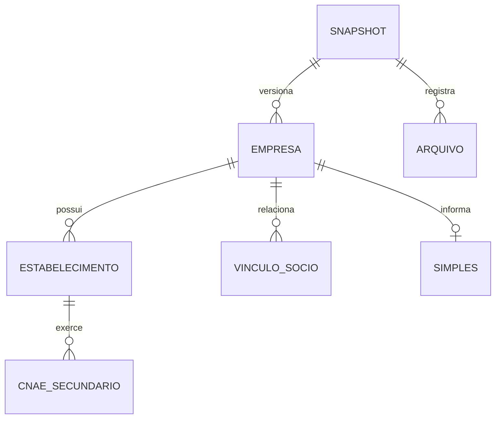
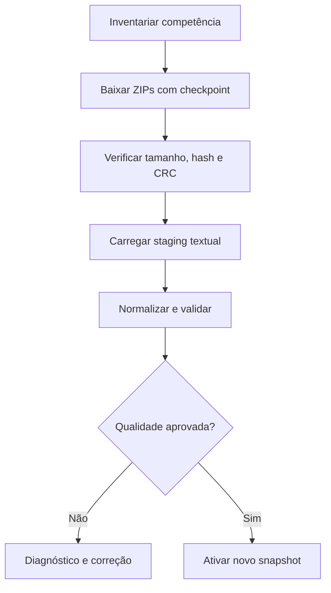

# CNPJ — Documentação de arquivos, download e banco de dados

**Projeto:** BancoDePreços / integração de dados cadastrais de fornecedores  
**Versão:** 1.0  
**Data do levantamento:** 05/11/2026  
**Formato:** Markdown com Mermaid  
**Objetivo imediato:** preparar a implementação de download, validação e carga em banco; não realizar a carga integral neste momento.

## 1. Fontes e nível de evidência

| Fonte | Endereço | Papel |
|---|---|---|
| Catálogo nacional | https://dados.gov.br/dados/conjuntos-dados/cadastro-nacional-da-pessoa-juridica---cnpj | Página de identificação do conjunto |
| Compartilhamento oficial | https://arquivos.receitafederal.gov.br/index.php/s/YggdBLfdninEJX9 | Pastas por competência e ZIPs |
| Dicionário da Receita | https://www.gov.br/receitafederal/dados/cnpj-metadados.pdf | Layout posicional e códigos |
| Nota 47/2024 | https://www.gov.br/receitafederal/dados/nota_cocad_no_47_2024.pdf | Periodicidade e explicação do conjunto; alterada pela nota 86 |
| Nota 86/2024 | https://www.gov.br/receitafederal/dados/nota-cocad-rfb-86-2024.pdf | Esclarecimentos de campos e máscara de CPF |
| Portal CNPJ alfanumérico | https://www.gov.br/receitafederal/pt-br/acesso-a-informacao/acoes-e-programas/programas-e-atividades/cnpj-alfanumerico | Compatibilidade do identificador |
| Comunicação de implantação | https://www.gov.br/receitafederal/pt-br/assuntos/noticias/2026/julho/receita-federal-gera-o-primeiro-cnpj-em-formato-alfanumerico | Confirma primeiro CNPJ alfanumérico em 31/07/2026 |

**Oficial/documentado:** estrutura e significado dos campos no PDF; periodicidade mensal na nota 47; máscara na nota 86; CNPJ alfanumérico na comunicação da Receita. **Observado:** listagem WebDAV do compartilhamento e pequenas amostras ZIP/CSV. **Proposto:** nomes snake_case, tipos SQL, modelo, pipeline, regras de publicação e consultas. Propostas não devem ser confundidas com restrições oficiais.

O PDF tem seis páginas e usa descrições históricas como “dígitos” para a raiz. A compatibilidade alfanumérica precisa prevalecer na implementação atual. A existência de um layout antigo disponível não autoriza um parser exclusivamente numérico.

A página dados.gov.br depende de JavaScript e não expôs os metadados completos na leitura HTML. A fonte efetiva para arquivos foi o compartilhamento oficial fornecido pelo usuário. Não foi utilizado espelho de terceiros como autoridade de layout ou de inventário.

## 2. Resultado da análise da publicação

A listagem pública observada contém **42 pastas mensais**, de **2023-05 a 2026-10**. A competência mais recente encontrada foi **2026-10**, com **37 ZIPs**, somando **7,808,752,942 bytes** (7.81 GB decimais; 7.27 GiB). As pastas listadas não comprovam completude de todos os registros históricos.

| Família | Arquivos observados na competência | Granularidade |
|---|---|---|
| Empresas | Empresas0.zip a Empresas9.zip | Entidade por raiz |
| Estabelecimentos | Estabelecimentos0.zip a Estabelecimentos9.zip | CNPJ completo de matriz/filial |
| Sócios | Socios0.zip a Socios9.zip | Vínculos societários/administradores |
| Simples | Simples.zip | Opção Simples/MEI por raiz |
| Domínios | Cnaes, Motivos, Municipios, Naturezas, Paises, Qualificacoes | Código e descrição |

Os números das partes são fragmentos físicos, não UF, município, faixa de CNPJ ou unidade de negócio. Não assumir correspondência de linhas entre Empresas1 e Estabelecimentos1, nem que uma raiz esteja sempre no mesmo fragmento em competências diferentes.

Na raiz também aparece `cnpj.tar.gz`, com tamanho anunciado de 63.954.782.749 bytes e modificação em 28/01/2026. Seu conteúdo não foi inspecionado. Não o tratar como equivalente ou mais atual que a competência mensal, nem baixar o compartilhamento inteiro como um único arquivo por padrão.

A nota oficial informa atualização mensal. Não foi identificado um dia fixo ou SLA. A competência da pasta, o instante de extração, o Last-Modified remoto e a data de download são conceitos distintos; o nome da pasta não comprova que os fatos correspondam exatamente ao último dia do mês.

## 3. Acesso para o futuro coletor

### 3.1 Compartilhamento e descoberta

O endereço informado é uma pasta pública Nextcloud. A página HTML entrega a interface, não uma lista estática de links para todos os arquivos. O canal WebDAV público foi testado e permitiu inventariar a raiz e a competência.

| Operação observada | Método e caminho | Resultado |
|---|---|---|
| Abrir compartilhamento | GET `/index.php/s/YggdBLfdninEJX9` | HTML do compartilhamento CNPJ |
| Listar raiz | PROPFIND `/public.php/webdav/`, Depth: 1 | XML com pastas, nomes, tamanhos, ETags e modificação |
| Listar competência | PROPFIND `/public.php/webdav/{AAAA-MM}/`, Depth: 1 | XML com ZIPs daquela competência |
| Ler arquivo | GET `/public.php/webdav/{AAAA-MM}/{nome.zip}` | ZIP; amostras retornaram 206 com Range |
| Caminho de download da interface | `/index.php/s/YggdBLfdninEJX9/download` | Link exposto pelo HTML; download agregado não executado |

WebDAV usou Basic com o **identificador público do compartilhamento como usuário e senha vazia**. Esse identificador está na URL pública fornecida; não se trata da conta pessoal do contribuinte. Nunca inserir credenciais privadas da Receita no coletor. Não registrar Authorization em logs, ainda que contenha apenas referência pública.

O antigo caminho `/dados/cnpj/dados_abertos_cnpj/` retornou 404 nesta análise. Ele não deve ser assumido como base vigente sem nova verificação. Os caminhos WebDAV são comportamento observado da hospedagem, não uma API de negócio versionada com SLA garantido. Se o canal mudar, diagnosticar e atualizar o adaptador.

### 3.2 Exemplo de descoberta — template técnico

```bash
curl --request PROPFIND \
  --user 'YggdBLfdninEJX9:' \
  --header 'Depth: 1' \
  --header 'Content-Type: application/xml' \
  --data '<?xml version="1.0"?><d:propfind xmlns:d="DAV:"><d:prop><d:displayname/><d:getcontentlength/><d:getlastmodified/><d:getetag/><d:resourcetype/></d:prop></d:propfind>' \
  'https://arquivos.receitafederal.gov.br/public.php/webdav/2026-10/'
```

Interpretar XML com namespace `DAV:` e verificar cada `propstat/status`; uma resposta 207 pode conter propriedades não disponíveis. A própria pasta também aparece na listagem: ignorá-la ao enumerar filhos e evitar recursão cíclica. Validar paths e host ao seguir referências. Não inferir checksum MD5 só porque um ETag parece hexadecimal.

### 3.3 Download individual — template

```bash
curl --fail --location \
  --user 'YggdBLfdninEJX9:' \
  --output 'Naturezas.zip.part' \
  'https://arquivos.receitafederal.gov.br/public.php/webdav/2026-10/Naturezas.zip'
```

O exemplo não faz validação integral nem promoção para arquivo final. O software deve complementar hash, CRC, retry, checkpoint e renomeação atômica. Retomada por Range só é segura se o objeto remoto continuar na mesma versão, utilizando ETag/Last-Modified e Content-Range para verificar. Resposta 200 a uma tentativa de retomada exige reinício, não append.

## 4. Contrato físico dos arquivos

| Aspecto | Regra e evidência |
|---|---|
| Transporte | ZIPs por família e fragmento, observados |
| Delimitador | Ponto e vírgula, documentado e observado |
| Cabeçalho | Não existe nas amostras examinadas; primeira linha já é registro |
| Aspas | Campos delimitados por aspas duplas nas amostras |
| Codificação | Amostras com acentos são incompatíveis com UTF-8 e legíveis como Latin-1; usar ISO-8859-1 como configuração inicial a validar por competência |
| Datas | Representações AAAAMMDD nas amostras; sentinelas e vazios precisam de perfilamento |
| Capital social | Vírgula como separador decimal nas amostras; Decimal no modelo |
| CNAE secundário | Lista separada por vírgula dentro de uma coluna, documentado |
| Extensão interna | Nome pode não terminar em .csv; descobrir entradas no ZIP |
| Ordenação/particionamento | Não foi identificado contrato de ordenação ou de divisão estável por raiz |
| Identificadores | Texto; preservar zeros, letras e máscaras |

Latin-1 decodifica qualquer byte: sucesso da decodificação não prova correção do encoding. Se houver bytes/caracteres de controle ou indícios de Windows-1252, produzir relatório; não substituir caracteres silenciosamente. Preservar o ZIP original. Converter para UTF-8 apenas na camada normalizada, com regra explícita.

Não usar `split(';')`, nem `splitlines()` para contar registros. Usar parser CSV que respeite aspas, escapes e campos com quebras de linha; carregar em streaming/blocos. A primeira linha não deve ser descartada como cabeçalho. Mudança na quantidade ou ordem das colunas exige novo contrato de layout.

## 5. Layout posicional detalhado

As posições começam em 1. Nomes canônicos e tipos SQL abaixo são **propostos**: a fonte não fornece cabeçalhos. O PDF descreve campos e ordem, não limites máximos para todo texto. `text` evita truncamento inicial; tamanhos e precisão devem ser confirmados por perfilamento antes de restringir produção. Campos de data/decimal devem entrar como texto no staging e só depois ser convertidos.

### 5.1. Empresas

**Caminho relativo:** `{AAAA-MM}/Empresas{parte}.zip`. **Granularidade:** empresa por raiz; 7 campos.

| Posição | Nome canônico proposto | Tipo no banco | Descrição e regra de transformação |
|---|---|---|---|
| 1 | `cnpj_basico` | `varchar(8)` | Raiz de oito posições; representa a entidade e relaciona as famílias. Aceitar letras e dígitos. |
| 2 | `razao_social` | `text` | Nome empresarial da entidade. |
| 3 | `natureza_juridica` | `text` | Código de natureza jurídica; vincular ao domínio Naturezas. |
| 4 | `qualificacao_responsavel` | `text` | Código de qualificação da pessoa responsável; não é o identificador da pessoa. |
| 5 | `capital_social` | `numeric(24,2)` | Capital social declarado; converter vírgula decimal. Precisão proposta, a validar no perfil completo. |
| 6 | `porte_empresa` | `varchar(2)` | Porte: 00 não informado, 01 microempresa, 03 pequeno porte, 05 demais. |
| 7 | `ente_federativo_responsavel` | `text` | Nome do ente para entidades públicas; vazio pode ser legítimo. Não contém um CNPJ do ente. |

### 5.2. Estabelecimentos

**Caminho relativo:** `{AAAA-MM}/Estabelecimentos{parte}.zip`. **Granularidade:** matriz ou filial; 30 campos.

| Posição | Nome canônico proposto | Tipo no banco | Descrição e regra de transformação |
|---|---|---|---|
| 1 | `cnpj_basico` | `varchar(8)` | Raiz que liga o estabelecimento à empresa. |
| 2 | `cnpj_ordem` | `varchar(4)` | Quatro posições do estabelecimento; aceitar formato alfanumérico. |
| 3 | `cnpj_dv` | `varchar(2)` | Dois dígitos verificadores; preservar zeros. |
| 4 | `identificador_matriz_filial` | `varchar(1)` | 1 matriz, 2 filial. Não determinar matriz apenas pela ordem 0001. |
| 5 | `nome_fantasia` | `text` | Nome fantasia; pode ser vazio. |
| 6 | `situacao_cadastral` | `varchar(2)` | Situação cadastral; domínio detalhado adiante. |
| 7 | `data_situacao_cadastral` | `date` | Data do evento de situação; não é data universal de atualização da linha. |
| 8 | `motivo_situacao_cadastral` | `text` | Código de motivo; consultar Motivos.zip. |
| 9 | `nome_cidade_exterior` | `text` | Cidade no exterior quando aplicável. |
| 10 | `pais` | `text` | Código de país; domínio Paises, não presumir ISO. |
| 11 | `data_inicio_atividade` | `date` | Início da atividade do estabelecimento. |
| 12 | `cnae_fiscal_principal` | `text` | CNAE principal; preservar como código textual. |
| 13 | `cnae_fiscal_secundaria` | `text` | Lista de códigos separados por vírgula dentro de um único campo; normalizar em tabela filha. |
| 14 | `tipo_logradouro` | `text` | Tipo do logradouro. |
| 15 | `logradouro` | `text` | Nome do logradouro. |
| 16 | `numero` | `text` | Número do endereço; admite S/N e outros textos. |
| 17 | `complemento` | `text` | Complemento de endereço. |
| 18 | `bairro` | `text` | Bairro. |
| 19 | `cep` | `varchar(8)` | CEP; preservar zeros e validar formato sem completar ausências arbitrariamente. |
| 20 | `uf` | `varchar(2)` | UF; manter códigos especiais de exterior se publicados e validar domínio. |
| 21 | `municipio` | `text` | Código de município da Receita; não equiparar ao código IBGE. |
| 22 | `ddd_1` | `text` | DDD do primeiro telefone. |
| 23 | `telefone_1` | `text` | Primeiro telefone, sem conversão numérica. |
| 24 | `ddd_2` | `text` | DDD do segundo telefone. |
| 25 | `telefone_2` | `text` | Segundo telefone. |
| 26 | `ddd_fax` | `text` | DDD do fax. |
| 27 | `fax` | `text` | Número do fax. |
| 28 | `correio_eletronico` | `text` | E-mail informado no cadastro; não comprova atualidade ou validação de entrega. |
| 29 | `situacao_especial` | `text` | Descrição da situação especial; distinta da situação cadastral. |
| 30 | `data_situacao_especial` | `date` | Data associada à situação especial. |

### 5.3. Socios

**Caminho relativo:** `{AAAA-MM}/Socios{parte}.zip`. **Granularidade:** vínculo societário/administrador; 11 campos.

| Posição | Nome canônico proposto | Tipo no banco | Descrição e regra de transformação |
|---|---|---|---|
| 1 | `cnpj_basico` | `varchar(8)` | Raiz da empresa de que o registro faz parte. |
| 2 | `identificador_socio` | `varchar(1)` | Tipo: 1 pessoa jurídica, 2 pessoa física, 3 estrangeiro; não é ID único do sócio. |
| 3 | `nome_socio_razao_social` | `text` | Nome de pessoa física ou nome empresarial do sócio pessoa jurídica/estrangeiro. |
| 4 | `cnpj_cpf_socio` | `text` | Identificação publicada; pode ser CNPJ, CPF mascarado ou ausência em estrangeiro. Não remover a máscara nem usar como chave universal. |
| 5 | `qualificacao_socio` | `text` | Código da qualificação do sócio/administrador. |
| 6 | `data_entrada_sociedade` | `date` | Data de entrada informada na sociedade. |
| 7 | `pais` | `text` | Código de país do sócio estrangeiro. |
| 8 | `representante_legal` | `text` | CPF publicado do representante, com descaracterização quando aplicável. |
| 9 | `nome_representante` | `text` | Nome do representante legal. |
| 10 | `qualificacao_representante_legal` | `text` | Código da qualificação do representante. |
| 11 | `faixa_etaria` | `varchar(1)` | Código de faixa etária; não contém data de nascimento. |

### 5.4. Simples

**Caminho relativo:** `{AAAA-MM}/Simples.zip`. **Granularidade:** condição Simples/MEI da raiz; 7 campos.

| Posição | Nome canônico proposto | Tipo no banco | Descrição e regra de transformação |
|---|---|---|---|
| 1 | `cnpj_basico` | `varchar(8)` | Raiz da empresa; condição publicada é da entidade, não uma linha por filial. |
| 2 | `opcao_simples` | `varchar(1)` | S sim, N não, vazio outros. Não converter vazio para não. |
| 3 | `data_opcao_simples` | `date` | Data de opção pelo Simples. |
| 4 | `data_exclusao_simples` | `date` | Data de exclusão do Simples, quando informada. |
| 5 | `opcao_mei` | `varchar(1)` | S sim, N não, vazio outros. |
| 6 | `data_opcao_mei` | `date` | Data de opção pelo MEI. |
| 7 | `data_exclusao_mei` | `date` | Data de exclusão do MEI, quando informada. |

### 5.5 Tabelas auxiliares

| ZIP | Entidade | Posição 1 | Posição 2 | Referenciado por |
|---|---|---|---|---|
| Cnaes.zip | CNAEs | Código | Descrição | Atividade principal e secundárias |
| Motivos.zip | Motivos de situação | Código | Descrição | Situação cadastral do estabelecimento |
| Municipios.zip | Municípios RFB | Código | Descrição | Localização do estabelecimento |
| Naturezas.zip | Naturezas jurídicas | Código | Descrição | Empresa |
| Paises.zip | Países RFB | Código | Descrição | Estabelecimento e sócio |
| Qualificacoes.zip | Qualificações | Código | Descrição | Responsável, sócio e representante |

Tipos propostos: código como texto e descrição como text. A chave precisa incluir o tipo do domínio e o snapshot quando se usa uma tabela genérica. As seis famílias aparecem no inventário; registrar na seção de amostragem quais puderam ser lidas efetivamente. Motivos é publicado como arquivo, embora a seção de tabelas de domínio do PDF examinado não o enumere expressamente.

## 6. Domínios e regras de negócio

### 6.1 CNPJ completo e alfanumérico

```text
cnpj_completo = cnpj_basico + cnpj_ordem + cnpj_dv
comprimentos = 8 + 4 + 2 = 14 posições
```

A Receita confirmou a primeira emissão alfanumérica em 31/07/2026, para filial do Banco do Brasil, com CNPJ público `00.000.000/E08G-12`. A representação sem máscara é `00000000E08G12`, com ordem `E08G`. Esse exemplo é oficial; não foi encontrado por varredura da amostra parcial.

O armazenamento deve aceitar letras A–Z/dígitos nas primeiras 12 posições e dígitos nas duas finais; manter compatibilidade com CNPJs numéricos. Não usar BIGINT, int, regex exclusivamente numérica ou limpeza com `\D`, que removeria letras válidas. A validação lexical não substitui dígito verificador. Implementar o DV segundo algoritmo oficial vigente e testes do material da Receita; o algoritmo não foi reimplementado ou testado neste levantamento.

A raiz identifica a empresa; o CNPJ completo identifica o estabelecimento. Todas as filiais se ligam à mesma raiz, mas podem ter endereço, CNAE e situação distintos. Um cadastro com natureza de órgão público não é necessariamente uma sociedade comercial, embora figure na família Empresas.

### 6.2 Situação e porte

| Situação normalizada proposta | Significado no PDF |
|---|---|
| 01 | Nula |
| 02 | Ativa |
| 03 | Suspensa |
| 04 | Inapta |
| 08 | Baixada |

O PDF apresenta 2, 3 e 4 sem padding em sua descrição e 01/08 com padding. Preservar o código bruto e normalizar somente por mapeamento explícito. Código desconhecido deve gerar diagnóstico, não ser classificado como ativo.

| Porte | Significado |
|---|---|
| 00 | Não informado |
| 01 | Microempresa |
| 03 | Empresa de pequeno porte |
| 05 | Demais |

Porte não informa faturamento exato. Capital social não é faturamento, patrimônio ou capacidade financeira comprovada. CNAE cadastrado não comprova fornecimento efetivo ao governo.

### 6.3 Sócios, representantes e faixa etária

| Tipo de sócio | Significado |
|---|---|
| 1 | Pessoa jurídica |
| 2 | Pessoa física |
| 3 | Estrangeiro |

`identificador_socio` é um tipo, não uma chave. A nota 86 esclarece a máscara do CPF: três posições iniciais e duas finais são ocultadas. CPF mascarado ou nome não identifica univocamente uma pessoa; não deduzir CPF completo e não unir sócios de empresas diferentes apenas pelo fragmento/nome. Um vínculo de administrador não implica controle societário nem percentual de participação, que não é fornecido neste layout.

| Faixa | Intervalo descrito no PDF |
|---|---|
| 0 | Não se aplica |
| 1 | 0–12 anos |
| 2 | 13–20 anos |
| 3 | 21–30 anos |
| 4 | 31–40 anos |
| 5 | 41–50 anos |
| 6 | 51–60 anos |
| 7 | 61–70 anos |
| 8 | 71–80 anos |
| 9 | Mais de 80 anos |

Guardar a representação publicada e o contexto do snapshot; não transformar faixa em data de nascimento estimada.

### 6.4 Simples/MEI e datas

S, N e vazio têm semânticas diferentes. Ausência de registro em Simples não deve virar automaticamente N. As datas de opção/exclusão publicadas não compõem necessariamente uma sequência completa de todos os eventos passados. Para uma data histórica de licitação, informar a competência cadastral usada; não afirmar situação tributária passada só pela condição atual.

Converter datas válidas AAAAMMDD para DATE. Valores vazios ou sentinelas observadas como `00000000` devem virar null com motivo documentado, mantendo o bruto. `0`, datas impossíveis e valores adicionais exigem classificação explícita. Não gravar ano zero ou interpretar todo erro como data ausente. Data de situação cadastral não é um timestamp de qualquer alteração da empresa.

### 6.5 Geografia e atividades

Município RFB e município IBGE são namespaces diferentes. Para integração com ComprasGov, usar tabela de correspondência com proveniência, UF e validação, sem join direto pelo número ou apenas pelo nome. Nomes repetidos e mudanças territoriais exigem cuidado. País RFB também não deve ser unido diretamente a ISO sem correspondência.

Desmembrar CNAEs secundários por vírgula, eliminar apenas tokens vazios e deduplicar na tabela normalizada. Preservar a lista bruta e a ordem de origem quando necessária para rastreabilidade. Não confundir o separador dessa lista com o delimitador CSV, que é ponto e vírgula.

## 7. Modelo de dados proposto

### 7.1 Entidades e chaves

| Entidade | Chave no snapshot | Observação |
|---|---|---|
| Snapshot | UUID da publicação validada | Competência + versão de origem, sem assumir imutabilidade mensal |
| Arquivo de origem | UUID | URL, nome, tamanho, hash e estado |
| Empresa | Snapshot + CNPJ básico | Validar duplicidades antes de impor unicidade |
| Estabelecimento | Snapshot + CNPJ completo | Derivado das três partes; raiz liga à empresa |
| Sócio/vínculo | Snapshot + identificador técnico do registro | Sem chave natural única comprovada; guardar arquivo e ordinal |
| Simples | Snapshot + CNPJ básico | Perfilamento confirma multiplicidade |
| Domínio | Snapshot + tipo + código | Natureza/CNAE/município etc. separados logicamente |
| CNAE secundário | Snapshot + CNPJ completo + CNAE | Tabela filha de estabelecimento |



Cardinalidades propostas; medir cobertura e órfãos antes de criar FKs rígidas. Arquivos brutos/staging aceitam anomalias para diagnóstico. A camada normalizada deve separar registros válidos e pendências sem descartar linhas silenciosamente.

### 7.2 Camadas

1. **Raw:** ZIP original por competência e hash, imutável.
2. **Staging:** todas as colunas como texto, mais arquivo, ordinal do registro, snapshot e erros de parsing.
3. **Normalizada:** datas, Decimal, identificadores canônicos e domínios; CNAEs secundários separados.
4. **Consulta:** snapshot ativo e índices; visões para estabelecimento completo, empresa e quadro societário.
5. **Histórico:** snapshots preservados ou alterações derivadas entre snapshots, conforme política de retenção.

Para começar, PostgreSQL é uma opção de banco operacional; Parquet/DuckDB pode apoiar perfilamento e análise. SQL Server também é viável, com adaptação de carga em lote, tipos e índices. A escolha não é exigência da Receita. Evitar inserts linha a linha ou ORM rastreando milhões de objetos; usar COPY/bulk e blocos de memória limitada.

### 7.3 Snapshot em vez de atualização destrutiva

A publicação mensal deve ser tratada como retrato até confirmação de outra modalidade. Não foi identificado feed delta de alterações. Para obter visão atual, baixar todos os fragmentos do mês escolhido, construir nova versão e ativá-la somente após validação. Não concatenar meses sem snapshot, pois isso duplica entidades.

Diferenciar `competencia_origem`, `observado_em`, `carregado_em` e datas cadastrais. A ausência em um novo snapshot só deve ser avaliada após completude comprovada e não significa automaticamente baixa. Guardar versão/hash também quando o mesmo mês for republicado.

## 8. DDL de referência para PostgreSQL

**Proposta técnica, não contrato oficial.** DDL ilustrativo revisado estruturalmente; não executado contra PostgreSQL nesta análise. Usa text para domínios/textos sem limite oficial e numeric proposto para capital. O staging anterior a este DDL deve preservar todos os campos brutos. FKs para domínios e entidades só devem ser acrescentadas após medição de qualidade.

```sql
CREATE SCHEMA IF NOT EXISTS cnpj;

CREATE TABLE cnpj.snapshot (
    snapshot_id uuid PRIMARY KEY,
    competencia varchar(7) NOT NULL,
    versao_origem text NOT NULL,
    status text NOT NULL,
    observado_em timestamptz NOT NULL,
    ativado_em timestamptz,
    UNIQUE (competencia, versao_origem)
);

CREATE TABLE cnpj.arquivo (
    arquivo_id uuid PRIMARY KEY,
    snapshot_id uuid NOT NULL REFERENCES cnpj.snapshot(snapshot_id),
    familia text NOT NULL,
    nome text NOT NULL,
    url_origem text NOT NULL,
    tamanho_remoto bigint,
    tamanho_baixado bigint,
    etag text,
    modificado_em_origem text,
    sha256_zip varchar(64),
    entrada_zip text,
    encoding_detectado text,
    registros_lidos bigint,
    registros_rejeitados bigint,
    status text NOT NULL,
    UNIQUE (snapshot_id, nome)
);

CREATE TABLE cnpj.dominio (
    snapshot_id uuid NOT NULL REFERENCES cnpj.snapshot(snapshot_id),
    tipo text NOT NULL,
    codigo text NOT NULL,
    descricao text,
    PRIMARY KEY (snapshot_id, tipo, codigo)
);

CREATE TABLE cnpj.empresa (
    snapshot_id uuid NOT NULL REFERENCES cnpj.snapshot(snapshot_id),
    cnpj_basico varchar(8) NOT NULL,
    razao_social text,
    natureza_juridica text,
    qualificacao_responsavel text,
    capital_social numeric(24,2),
    porte_empresa varchar(2),
    ente_federativo_responsavel text,
    arquivo_id uuid NOT NULL REFERENCES cnpj.arquivo(arquivo_id),
    registro_origem bigint NOT NULL,
    PRIMARY KEY (snapshot_id, cnpj_basico),
    UNIQUE (arquivo_id, registro_origem)
);

CREATE TABLE cnpj.estabelecimento (
    snapshot_id uuid NOT NULL REFERENCES cnpj.snapshot(snapshot_id),
    cnpj_basico varchar(8) NOT NULL,
    cnpj_ordem varchar(4) NOT NULL,
    cnpj_dv varchar(2) NOT NULL,
    identificador_matriz_filial varchar(1),
    nome_fantasia text,
    situacao_cadastral varchar(2),
    data_situacao_cadastral date,
    motivo_situacao_cadastral text,
    nome_cidade_exterior text,
    pais text,
    data_inicio_atividade date,
    cnae_fiscal_principal text,
    cnae_fiscal_secundaria text,
    tipo_logradouro text,
    logradouro text,
    numero text,
    complemento text,
    bairro text,
    cep varchar(8),
    uf varchar(2),
    municipio text,
    ddd_1 text,
    telefone_1 text,
    ddd_2 text,
    telefone_2 text,
    ddd_fax text,
    fax text,
    correio_eletronico text,
    situacao_especial text,
    data_situacao_especial date,
    cnpj_completo varchar(14) GENERATED ALWAYS AS
        (cnpj_basico || cnpj_ordem || cnpj_dv) STORED,
    arquivo_id uuid NOT NULL REFERENCES cnpj.arquivo(arquivo_id),
    registro_origem bigint NOT NULL,
    PRIMARY KEY (snapshot_id, cnpj_completo),
    UNIQUE (arquivo_id, registro_origem)
);

CREATE TABLE cnpj.simples (
    snapshot_id uuid NOT NULL REFERENCES cnpj.snapshot(snapshot_id),
    cnpj_basico varchar(8) NOT NULL,
    opcao_simples varchar(1),
    data_opcao_simples date,
    data_exclusao_simples date,
    opcao_mei varchar(1),
    data_opcao_mei date,
    data_exclusao_mei date,
    arquivo_id uuid NOT NULL REFERENCES cnpj.arquivo(arquivo_id),
    registro_origem bigint NOT NULL,
    PRIMARY KEY (snapshot_id, cnpj_basico),
    UNIQUE (arquivo_id, registro_origem)
);

CREATE TABLE cnpj.vinculo_socio (
    snapshot_id uuid NOT NULL REFERENCES cnpj.snapshot(snapshot_id),
    vinculo_id bigint GENERATED ALWAYS AS IDENTITY,
    cnpj_basico varchar(8) NOT NULL,
    identificador_socio varchar(1),
    nome_socio_razao_social text,
    cnpj_cpf_socio text,
    qualificacao_socio text,
    data_entrada_sociedade date,
    pais text,
    representante_legal text,
    nome_representante text,
    qualificacao_representante_legal text,
    faixa_etaria varchar(1),
    arquivo_id uuid NOT NULL REFERENCES cnpj.arquivo(arquivo_id),
    registro_origem bigint NOT NULL,
    PRIMARY KEY (snapshot_id, vinculo_id),
    UNIQUE (arquivo_id, registro_origem)
);

CREATE TABLE cnpj.cnae_secundario (
    snapshot_id uuid NOT NULL,
    cnpj_completo varchar(14) NOT NULL,
    codigo_cnae text NOT NULL,
    PRIMARY KEY (snapshot_id, cnpj_completo, codigo_cnae)
);

-- Índices iniciais; criar após a carga em lote.
CREATE INDEX ix_estabelecimento_raiz
    ON cnpj.estabelecimento(snapshot_id, cnpj_basico);
CREATE INDEX ix_estabelecimento_cnae_uf
    ON cnpj.estabelecimento(snapshot_id, cnae_fiscal_principal, uf);
CREATE INDEX ix_estabelecimento_situacao
    ON cnpj.estabelecimento(snapshot_id, situacao_cadastral);
CREATE INDEX ix_vinculo_socio_raiz
    ON cnpj.vinculo_socio(snapshot_id, cnpj_basico);
CREATE INDEX ix_cnae_secundario_codigo
    ON cnpj.cnae_secundario(snapshot_id, codigo_cnae);

-- Ponteiro para publicação atômica de uma versão validada.
CREATE TABLE cnpj.publicacao_ativa (
    chave smallint PRIMARY KEY CHECK (chave = 1),
    snapshot_id uuid NOT NULL REFERENCES cnpj.snapshot(snapshot_id)
);
```

Criar UUIDs no aplicativo; o exemplo não depende de extensão de UUID no banco. Em grande volume, avaliar particionamento por snapshot, retenção de apenas visão atual no banco de serviço e histórico em Parquet. Duplicar todas as competências no PostgreSQL pode ampliar muito o espaço e os índices; medir antes de escolher.

O banco deve impedir publicação de versão incompleta. Trocar o ponteiro `publicacao_ativa` em uma transação curta, mantendo o snapshot anterior para rollback. Não executar uma única transação envolvendo horas de download, extração e carga.

## 9. Pipeline de download e carga



### 9.1 Inventário e completude

Descobrir os meses e arquivos efetivamente listados, não fabricar URLs como se toda competência tivesse número fixo de partes. A competência examinada tem 10+10+10+1+6 arquivos; mudanças devem gerar nova versão do inventário, e não erro genérico ou exclusão silenciosa.

Registrar duas listagens em momentos distintos se houver indícios de publicação em andamento. Estabilidade de nome/tamanho/ETag ajuda, mas não prova completude absoluta. Definir aceite por famílias esperadas, integridade, perfil de registros e comparação com mês anterior. Não marcar sucesso enquanto houver arquivo sem baixar ou validar.

### 9.2 Download resiliente

- Configurar concorrência pequena e ajustável; uma ou duas conexões iniciais são política proposta, não limite oficial.
- Timeout, tentativas limitadas, backoff e jitter; respeitar Retry-After quando presente. Houve HTTP 503 em amostras deste levantamento.
- Gravar `.part`; se retomar, conferir versão e Content-Range. Evitar juntar bytes de versões diferentes.
- Calcular SHA-256 local em streaming; conferir tamanho remoto quando confiável e CRC completo após download.
- Validar assinatura ZIP antes de interpretar como arquivo; uma página HTML de erro pode chegar sob nome .zip.
- Descobrir nomes internos e impedir path traversal. Limitar expansão e monitorar disco; não descompactar todos os arquivos simultaneamente sem necessidade.
- Só renomear e considerar o arquivo concluído depois de validado.

### 9.3 Parsing e transformação

Ler em blocos com esquema posicional e número de campos esperado. Guardar ordinal lógico do registro, diferente de linha física em caso de campo multilinha. Converter encoding, datas, Decimal e domínios separadamente. O parser não deve executar eval, perder zeros ou “corrigir” CNPJ por conversão numérica.

Cada rejeição deve conter família, arquivo, ordinal, motivo e localização do bruto; preservar dados de contato/pessoas fora de logs operacionais desnecessários. Limitar memória; usar staging em lote e checkpoints por arquivo/bloco. A validação final do CRC exige leitura integral do ZIP, não a amostra parcial usada nesta documentação.

### 9.4 Estado e idempotência

| Estado proposto | Significado |
|---|---|
| descoberto | Arquivo inventariado |
| baixando | Temporário em andamento |
| baixado | Bytes completos, ainda não validados |
| validado | ZIP e estrutura aceitos |
| carregando | Staging/carga em execução |
| carregado | Registros conciliados |
| rejeitado | Falha que exige intervenção ou regra explícita |
| publicado | Snapshot íntegro ativado |

A mesma versão de arquivo não deve gerar duplicatas em reexecução. Usar arquivo+hash+versão do parser no controle e `arquivo_id + registro_origem` para rastrear carga. Uma alteração do parser pode exigir reprocessar o mesmo ZIP e criar nova versão de derivação.

## 10. Qualidade e validação

| Validação | Ação proposta |
|---|---|
| 7/30/11/7 campos nas famílias principais e 2 nos domínios | Quarentena de estruturas inesperadas |
| CNPJ básico/ordem/DV e completo | Validar lexicalmente e DV com regra atual; preservar bruto inválido |
| Empresas/estabelecimentos duplicados na competência | Relatório; não escolher arbitrariamente a primeira linha |
| Sócios repetidos | Não eliminar automaticamente sem política de identidade e evidência |
| Códigos sem correspondência em domínio | Medir órfãos; preservar e diagnosticar antes de FK rígida |
| Datas inválidas e sentinelas | Distinguir nulo conhecido de erro de dado |
| Capital social | Parse Decimal com vírgula; medir máximo/escala antes de restringir |
| Campos de contato/endereço | Não presumir integridade, atualidade ou unicidade |
| Quantidades lidas/carregadas/rejeitadas | Conciliar por arquivo e família |
| Mudança frente ao mês anterior | Analisar variação de contagens e distribuições, sem inferir baixa automática |

A regra de uma matriz por raiz deve ser medida e reportada, não usada para excluir registros automaticamente. Domínios históricos podem conter códigos antigos; a ausência de correspondência não deve apagar o estabelecimento.

## 11. Consultas de referência

Exemplos no modelo proposto, sem resultados reais computados; `:snapshot_id` e `:cnpj` são parâmetros do aplicativo, não sintaxe para colar sem binding no psql.

### 11.1 Consulta cadastral completa

```sql
SELECT est.cnpj_completo, emp.razao_social, est.nome_fantasia,
       est.identificador_matriz_filial, est.situacao_cadastral,
       emp.porte_empresa, emp.capital_social,
       est.cnae_fiscal_principal, est.uf, est.municipio,
       est.logradouro, est.numero, est.bairro, est.cep,
       sim.opcao_simples, sim.opcao_mei
FROM cnpj.estabelecimento est
JOIN cnpj.empresa emp
  ON emp.snapshot_id = est.snapshot_id
 AND emp.cnpj_basico = est.cnpj_basico
LEFT JOIN cnpj.simples sim
  ON sim.snapshot_id = emp.snapshot_id
 AND sim.cnpj_basico = emp.cnpj_basico
WHERE est.snapshot_id = :snapshot_id
  AND est.cnpj_completo = :cnpj;
```

O INNER JOIN de empresa pressupõe cobertura validada; para diagnóstico usar LEFT JOIN e contar raízes órfãs. Não filtrar situação ativa na ingestão: isso impediria analisar fornecedores baixados/inaptos no histórico.

### 11.2 Estabelecimentos ativos por CNAE e UF

```sql
SELECT cnae_fiscal_principal, uf, count(*) AS estabelecimentos
FROM cnpj.estabelecimento
WHERE snapshot_id = :snapshot_id
  AND situacao_cadastral = '02'
GROUP BY cnae_fiscal_principal, uf;
```

Conta estabelecimentos, não empresas: para contar entidades usar DISTINCT cnpj_basico. O exemplo pressupõe normalização da situação para duas posições.

## 12. Integração com ComprasGov e BancoDePreços

Relacionar fornecedor pessoa jurídica por CNPJ completo normalizado, preservando o identificador original e tipo de pessoa. CNPJ básico serve para consolidar matriz e filiais da mesma entidade, não para substituir qual estabelecimento participou/vendeu. Fornecedor pessoa física ou estrangeiro pode não ter correspondência nesta base.

| Dado enriquecido | Fonte e limite |
|---|---|
| Razão social e natureza jurídica | Empresa; usar competência da observação |
| Nome fantasia, endereço, UF e município | Estabelecimento; local cadastral não equivale ao local de entrega |
| CNAE | Atividade cadastral; não comprova item fornecido |
| Porte | Porte cadastral da RFB; pode divergir da classificação declarada na contratação |
| Simples/MEI | Retrato da competência; evitar inferir regime em data antiga |
| Quadro societário | Vínculos publicados; CPF mascarado não permite identidade inequívoca entre empresas |
| Situação cadastral | Situação conhecida na competência, não avaliação automática de habilitação no certame |

Na previsão de preço/vencedor, usar o cadastro que era conhecido no corte da previsão. Enriquecer licitação antiga com quadro societário ou situação atual introduz informação posterior. Se não houver snapshot histórico suficiente, declarar a limitação e não apresentar o enriquecimento como estado certo à época.

## 13. Volume, recursos e retenção

O total compactado foi obtido do inventário remoto. Não houve contagem integral de registros ou medição do volume expandido; não usar contagens de terceiros como dimensionamento confirmado.

```text
disco necessário = ZIPs retidos + dados em extração/staging
                 + banco normalizado + índices + WAL/log de carga
                 + histórico/backup + margem operacional
```

Medir pelo menos um fragmento de cada família e o maior arquivo antes de estimar ambiente. Ler ZIP em streaming pode reduzir a necessidade de CSV extraído, mas não elimina armazenamento de banco, índices e WAL. Definir política de retenção de raw, snapshots ativos, histórico e dados intermediários. A carga de todos os meses é muito maior que uma única competência e não é necessária para uma primeira visão atual.

## 14. Critérios de aceite para implementação posterior

1. Inventariar pastas e ZIPs reais, com manifesto e competência configurável.
2. Baixar arquivo pequeno de domínio, validar CRC, extrair e contar dois campos sem cabeçalho.
3. Validar amostra das quatro famílias principais com contratos posicionais.
4. Preservar CNPJ numérico com zeros e CNPJ alfanumérico, incluindo ordem E08G.
5. Converter capital Decimal, datas e CNAE secundário sem perda do bruto.
6. Demonstrar pausa/retomada segura e reexecução idempotente.
7. Carregar staging e modelo relacional com rastreabilidade por arquivo/registro.
8. Gerar relatório de duplicados, órfãos, rejeições e cobertura antes de publicar.
9. Trocar snapshot ativo atomicamente e manter rollback.
10. Demonstrar consulta por CNPJ, agregação por raiz, CNAE/UF e enriquecimento de fornecedores.

Pendências para fechar o prompt: banco escolhido, ambiente e disco, competência inicial, retenção histórica, limite de concorrência, metas de tempo de carga e política de publicação diante de anomalias. O coletor deve listar decisões assumidas e impedir que uma carga parcial seja apresentada como completa.

## Apêndice A — Inventário exato da competência examinada

Tamanhos e datas são metadados anunciados pelo servidor, não medição de todos os downloads. Os horários abaixo são GMT/UTC conforme resposta remota; não foram convertidos para hora local. Os ZIPs foram vistos na competência 2026-10.

| Arquivo | Bytes anunciados | Modificação remota | Caminho relativo |
|---|---|---|---|
| Cnaes.zip | 22078 | Tue, 13 Oct 2026 22:00:16 GMT | `2026-10/Cnaes.zip` |
| Empresas0.zip | 570972127 | Tue, 13 Oct 2026 22:00:54 GMT | `2026-10/Empresas0.zip` |
| Empresas1.zip | 77901368 | Tue, 13 Oct 2026 22:01:01 GMT | `2026-10/Empresas1.zip` |
| Empresas2.zip | 79125712 | Tue, 13 Oct 2026 22:01:07 GMT | `2026-10/Empresas2.zip` |
| Empresas3.zip | 85102880 | Tue, 13 Oct 2026 22:01:14 GMT | `2026-10/Empresas3.zip` |
| Empresas4.zip | 90222463 | Tue, 13 Oct 2026 22:01:21 GMT | `2026-10/Empresas4.zip` |
| Empresas5.zip | 97310075 | Tue, 13 Oct 2026 22:01:28 GMT | `2026-10/Empresas5.zip` |
| Empresas6.zip | 94194819 | Tue, 13 Oct 2026 22:01:36 GMT | `2026-10/Empresas6.zip` |
| Empresas7.zip | 98676055 | Tue, 13 Oct 2026 22:01:43 GMT | `2026-10/Empresas7.zip` |
| Empresas8.zip | 98736571 | Tue, 13 Oct 2026 22:01:50 GMT | `2026-10/Empresas8.zip` |
| Empresas9.zip | 94309858 | Tue, 13 Oct 2026 22:01:57 GMT | `2026-10/Empresas9.zip` |
| Estabelecimentos0.zip | 2277696710 | Tue, 13 Oct 2026 22:04:26 GMT | `2026-10/Estabelecimentos0.zip` |
| Estabelecimentos1.zip | 341948627 | Tue, 13 Oct 2026 22:04:51 GMT | `2026-10/Estabelecimentos1.zip` |
| Estabelecimentos2.zip | 336288966 | Tue, 13 Oct 2026 22:05:15 GMT | `2026-10/Estabelecimentos2.zip` |
| Estabelecimentos3.zip | 368597760 | Tue, 13 Oct 2026 22:05:40 GMT | `2026-10/Estabelecimentos3.zip` |
| Estabelecimentos4.zip | 340413465 | Tue, 13 Oct 2026 22:06:03 GMT | `2026-10/Estabelecimentos4.zip` |
| Estabelecimentos5.zip | 335452647 | Tue, 13 Oct 2026 22:06:26 GMT | `2026-10/Estabelecimentos5.zip` |
| Estabelecimentos6.zip | 369782592 | Tue, 13 Oct 2026 22:06:50 GMT | `2026-10/Estabelecimentos6.zip` |
| Estabelecimentos7.zip | 338419961 | Tue, 13 Oct 2026 22:07:14 GMT | `2026-10/Estabelecimentos7.zip` |
| Estabelecimentos8.zip | 343568209 | Tue, 13 Oct 2026 22:07:37 GMT | `2026-10/Estabelecimentos8.zip` |
| Estabelecimentos9.zip | 364761032 | Tue, 13 Oct 2026 22:08:02 GMT | `2026-10/Estabelecimentos9.zip` |
| Motivos.zip | 1180 | Tue, 13 Oct 2026 22:08:03 GMT | `2026-10/Motivos.zip` |
| Municipios.zip | 43443 | Tue, 13 Oct 2026 22:08:04 GMT | `2026-10/Municipios.zip` |
| Naturezas.zip | 1585 | Tue, 13 Oct 2026 22:08:05 GMT | `2026-10/Naturezas.zip` |
| Paises.zip | 2745 | Tue, 13 Oct 2026 22:08:06 GMT | `2026-10/Paises.zip` |
| Qualificacoes.zip | 980 | Tue, 13 Oct 2026 22:08:07 GMT | `2026-10/Qualificacoes.zip` |
| Simples.zip | 310608217 | Tue, 13 Oct 2026 22:08:29 GMT | `2026-10/Simples.zip` |
| Socios0.zip | 251430070 | Tue, 13 Oct 2026 22:08:47 GMT | `2026-10/Socios0.zip` |
| Socios1.zip | 49546399 | Tue, 13 Oct 2026 22:08:52 GMT | `2026-10/Socios1.zip` |
| Socios2.zip | 49056863 | Tue, 13 Oct 2026 22:08:56 GMT | `2026-10/Socios2.zip` |
| Socios3.zip | 49011621 | Tue, 13 Oct 2026 22:09:00 GMT | `2026-10/Socios3.zip` |
| Socios4.zip | 49560198 | Tue, 13 Oct 2026 22:09:04 GMT | `2026-10/Socios4.zip` |
| Socios5.zip | 49063747 | Tue, 13 Oct 2026 22:09:08 GMT | `2026-10/Socios5.zip` |
| Socios6.zip | 49147194 | Tue, 13 Oct 2026 22:09:13 GMT | `2026-10/Socios6.zip` |
| Socios7.zip | 49212792 | Tue, 13 Oct 2026 22:09:17 GMT | `2026-10/Socios7.zip` |
| Socios8.zip | 49447177 | Tue, 13 Oct 2026 22:09:21 GMT | `2026-10/Socios8.zip` |
| Socios9.zip | 49114756 | Tue, 13 Oct 2026 22:09:25 GMT | `2026-10/Socios9.zip` |

## Apêndice B — Evidências da amostragem

| Arquivo | HTTP | Entrada interna observada | Campos nas primeiras linhas | CRC integral verificado? |
|---|---|---|---|---|
| Empresas1.zip | 206 | `K3241.K03200Y1.D61010.EMPRECSV` | [7, 7, 7] | não |
| Estabelecimentos1.zip | 206 | `K3241.K03200Y1.D61010.ESTABELE` | [30, 30, 30] | não |
| Socios1.zip | 206 | `K3241.K03200Y1.D61010.SOCIOCSV` | [11, 11, 11] | não |
| Simples.zip | 206 | `F.K03200$W.SIMPLES.CSV.D61010` | [7, 7, 7] | não |
| Cnaes.zip | 206 | `F.K03200$Z.D61010.CNAECSV` | [2, 2, 2] | sim |
| Motivos.zip | 206 | `F.K03200$Z.D61010.MOTICSV` | [2, 2, 2] | sim |
| Municipios.zip | 206 | `F.K03200$Z.D61010.MUNICCSV` | [2, 2, 2] | não |
| Naturezas.zip | 206 | `F.K03200$Z.D61010.NATJUCSV` | [2, 2, 2] | sim |
| Paises.zip | 206 | `F.K03200$Z.D61010.PAISCSV` | [2, 2, 2] | sim |
| Qualificacoes.zip | 206 | `F.K03200$Z.D61010.QUALSCSV` | [2, 2, 2] | sim |

Algumas primeiras tentativas retornaram HTTP 503; eventuais retries estão refletidos acima. Trechos iniciais dos ZIPs grandes não comprovam integridade integral nem representatividade estatística. As linhas com sucesso confirmam quantidade de campos e ausência de cabeçalho apenas nas amostras examinadas. Os nomes internos incluem identificadores de extração variáveis; não são contratos fixos.

## Apêndice C — Identidade dos documentos oficiais consultados

| Documento | SHA-256 dos bytes consultados |
|---|---|
| cnpj_metadados.pdf | `0a52d6bdfb61a07425e352a0e692932306a5ec9ecad682f5f9e28059e1a5fce0` |
| cnpj_nota47.pdf | `a317abd377881b97fb7c93078a02c591229f71544d9416d9729fa0da9938d498` |
| cnpj_nota86.pdf | `c10d93aabb83d7d14e457689ca8aee5f17dc2a75db97198cf5baee94051e1667` |

Este levantamento não baixou a base inteira, não criou o banco de produção e não validou exaustivamente unicidade, limites de campo, cobertura ou DVs. O DDL e o fluxo são especificações propostas para a etapa posterior de desenvolvimento.
