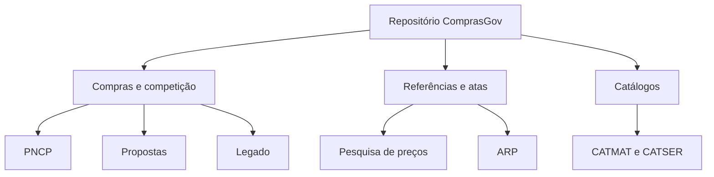
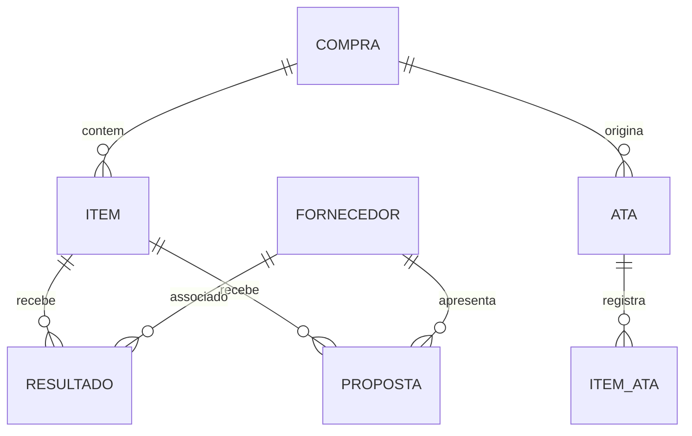
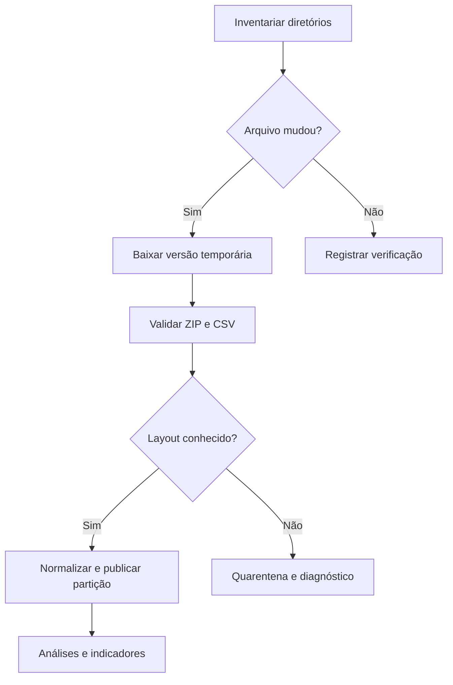
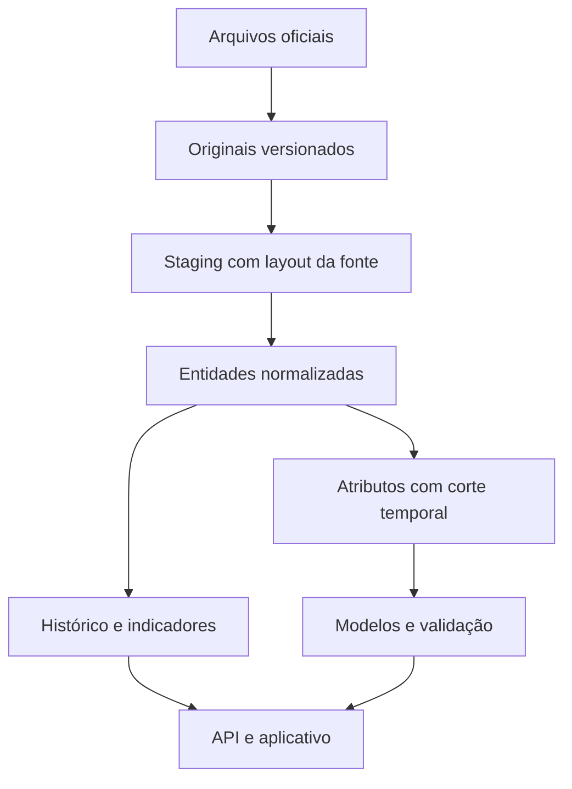

# TaxCoreBrazil — Documentação das fontes de compras públicas

**Versão:** 1.0 • **Levantamento:** 05/11/2026 • **Formato:** Markdown com Mermaid

## 1. Objetivo e alcance

Especificar os arquivos do repositório ComprasGov para subsidiar um futuro prompt de desenvolvimento do coletor e da plataforma de inteligência de licitações: histórico de vencedores, preços, participantes e posterior previsão de preço e de possíveis vencedores.

Fonte raiz: https://repositorio.dados.gov.br/seges/comprasgov/

Este documento descreve fontes de compras públicas dentro do projeto TaxCoreBrazil; não constitui especificação do motor tributário. Não houve download integral do acervo. Foram consultados os seis LEIAMEs, índices de diretórios e trechos iniciais dos CSVs, extraídos de ZIPs quando necessário. Os cabeçalhos são observados; os tipos e descrições semânticas são propostas de interpretação para implementação, não um dicionário oficial de dados.

### Convenções de evidência

- **Documentado:** regra expressa no LEIAME oficial, reproduzido no apêndice.
- **Observado:** nome, ordem de coluna, valor ou arquivo encontrado na amostra identificada.
- **Proposto:** regra de tratamento ou modelo para o software futuro.
- **Pendente:** significado, domínio, unicidade ou cobertura a verificar com perfilamento completo.

Não inferir obrigatoriedade, tamanho máximo ou precisão de banco a partir de três registros. Nenhuma chave foi validada em todo o acervo. Os layouts podem variar entre anos e ser alterados em republicações.

## 2. Organização dos conjuntos

| Diretório relativo | Conteúdo | Partição documentada | Histórico listado na raiz | Atualização documentada |
|---|---|---|---|---|
| `pncp/` | Compras, itens e resultados publicados pelo ComprasGov no PNCP | Ano/mês de `data_publicacao_pncp` da compra | 2021–2026 | Domingo, 9h |
| `propostas/` | Propostas de fornecedores em itens homologados | Ano/mês de `data_hora_inclusao` do item | 2022–2026 | Domingo, 8h |
| `pesquisa_precos/` | Referências de preços de materiais e serviços | Ano/mês de `data_compra` | 2020–2026 | Sábado, 7h |
| `arp/` | Atas de registro de preços e itens | Ano nos quatro últimos caracteres de `numero_ata_registro_preco` | 2023–2026 | Sábado, 8h |
| `catalogo_cnbs/` | CATMAT e CATSER, ativos e inativos | Sem partição temporal | Versão corrente | Sábado, 6h |
| `compras_legado/` | Compras sem licitação, pregões, licitações e RDC | Modalidade e ano próprio do conjunto | Varia por modalidade | Cargas programadas; sem rotina semanal |

Os LEIAMEs não explicitam o fuso dos horários. Não pressupor pontualidade de disponibilização. Intervalos de pastas não comprovam completude de registros.



### 2.1 Cobertura e limitações

A pasta PNCP contém divulgações do ComprasGov no PNCP; não representa todo o PNCP. A amostra de compras contém esferas estadual e municipal: não assumir que o repositório é exclusivamente federal. O recorte federal deve usar o campo de esfera, com domínio formalmente validado. Na amostra da pesquisa de preços, `F` aparece associado a órgão federal.

Propostas contemplam itens incluídos desde 01/01/2022 e devidamente homologados. Isso produz seleção de observações para treinamento: não representa todas as oportunidades abertas, itens desertos, fracassados ou todos os participantes possíveis. O arquivo não é uma sequência completa de eventos de lance.

A atualização semanal favorece histórico; a operação com licitações abertas e previsões anteriores à sessão exigirá avaliar fonte adicional de oportunidades e documentos atualizados.

## 3. Contrato físico comum

| Propriedade | Regra |
|---|---|
| Codificação documentada | UTF-8; aceitar BOM na leitura |
| Separador documentado | Ponto e vírgula `;` |
| Cabeçalho | Primeira linha, nomes e caixa devem ser preservados |
| Distribuição | CSV dentro de ZIP; catálogos CSV direto |
| Leitura | Parser CSV com suporte a aspas, delimitador dentro de texto e quebras de linha em campos |
| Decimais observados | Ponto decimal; escalas variáveis, inclusive oito casas |
| Datas observadas | Data simples e timestamp, alguns com microssegundos, sem offset explícito |
| Booleanos observados | `True`, `False`, `true`, `FALSE`; outros campos usam códigos ou `S`/`N` |
| Ausência | Campos vazios; distinguir vazio de zero e de falso |
| Identificadores | Ler como texto para preservar zeros à esquerda, CPF/CNPJ e códigos longos |

**Tipos nas tabelas:** são tipos lógicos sugeridos. `texto/código` não implica enum conhecido; `decimal` deve usar aritmética exata, com precisão definida após perfilamento; `data/hora` não implica timezone conhecido. Exemplos são observações ilustrativas, não domínios completos. Campos pessoais de responsáveis não são reproduzidos nos exemplos.

Não usar contagem de linhas físicas como contagem de registros. Os arquivos de itens de pregão contêm descrições com quebras de linha. Não extrair ZIP em diretórios arbitrários; validar nomes internos, integridade e limite de tamanho descompactado.

## 4. Inventário de famílias e layouts

Os caminhos abaixo são relativos à fonte raiz. Para cada família, o layout é o cabeçalho da amostra citada, em sua ordem original. O nome do CSV interno do ZIP deve ser descoberto, não deduzido removendo `.zip`. Cada campo permanece anulável na ingestão até perfilamento. Descrições inferidas devem ser confirmadas antes de virarem regras de negócio.

### 4.1. `compra_2026_10.csv.zip`

**Padrão de caminho:** `pncp/{ano}/{mes}/compra_{ano}_{mes}.csv.zip`

**Amostra consultada:** [pncp/2026/10/compra_2026_10.csv.zip](https://repositorio.dados.gov.br/seges/comprasgov/pncp/2026/10/compra_2026_10.csv.zip)

Uma linha descreve uma compra/publicação. `ind_atual` e `contratacao_excluida` exigem regras de versão e exclusão. Códigos de modalidade ComprasGov e PNCP pertencem a espaços distintos.

**Colunas observadas:** 59.

| Ordem | Campo exato | Tipo lógico proposto | Descrição / interpretação | Exemplo observado |
|---|---|---|---|---|
| 1 | `cod_compra` | texto/código | Código interno da compra nesta projeção; não confundir com id_compra. | 11583379 |
| 2 | `modalidade_id_pncp` | texto/código | Modalidade identificador pncp. Interpretação pelo nome; domínio e semântica detalhada a validar. | 8 |
| 3 | `modo_disputa_id_pncp` | texto/código | Modo disputa identificador pncp. Interpretação pelo nome; domínio e semântica detalhada a validar. | 5 |
| 4 | `id_compra` | texto/código | Identificador da compra no ComprasGov; candidato a ligação entre conjuntos. | 92515306003392026 |
| 5 | `ind_atual` | booleano/código | Ind atual. Interpretação pelo nome; domínio e semântica detalhada a validar. | True |
| 6 | `valor_total_estimado` | decimal | Valor total estimado. Interpretação pelo nome; domínio e semântica detalhada a validar. | 2392.37000000 |
| 7 | `valor_total_homologado` | decimal | Valor total homologado. Interpretação pelo nome; domínio e semântica detalhada a validar. | 2392.37000000 |
| 8 | `orgao_subrogado_cnpj` | texto/código | Orgao subrogado cnpj. Interpretação pelo nome; domínio e semântica detalhada a validar. | vazio na amostra |
| 9 | `orgao_subrogado_razao_social` | texto/código | Orgao subrogado razao social. Interpretação pelo nome; domínio e semântica detalhada a validar. | vazio na amostra |
| 10 | `orgao_subrogado_esfera_id` | texto/código | Orgao subrogado esfera identificador. Interpretação pelo nome; domínio e semântica detalhada a validar. | vazio na amostra |
| 11 | `orgao_subrogado_poder_id` | texto/código | Orgao subrogado poder identificador. Interpretação pelo nome; domínio e semântica detalhada a validar. | vazio na amostra |
| 12 | `codigo_orgao` | texto/código | Código orgao. Interpretação pelo nome; domínio e semântica detalhada a validar. | 76390 |
| 13 | `unidade_orgao_uf_nome` | texto/código | Unidade orgao uf nome. Interpretação pelo nome; domínio e semântica detalhada a validar. | RIO DE JANEIRO |
| 14 | `unidade_orgao_codigo_unidade` | texto/código | Unidade orgao código unidade. Interpretação pelo nome; domínio e semântica detalhada a validar. | 925153 |
| 15 | `unidade_orgao_nome_unidade` | texto/código | Unidade orgao nome unidade. Interpretação pelo nome; domínio e semântica detalhada a validar. | ERJ-MINISTÉRIO PUBLICO ESTADO RIO DE JANEIRO |
| 16 | `unidade_orgao_uf_sigla` | texto/código | Unidade orgao uf sigla. Interpretação pelo nome; domínio e semântica detalhada a validar. | RJ |
| 17 | `unidade_orgao_municipio_nome` | texto/código | Unidade orgao municipio nome. Interpretação pelo nome; domínio e semântica detalhada a validar. | RIO DE JANEIRO |
| 18 | `unidade_orgao_codigo_ibge` | texto/código | Unidade orgao código ibge. Interpretação pelo nome; domínio e semântica detalhada a validar. | 3304557 |
| 19 | `unidade_subrogada_uf_nome` | texto/código | Unidade subrogada uf nome. Interpretação pelo nome; domínio e semântica detalhada a validar. | vazio na amostra |
| 20 | `unidade_subrogada_codigo_unidade` | texto/código | Unidade subrogada código unidade. Interpretação pelo nome; domínio e semântica detalhada a validar. | vazio na amostra |
| 21 | `unidade_subrogada_nome_unidade` | texto/código | Unidade subrogada nome unidade. Interpretação pelo nome; domínio e semântica detalhada a validar. | vazio na amostra |
| 22 | `unidade_subrogada_uf_sigla` | texto/código | Unidade subrogada uf sigla. Interpretação pelo nome; domínio e semântica detalhada a validar. | vazio na amostra |
| 23 | `unidade_subrogada_municipio_nome` | texto/código | Unidade subrogada municipio nome. Interpretação pelo nome; domínio e semântica detalhada a validar. | vazio na amostra |
| 24 | `unidade_subrogada_codigo_ibge` | texto/código | Unidade subrogada código ibge. Interpretação pelo nome; domínio e semântica detalhada a validar. | vazio na amostra |
| 25 | `numero_compra` | texto/código | Número compra. Interpretação pelo nome; domínio e semântica detalhada a validar. | 339 |
| 26 | `data_atualizacao_pncp` | data/hora | Data atualizacao pncp. Interpretação pelo nome; domínio e semântica detalhada a validar. | 2026-10-01 00:34:26 |
| 27 | `data_publicacao_pncp` | data/hora | Data publicacao pncp. Interpretação pelo nome; domínio e semântica detalhada a validar. | 2026-10-01 00:34:26 |
| 28 | `codigo_modo_disputa` | texto/código | Código modo disputa. Interpretação pelo nome; domínio e semântica detalhada a validar. | 5 |
| 29 | `codigo_modalidade` | texto/código | Código modalidade. Interpretação pelo nome; domínio e semântica detalhada a validar. | 6 |
| 30 | `srp` | booleano/código | Srp. Interpretação pelo nome; domínio e semântica detalhada a validar. | False |
| 31 | `ano_compra_pncp` | texto/código | Ano compra pncp. Interpretação pelo nome; domínio e semântica detalhada a validar. | 2026 |
| 32 | `sequencial_compra_pncp` | texto/código | Sequencial compra pncp. Interpretação pelo nome; domínio e semântica detalhada a validar. | 361 |
| 33 | `orgao_entidade_cnpj` | texto/código | Orgao entidade cnpj. Interpretação pelo nome; domínio e semântica detalhada a validar. | 28305936000140 |
| 34 | `orgao_entidade_razao_social` | texto/código | Orgao entidade razao social. Interpretação pelo nome; domínio e semântica detalhada a validar. | MINISTERIO PUBLICO DO ESTADO DO RIO DE JANEIRO |
| 35 | `orgao_entidade_esfera_id` | texto/código | Orgao entidade esfera identificador. Interpretação pelo nome; domínio e semântica detalhada a validar. | E |
| 36 | `orgao_entidade_poder_id` | texto/código | Orgao entidade poder identificador. Interpretação pelo nome; domínio e semântica detalhada a validar. | E |
| 37 | `data_inclusao_pncp` | data/hora | Data inclusao pncp. Interpretação pelo nome; domínio e semântica detalhada a validar. | 2026-10-01 00:34:26 |
| 38 | `amparo_legal_codigo_pncp` | texto/código | Amparo legal código pncp. Interpretação pelo nome; domínio e semântica detalhada a validar. | 19 |
| 39 | `amparo_legal_nome` | texto/código | Amparo legal nome. Interpretação pelo nome; domínio e semântica detalhada a validar. | Lei 14.133/2021, Art. 75, II |
| 40 | `amparo_legal_descricao` | texto/código | Amparo legal descricao. Interpretação pelo nome; domínio e semântica detalhada a validar. | Dispensa de Licitação: para contratação que envolva valores inferiores a R$ 50.000,00 (cinquenta mil reais), no caso de  |
| 41 | `data_abertura_proposta_pncp` | data/hora | Data abertura proposta pncp. Interpretação pelo nome; domínio e semântica detalhada a validar. | vazio na amostra |
| 42 | `data_encerramento_proposta_pncp` | data/hora | Data encerramento proposta pncp. Interpretação pelo nome; domínio e semântica detalhada a validar. | vazio na amostra |
| 43 | `informacao_complementar` | texto/código | Informacao complementar. Interpretação pelo nome; domínio e semântica detalhada a validar. | vazio na amostra |
| 44 | `processo` | texto/código | Processo. Interpretação pelo nome; domínio e semântica detalhada a validar. | 20.22.0001.0052467.2026-83 |
| 45 | `objeto_compra` | texto/código | Objeto compra. Interpretação pelo nome; domínio e semântica detalhada a validar. | Contratação de orientadores de Trabalho de Conclusão de Curso (TCC) para a Pós-Graduação Lato Sensu em Inteligência Apli |
| 46 | `link_sistema_origem` | texto/código | Link sistema origem. Interpretação pelo nome; domínio e semântica detalhada a validar. | vazio na amostra |
| 47 | `justificativa_presencial` | texto/código | Justificativa presencial. Interpretação pelo nome; domínio e semântica detalhada a validar. | vazio na amostra |
| 48 | `numero_controle_PNCP` | texto/código | Número controle pncp. Interpretação pelo nome; domínio e semântica detalhada a validar. | 28305936000140-1-000361/2026 |
| 49 | `existe_resultado` | booleano/código | Existe resultado. Interpretação pelo nome; domínio e semântica detalhada a validar. | True |
| 50 | `modalidade_nome` | texto/código | Modalidade nome. Interpretação pelo nome; domínio e semântica detalhada a validar. | Dispensa |
| 51 | `orcamento_sigiloso_codigo` | texto/código | Orcamento sigiloso código. Interpretação pelo nome; domínio e semântica detalhada a validar. | 1 |
| 52 | `orcamento_sigiloso_descricao` | texto/código | Orcamento sigiloso descricao. Interpretação pelo nome; domínio e semântica detalhada a validar. | Compra sem sigilo |
| 53 | `situacao_compra_id_pncp` | texto/código | Situacao compra identificador pncp. Interpretação pelo nome; domínio e semântica detalhada a validar. | 1 |
| 54 | `situacao_compra_nome_pncp` | texto/código | Situacao compra nome pncp. Interpretação pelo nome; domínio e semântica detalhada a validar. | Divulgada no PNCP |
| 55 | `tipo_instrumento_convocatorio_codigo_pncp` | texto/código | Tipo instrumento convocatorio código pncp. Interpretação pelo nome; domínio e semântica detalhada a validar. | 3 |
| 56 | `tipo_instrumento_convocatorio_nome` | texto/código | Tipo instrumento convocatorio nome. Interpretação pelo nome; domínio e semântica detalhada a validar. | Ato que autoriza a Contratação Direta |
| 57 | `modo_disputa_nome_pncp` | texto/código | Modo disputa nome pncp. Interpretação pelo nome; domínio e semântica detalhada a validar. | Não se aplica |
| 58 | `usuario_nome` | texto/código | Usuario nome. Interpretação pelo nome; domínio e semântica detalhada a validar. | Compras.gov.br |
| 59 | `contratacao_excluida` | booleano/código | Contratacao excluida. Interpretação pelo nome; domínio e semântica detalhada a validar. | False |

### 4.2. `compra_item_2026_10.csv.zip`

**Padrão de caminho:** `pncp/{ano}/{mes}/compra_item_{ano}_{mes}.csv.zip`

**Amostra consultada:** [pncp/2026/10/compra_item_2026_10.csv.zip](https://repositorio.dados.gov.br/seges/comprasgov/pncp/2026/10/compra_item_2026_10.csv.zip)

Uma linha descreve uma compra/publicação. `ind_atual` e `contratacao_excluida` exigem regras de versão e exclusão. Códigos de modalidade ComprasGov e PNCP pertencem a espaços distintos.

**Colunas observadas:** 59.

| Ordem | Campo exato | Tipo lógico proposto | Descrição / interpretação | Exemplo observado |
|---|---|---|---|---|
| 1 | `srk_pncp_item_compra` | texto/código | Chave interna pncp item compra. Interpretação pelo nome; domínio e semântica detalhada a validar. | 104393720 |
| 2 | `cod_compra` | texto/código | Código interno da compra nesta projeção; não confundir com id_compra. | 11583379 |
| 3 | `cod_item_compra` | texto/código | Código interno do item nesta projeção. | 61475050 |
| 4 | `codigo_classe` | texto/código | Código classe. Interpretação pelo nome; domínio e semântica detalhada a validar. | vazio na amostra |
| 5 | `codigo_grupo` | texto/código | Código grupo. Interpretação pelo nome; domínio e semântica detalhada a validar. | vazio na amostra |
| 6 | `numero_item_pncp` | texto/código | Número item pncp. Interpretação pelo nome; domínio e semântica detalhada a validar. | 1 |
| 7 | `numero_grupo` | texto/código | Número grupo. Interpretação pelo nome; domínio e semântica detalhada a validar. | 0 |
| 8 | `numero_item_compra` | texto/código | Número item compra. Interpretação pelo nome; domínio e semântica detalhada a validar. | 1 |
| 9 | `descricao_detalhada` | texto/código | Descricao detalhada. Interpretação pelo nome; domínio e semântica detalhada a validar. | vazio na amostra |
| 10 | `descricao_resumida` | texto/código | Descricao resumida. Interpretação pelo nome; domínio e semântica detalhada a validar. | Treinamento Qualificação Profissional Treinamento Qualificação Profissional |
| 11 | `material_ou_servico` | texto/código | Material ou servico. Interpretação pelo nome; domínio e semântica detalhada a validar. | S |
| 12 | `material_ou_servico_nome` | texto/código | Material ou servico nome. Interpretação pelo nome; domínio e semântica detalhada a validar. | Serviço |
| 13 | `valor_unitario_estimado` | decimal | Valor unitario estimado. Interpretação pelo nome; domínio e semântica detalhada a validar. | 2392.37000000 |
| 14 | `valor_total` | decimal | Valor total. Interpretação pelo nome; domínio e semântica detalhada a validar. | 2392.37000000 |
| 15 | `quantidade` | decimal | Quantidade. Interpretação pelo nome; domínio e semântica detalhada a validar. | 1.00000000 |
| 16 | `unidade_medida` | texto/código | Unidade medida. Interpretação pelo nome; domínio e semântica detalhada a validar. | UNIDADE |
| 17 | `orcamento_sigiloso` | texto/código | Orcamento sigiloso. Interpretação pelo nome; domínio e semântica detalhada a validar. | False |
| 18 | `item_categoria_id_pncp` | texto/código | Item categoria identificador pncp. Interpretação pelo nome; domínio e semântica detalhada a validar. | 3 |
| 19 | `item_categoria_nome` | texto/código | Item categoria nome. Interpretação pelo nome; domínio e semântica detalhada a validar. | Informática (TIC) |
| 20 | `patrimonio` | texto/código | Patrimonio. Interpretação pelo nome; domínio e semântica detalhada a validar. | vazio na amostra |
| 21 | `codigo_registro_imobiliario` | texto/código | Código registro imobiliario. Interpretação pelo nome; domínio e semântica detalhada a validar. | vazio na amostra |
| 22 | `criterio_julgamento_id_pncp` | texto/código | Criterio julgamento identificador pncp. Interpretação pelo nome; domínio e semântica detalhada a validar. | 7 |
| 23 | `criterio_julgamento_nome` | texto/código | Criterio julgamento nome. Interpretação pelo nome; domínio e semântica detalhada a validar. | Não se aplica |
| 24 | `situacao_compra_item` | texto/código | Situacao compra item. Interpretação pelo nome; domínio e semântica detalhada a validar. | 2 |
| 25 | `situacao_compra_item_nome` | texto/código | Situacao compra item nome. Interpretação pelo nome; domínio e semântica detalhada a validar. | Homologado |
| 26 | `tipo_beneficio` | texto/código | Tipo beneficio. Interpretação pelo nome; domínio e semântica detalhada a validar. | 5 |
| 27 | `tipo_beneficio_nome` | texto/código | Tipo beneficio nome. Interpretação pelo nome; domínio e semântica detalhada a validar. | Não se aplica |
| 28 | `incentivo_produtivo_basico` | texto/código | Incentivo produtivo basico. Interpretação pelo nome; domínio e semântica detalhada a validar. | False |
| 29 | `data_inclusao_pncp` | data/hora | Data inclusao pncp. Interpretação pelo nome; domínio e semântica detalhada a validar. | 2026-10-01 00:34:26 |
| 30 | `data_atualizacao_pncp` | data/hora | Data atualizacao pncp. Interpretação pelo nome; domínio e semântica detalhada a validar. | 2026-10-01 00:37:38 |
| 31 | `tem_resultado` | booleano/código | Tem resultado. Interpretação pelo nome; domínio e semântica detalhada a validar. | True |
| 32 | `cod_item_catalogo` | texto/código | Código item catalogo. Interpretação pelo nome; domínio e semântica detalhada a validar. | vazio na amostra |
| 33 | `ID_contratacao_PNCP` | texto/código | Identificador contratacao pncp. Interpretação pelo nome; domínio e semântica detalhada a validar. | 28305936000140-1-000361/2026 |
| 34 | `cod_fornecedor` | texto/código | Código rotulado fornecedor na projeção de itens; semântica deve ser confrontada com resultados. | 28305936000140 |
| 35 | `nome_fornecedor` | texto/código | Nome fornecedor. Interpretação pelo nome; domínio e semântica detalhada a validar. | MINISTERIO PUBLICO DO ESTADO DO RIO DE JANEIRO |
| 36 | `data_resultado` | data/hora | Data resultado. Interpretação pelo nome; domínio e semântica detalhada a validar. | 2026-10-01 00:00:00 |
| 37 | `valor_total_resultado` | decimal | Valor total resultado. Interpretação pelo nome; domínio e semântica detalhada a validar. | 2392.37000000 |
| 38 | `valor_unitario_resultado` | decimal | Valor unitario resultado. Interpretação pelo nome; domínio e semântica detalhada a validar. | 2392.37000000 |
| 39 | `quantidade_resultado` | decimal | Quantidade resultado. Interpretação pelo nome; domínio e semântica detalhada a validar. | 1.00000000 |
| 40 | `id_compra` | texto/código | Identificador da compra no ComprasGov; candidato a ligação entre conjuntos. | 92515306003392026 |
| 41 | `id_compra_item` | texto/código | Identificador do item da compra; candidato a ligação, não obrigatório em todas as linhas. | 9251530600339202600001 |
| 42 | `ano_compra` | texto/código | Ano compra. Interpretação pelo nome; domínio e semântica detalhada a validar. | 2026 |
| 43 | `sequencial_compra` | texto/código | Sequencial compra. Interpretação pelo nome; domínio e semântica detalhada a validar. | 361 |
| 44 | `orgao_entidade_cnpj` | texto/código | Orgao entidade cnpj. Interpretação pelo nome; domínio e semântica detalhada a validar. | 28305936000140 |
| 45 | `unidade_orgao_codigo_unidade` | texto/código | Unidade orgao código unidade. Interpretação pelo nome; domínio e semântica detalhada a validar. | 925153 |
| 46 | `margem_preferencia_normal` | texto/código | Margem preferencia normal. Interpretação pelo nome; domínio e semântica detalhada a validar. | False |
| 47 | `percentual_margem_preferencia_normal` | decimal | Percentual margem preferencia normal. Interpretação pelo nome; domínio e semântica detalhada a validar. | vazio na amostra |
| 48 | `margem_preferencia_adicional` | texto/código | Margem preferencia adicional. Interpretação pelo nome; domínio e semântica detalhada a validar. | False |
| 49 | `percentual_margem_preferencia_adicional` | decimal | Percentual margem preferencia adicional. Interpretação pelo nome; domínio e semântica detalhada a validar. | vazio na amostra |
| 50 | `codigo_NCM` | texto/código | Código ncm. Interpretação pelo nome; domínio e semântica detalhada a validar. | vazio na amostra |
| 51 | `descricao_NCM` | texto/código | Descricao ncm. Interpretação pelo nome; domínio e semântica detalhada a validar. | vazio na amostra |
| 52 | `numero_controle_PNCP_compra` | texto/código | Número controle pncp compra. Interpretação pelo nome; domínio e semântica detalhada a validar. | 28305936000140-1-000361/2026 |
| 53 | `TXT_LINK_MATERIAL` | texto/código | Texto link material. Interpretação pelo nome; domínio e semântica detalhada a validar. | vazio na amostra |
| 54 | `TXT_LINK_CLASSE` | texto/código | Texto link classe. Interpretação pelo nome; domínio e semântica detalhada a validar. | vazio na amostra |
| 55 | `TXT_LINK_SERVICO` | texto/código | Texto link servico. Interpretação pelo nome; domínio e semântica detalhada a validar. | vazio na amostra |
| 56 | `TXT_LINK_GRUPO` | texto/código | Texto link grupo. Interpretação pelo nome; domínio e semântica detalhada a validar. | vazio na amostra |
| 57 | `COD_RESULTADO_ITEM` | texto/código | Código resultado item. Interpretação pelo nome; domínio e semântica detalhada a validar. | 26874620 |
| 58 | `codigo_pdm` | texto/código | Código pdm. Interpretação pelo nome; domínio e semântica detalhada a validar. | vazio na amostra |
| 59 | `nome_pdm` | texto/código | Nome pdm. Interpretação pelo nome; domínio e semântica detalhada a validar. | vazio na amostra |

### 4.3. `item_resultado_2026_10.csv.zip`

**Padrão de caminho:** `pncp/{ano}/{mes}/item_resultado_{ano}_{mes}.csv.zip`

**Amostra consultada:** [pncp/2026/10/item_resultado_2026_10.csv.zip](https://repositorio.dados.gov.br/seges/comprasgov/pncp/2026/10/item_resultado_2026_10.csv.zip)

Uma linha descreve um resultado de item associado a fornecedor. Considerar cancelamento, situação e sequência; não pressupor um único vencedor por item.

**Colunas observadas:** 48.

| Ordem | Campo exato | Tipo lógico proposto | Descrição / interpretação | Exemplo observado |
|---|---|---|---|---|
| 1 | `srk_item_resultado` | texto/código | Chave interna item resultado. Interpretação pelo nome; domínio e semântica detalhada a validar. | 52200690 |
| 2 | `id_compra` | texto/código | Identificador da compra no ComprasGov; candidato a ligação entre conjuntos. | 92515306003392026 |
| 3 | `id_compra_item` | texto/código | Identificador do item da compra; candidato a ligação, não obrigatório em todas as linhas. | 9251530600339202600001 |
| 4 | `id_contratacao_pncp` | texto/código | Identificador contratacao pncp. Interpretação pelo nome; domínio e semântica detalhada a validar. | 28305936000140-1-000361/2026 |
| 5 | `data_atualizacao_pncp` | data/hora | Data atualizacao pncp. Interpretação pelo nome; domínio e semântica detalhada a validar. | 2026-10-01 00:34:38 |
| 6 | `ni_fornecedor` | texto/código | Identificação do fornecedor; preservar como texto e validar natureza e país. | 28305936000140 |
| 7 | `tipo_pessoa` | texto/código | Tipo pessoa. Interpretação pelo nome; domínio e semântica detalhada a validar. | PJ |
| 8 | `data_inclusao_pncp` | data/hora | Data inclusao pncp. Interpretação pelo nome; domínio e semântica detalhada a validar. | 2026-10-01 00:34:38 |
| 9 | `numero_item_pncp` | texto/código | Número item pncp. Interpretação pelo nome; domínio e semântica detalhada a validar. | 1 |
| 10 | `data_cancelamento_pncp` | data/hora | Data cancelamento pncp. Interpretação pelo nome; domínio e semântica detalhada a validar. | vazio na amostra |
| 11 | `nome_razao_social_fornecedor` | texto/código | Nome razao social fornecedor. Interpretação pelo nome; domínio e semântica detalhada a validar. | MINISTERIO PUBLICO DO ESTADO DO RIO DE JANEIRO |
| 12 | `codigo_pais` | texto/código | Código pais. Interpretação pelo nome; domínio e semântica detalhada a validar. | BRA |
| 13 | `porte_fornecedor_id` | texto/código | Porte fornecedor identificador. Interpretação pelo nome; domínio e semântica detalhada a validar. | 3 |
| 14 | `quantidade_homologada` | decimal | Quantidade homologada. Interpretação pelo nome; domínio e semântica detalhada a validar. | 1.00000000 |
| 15 | `valor_unitario_homologado` | decimal | Valor unitario homologado. Interpretação pelo nome; domínio e semântica detalhada a validar. | 2392.37000000 |
| 16 | `valor_total_homologado` | decimal | Valor total homologado. Interpretação pelo nome; domínio e semântica detalhada a validar. | 2392.37000000 |
| 17 | `percentual_desconto` | decimal | Percentual desconto. Interpretação pelo nome; domínio e semântica detalhada a validar. | 0.00000000 |
| 18 | `indicador_subcontratacao` | texto/código | Indicador subcontratacao. Interpretação pelo nome; domínio e semântica detalhada a validar. | False |
| 19 | `ordem_classificacao_srp` | texto/código | Ordem classificacao srp. Interpretação pelo nome; domínio e semântica detalhada a validar. | 1 |
| 20 | `data_resultado_pncp` | data/hora | Data resultado pncp. Interpretação pelo nome; domínio e semântica detalhada a validar. | 2026-10-01 00:00:00 |
| 21 | `motivo_cancelamento` | texto/código | Motivo cancelamento. Interpretação pelo nome; domínio e semântica detalhada a validar. | vazio na amostra |
| 22 | `numero_controle_PNCP_compra` | texto/código | Número controle pncp compra. Interpretação pelo nome; domínio e semântica detalhada a validar. | 28305936000140-1-000361/2026 |
| 23 | `porte_fornecedor_nome` | texto/código | Porte fornecedor nome. Interpretação pelo nome; domínio e semântica detalhada a validar. | Demais |
| 24 | `situacao_compra_item_resultado_nome` | texto/código | Situacao compra item resultado nome. Interpretação pelo nome; domínio e semântica detalhada a validar. | Informado |
| 25 | `sequencial_resultado` | texto/código | Sequencial resultado. Interpretação pelo nome; domínio e semântica detalhada a validar. | 1 |
| 26 | `natureza_juridica_nome` | texto/código | Natureza juridica nome. Interpretação pelo nome; domínio e semântica detalhada a validar. | Órgão Público Autônomo Estadual ou do Distrito Federal |
| 27 | `natureza_juridica_id` | texto/código | Natureza juridica identificador. Interpretação pelo nome; domínio e semântica detalhada a validar. | 1171 |
| 28 | `situacao_compra_item_resultado_id` | texto/código | Situacao compra item resultado identificador. Interpretação pelo nome; domínio e semântica detalhada a validar. | 1 |
| 29 | `orgao_entidade_cnpj` | texto/código | Orgao entidade cnpj. Interpretação pelo nome; domínio e semântica detalhada a validar. | 28305936000140 |
| 30 | `sequencial_compra` | texto/código | Sequencial compra. Interpretação pelo nome; domínio e semântica detalhada a validar. | 361 |
| 31 | `ano_compra` | texto/código | Ano compra. Interpretação pelo nome; domínio e semântica detalhada a validar. | 2026 |
| 32 | `unidade_orgao_codigo_unidade` | texto/código | Unidade orgao código unidade. Interpretação pelo nome; domínio e semântica detalhada a validar. | 925153 |
| 33 | `aplicacao_margem_preferencia` | texto/código | Aplicacao margem preferencia. Interpretação pelo nome; domínio e semântica detalhada a validar. | False |
| 34 | `amparo_legal_margem_preferencia_id` | texto/código | Amparo legal margem preferencia identificador. Interpretação pelo nome; domínio e semântica detalhada a validar. | vazio na amostra |
| 35 | `amparo_legal_margem_preferencia_nome` | texto/código | Amparo legal margem preferencia nome. Interpretação pelo nome; domínio e semântica detalhada a validar. | vazio na amostra |
| 36 | `amparo_legal_margem_preferencia_descricao` | texto/código | Amparo legal margem preferencia descricao. Interpretação pelo nome; domínio e semântica detalhada a validar. | vazio na amostra |
| 37 | `aplicacao_beneficio_meepp` | texto/código | Aplicacao beneficio meepp. Interpretação pelo nome; domínio e semântica detalhada a validar. | False |
| 38 | `aplicacao_criterio_desempate` | texto/código | Aplicacao criterio desempate. Interpretação pelo nome; domínio e semântica detalhada a validar. | False |
| 39 | `amparo_legal_criterio_desempate_id` | texto/código | Amparo legal criterio desempate identificador. Interpretação pelo nome; domínio e semântica detalhada a validar. | vazio na amostra |
| 40 | `amparo_legal_criterio_desempate_nome` | texto/código | Amparo legal criterio desempate nome. Interpretação pelo nome; domínio e semântica detalhada a validar. | vazio na amostra |
| 41 | `amparo_legal_criterio_desempate_descricao` | texto/código | Amparo legal criterio desempate descricao. Interpretação pelo nome; domínio e semântica detalhada a validar. | vazio na amostra |
| 42 | `moeda_estrangeira_id` | texto/código | Moeda estrangeira identificador. Interpretação pelo nome; domínio e semântica detalhada a validar. | vazio na amostra |
| 43 | `data_cotacao_moeda_estrangeira` | data/hora | Data cotacao moeda estrangeira. Interpretação pelo nome; domínio e semântica detalhada a validar. | vazio na amostra |
| 44 | `valor_nominal_moeda_estrangeira` | decimal | Valor nominal moeda estrangeira. Interpretação pelo nome; domínio e semântica detalhada a validar. | vazio na amostra |
| 45 | `pais_origem_produto_servico_id` | texto/código | Pais origem produto servico identificador. Interpretação pelo nome; domínio e semântica detalhada a validar. | vazio na amostra |
| 46 | `timezone_cotacao_moeda_estrangeira` | texto/código | Timezone cotacao moeda estrangeira. Interpretação pelo nome; domínio e semântica detalhada a validar. | vazio na amostra |
| 47 | `unidade_orgao_uf_sigla` | texto/código | Unidade orgao uf sigla. Interpretação pelo nome; domínio e semântica detalhada a validar. | RJ |
| 48 | `COD_RESULTADO_ITEM` | texto/código | Código resultado item. Interpretação pelo nome; domínio e semântica detalhada a validar. | 26874620 |

### 4.4. `propostas-2026-10.csv.zip`

**Padrão de caminho:** `propostas/{ano}/{mes}/propostas-{ano}-{mes}.csv.zip`

**Amostra consultada:** [propostas/2026/10/propostas-2026-10.csv.zip](https://repositorio.dados.gov.br/seges/comprasgov/propostas/2026/10/propostas-2026-10.csv.zip)

Uma linha representa proposta de fornecedor. A amostra contém `numero_item = -1`, descrição de grupo e `id_compra_item` vazio: separar grupos de itens. Classificação pode estar vazia. Não calcular taxa de vitória tratando todos os vazios como derrota.

**Colunas observadas:** 35.

| Ordem | Campo exato | Tipo lógico proposto | Descrição / interpretação | Exemplo observado |
|---|---|---|---|---|
| 1 | `numero_uasg` | texto/código | Número uasg. Interpretação pelo nome; domínio e semântica detalhada a validar. | 983389 |
| 2 | `id_compra` | texto/código | Identificador da compra no ComprasGov; candidato a ligação entre conjuntos. | 98338905000042026 |
| 3 | `id_compra_item` | texto/código | Identificador do item da compra; candidato a ligação, não obrigatório em todas as linhas. | 9250030500312202600001 |
| 4 | `numero_controle_pncp` | texto/código | Número controle pncp. Interpretação pelo nome; domínio e semântica detalhada a validar. | 13797600000174-1-000019/2026 |
| 5 | `codigo_modalidade` | texto/código | Código modalidade. Interpretação pelo nome; domínio e semântica detalhada a validar. | 5 |
| 6 | `numero_compra` | texto/código | Número compra. Interpretação pelo nome; domínio e semântica detalhada a validar. | 4 |
| 7 | `ano_compra` | texto/código | Ano compra. Interpretação pelo nome; domínio e semântica detalhada a validar. | 2026 |
| 8 | `objeto` | texto/código | Objeto. Interpretação pelo nome; domínio e semântica detalhada a validar. | Contratação de empresa especializada em locação de software e cessão de direito de uso de Sistemas Integrados de Gestão  |
| 9 | `numero_item` | texto/código | Número do item; em propostas, -1 foi observado para grupo. | -1 |
| 10 | `descricao` | texto/código | Descricao. Interpretação pelo nome; domínio e semântica detalhada a validar. | Grupo 1 |
| 11 | `sigla_unidade_fornecimento` | texto/código | Sigla unidade fornecimento. Interpretação pelo nome; domínio e semântica detalhada a validar. | UN |
| 12 | `quantidade_solicitada` | decimal | Quantidade solicitada. Interpretação pelo nome; domínio e semântica detalhada a validar. | 120 |
| 13 | `identificacao_participante` | texto/código | Identificação do participante da proposta; preservar zeros à esquerda. | 23221699000115 |
| 14 | `nome_participante` | texto/código | Nome participante. Interpretação pelo nome; domínio e semântica detalhada a validar. | GPI SISTEMAS LTDA |
| 15 | `porte_empresa_participante` | texto/código | Porte empresa participante. Interpretação pelo nome; domínio e semântica detalhada a validar. | 0 |
| 16 | `uf` | texto/código | UF nesta fonte; em propostas, não presumir local de entrega. | BA |
| 17 | `municipio` | texto/código | Municipio. Interpretação pelo nome; domínio e semântica detalhada a validar. | Salvador |
| 18 | `valor_proposta_calculado` | decimal | Valor da proposta; terceira opção quando negociado e lance estão ausentes. | 142083.96000000 |
| 19 | `valor_lance_calculado` | decimal | Valor de lance; segunda opção quando negociado está ausente. | 1812000.00000000 |
| 20 | `valor_negociado_julgamento_calculado` | decimal | Valor negociado no julgamento; primeira opção do valor final segundo LEIAME. | vazio na amostra |
| 21 | `id` | texto/código | Identificador do registro nesta fonte; unicidade e estabilidade pendentes. | 69853047 |
| 22 | `origem_melhor_valor` | decimal | Código de origem do melhor valor; domínio completo pendente. | P |
| 23 | `situacao_proposta` | texto/código | Situacao proposta. Interpretação pelo nome; domínio e semântica detalhada a validar. | 2 |
| 24 | `situacao_item` | texto/código | Situacao item. Interpretação pelo nome; domínio e semântica detalhada a validar. | 14 |
| 25 | `homologado` | booleano/código | Homologado. Interpretação pelo nome; domínio e semântica detalhada a validar. | S |
| 26 | `classificacao` | texto/código | Posição da proposta; 1 indica vencedora segundo LEIAME; vazio exige tratamento separado. | vazio na amostra |
| 27 | `data_hora_inclusao` | data/hora | Data hora inclusao. Interpretação pelo nome; domínio e semântica detalhada a validar. | 2026-10-16 10:52:08.962845 |
| 28 | `data_hora_alteracao` | data/hora | Data hora alteracao. Interpretação pelo nome; domínio e semântica detalhada a validar. | 2026-10-16 10:59:46.599924 |
| 29 | `data_hora_alteracao_homologacao` | data/hora | Data hora alteracao homologacao. Interpretação pelo nome; domínio e semântica detalhada a validar. | 2026-10-16 17:39:58.969364 |
| 30 | `aplicabilidade_margem_pref` | texto/código | Aplicabilidade margem pref. Interpretação pelo nome; domínio e semântica detalhada a validar. | N |
| 31 | `perc_normal_margem_pref` | decimal | Perc normal margem pref. Interpretação pelo nome; domínio e semântica detalhada a validar. | vazio na amostra |
| 32 | `perc_adicional_margem_pref` | decimal | Perc adicional margem pref. Interpretação pelo nome; domínio e semântica detalhada a validar. | vazio na amostra |
| 33 | `id_proposta_base_margem_pref` | texto/código | Proposta base do cálculo da margem; campo do item, raramente preenchido. | vazio na amostra |
| 34 | `declaracao_margem_pref` | texto/código | Declaração da proposta: 0 sem direito; 1 margem normal; 2 adicional. | vazio na amostra |
| 35 | `pais_origem` | texto/código | Pais origem. Interpretação pelo nome; domínio e semântica detalhada a validar. | vazio na amostra |

### 4.5. `material_2026_10.csv.zip`

**Padrão de caminho:** `pesquisa_precos/{ano}/{mes}/material_{ano}_{mes}.csv.zip`

**Amostra consultada:** [pesquisa_precos/2026/10/material_2026_10.csv.zip](https://repositorio.dados.gov.br/seges/comprasgov/pesquisa_precos/2026/10/material_2026_10.csv.zip)

Referências para materiais; há marca, capacidade, unidade de fornecimento e unidade de medida. Normalizar embalagem antes de comparar preços.

**Colunas observadas:** 42.

| Ordem | Campo exato | Tipo lógico proposto | Descrição / interpretação | Exemplo observado |
|---|---|---|---|---|
| 1 | `id_compra` | texto/código | Identificador da compra no ComprasGov; candidato a ligação entre conjuntos. | 15303805000402023 |
| 2 | `data_compra` | data/hora | Data compra. Interpretação pelo nome; domínio e semântica detalhada a validar. | 2026-10-02 |
| 3 | `forma` | texto/código | Forma. Interpretação pelo nome; domínio e semântica detalhada a validar. | SISRP |
| 4 | `modalidade` | texto/código | Modalidade. Interpretação pelo nome; domínio e semântica detalhada a validar. | 5 |
| 5 | `data_hora_atualizacao_compra` | data/hora | Data hora atualizacao compra. Interpretação pelo nome; domínio e semântica detalhada a validar. | 2026-10-03 01:10:01.799638 |
| 6 | `id_item_compra` | texto/código | Identificador do item nesta fonte; equivalência com outras chaves pendente. | 4230151 |
| 7 | `numero_item_compra` | texto/código | Número item compra. Interpretação pelo nome; domínio e semântica detalhada a validar. | 6 |
| 8 | `ni_fornecedor` | texto/código | Identificação do fornecedor; preservar como texto e validar natureza e país. | 00029372000221 |
| 9 | `codigo_item_catalogo` | texto/código | Código item catalogo. Interpretação pelo nome; domínio e semântica detalhada a validar. | 460314 |
| 10 | `quantidade` | decimal | Quantidade. Interpretação pelo nome; domínio e semântica detalhada a validar. | 1.00000000 |
| 11 | `preco_unitario` | decimal | Preco unitario. Interpretação pelo nome; domínio e semântica detalhada a validar. | 189000.00000000 |
| 12 | `descricao_item` | texto/código | Descricao item. Interpretação pelo nome; domínio e semântica detalhada a validar. | APARELHO ULTRASSONOGRAFIA, MATERIAL GABINETE: UNIDADE C/ RODÍZIO , APLICAÇÃO: MULTIFUNCIONAL , CARACTERÍSTICAS ADICIONAI |
| 13 | `sigla_unidade_fornecimento` | texto/código | Sigla unidade fornecimento. Interpretação pelo nome; domínio e semântica detalhada a validar. | UN |
| 14 | `nome_unidade_fornecimento` | texto/código | Nome unidade fornecimento. Interpretação pelo nome; domínio e semântica detalhada a validar. | UNIDADE |
| 15 | `capacidade_unidade_fornecimento` | decimal | Capacidade unidade fornecimento. Interpretação pelo nome; domínio e semântica detalhada a validar. | 0.00000000 |
| 16 | `sigla_unidade_medida` | texto/código | Sigla unidade medida. Interpretação pelo nome; domínio e semântica detalhada a validar. | vazio na amostra |
| 17 | `nome_unidade_medida` | texto/código | Nome unidade medida. Interpretação pelo nome; domínio e semântica detalhada a validar. | vazio na amostra |
| 18 | `criterio_julgamento` | texto/código | Criterio julgamento. Interpretação pelo nome; domínio e semântica detalhada a validar. | V |
| 19 | `percentual_maior_desconto` | decimal | Percentual maior desconto. Interpretação pelo nome; domínio e semântica detalhada a validar. | 0.00000000 |
| 20 | `nome_fornecedor` | texto/código | Nome fornecedor. Interpretação pelo nome; domínio e semântica detalhada a validar. | GE HEALTHCARE DO BRASIL COMERCIO E SERVICOS PARA EQUIPAMENTOS MEDICO-HOSPITALARE |
| 21 | `marca` | texto/código | Marca. Interpretação pelo nome; domínio e semântica detalhada a validar. | VOLUSON S8T |
| 22 | `data_resultado` | data/hora | Data resultado. Interpretação pelo nome; domínio e semântica detalhada a validar. | 2026-10-02 |
| 23 | `data_hora_atualizacao_item` | data/hora | Data hora atualizacao item. Interpretação pelo nome; domínio e semântica detalhada a validar. | 2026-10-03 03:00:00.214866 |
| 24 | `codigo_uasg` | texto/código | Código uasg. Interpretação pelo nome; domínio e semântica detalhada a validar. | 153038 |
| 25 | `nome_uasg` | texto/código | Nome uasg. Interpretação pelo nome; domínio e semântica detalhada a validar. | UNIVERSIDADE FEDERAL DA BAHIA-UF/BA |
| 26 | `codigo_orgao` | texto/código | Código orgao. Interpretação pelo nome; domínio e semântica detalhada a validar. | 26232 |
| 27 | `nome_orgao` | texto/código | Nome orgao. Interpretação pelo nome; domínio e semântica detalhada a validar. | UNIVERSIDADE FEDERAL DA BAHIA |
| 28 | `estado` | texto/código | Estado. Interpretação pelo nome; domínio e semântica detalhada a validar. | BA |
| 29 | `codigo_municipio` | texto/código | Código municipio. Interpretação pelo nome; domínio e semântica detalhada a validar. | 2927408 |
| 30 | `municipio` | texto/código | Municipio. Interpretação pelo nome; domínio e semântica detalhada a validar. | SALVADOR |
| 31 | `poder` | texto/código | Poder. Interpretação pelo nome; domínio e semântica detalhada a validar. | E |
| 32 | `esfera` | texto/código | Esfera. Interpretação pelo nome; domínio e semântica detalhada a validar. | F |
| 33 | `data_hora_atualizacao_uasg` | data/hora | Data hora atualizacao uasg. Interpretação pelo nome; domínio e semântica detalhada a validar. | 2025-07-07 15:15:00 |
| 34 | `codigo_classe` | texto/código | Código classe. Interpretação pelo nome; domínio e semântica detalhada a validar. | 6515 |
| 35 | `nome_classe` | texto/código | Nome classe. Interpretação pelo nome; domínio e semântica detalhada a validar. | INSTRUMENTOS, EQUIPAMENTOS E SUPRIMENTOS MÉDICOS  E  CIRÚRGICOS |
| 36 | `id_compra_item` | texto/código | Identificador do item da compra; candidato a ligação, não obrigatório em todas as linhas. | 1530380500040202300006 |
| 37 | `objeto_compra` | texto/código | Objeto compra. Interpretação pelo nome; domínio e semântica detalhada a validar. | Objeto: Pregão Eletrônico -  Registro de Preços, pelo prazo de 12(doze) meses, para eventual Aquisição de Reagentes e Eq |
| 38 | `descricao_detalhada_item` | texto/código | Descricao detalhada item. Interpretação pelo nome; domínio e semântica detalhada a validar. | APARELHO ULTRASSONOGRAFIA, MATERIAL GABINETE UNIDADE C/ RODÍZIO, APLICAÇÃOMULTIFUNCIONAL, CARACTERÍSTICAS ADICIONAIS DOP |
| 39 | `codigo_grupo` | texto/código | Código grupo. Interpretação pelo nome; domínio e semântica detalhada a validar. | 65 |
| 40 | `nome_grupo` | texto/código | Nome grupo. Interpretação pelo nome; domínio e semântica detalhada a validar. | EQUIPAMENTOS E ARTIGOS PARA USO MÉDICO, DENTÁRIO E VETERINÁRIO |
| 41 | `codigo_pdm` | texto/código | Código pdm. Interpretação pelo nome; domínio e semântica detalhada a validar. | 7145 |
| 42 | `nome_pdm` | texto/código | Nome pdm. Interpretação pelo nome; domínio e semântica detalhada a validar. | APARELHO ULTRASSONOGRAFIA |

### 4.6. `servico_2026_10.csv.zip`

**Padrão de caminho:** `pesquisa_precos/{ano}/{mes}/servico_{ano}_{mes}.csv.zip`

**Amostra consultada:** [pesquisa_precos/2026/10/servico_2026_10.csv.zip](https://repositorio.dados.gov.br/seges/comprasgov/pesquisa_precos/2026/10/servico_2026_10.csv.zip)

Referências para serviços; esquema distinto do material. A amostra não contém `id_compra_item`; não confundir `id_item_compra` com essa chave sem validação.

**Colunas observadas:** 33.

| Ordem | Campo exato | Tipo lógico proposto | Descrição / interpretação | Exemplo observado |
|---|---|---|---|---|
| 1 | `id_compra` | texto/código | Identificador da compra no ComprasGov; candidato a ligação entre conjuntos. | 92738107000112026 |
| 2 | `data_compra` | data/hora | Data compra. Interpretação pelo nome; domínio e semântica detalhada a validar. | 2026-10-06 |
| 3 | `forma` | texto/código | Forma. Interpretação pelo nome; domínio e semântica detalhada a validar. | SISPP |
| 4 | `modalidade` | texto/código | Modalidade. Interpretação pelo nome; domínio e semântica detalhada a validar. | 7 |
| 5 | `data_hora_atualizacao_compra` | data/hora | Data hora atualizacao compra. Interpretação pelo nome; domínio e semântica detalhada a validar. | 2026-10-08 02:27:21.667724 |
| 6 | `id_item_compra` | texto/código | Identificador do item nesta fonte; equivalência com outras chaves pendente. | 12938539 |
| 7 | `numero_item_compra` | texto/código | Número item compra. Interpretação pelo nome; domínio e semântica detalhada a validar. | 2 |
| 8 | `ni_fornecedor` | texto/código | Identificação do fornecedor; preservar como texto e validar natureza e país. | 03173924000188 |
| 9 | `codigo_item_catalogo` | texto/código | Código item catalogo. Interpretação pelo nome; domínio e semântica detalhada a validar. | 51 |
| 10 | `quantidade` | decimal | Quantidade. Interpretação pelo nome; domínio e semântica detalhada a validar. | 1.00000000 |
| 11 | `preco_unitario` | decimal | Preco unitario. Interpretação pelo nome; domínio e semântica detalhada a validar. | 5400.00000000 |
| 12 | `descricao_item` | texto/código | Descricao item. Interpretação pelo nome; domínio e semântica detalhada a validar. | ESTUDOS E PROJETOS URBANISTICOS / PAISAGISTICOS / ARQUITETO-NICOS |
| 13 | `sigla_unidade_medida` | texto/código | Sigla unidade medida. Interpretação pelo nome; domínio e semântica detalhada a validar. | UN |
| 14 | `nome_unidade_medida` | texto/código | Nome unidade medida. Interpretação pelo nome; domínio e semântica detalhada a validar. | UNIDADE |
| 15 | `criterio_julgamento` | texto/código | Criterio julgamento. Interpretação pelo nome; domínio e semântica detalhada a validar. | 0 |
| 16 | `percentual_maior_desconto` | decimal | Percentual maior desconto. Interpretação pelo nome; domínio e semântica detalhada a validar. | 0.00000000 |
| 17 | `nome_fornecedor` | texto/código | Nome fornecedor. Interpretação pelo nome; domínio e semântica detalhada a validar. | ELOAH GOUVEIA RAMOS DA SILVA |
| 18 | `data_resultado` | data/hora | Data resultado. Interpretação pelo nome; domínio e semântica detalhada a validar. | 2026-10-07 |
| 19 | `data_hora_atualizacao_item` | data/hora | Data hora atualizacao item. Interpretação pelo nome; domínio e semântica detalhada a validar. | 2026-10-08 22:11:11.977677 |
| 20 | `codigo_uasg` | texto/código | Código uasg. Interpretação pelo nome; domínio e semântica detalhada a validar. | 927381 |
| 21 | `nome_uasg` | texto/código | Nome uasg. Interpretação pelo nome; domínio e semântica detalhada a validar. | CONSELHO REGIONAL DE CORRETORES DE IMOVEIS-PE |
| 22 | `codigo_orgao` | texto/código | Código orgao. Interpretação pelo nome; domínio e semântica detalhada a validar. | 38757 |
| 23 | `nome_orgao` | texto/código | Nome orgao. Interpretação pelo nome; domínio e semântica detalhada a validar. | CONSELHO REG DE CORRETORES DE IMOVEIS-PE |
| 24 | `estado` | texto/código | Estado. Interpretação pelo nome; domínio e semântica detalhada a validar. | PE |
| 25 | `codigo_municipio` | texto/código | Código municipio. Interpretação pelo nome; domínio e semântica detalhada a validar. | 2611606 |
| 26 | `municipio` | texto/código | Municipio. Interpretação pelo nome; domínio e semântica detalhada a validar. | RECIFE |
| 27 | `poder` | texto/código | Poder. Interpretação pelo nome; domínio e semântica detalhada a validar. | E |
| 28 | `esfera` | texto/código | Esfera. Interpretação pelo nome; domínio e semântica detalhada a validar. | F |
| 29 | `data_hora_atualizacao_uasg` | data/hora | Data hora atualizacao uasg. Interpretação pelo nome; domínio e semântica detalhada a validar. | 2025-01-09 17:45:00 |
| 30 | `objeto_compra` | texto/código | Objeto compra. Interpretação pelo nome; domínio e semântica detalhada a validar. | Contratação de arquiteta para prestação de serviços técnicos especializados  destinados ao Conselho Regional de Corretor |
| 31 | `descricao_detalhada_item` | texto/código | Descricao detalhada item. Interpretação pelo nome; domínio e semântica detalhada a validar. | Estudos e projetos urbanísticos / paisagísticos / arquitetô-nicos Estudos e projetos urbanísticos / paisagísticos / arqu |
| 32 | `codigo_grupo` | texto/código | Código grupo. Interpretação pelo nome; domínio e semântica detalhada a validar. | 8319 |
| 33 | `nome_grupo` | texto/código | Nome grupo. Interpretação pelo nome; domínio e semântica detalhada a validar. | vazio na amostra |

### 4.7. `atas_2026.csv.zip`

**Padrão de caminho:** `arp/{ano}/atas_{ano}.csv.zip`

**Amostra consultada:** [arp/2026/atas_2026.csv.zip](https://repositorio.dados.gov.br/seges/comprasgov/arp/2026/atas_2026.csv.zip)

Dados da ata, sua vigência e vínculo à compra. Registro em ata não comprova execução ou pagamento.

**Colunas observadas:** 27.

| Ordem | Campo exato | Tipo lógico proposto | Descrição / interpretação | Exemplo observado |
|---|---|---|---|---|
| 1 | `numero_ata_registro_preco` | decimal | Número ata registro preco. Interpretação pelo nome; domínio e semântica detalhada a validar. | 22002/2026 |
| 2 | `codigo_unidade_gerenciadora` | texto/código | Código unidade gerenciadora. Interpretação pelo nome; domínio e semântica detalhada a validar. | 160171 |
| 3 | `nome_unidade_gerenciadora` | texto/código | Nome unidade gerenciadora. Interpretação pelo nome; domínio e semântica detalhada a validar. | 8º BATALHAO DE ENGENHARIA DE CONSTRUCAO |
| 4 | `codigo_orgao` | texto/código | Código orgao. Interpretação pelo nome; domínio e semântica detalhada a validar. | 52121 |
| 5 | `nome_orgao` | texto/código | Nome orgao. Interpretação pelo nome; domínio e semântica detalhada a validar. | COMANDO DO EXERCITO |
| 6 | `numero_controle_pncp_ata` | texto/código | Identificador de controle PNCP da ata; candidato de relacionamento. | 00394452000103-1-022731/2024-000001 |
| 7 | `numero_compra` | texto/código | Número compra. Interpretação pelo nome; domínio e semântica detalhada a validar. | 90022 |
| 8 | `ano_compra` | texto/código | Ano compra. Interpretação pelo nome; domínio e semântica detalhada a validar. | 2024 |
| 9 | `id_compra` | texto/código | Identificador da compra no ComprasGov; candidato a ligação entre conjuntos. | 16017105900222024 |
| 10 | `numero_processo_compra` | texto/código | Número processo compra. Interpretação pelo nome; domínio e semântica detalhada a validar. | 64046.003791/2024-61 |
| 11 | `numero_controle_pncp_compra` | texto/código | Número controle pncp compra. Interpretação pelo nome; domínio e semântica detalhada a validar. | 00394452000103-1-022731/2024 |
| 12 | `codigo_modalidade_compra` | texto/código | Código modalidade compra. Interpretação pelo nome; domínio e semântica detalhada a validar. | 05 |
| 13 | `nome_modalidade_compra` | texto/código | Nome modalidade compra. Interpretação pelo nome; domínio e semântica detalhada a validar. | Pregão |
| 14 | `data_assinatura` | data/hora | Data assinatura. Interpretação pelo nome; domínio e semântica detalhada a validar. | 2026-01-30 |
| 15 | `data_vigencia_inicial` | data/hora | Data vigencia inicial. Interpretação pelo nome; domínio e semântica detalhada a validar. | 2025-02-12 |
| 16 | `data_vigencia_final` | data/hora | Data vigencia final. Interpretação pelo nome; domínio e semântica detalhada a validar. | 2027-02-12 |
| 17 | `link_ata_pncp` | texto/código | Link ata pncp. Interpretação pelo nome; domínio e semântica detalhada a validar. | https://pncp.gov.br/app/atas/00394452000103/2024/22731/1 |
| 18 | `link_compra_pncp` | texto/código | Link compra pncp. Interpretação pelo nome; domínio e semântica detalhada a validar. | https://pncp.gov.br/app/editais/00394452000103/2024/022731 |
| 19 | `ativo_inativo_log_sys` | texto/código | Ativo inativo log sys. Interpretação pelo nome; domínio e semântica detalhada a validar. | Ativo |
| 20 | `status_ata` | texto/código | Status ata. Interpretação pelo nome; domínio e semântica detalhada a validar. | Ata de Registro de Preços |
| 21 | `ata_excluido` | texto/código | Ata excluido. Interpretação pelo nome; domínio e semântica detalhada a validar. | False |
| 22 | `data_hora_exclusao` | data/hora | Data hora exclusao. Interpretação pelo nome; domínio e semântica detalhada a validar. | vazio na amostra |
| 23 | `quantidade_itens` | decimal | Quantidade itens. Interpretação pelo nome; domínio e semântica detalhada a validar. | 5 |
| 24 | `valor_total` | decimal | Valor total. Interpretação pelo nome; domínio e semântica detalhada a validar. | 1412537.85000000 |
| 25 | `data_hora_inclusao` | data/hora | Data hora inclusao. Interpretação pelo nome; domínio e semântica detalhada a validar. | 2025-02-17 13:15:50 |
| 26 | `data_hora_atualizacao` | data/hora | Data hora atualizacao. Interpretação pelo nome; domínio e semântica detalhada a validar. | 2026-02-10 16:47:54 |
| 27 | `objeto` | texto/código | Objeto. Interpretação pelo nome; domínio e semântica detalhada a validar. | Contratação de serviços de Contratação de serviços de execução de sinalização horizontal e vertical na Operação Matapi d |

### 4.8. `atas_itens_2026.csv.zip`

**Padrão de caminho:** `arp/{ano}/atas_itens_{ano}.csv.zip`

**Amostra consultada:** [arp/2026/atas_itens_2026.csv.zip](https://repositorio.dados.gov.br/seges/comprasgov/arp/2026/atas_itens_2026.csv.zip)

Item da ata com fornecedor e classificação. Quantidade registrada, empenhada e limite de adesão não são medidas intercambiáveis.

**Colunas observadas:** 36.

| Ordem | Campo exato | Tipo lógico proposto | Descrição / interpretação | Exemplo observado |
|---|---|---|---|---|
| 1 | `numero_ata_registro_preco` | decimal | Número ata registro preco. Interpretação pelo nome; domínio e semântica detalhada a validar. | 00023/2026 |
| 2 | `codigo_unidade_gerenciadora` | texto/código | Código unidade gerenciadora. Interpretação pelo nome; domínio e semântica detalhada a validar. | 153080 |
| 3 | `nome_unidade_gerenciadora` | texto/código | Nome unidade gerenciadora. Interpretação pelo nome; domínio e semântica detalhada a validar. | UNIVERSIDADE FEDERAL DE PERNAMBUCO |
| 4 | `numero_controle_pncp_ata` | texto/código | Identificador de controle PNCP da ata; candidato de relacionamento. | 24134488000108-1-000162/2025-000003 |
| 5 | `numero_compra` | texto/código | Número compra. Interpretação pelo nome; domínio e semântica detalhada a validar. | 90010 |
| 6 | `ano_compra` | texto/código | Ano compra. Interpretação pelo nome; domínio e semântica detalhada a validar. | 2025 |
| 7 | `codigo_modalidade_compra` | texto/código | Código modalidade compra. Interpretação pelo nome; domínio e semântica detalhada a validar. | 05 |
| 8 | `nome_modalidade_compra` | texto/código | Nome modalidade compra. Interpretação pelo nome; domínio e semântica detalhada a validar. | Pregão |
| 9 | `id_compra` | texto/código | Identificador da compra no ComprasGov; candidato a ligação entre conjuntos. | 15308005900102025 |
| 10 | `numero_controle_pncp_compra` | texto/código | Número controle pncp compra. Interpretação pelo nome; domínio e semântica detalhada a validar. | 24134488000108-1-000162/2025 |
| 11 | `numero_item` | texto/código | Número do item; em propostas, -1 foi observado para grupo. | 00002 |
| 12 | `codigo_item` | texto/código | Código item. Interpretação pelo nome; domínio e semântica detalhada a validar. | 223504 |
| 13 | `descricao_item` | texto/código | Descricao item. Interpretação pelo nome; domínio e semântica detalhada a validar. | MASSA CORRIDA, MÉTODO APLICAÇÃO COM ESPÁTULA E DESEMPENADEIRA, TEMPO SECAGEM 3 H, COMPOSIÇÃO BÁSICA PVA- POLICLORETO DE  |
| 14 | `tipo_item` | texto/código | Tipo item. Interpretação pelo nome; domínio e semântica detalhada a validar. | Material |
| 15 | `data_assinatura` | data/hora | Data assinatura. Interpretação pelo nome; domínio e semântica detalhada a validar. | 2026-03-03 00:00:00 |
| 16 | `data_vigencia_inicial` | data/hora | Data vigencia inicial. Interpretação pelo nome; domínio e semântica detalhada a validar. | 2026-03-06 |
| 17 | `data_vigencia_final` | data/hora | Data vigencia final. Interpretação pelo nome; domínio e semântica detalhada a validar. | 2027-03-06 |
| 18 | `quantidade_homologada_item` | decimal | Quantidade homologada item. Interpretação pelo nome; domínio e semântica detalhada a validar. | 162.00000000 |
| 19 | `valor_total` | decimal | Valor total. Interpretação pelo nome; domínio e semântica detalhada a validar. | 6318.00000000 |
| 20 | `classificacao_fornecedor` | texto/código | Classificacao fornecedor. Interpretação pelo nome; domínio e semântica detalhada a validar. | 001 |
| 21 | `ni_fornecedor` | texto/código | Identificação do fornecedor; preservar como texto e validar natureza e país. | 62223444000143 |
| 22 | `nome_razao_social_fornecedor` | texto/código | Nome razao social fornecedor. Interpretação pelo nome; domínio e semântica detalhada a validar. | 62.223.444 GEOVANNA BEATRIZ PEREIRA LIMA |
| 23 | `situacao_sicaf` | texto/código | Situacao sicaf. Interpretação pelo nome; domínio e semântica detalhada a validar. | 1 |
| 24 | `quantidade_homologada_vencedor` | decimal | Quantidade homologada vencedor. Interpretação pelo nome; domínio e semântica detalhada a validar. | 162 |
| 25 | `valor_unitario` | decimal | Valor unitario. Interpretação pelo nome; domínio e semântica detalhada a validar. | 39.00000000 |
| 26 | `quantidade_empenhada` | decimal | Quantidade empenhada. Interpretação pelo nome; domínio e semântica detalhada a validar. | 0.00000000 |
| 27 | `maximo_adesao` | texto/código | Maximo adesao. Interpretação pelo nome; domínio e semântica detalhada a validar. | 324.00000000 |
| 28 | `percentual_maior_desconto` | decimal | Percentual maior desconto. Interpretação pelo nome; domínio e semântica detalhada a validar. | 0.00000000 |
| 29 | `item_excluido` | texto/código | Item excluido. Interpretação pelo nome; domínio e semântica detalhada a validar. | False |
| 30 | `data_hora_exclusao` | data/hora | Data hora exclusao. Interpretação pelo nome; domínio e semântica detalhada a validar. | vazio na amostra |
| 31 | `data_hora_atualizacao` | data/hora | Data hora atualizacao. Interpretação pelo nome; domínio e semântica detalhada a validar. | 2026-03-05 12:29:01 |
| 32 | `codigo_pdm` | texto/código | Código pdm. Interpretação pelo nome; domínio e semântica detalhada a validar. | 1508 |
| 33 | `nome_pdm` | texto/código | Nome pdm. Interpretação pelo nome; domínio e semântica detalhada a validar. | MASSA CORRIDA |
| 34 | `data_hora_inclusao` | data/hora | Data hora inclusao. Interpretação pelo nome; domínio e semântica detalhada a validar. | 2026-03-05 12:29:01 |
| 35 | `COD_ARP_ITEM` | texto/código | Código arp item. Interpretação pelo nome; domínio e semântica detalhada a validar. | 2300291 |
| 36 | `aceita_adesao` | texto/código | Aceita adesao. Interpretação pelo nome; domínio e semântica detalhada a validar. | True |

### 4.9. `tb_vw_itens_pregao_2024.csv.zip`

**Padrão de caminho:** `compras_legado/pregao/{ano}/tb_vw_itens_pregao_{ano}.csv.zip`

**Amostra consultada:** [compras_legado/pregao/2024/tb_vw_itens_pregao_2024.csv.zip](https://repositorio.dados.gov.br/seges/comprasgov/compras_legado/pregao/2024/tb_vw_itens_pregao_2024.csv.zip)

Dados históricos do legado; cabeçalho, itens e situações variam por família e período. Não assumir que toda pasta anual contém todos os arquivos.

**Colunas observadas:** 39.

| Ordem | Campo exato | Tipo lógico proposto | Descrição / interpretação | Exemplo observado |
|---|---|---|---|---|
| 1 | `co_pregao` | texto/código | Código pregao. Interpretação pelo nome; domínio e semântica detalhada a validar. | 1178074 |
| 2 | `nu_pregao` | texto/código | Número pregao. Interpretação pelo nome; domínio e semântica detalhada a validar. | 900012024 |
| 3 | `co_uasg` | texto/código | Código uasg. Interpretação pelo nome; domínio e semântica detalhada a validar. | 925509 |
| 4 | `no_unidade_gestora` | texto/código | Nome unidade gestora. Interpretação pelo nome; domínio e semântica detalhada a validar. | TRIBUNAL DE JUSTIÇA DO ESTADO DO ACRE |
| 5 | `id_orgao` | texto/código | Identificador orgao. Interpretação pelo nome; domínio e semântica detalhada a validar. | 93120 |
| 6 | `no_orgao` | texto/código | Nome orgao. Interpretação pelo nome; domínio e semântica detalhada a validar. | ESTADO DO ACRE |
| 7 | `ds_tipo_pregao` | texto/código | Descrição tipo pregao. Interpretação pelo nome; domínio e semântica detalhada a validar. | eletronico |
| 8 | `ds_tipo_compra` | texto/código | Descrição tipo compra. Interpretação pelo nome; domínio e semântica detalhada a validar. | SISRP |
| 9 | `tx_objeto` | texto/código | Texto objeto. Interpretação pelo nome; domínio e semântica detalhada a validar. | Contratação de empresa especializada na prestação de serviços terceirizados de BUFFET, compreendendo coffee break, brunc |
| 10 | `ds_situacao_pregao` | texto/código | Descrição situacao pregao. Interpretação pelo nome; domínio e semântica detalhada a validar. | homologado |
| 11 | `dt_data_edital` | data/hora | Data data edital. Interpretação pelo nome; domínio e semântica detalhada a validar. | 2023-12-18 07:03:09.463000 |
| 12 | `dt_inicio_proposta` | data/hora | Data inicio proposta. Interpretação pelo nome; domínio e semântica detalhada a validar. | 2023-12-18 08:00:00 |
| 13 | `dt_fim_proposta` | data/hora | Data fim proposta. Interpretação pelo nome; domínio e semântica detalhada a validar. | 2024-01-22 10:00:00 |
| 14 | `co_portaria` | texto/código | Código portaria. Interpretação pelo nome; domínio e semântica detalhada a validar. | Portaria nº 149/2023                               |
| 15 | `dt_portaria` | data/hora | Data portaria. Interpretação pelo nome; domínio e semântica detalhada a validar. | 2023-01-25 00:00:00 |
| 16 | `co_processo` | texto/código | Código processo. Interpretação pelo nome; domínio e semântica detalhada a validar. | 0007497-61.2023                |
| 17 | `dt_encerramento` | data/hora | Data encerramento. Interpretação pelo nome; domínio e semântica detalhada a validar. | 2024-01-22 14:45:15 |
| 18 | `dt_adjudic` | data/hora | Data adjudic. Interpretação pelo nome; domínio e semântica detalhada a validar. | 2024-01-22 14:49:14.327000 |
| 19 | `no_adjudic` | texto/código | Nome adjudic. Interpretação pelo nome; domínio e semântica detalhada a validar. | omitido |
| 20 | `dt_hom` | data/hora | Data hom. Interpretação pelo nome; domínio e semântica detalhada a validar. | 2024-01-31 16:35:41.567000 |
| 21 | `no_hom` | texto/código | Nome hom. Interpretação pelo nome; domínio e semântica detalhada a validar. | omitido |
| 22 | `co_item` | texto/código | Código item. Interpretação pelo nome; domínio e semântica detalhada a validar. | 31723614 |
| 23 | `descricao_item` | texto/código | Descricao item. Interpretação pelo nome; domínio e semântica detalhada a validar. | Buffet |
| 24 | `quantidade_item` | decimal | Quantidade item. Interpretação pelo nome; domínio e semântica detalhada a validar. | 200 |
| 25 | `valor_estimado_item` | decimal | Valor estimado item. Interpretação pelo nome; domínio e semântica detalhada a validar. | 224.88 |
| 26 | `nu_item_compra` | texto/código | Número item compra. Interpretação pelo nome; domínio e semântica detalhada a validar. | 1 |
| 27 | `descricao_detalhada_item` | texto/código | Descricao detalhada item. Interpretação pelo nome; domínio e semântica detalhada a validar. | COFFEE BREAK MATUTINO TIPO A    Fornecimento de Coffee break Matutino para evento 10 pessoas (mínimo) com o seguinte car |
| 28 | `decreto_7174` | texto/código | Decreto 7174. Interpretação pelo nome; domínio e semântica detalhada a validar. | FALSE |
| 29 | `margem_preferencial` | texto/código | Margem preferencial. Interpretação pelo nome; domínio e semântica detalhada a validar. | FALSE |
| 30 | `unidade_fornecimento` | texto/código | Unidade fornecimento. Interpretação pelo nome; domínio e semântica detalhada a validar. | UNIDADE |
| 31 | `situacao_item` | texto/código | Situacao item. Interpretação pelo nome; domínio e semântica detalhada a validar. | homologado |
| 32 | `valor_negociado` | decimal | Valor negociado. Interpretação pelo nome; domínio e semântica detalhada a validar. | vazio na amostra |
| 33 | `menor_lance` | decimal | Menor lance. Interpretação pelo nome; domínio e semântica detalhada a validar. | 67.00 |
| 34 | `valor_homologado_item` | decimal | Valor homologado item. Interpretação pelo nome; domínio e semântica detalhada a validar. | 67.00 |
| 35 | `dt_alteracao` | data/hora | Data alteracao. Interpretação pelo nome; domínio e semântica detalhada a validar. | 2024-01-31 16:36:05.297000 |
| 36 | `fornecedor_vencedor` | texto/código | Identificação do vencedor no legado; pode estar vazia mesmo em item homologado. | vazio na amostra |
| 37 | `tratamento_diferenciado` | texto/código | Tratamento diferenciado. Interpretação pelo nome; domínio e semântica detalhada a validar. | vazio na amostra |
| 38 | `id_compra` | texto/código | Identificador da compra no ComprasGov; candidato a ligação entre conjuntos. | 92550905900012024 |
| 39 | `id_compra_item` | texto/código | Identificador do item da compra; candidato a ligação, não obrigatório em todas as linhas. | 9255090590001202400001 |

### 4.10. `vw_tb_vw_pregao_2024.csv.zip`

**Padrão de caminho:** `compras_legado/pregao/{ano}/vw_tb_vw_pregao_{ano}.csv.zip`

**Amostra consultada:** [compras_legado/pregao/2024/vw_tb_vw_pregao_2024.csv.zip](https://repositorio.dados.gov.br/seges/comprasgov/compras_legado/pregao/2024/vw_tb_vw_pregao_2024.csv.zip)

Dados históricos do legado; cabeçalho, itens e situações variam por família e período. Não assumir que toda pasta anual contém todos os arquivos.

**Colunas observadas:** 32.

| Ordem | Campo exato | Tipo lógico proposto | Descrição / interpretação | Exemplo observado |
|---|---|---|---|---|
| 1 | `numero` | texto/código | Número. Interpretação pelo nome; domínio e semântica detalhada a validar. | 900012024 |
| 2 | `ds_tipo_pregao` | texto/código | Descrição tipo pregao. Interpretação pelo nome; domínio e semântica detalhada a validar. | eletronico |
| 3 | `ds_tipo_pregao_compra` | texto/código | Descrição tipo pregao compra. Interpretação pelo nome; domínio e semântica detalhada a validar. | SISPP |
| 4 | `tx_objeto` | texto/código | Texto objeto. Interpretação pelo nome; domínio e semântica detalhada a validar. | Contratação de empresa especializada no preparo e distribuição de refeições e ainda o fornecimento de refeições prontas  |
| 5 | `co_uasg` | texto/código | Código uasg. Interpretação pelo nome; domínio e semântica detalhada a validar. | 154080 |
| 6 | `no_ausg` | texto/código | Nome uasg (grafia da fonte). Interpretação pelo nome; domínio e semântica detalhada a validar. | UNIVERSIDADE FEDERAL/RR |
| 7 | `co_orgao` | texto/código | Código orgao. Interpretação pelo nome; domínio e semântica detalhada a validar. | 26250 |
| 8 | `no_orgao` | texto/código | Nome orgao. Interpretação pelo nome; domínio e semântica detalhada a validar. | UNIVERSIDADE FEDERAL DE RORAIMA |
| 9 | `ds_situacao_pregao` | texto/código | Descrição situacao pregao. Interpretação pelo nome; domínio e semântica detalhada a validar. | homologado |
| 10 | `vl_estimado_total` | decimal | Valor estimado total. Interpretação pelo nome; domínio e semântica detalhada a validar. | 4618615.60 |
| 11 | `vl_homologado_total` | decimal | Valor homologado total. Interpretação pelo nome; domínio e semântica detalhada a validar. | 771134.00 |
| 12 | `dt_data_edital` | data/hora | Data data edital. Interpretação pelo nome; domínio e semântica detalhada a validar. | 2023-12-28 00:00:00 |
| 13 | `dt_inicio_proposta` | data/hora | Data inicio proposta. Interpretação pelo nome; domínio e semântica detalhada a validar. | 2023-12-28 08:00:00 |
| 14 | `sdt_inicio_proposta` | data/hora | Data auxiliar inicio proposta. Interpretação pelo nome; domínio e semântica detalhada a validar. | 2023-12-28 00:00:00 |
| 15 | `dt_fim_proposta` | data/hora | Data fim proposta. Interpretação pelo nome; domínio e semântica detalhada a validar. | 2024-01-11 15:00:00 |
| 16 | `sdt_fim_proposta` | data/hora | Data auxiliar fim proposta. Interpretação pelo nome; domínio e semântica detalhada a validar. | 2024-01-11 00:00:00 |
| 17 | `dt_portaria` | data/hora | Data portaria. Interpretação pelo nome; domínio e semântica detalhada a validar. | 2023-03-28 00:00:00 |
| 18 | `sdt_portaria` | data/hora | Data auxiliar portaria. Interpretação pelo nome; domínio e semântica detalhada a validar. | 2023-03-28 00:00:00 |
| 19 | `no_adjudic` | texto/código | Nome adjudic. Interpretação pelo nome; domínio e semântica detalhada a validar. | omitido |
| 20 | `no_hom` | texto/código | Nome hom. Interpretação pelo nome; domínio e semântica detalhada a validar. | omitido |
| 21 | `co_portaria` | texto/código | Código portaria. Interpretação pelo nome; domínio e semântica detalhada a validar. | Portaria 158/2023/GR |
| 22 | `co_processo` | texto/código | Código processo. Interpretação pelo nome; domínio e semântica detalhada a validar. | 23129009205202312 |
| 23 | `dt_adjudic` | data/hora | Data adjudic. Interpretação pelo nome; domínio e semântica detalhada a validar. | 2024-01-19 19:59:35.170000 |
| 24 | `dt_resultado` | data/hora | Data resultado. Interpretação pelo nome; domínio e semântica detalhada a validar. | 2024-01-22 17:34:04.457000 |
| 25 | `st_item_regra` | texto/código | Indicador item regra. Interpretação pelo nome; domínio e semântica detalhada a validar. | aceitacao/habilitacao |
| 26 | `dt_fechamento_int_recurso` | data/hora | Data fechamento int recurso. Interpretação pelo nome; domínio e semântica detalhada a validar. | 2024-01-19 17:42:00 |
| 27 | `dt_encerramento` | data/hora | Data encerramento. Interpretação pelo nome; domínio e semântica detalhada a validar. | 2024-01-19 19:57:38 |
| 28 | `co_evento` | texto/código | Código evento. Interpretação pelo nome; domínio e semântica detalhada a validar. | 8 |
| 29 | `possui_fornecedor_vencedor` | texto/código | Possui fornecedor vencedor. Interpretação pelo nome; domínio e semântica detalhada a validar. | 1 |
| 30 | `dt_alteracao` | data/hora | Data alteracao. Interpretação pelo nome; domínio e semântica detalhada a validar. | 2024-01-22 17:34:07.907000 |
| 31 | `id_compra` | texto/código | Identificador da compra no ComprasGov; candidato a ligação entre conjuntos. | 15408005900012024 |
| 32 | `pertence_14133` | booleano/código | Pertence 14133. Interpretação pelo nome; domínio e semântica detalhada a validar. | False |

### 4.11. `vw_tb_vw_licitacao_2026.csv.zip`

**Padrão de caminho:** `compras_legado/licitacao/{ano}/vw_tb_vw_licitacao_{ano}.csv.zip`

**Amostra consultada:** [compras_legado/licitacao/2026/vw_tb_vw_licitacao_2026.csv.zip](https://repositorio.dados.gov.br/seges/comprasgov/compras_legado/licitacao/2026/vw_tb_vw_licitacao_2026.csv.zip)

Dados históricos do legado; cabeçalho, itens e situações variam por família e período. Não assumir que toda pasta anual contém todos os arquivos.

**Colunas observadas:** 31.

| Ordem | Campo exato | Tipo lógico proposto | Descrição / interpretação | Exemplo observado |
|---|---|---|---|---|
| 1 | `ISN_SIDEC_COMPRA_COM_LICITACAO` | texto/código | Chave interna sidec compra com licitacao. Interpretação pelo nome; domínio e semântica detalhada a validar. | 1941656 |
| 2 | `identificador` | texto/código | Identificador. Interpretação pelo nome; domínio e semântica detalhada a validar. | 94300105916992026 |
| 3 | `uasg` | texto/código | Uasg. Interpretação pelo nome; domínio e semântica detalhada a validar. | 943001 |
| 4 | `nome_uasg` | texto/código | Nome uasg. Interpretação pelo nome; domínio e semântica detalhada a validar. | ECE-GOVERNO DO ESTADO DO CEARÁ |
| 5 | `modalidade` | texto/código | Modalidade. Interpretação pelo nome; domínio e semântica detalhada a validar. | 5 |
| 6 | `nome_modalidade` | texto/código | Nome modalidade. Interpretação pelo nome; domínio e semântica detalhada a validar. | PREGÃO |
| 7 | `numero_aviso` | texto/código | Número aviso. Interpretação pelo nome; domínio e semântica detalhada a validar. | 916992026 |
| 8 | `objeto` | texto/código | Objeto. Interpretação pelo nome; domínio e semântica detalhada a validar. | Pregão Eletrônico O objeto da licita ção é a prestação dos serviços de manutenção pr eventiva e corretiva com reposição  |
| 9 | `informacoes_gerais` | texto/código | Informacoes gerais. Interpretação pelo nome; domínio e semântica detalhada a validar. | O EDITAL PODERÁ SER ADQUIRI DO GRATUITAMENTE NO ENDEREÇO ELETRÔNICO www.sep lag.ce gov.br |
| 10 | `numero_processo` | texto/código | Número processo. Interpretação pelo nome; domínio e semântica detalhada a validar. | 24001035040202325 |
| 11 | `tipo_recurso` | texto/código | Tipo recurso. Interpretação pelo nome; domínio e semântica detalhada a validar. | Nacional |
| 12 | `numero_itens` | texto/código | Número itens. Interpretação pelo nome; domínio e semântica detalhada a validar. | vazio na amostra |
| 13 | `valor_estimado_total` | decimal | Valor estimado total. Interpretação pelo nome; domínio e semântica detalhada a validar. | vazio na amostra |
| 14 | `valor_homologado_total` | decimal | Valor homologado total. Interpretação pelo nome; domínio e semântica detalhada a validar. | vazio na amostra |
| 15 | `nome_responsavel` | texto/código | Nome responsavel. Interpretação pelo nome; domínio e semântica detalhada a validar. | omitido |
| 16 | `funcao_responsavel` | texto/código | Funcao responsavel. Interpretação pelo nome; domínio e semântica detalhada a validar. | omitido |
| 17 | `situacao_aviso` | texto/código | Situacao aviso. Interpretação pelo nome; domínio e semântica detalhada a validar. | Divulgado |
| 18 | `data_publicacao` | data/hora | Data publicacao. Interpretação pelo nome; domínio e semântica detalhada a validar. | vazio na amostra |
| 19 | `data_entrega_edital` | data/hora | Data entrega edital. Interpretação pelo nome; domínio e semântica detalhada a validar. | 2025-02-14 08:00:00 |
| 20 | `endereco_entrega_edital` | texto/código | Endereco entrega edital. Interpretação pelo nome; domínio e semântica detalhada a validar. | Av. Dr. José Martins Rodrigues, 150 - Cent. Adm. Barbara de Alenc - Edson Queiroz/CE |
| 21 | `data_abertura_proposta` | data/hora | Data abertura proposta. Interpretação pelo nome; domínio e semântica detalhada a validar. | 2025-02-28 09:00:00 |
| 22 | `data_entrega_proposta` | data/hora | Data entrega proposta. Interpretação pelo nome; domínio e semântica detalhada a validar. | 2025-02-14 08:00:00 |
| 23 | `orgao` | texto/código | Orgao. Interpretação pelo nome; domínio e semântica detalhada a validar. | 94320 |
| 24 | `codigo_municipio_uasg` | texto/código | Código municipio uasg. Interpretação pelo nome; domínio e semântica detalhada a validar. | 13897 |
| 25 | `uf_uasg` | texto/código | Uf uasg. Interpretação pelo nome; domínio e semântica detalhada a validar. | CE |
| 26 | `origem_licitacao` | texto/código | Origem licitacao. Interpretação pelo nome; domínio e semântica detalhada a validar. | SISPP |
| 27 | `pregao_eletronico` | texto/código | Pregao eletronico. Interpretação pelo nome; domínio e semântica detalhada a validar. | true |
| 28 | `dt_alteracao` | data/hora | Data alteracao. Interpretação pelo nome; domínio e semântica detalhada a validar. | 2025-02-10 10:59:09 |
| 29 | `tipo_pregao` | texto/código | Tipo pregao. Interpretação pelo nome; domínio e semântica detalhada a validar. | eletronico |
| 30 | `id_compra` | texto/código | Identificador da compra no ComprasGov; candidato a ligação entre conjuntos. | 94300105916992026 |
| 31 | `pertence_14133` | booleano/código | Pertence 14133. Interpretação pelo nome; domínio e semântica detalhada a validar. | True |

### 4.12. `tb_vw_rdc_2024.csv.zip`

**Padrão de caminho:** `compras_legado/rdc/{ano}/tb_vw_rdc_{ano}.csv.zip`

**Amostra consultada:** [compras_legado/rdc/2024/tb_vw_rdc_2024.csv.zip](https://repositorio.dados.gov.br/seges/comprasgov/compras_legado/rdc/2024/tb_vw_rdc_2024.csv.zip)

Dados históricos do legado; cabeçalho, itens e situações variam por família e período. Não assumir que toda pasta anual contém todos os arquivos.

**Colunas observadas:** 28.

| Ordem | Campo exato | Tipo lógico proposto | Descrição / interpretação | Exemplo observado |
|---|---|---|---|---|
| 1 | `isn_sidec_compra_com_licitacao` | texto/código | Chave interna sidec compra com licitacao. Interpretação pelo nome; domínio e semântica detalhada a validar. | 1798083 |
| 2 | `identificador` | texto/código | Identificador. Interpretação pelo nome; domínio e semântica detalhada a validar. | 15306399900002024 |
| 3 | `uasg` | texto/código | Uasg. Interpretação pelo nome; domínio e semântica detalhada a validar. | 153063 |
| 4 | `nome_uasg` | texto/código | Nome uasg. Interpretação pelo nome; domínio e semântica detalhada a validar. | UNIVERSIDADE FEDERAL DO PARA/PA |
| 5 | `modalidade` | texto/código | Modalidade. Interpretação pelo nome; domínio e semântica detalhada a validar. | 99 |
| 6 | `nome_modalidade` | texto/código | Nome modalidade. Interpretação pelo nome; domínio e semântica detalhada a validar. | RDC |
| 7 | `numero_aviso` | texto/código | Número aviso. Interpretação pelo nome; domínio e semântica detalhada a validar. | 900002024 |
| 8 | `objeto` | texto/código | Objeto. Interpretação pelo nome; domínio e semântica detalhada a validar. | CONSTRUÇÃO BLOCO PADRÃO COM 4 PAVIMENTO S do ICEN na cidade de Belém PA, na Cidade Un iversitária José da Silveira Netto |
| 9 | `informacoes_gerais` | texto/código | Informacoes gerais. Interpretação pelo nome; domínio e semântica detalhada a validar. | vazio na amostra |
| 10 | `numero_processo` | texto/código | Número processo. Interpretação pelo nome; domínio e semântica detalhada a validar. | 022769/2018-68 |
| 11 | `tipo_recurso` | texto/código | Tipo recurso. Interpretação pelo nome; domínio e semântica detalhada a validar. | Nacional |
| 12 | `numero_itens` | texto/código | Número itens. Interpretação pelo nome; domínio e semântica detalhada a validar. | 1 |
| 13 | `valor_estimado_total` | decimal | Valor estimado total. Interpretação pelo nome; domínio e semântica detalhada a validar. | 6655193.0800 |
| 14 | `valor_homologado_total` | decimal | Valor homologado total. Interpretação pelo nome; domínio e semântica detalhada a validar. | 8477952.9800 |
| 15 | `nome_responsavel` | texto/código | Nome responsavel. Interpretação pelo nome; domínio e semântica detalhada a validar. | omitido |
| 16 | `funcao_responsavel` | texto/código | Funcao responsavel. Interpretação pelo nome; domínio e semântica detalhada a validar. | omitido |
| 17 | `situacao_aviso` | texto/código | Situacao aviso. Interpretação pelo nome; domínio e semântica detalhada a validar. | Publicado |
| 18 | `data_publicacao` | data/hora | Data publicacao. Interpretação pelo nome; domínio e semântica detalhada a validar. | 2023-12-12 00:00:00 |
| 19 | `data_entrega_edital` | data/hora | Data entrega edital. Interpretação pelo nome; domínio e semântica detalhada a validar. | 2023-12-12 09:00:00 |
| 20 | `endereco_entrega_edital` | texto/código | Endereco entrega edital. Interpretação pelo nome; domínio e semântica detalhada a validar. | Rua Augusto Corrêa,01 Cidade Universitaria Prof.silveira Neto - Guamá/PA |
| 21 | `data_abertura_proposta` | data/hora | Data abertura proposta. Interpretação pelo nome; domínio e semântica detalhada a validar. | 2024-01-04 10:00:00 |
| 22 | `data_entrega_proposta` | data/hora | Data entrega proposta. Interpretação pelo nome; domínio e semântica detalhada a validar. | 2023-12-12 09:00:00 |
| 23 | `orgao_uasg` | texto/código | Orgao uasg. Interpretação pelo nome; domínio e semântica detalhada a validar. | 26239 |
| 24 | `codigo_municipio_uasg` | texto/código | Código municipio uasg. Interpretação pelo nome; domínio e semântica detalhada a validar. | 4278 |
| 25 | `uf_uasg` | texto/código | Uf uasg. Interpretação pelo nome; domínio e semântica detalhada a validar. | PA |
| 26 | `origem_licitacao` | texto/código | Origem licitacao. Interpretação pelo nome; domínio e semântica detalhada a validar. | SISPP |
| 27 | `forma_de_realizacao_licitacao` | texto/código | Forma de realizacao licitacao. Interpretação pelo nome; domínio e semântica detalhada a validar. | eletronico |
| 28 | `dt_alteracao` | data/hora | Data alteracao. Interpretação pelo nome; domínio e semântica detalhada a validar. | 2024-12-30 18:14:57 |

### 4.13. `vw_tb_vw_compras_sem_licitacao_2025.csv.zip`

**Padrão de caminho:** `compras_legado/compra_sem_licitacao/{ano}/vw_tb_vw_compras_sem_licitacao_{ano}.csv.zip`

**Amostra consultada:** [compras_legado/compra_sem_licitacao/2025/vw_tb_vw_compras_sem_licitacao_2025.csv.zip](https://repositorio.dados.gov.br/seges/comprasgov/compras_legado/compra_sem_licitacao/2025/vw_tb_vw_compras_sem_licitacao_2025.csv.zip)

Dados históricos do legado; cabeçalho, itens e situações variam por família e período. Não assumir que toda pasta anual contém todos os arquivos.

**Colunas observadas:** 32.

| Ordem | Campo exato | Tipo lógico proposto | Descrição / interpretação | Exemplo observado |
|---|---|---|---|---|
| 1 | `id` | texto/código | Identificador do registro nesta fonte; unicidade e estabilidade pendentes. | 5449463 |
| 2 | `co_orgao` | texto/código | Código orgao. Interpretação pelo nome; domínio e semântica detalhada a validar. | 52121 |
| 3 | `no_orgao` | texto/código | Nome orgao. Interpretação pelo nome; domínio e semântica detalhada a validar. | COMANDO DO EXERCITO |
| 4 | `id_orgao_superior` | texto/código | Identificador orgao superior. Interpretação pelo nome; domínio e semântica detalhada a validar. | 20101 |
| 5 | `no_orgao_superior` | texto/código | Nome orgao superior. Interpretação pelo nome; domínio e semântica detalhada a validar. | PRESIDENCIA DA REPUBLICA |
| 6 | `co_uasg` | texto/código | Código uasg. Interpretação pelo nome; domínio e semântica detalhada a validar. | 160176 |
| 7 | `no_ausg` | texto/código | Nome uasg (grafia da fonte). Interpretação pelo nome; domínio e semântica detalhada a validar. | COMANDO 1.GRUPAMENTO DE ENGENHARIA |
| 8 | `co_modalidade_licitacao` | texto/código | Código modalidade licitacao. Interpretação pelo nome; domínio e semântica detalhada a validar. | 6 |
| 9 | `no_modalidade_licitacao` | texto/código | Nome modalidade licitacao. Interpretação pelo nome; domínio e semântica detalhada a validar. | Dispensa |
| 10 | `nu_aviso_licitacao` | texto/código | Número aviso licitacao. Interpretação pelo nome; domínio e semântica detalhada a validar. | 90001 |
| 11 | `dt_ano_aviso` | data/hora | Data ano aviso. Interpretação pelo nome; domínio e semântica detalhada a validar. | 2025 |
| 12 | `ds_lei` | texto/código | Descrição lei. Interpretação pelo nome; domínio e semântica detalhada a validar. | vazio na amostra |
| 13 | `nu_inciso` | texto/código | Número inciso. Interpretação pelo nome; domínio e semântica detalhada a validar. | 00 |
| 14 | `nu_processo` | texto/código | Número processo. Interpretação pelo nome; domínio e semântica detalhada a validar. | 64278.000009/2025 |
| 15 | `vr_estimado` | decimal | Valor estimado. Interpretação pelo nome; domínio e semântica detalhada a validar. | 1029062.02 |
| 16 | `qt_total_item` | decimal | Quantidade total item. Interpretação pelo nome; domínio e semântica detalhada a validar. | 59 |
| 17 | `ds_objeto_licitacao` | texto/código | Descrição objeto licitacao. Interpretação pelo nome; domínio e semântica detalhada a validar. | Objeto: Géneros Alimentícios (Chamada Pública -                              Agricultura Familiar). |
| 18 | `ds_fundamento_legal` | texto/código | Descrição fundamento legal. Interpretação pelo nome; domínio e semântica detalhada a validar. | Fundamento Legal: Art. 4º da Lei nº 14.628 de 20/07/2023. |
| 19 | `ds_justificativa` | texto/código | Descrição justificativa. Interpretação pelo nome; domínio e semântica detalhada a validar. | Justificativa: A aquisição de gêneros alimentícios produzidos através de agricultura familiar |
| 20 | `dt_declaracao_dispensa` | data/hora | Data declaracao dispensa. Interpretação pelo nome; domínio e semântica detalhada a validar. | 2025-01-02 |
| 21 | `no_responsavel_decl_disp` | texto/código | Nome responsavel decl disp. Interpretação pelo nome; domínio e semântica detalhada a validar. | omitido |
| 22 | `no_cargo_resp_decl_disp` | texto/código | Nome cargo resp decl disp. Interpretação pelo nome; domínio e semântica detalhada a validar. | omitido |
| 23 | `dt_ratificacao` | data/hora | Data ratificacao. Interpretação pelo nome; domínio e semântica detalhada a validar. | vazio na amostra |
| 24 | `no_responsavel_ratificacao` | texto/código | Nome responsavel ratificacao. Interpretação pelo nome; domínio e semântica detalhada a validar. | omitido |
| 25 | `no_cargo_resp_ratificacao` | texto/código | Nome cargo resp ratificacao. Interpretação pelo nome; domínio e semântica detalhada a validar. | omitido |
| 26 | `dt_publicacao` | data/hora | Data publicacao. Interpretação pelo nome; domínio e semântica detalhada a validar. | vazio na amostra |
| 27 | `nu_cpf_resp_decl_disp` | texto/código | Número cpf resp decl disp. Interpretação pelo nome; domínio e semântica detalhada a validar. | omitido |
| 28 | `nu_cpf_resp_ratificacao` | texto/código | Número cpf resp ratificacao. Interpretação pelo nome; domínio e semântica detalhada a validar. | omitido |
| 29 | `nu_cpf_resp_publicacao` | texto/código | Número cpf resp publicacao. Interpretação pelo nome; domínio e semântica detalhada a validar. | omitido |
| 30 | `dt_alteracao` | data/hora | Data alteracao. Interpretação pelo nome; domínio e semântica detalhada a validar. | 2025-06-09 14:27:00 |
| 31 | `id_compra` | texto/código | Identificador da compra no ComprasGov; candidato a ligação entre conjuntos. | 16017606900012025 |
| 32 | `pertence_14133` | booleano/código | Pertence 14133. Interpretação pelo nome; domínio e semântica detalhada a validar. | True |

### 4.14. `catmat.csv`

**Padrão de caminho:** `catalogo_cnbs/catmat.csv`

**Amostra consultada:** [catalogo_cnbs/catmat.csv](https://repositorio.dados.gov.br/seges/comprasgov/catalogo_cnbs/catmat.csv)

Catálogo de materiais. Hierarquia grupo → classe → PDM → item. Guardar snapshots para reconstruir o catálogo conhecido em cada data.

**Colunas observadas:** 12.

| Ordem | Campo exato | Tipo lógico proposto | Descrição / interpretação | Exemplo observado |
|---|---|---|---|---|
| 1 | `codigoGrupo` | texto/código | Código grupo. Interpretação pelo nome; domínio e semântica detalhada a validar. | 59 |
| 2 | `nomeGrupo` | texto/código | Nome grupo. Interpretação pelo nome; domínio e semântica detalhada a validar. | COMPONENTES DE EQUIPAMENTOS ELÉTRICOS E ELETRÔNICOS |
| 3 | `codigoClasse` | texto/código | Código classe. Interpretação pelo nome; domínio e semântica detalhada a validar. | 5905 |
| 4 | `nomeClasse` | texto/código | Nome classe. Interpretação pelo nome; domínio e semântica detalhada a validar. | RESISTORES |
| 5 | `codigoPdm` | texto/código | Código pdm. Interpretação pelo nome; domínio e semântica detalhada a validar. | 1 |
| 6 | `nomePdm` | texto/código | Nome pdm. Interpretação pelo nome; domínio e semântica detalhada a validar. | RESISTOR CARBONO |
| 7 | `codigoItem` | texto/código | Código item. Interpretação pelo nome; domínio e semântica detalhada a validar. | 393604 |
| 8 | `descricaoItem` | texto/código | Descricao item. Interpretação pelo nome; domínio e semântica detalhada a validar. | RESISTOR CARBONO, RESISTÊNCIA NOMINAL: 56 KOHM, POTÊNCIA NOMINAL: 1/4 W, TIPO: FIXO , APLICAÇÃO: ELETRÔNICA  |
| 9 | `codigoNcm` | texto/código | Código ncm. Interpretação pelo nome; domínio e semântica detalhada a validar. | vazio na amostra |
| 10 | `aplicaMargemPreferencia` | texto/código | Aplica margem preferencia. Interpretação pelo nome; domínio e semântica detalhada a validar. | vazio na amostra |
| 11 | `dataHoraAtualizacao` | data/hora | Data hora atualizacao. Interpretação pelo nome; domínio e semântica detalhada a validar. | 2021-10-16 09:43:08.030221 |
| 12 | `statusItem` | booleano/código | Situação do material: True ativo, False inativo, conforme LEIAME. | True |

### 4.15. `catser.csv`

**Padrão de caminho:** `catalogo_cnbs/catser.csv`

**Amostra consultada:** [catalogo_cnbs/catser.csv](https://repositorio.dados.gov.br/seges/comprasgov/catalogo_cnbs/catser.csv)

Catálogo de serviços. Hierarquia grupo → classe → serviço. Namespace distinto do CATMAT; usar tipo de catálogo na chave.

**Colunas observadas:** 7.

| Ordem | Campo exato | Tipo lógico proposto | Descrição / interpretação | Exemplo observado |
|---|---|---|---|---|
| 1 | `codigoGrupo` | texto/código | Código grupo. Interpretação pelo nome; domínio e semântica detalhada a validar. | 111 |
| 2 | `nomeGrupo` | texto/código | Nome grupo. Interpretação pelo nome; domínio e semântica detalhada a validar. | SERVIÇOS  DE DESENVOLVIMENTO E MANUTENÇÃO DE SOFTWARE |
| 3 | `codigoClasse` | texto/código | Código classe. Interpretação pelo nome; domínio e semântica detalhada a validar. | 1111 |
| 4 | `nomeClasse` | texto/código | Nome classe. Interpretação pelo nome; domínio e semântica detalhada a validar. | SERVIÇOS  DE DESENVOLVIMENTO DE SOFTWARE E OU MANUTENÇÃO EVOLUTIVA DE SOFTWARE |
| 5 | `codigoServico` | texto/código | Código servico. Interpretação pelo nome; domínio e semântica detalhada a validar. | 25852 |
| 6 | `nomeServico` | texto/código | Nome servico. Interpretação pelo nome; domínio e semântica detalhada a validar. | DESENVOLVIMENTO DE NOVO SOFTWARE - JAVA |
| 7 | `statusServico` | booleano/código | Situação do serviço: True ativo, False inativo, conforme LEIAME. | True |

### 4.16. `tb_vw_licitacao_item_2023.csv.zip`

**Padrão de caminho:** `compras_legado/licitacao/{ano}/tb_vw_licitacao_item_{ano}.csv.zip`

**Amostra consultada:** [compras_legado/licitacao/2023/tb_vw_licitacao_item_2023.csv.zip](https://repositorio.dados.gov.br/seges/comprasgov/compras_legado/licitacao/2023/tb_vw_licitacao_item_2023.csv.zip)

Dados históricos do legado; cabeçalho, itens e situações variam por família e período. Não assumir que toda pasta anual contém todos os arquivos.

**Colunas observadas:** 27.

| Ordem | Campo exato | Tipo lógico proposto | Descrição / interpretação | Exemplo observado |
|---|---|---|---|---|
| 1 | `isn_sidec_resultado_compra` | texto/código | Chave interna sidec resultado compra. Interpretação pelo nome; domínio e semântica detalhada a validar. | 53636659 |
| 2 | `numero_licitacao` | texto/código | Número licitacao. Interpretação pelo nome; domínio e semântica detalhada a validar. | 25005205120231 |
| 3 | `uasg` | texto/código | Uasg. Interpretação pelo nome; domínio e semântica detalhada a validar. | 250052 |
| 4 | `nome_uasg` | texto/código | Nome uasg. Interpretação pelo nome; domínio e semântica detalhada a validar. | INSTITUTO NACIONAL DO CANCER - RJ |
| 5 | `modalidade` | texto/código | Modalidade. Interpretação pelo nome; domínio e semântica detalhada a validar. | 5 |
| 6 | `nome_modalidade` | texto/código | Nome modalidade. Interpretação pelo nome; domínio e semântica detalhada a validar. | PREGÃO |
| 7 | `numero_aviso` | texto/código | Número aviso. Interpretação pelo nome; domínio e semântica detalhada a validar. | 12023 |
| 8 | `numero_item_licitacao` | texto/código | Número item licitacao. Interpretação pelo nome; domínio e semântica detalhada a validar. | 1 |
| 9 | `codigo_item_material` | texto/código | Código item material. Interpretação pelo nome; domínio e semântica detalhada a validar. | 457532 |
| 10 | `nome_material` | texto/código | Nome material. Interpretação pelo nome; domínio e semântica detalhada a validar. | EXTENSOR INFUSÃO VASCULAR, VIAS 3 VIAS  MATERIAL POLÍMERO  COMPRIMENTO CERCA 10 CM CALIBRE CERCA 6 FRENCH TIPO CONEXÃO L |
| 11 | `codigo_item_servico` | texto/código | Código item servico. Interpretação pelo nome; domínio e semântica detalhada a validar. | vazio na amostra |
| 12 | `nome_servico` | texto/código | Nome servico. Interpretação pelo nome; domínio e semântica detalhada a validar. | vazio na amostra |
| 13 | `cnpj_fornecedor` | texto/código | Cnpj fornecedor. Interpretação pelo nome; domínio e semântica detalhada a validar. | vazio na amostra |
| 14 | `nome_fornecedor` | texto/código | Nome fornecedor. Interpretação pelo nome; domínio e semântica detalhada a validar. | vazio na amostra |
| 15 | `quantidade` | decimal | Quantidade. Interpretação pelo nome; domínio e semântica detalhada a validar. | 168 |
| 16 | `unidade` | texto/código | Unidade. Interpretação pelo nome; domínio e semântica detalhada a validar. | Unidade |
| 17 | `descricao_item` | texto/código | Descricao item. Interpretação pelo nome; domínio e semântica detalhada a validar. | vazio na amostra |
| 18 | `beneficio` | texto/código | Beneficio. Interpretação pelo nome; domínio e semântica detalhada a validar. | Nao possui tratamento diferenciado para ME/EPP/COOPERATIVA |
| 19 | `valor_estimado` | decimal | Valor estimado. Interpretação pelo nome; domínio e semântica detalhada a validar. | vazio na amostra |
| 20 | `decreto_7174` | texto/código | Decreto 7174. Interpretação pelo nome; domínio e semântica detalhada a validar. | false |
| 21 | `criterio_julgamento` | texto/código | Criterio julgamento. Interpretação pelo nome; domínio e semântica detalhada a validar. | Menor Valor |
| 22 | `cpf_vencedor` | texto/código | Cpf vencedor. Interpretação pelo nome; domínio e semântica detalhada a validar. | omitido |
| 23 | `nome_vencedor_pf` | texto/código | Nome vencedor pf. Interpretação pelo nome; domínio e semântica detalhada a validar. | vazio na amostra |
| 24 | `sustentavel` | texto/código | Sustentavel. Interpretação pelo nome; domínio e semântica detalhada a validar. | False |
| 25 | `dt_alteracao` | data/hora | Data alteracao. Interpretação pelo nome; domínio e semântica detalhada a validar. | 2025-06-11 12:51:00 |
| 26 | `id_compra` | texto/código | Identificador da compra no ComprasGov; candidato a ligação entre conjuntos. | 25005205000012023 |
| 27 | `id_compra_item` | texto/código | Identificador do item da compra; candidato a ligação, não obrigatório em todas as linhas. | 2500520500001202300001 |

### 4.17. `vw_compra_itens_sem_licitacao_2023.csv.zip`

**Padrão de caminho:** `compras_legado/compra_sem_licitacao/{ano}/vw_compra_itens_sem_licitacao_{ano}.csv.zip`

**Amostra consultada:** [compras_legado/compra_sem_licitacao/2023/vw_compra_itens_sem_licitacao_2023.csv.zip](https://repositorio.dados.gov.br/seges/comprasgov/compras_legado/compra_sem_licitacao/2023/vw_compra_itens_sem_licitacao_2023.csv.zip)

Dados históricos do legado; cabeçalho, itens e situações variam por família e período. Não assumir que toda pasta anual contém todos os arquivos.

**Colunas observadas:** 50.

| Ordem | Campo exato | Tipo lógico proposto | Descrição / interpretação | Exemplo observado |
|---|---|---|---|---|
| 1 | `id` | texto/código | Identificador do registro nesta fonte; unicidade e estabilidade pendentes. | 5216500 |
| 2 | `isn_sidec_resultado_compra` | texto/código | Chave interna sidec resultado compra. Interpretação pelo nome; domínio e semântica detalhada a validar. | 54019738 |
| 3 | `co_orgao` | texto/código | Código orgao. Interpretação pelo nome; domínio e semântica detalhada a validar. | 25000 |
| 4 | `no_orgao` | texto/código | Nome orgao. Interpretação pelo nome; domínio e semântica detalhada a validar. | MINISTERIO DA FAZENDA |
| 5 | `id_orgao_superior` | texto/código | Identificador orgao superior. Interpretação pelo nome; domínio e semântica detalhada a validar. | 20000 |
| 6 | `no_orgao_superior` | texto/código | Nome orgao superior. Interpretação pelo nome; domínio e semântica detalhada a validar. | PRESIDENCIA DA REPUBLICA - PRES |
| 7 | `co_uasg` | texto/código | Código uasg. Interpretação pelo nome; domínio e semântica detalhada a validar. | 170133 |
| 8 | `no_unidade_gestora` | texto/código | Nome unidade gestora. Interpretação pelo nome; domínio e semântica detalhada a validar. | SUP.REGIONAL RECEITA FEDERAL DA 8A.RF/SP |
| 9 | `co_modalidade_licitacao` | texto/código | Código modalidade licitacao. Interpretação pelo nome; domínio e semântica detalhada a validar. | 6 |
| 10 | `no_modalidade_licitacao` | texto/código | Nome modalidade licitacao. Interpretação pelo nome; domínio e semântica detalhada a validar. | Dispensa |
| 11 | `nu_aviso_licitacao` | texto/código | Número aviso licitacao. Interpretação pelo nome; domínio e semântica detalhada a validar. | 1 |
| 12 | `dt_ano_aviso_licitacao` | data/hora | Data ano aviso licitacao. Interpretação pelo nome; domínio e semântica detalhada a validar. | 2023 |
| 13 | `ds_lei` | texto/código | Descrição lei. Interpretação pelo nome; domínio e semântica detalhada a validar. | vazio na amostra |
| 14 | `nu_inciso` | texto/código | Número inciso. Interpretação pelo nome; domínio e semântica detalhada a validar. | 02 |
| 15 | `nu_processo` | texto/código | Número processo. Interpretação pelo nome; domínio e semântica detalhada a validar. | 10752720056202259 |
| 16 | `vr_estimado` | decimal | Valor estimado. Interpretação pelo nome; domínio e semântica detalhada a validar. | 17600.00 |
| 17 | `qt_total_item` | decimal | Quantidade total item. Interpretação pelo nome; domínio e semântica detalhada a validar. | 1 |
| 18 | `ds_objeto_licitacao` | texto/código | Descrição objeto licitacao. Interpretação pelo nome; domínio e semântica detalhada a validar. | Objeto: Contratação que tem como objeto a prest                             ação de serviços técnicos profissionais de a |
| 19 | `ds_fundamento_legal` | texto/código | Descrição fundamento legal. Interpretação pelo nome; domínio e semântica detalhada a validar. | Fundamento Legal: Art. 24º, Inciso II da Lei nº 8.666 de 21º/06/1993. |
| 20 | `ds_justificativa` | texto/código | Descrição justificativa. Interpretação pelo nome; domínio e semântica detalhada a validar. | Justificativa: Valor da presente contratação permite Dispensa de Licitação. |
| 21 | `dt_declaracao_dispensa` | data/hora | Data declaracao dispensa. Interpretação pelo nome; domínio e semântica detalhada a validar. | 2022-12-08 |
| 22 | `nu_cpf_resp_decl_disp` | texto/código | Número cpf resp decl disp. Interpretação pelo nome; domínio e semântica detalhada a validar. | omitido |
| 23 | `nu_cpf_resp_ratificacao` | texto/código | Número cpf resp ratificacao. Interpretação pelo nome; domínio e semântica detalhada a validar. | omitido |
| 24 | `nu_cpf_resp_publicacao` | texto/código | Número cpf resp publicacao. Interpretação pelo nome; domínio e semântica detalhada a validar. | omitido |
| 25 | `no_responsavel_decl_disp` | texto/código | Nome responsavel decl disp. Interpretação pelo nome; domínio e semântica detalhada a validar. | omitido |
| 26 | `no_cargo_resp_decl_disp` | texto/código | Nome cargo resp decl disp. Interpretação pelo nome; domínio e semântica detalhada a validar. | omitido |
| 27 | `dt_ratificacao` | data/hora | Data ratificacao. Interpretação pelo nome; domínio e semântica detalhada a validar. | vazio na amostra |
| 28 | `ds_fabricante` | texto/código | Descrição fabricante. Interpretação pelo nome; domínio e semântica detalhada a validar. | vazio na amostra |
| 29 | `no_responsavel_ratificacao` | texto/código | Nome responsavel ratificacao. Interpretação pelo nome; domínio e semântica detalhada a validar. | omitido |
| 30 | `no_cargo_resp_ratificacao` | texto/código | Nome cargo resp ratificacao. Interpretação pelo nome; domínio e semântica detalhada a validar. | omitido |
| 31 | `dt_publicacao` | data/hora | Data publicacao. Interpretação pelo nome; domínio e semântica detalhada a validar. | vazio na amostra |
| 32 | `nu_item_material` | texto/código | Número item material. Interpretação pelo nome; domínio e semântica detalhada a validar. | 1 |
| 33 | `in_material_servico` | texto/código | In material servico. Interpretação pelo nome; domínio e semântica detalhada a validar. | servico |
| 34 | `co_servico` | texto/código | Código servico. Interpretação pelo nome; domínio e semântica detalhada a validar. | 876 |
| 35 | `co_conjunto_materiais` | texto/código | Código conjunto materiais. Interpretação pelo nome; domínio e semântica detalhada a validar. | 0 |
| 36 | `no_servico` | texto/código | Nome servico. Interpretação pelo nome; domínio e semântica detalhada a validar. | PERICIA / LAUDO / AVALIACAO - TECNICA |
| 37 | `no_conjunto_materiais` | texto/código | Nome conjunto materiais. Interpretação pelo nome; domínio e semântica detalhada a validar. | vazio na amostra |
| 38 | `ds_detalhada` | texto/código | Descrição detalhada. Interpretação pelo nome; domínio e semântica detalhada a validar. | Perícia, Laudo e Avaliação |
| 39 | `qt_material_alt` | decimal | Quantidade material alt. Interpretação pelo nome; domínio e semântica detalhada a validar. | 70 |
| 40 | `no_unidade_medida` | texto/código | Nome unidade medida. Interpretação pelo nome; domínio e semântica detalhada a validar. | UNIDADE |
| 41 | `vr_estimado_item` | decimal | Valor estimado item. Interpretação pelo nome; domínio e semântica detalhada a validar. | 17600.00 |
| 42 | `no_marca_material` | texto/código | Nome marca material. Interpretação pelo nome; domínio e semântica detalhada a validar. | vazio na amostra |
| 43 | `in_tipo_fornecedor_vencedor` | texto/código | In tipo fornecedor vencedor. Interpretação pelo nome; domínio e semântica detalhada a validar. | PJ |
| 44 | `nu_cnpj_vencedor` | texto/código | Número cnpj vencedor. Interpretação pelo nome; domínio e semântica detalhada a validar. | 36232109000100 |
| 45 | `nu_cpf_vencedor` | texto/código | Número cpf vencedor. Interpretação pelo nome; domínio e semântica detalhada a validar. | omitido |
| 46 | `nu_cpf_cnpj_filtro` | texto/código | Número cpf cnpj filtro. Interpretação pelo nome; domínio e semântica detalhada a validar. | omitido |
| 47 | `no_fornecedor_vencedor` | texto/código | Nome fornecedor vencedor. Interpretação pelo nome; domínio e semântica detalhada a validar. | PSICOLOGIAAI - SERVICOS DE PSICOLOGIA EM GERAL LTDA. |
| 48 | `dt_alteracao` | data/hora | Data alteracao. Interpretação pelo nome; domínio e semântica detalhada a validar. | 2025-06-02 10:15:00 |
| 49 | `id_compra` | texto/código | Identificador da compra no ComprasGov; candidato a ligação entre conjuntos. | 17013306000012023 |
| 50 | `id_compra_item` | texto/código | Identificador do item da compra; candidato a ligação, não obrigatório em todas as linhas. | 1701330600001202300001 |


## 5. Variações e relacionamentos candidatos

### 5.1 Legado: descoberta dinâmica

Foram observadas quatro famílias de cabeçalho e três famílias de itens. A pasta de licitação de 2026 contém apenas o arquivo de cabeçalho, enquanto a de 2023 contém também itens. Compra sem licitação de 2025 contém cabeçalho; a de 2023 também contém itens. RDC de 2023 e de 2024 lista apenas cabeçalho nas pastas examinadas. Isso não comprova ausência de outros formatos em outros anos.

O coletor deverá percorrer todos os diretórios antes de declarar inventário completo. Variações históricas de cabeçalho não inspecionadas são pendências explícitas; o documento não garante um único layout por família para todo o período.

### 5.2 Matriz de ligações

| Origem | Destino | Campos candidatos | Verificação necessária |
|---|---|---|---|
| PNCP compra | PNCP item | `cod_compra` e/ou `id_compra` | Unicidade por versão, cobertura, duplicidade de publicação |
| PNCP item | PNCP resultado | `id_compra_item`, `id_compra`; alternativamente controle PNCP e número do item | Multiplicidade por fornecedor, sequência e cancelamento |
| PNCP compra | Propostas | `id_compra` ou controle PNCP | Caixa do nome da coluna varia; inclusão de grupos |
| PNCP item | Propostas | `id_compra_item` | Nulos em grupos; não reconstruir chave por concatenação sem contrato |
| Pesquisa material | PNCP item | `id_compra_item` | Compras antigas podem não existir no PNCP; sobreposição de fatos |
| Pesquisa serviço | Demais itens | `id_compra` e número do item | Ausência de `id_compra_item` no layout observado; equivalência pendente |
| Ata | Itens de ata | `numero_controle_pncp_ata` | Alternativa: unidade gerenciadora e número/ano da ata; medir unicidade |
| Ata | Compra PNCP | `id_compra` ou controle PNCP da compra | Uma compra pode originar várias atas |
| Item material | CATMAT | Código do catálogo e `codigoItem` | Tipo material, zeros, códigos ausentes e snapshots |
| Item serviço | CATSER | Código do catálogo e `codigoServico` | Tipo serviço; não unir CATMAT e CATSER só pelo número |
| Resultados/propostas/atas/preços | Fornecedor normalizado | Identificação do fornecedor/participante | PF/PJ, país, máscara, identificação ausente e múltiplos nomes |



O diagrama é conceitual proposto, não uma declaração de integridade referencial já comprovada. Propostas de grupo devem ter entidade própria ou associação de grupo, sem forçar referência a um item inexistente.

## 6. Regras semânticas para análise

### 6.1 Vencedor e preço final

Para propostas, o LEIAME define `classificacao = 1` como vencedora e a prioridade:

```sql
COALESCE(
  valor_negociado_julgamento_calculado,
  valor_lance_calculado,
  valor_proposta_calculado
)
```

Converter vazios para nulo antes da expressão; não tratar zero como ausente. Registrar também qual coluna originou o valor. Validar se o valor é unitário, total, de grupo ou de outra base conforme modalidade/critério, antes de compará-lo a um preço unitário homologado. O nome `calculado` não resolve essa distinção.

Para resultados PNCP, usar os campos explícitos de quantidade e valores homologados, respeitando cancelamento e situação. Se existirem vários resultados ativos para um item, preservar cada fornecedor/resultado. Não escolher arbitrariamente a primeira linha.

`classificacao`, situações e informações homologadas descrevem o resultado conhecido na extração. O histórico de revisões e eventual mudança de vencedor exige snapshots.

### 6.2 Métricas propostas

| Indicador | Definição proposta | Limitação |
|---|---|---|
| Vitórias por fornecedor | Contagem de itens comparáveis vencidos, após deduplicação e filtros de validade | Separar itens de grupos e múltiplos resultados |
| Participações observadas | Propostas distintas por item e fornecedor | Cobertura restrita da fonte; não significa todas as participações do mercado |
| Taxa de vitória observada | Vitórias / participações elegíveis observadas | Exibir período, fonte e tamanho da amostra |
| Desconto frente à estimativa | `1 - preço_final_unitário / preço_estimado_unitário` | Só com estimativa positiva, pública e mesma unidade/base |
| Distribuição histórica | Mediana e quantis dos preços unitários comparáveis | Segmentar especificação, embalagem, região, tempo e modalidade |
| Concentração | Participação de fornecedor no valor ou quantidade de um segmento | Não implica irregularidade ou favorecimento |

### 6.3 Comparabilidade

Normalizar tipo material/serviço, código e descrição, PDM quando disponível, unidade, capacidade da embalagem, quantidade, marca/especificação quando relevante, região e condições de entrega, critério de julgamento e data. Texto parecido ou código igual não garante equivalência comercial.

Guardar preço e unidade originais junto dos normalizados e da regra de conversão. Unidades não convertíveis devem impedir comparação automática. Preços cancelados, zero, sigilosos ou incompatíveis precisam de classificação explícita; não excluir silenciosamente.

Não somar o mesmo evento econômico encontrado em PNCP, pesquisa de preços, propostas e legado. Criar tabela de correspondência com origem, chave original, chave canônica e evidência de equivalência. Ata é compromisso de registro; preço homologado não é valor efetivamente pago. Este repositório não deve ser apresentado como comprovação de pagamentos sem fonte adicional.

## 7. Especificação proposta do coletor

### 7.1 Etapas



1. Descobrir links somente dentro da raiz autorizada, ignorando diretórios pai e evitando loops. Identificar ano/mês pelo caminho e preservar a listagem original como evidência.
2. Inventariar URL, família, período, tamanho e modificação anunciados; suportar ausência de metadados HTTP.
3. Baixar com concorrência limitada e configurável, timeout, backoff e limite de tentativas. Retomada apenas se o servidor suportar e o objeto continuar na mesma versão.
4. Gravar temporário; validar resposta HTTP, assinatura, integridade do ZIP e CSV; calcular SHA-256. Publicar arquivo por operação atômica.
5. Identificar entradas CSV do ZIP; múltiplas entradas devem ser inventariadas individualmente. Rejeitar travessia de diretórios e arquivos inesperados.
6. Ler em blocos, preservar original, conferir cabeçalho e tipos, registrar rejeições com motivo e origem.
7. Gerar dados analíticos e publicar somente a versão validada. Reexecução da mesma versão não duplica registros.
8. Revisitar histórico: tamanho, Last-Modified ou ETag são pistas; hash do conteúdo confirma mudança. Planejar reverificação completa periódica caso metadados não sejam confiáveis.

Não há promessa de retomada por byte, ETag, checksum oficial ou SLA no material examinado: detectar capacidades do servidor em execução.

### 7.2 Organização local proposta

| Caminho proposto | Uso |
|---|---|
| `TaxCoreBrazil/data/raw/{conjunto}/{particao}/{sha256}/{arquivo}` | Bytes originais imutáveis por versão |
| `TaxCoreBrazil/data/staging/{execucao}/` | Download e conversão temporários |
| `TaxCoreBrazil/data/curated/{entidade}/{particao}/` | Dados normalizados em Parquet |
| `TaxCoreBrazil/data/quarantine/{execucao}/` | Registros/arquivos rejeitados e diagnóstico |
| `TaxCoreBrazil/metadata/` | Manifesto, perfis e contratos de layout |
| `TaxCoreBrazil/docs/` | Evolução da documentação e decisões |

É uma organização sugerida para o futuro software, não uma afirmação de que essas pastas foram criadas agora. Dados brutos volumosos devem ficar fora do repositório Git.

### 7.3 Manifesto mínimo

| Campo proposto | Finalidade |
|---|---|
| `run_id`, `file_version_id` | Identificar execução e versão |
| `source_url`, `source_relative_path`, `dataset`, `family` | Origem e classificação |
| `partition_year`, `partition_month`, `partition_basis` | Período e significado temporal |
| `discovered_at`, `downloaded_at`, `validated_at` | Datas de observação em UTC |
| `http_status`, `etag`, `last_modified`, `content_length` | Evidência de transporte, quando disponível |
| `sha256_raw`, `zip_entry_name`, `sha256_csv` | Identidade de conteúdo |
| `schema_fingerprint`, `schema_version` | Detectar mudanças de layout |
| `row_count`, `rejected_count`, `null_profile` | Qualidade da carga |
| `status`, `attempt_count`, `error_code`, `error_message` | Retomada e diagnóstico |
| `previous_version_id`, `is_current` | Linhagem e versão vigente |
| `parser_version`, `normalization_version` | Reprodutibilidade |

### 7.4 Mudanças de esquema

Calcular assinatura de nomes e ordem das colunas. Coluna nova, removida, renomeada ou com tipo incompatível exige diagnóstico. Preservar leitura por nome; registrar ordem original. Não normalizar nomes distintos para o mesmo identificador sem detectar colisão. Preservar `numero_controle_PNCP`, `numero_controle_pncp` e variantes com mapeamento explícito por família.

## 8. Camadas e armazenamento propostos

Python para coleta, parsing e perfilamento; Parquet para análise; DuckDB como opção de exploração local. A API e o banco transacional da aplicação podem ser definidos posteriormente. Essas são decisões sugeridas, não dependências obrigatórias da fonte.



Entidades propostas: arquivo e versão, execução de carga, compra, item, grupo, resultado, proposta, fornecedor, órgão/unidade, catálogo e versão, ata/item de ata, observação de preço e correspondência entre fontes. Todas devem manter identificador da fonte, arquivo/versão e data de observação. Dimensões de fornecedor e órgão não devem sobrescrever silenciosamente nomes históricos.

## 9. Previsibilidade de preço e possíveis vencedores

### 9.1 Objetivos separados

| Modelo | Alvo | Dados de entrada permitidos |
|---|---|---|
| Preço | Faixa do preço unitário final homologado de item comparável | Apenas atributos conhecidos no instante da previsão e histórico anterior |
| Participação | Probabilidade de um fornecedor participar | Histórico anterior de atuação por categoria, órgão e região |
| Vitória condicional | Probabilidade de vencer se participar | Histórico anterior e informações públicas disponíveis no corte |

Uma probabilidade de vitória depende também de participação; fornecedores novos precisam de tratamento próprio. Não considerar a lista de participantes observada após a disputa como se fosse conhecida antes da abertura. Não reduzir qualquer critério de julgamento a menor preço.

### 9.2 Vazamento temporal e viés

Campos de resultado, classificação, lance final, negociação e homologação são alvos ou informação posterior, não atributos de previsão anterior à disputa. Agregações de taxa de vitória e preços históricos devem ser recalculadas com corte estritamente anterior ao evento previsto.

Snapshots coletados hoje podem conter correções posteriores. O download atual não permite reconstruir com certeza tudo que era público em uma data passada. Um teste histórico com esses dados deve declarar essa limitação; a avaliação prospectiva começa a ficar mais confiável com o versionamento realizado pelo próprio coletor.

O conjunto de propostas seleciona itens homologados desde 2022. Um modelo treinado somente nele pode ter desempenho inadequado em oportunidades não homologadas ou segmentos com baixa cobertura.

### 9.3 Validação proposta

- Separar treino, validação e teste por tempo; manter todos os registros de um mesmo item/compra no mesmo grupo de avaliação.
- Comparar primeiro com referência simples: mediana histórica dos itens comparáveis.
- Para preço: erro absoluto, erro relativo onde o denominador for válido e cobertura/largura do intervalo previsto.
- Para participação e vitória: precisão/recall, Brier score e calibração, além de desempenho por segmento e tamanho da amostra.
- Definir critérios de abstenção quando a amostra for pequena, a unidade não for comparável ou o segmento estiver fora do domínio observado.
- Mostrar data de corte, versão do modelo, fontes, comparáveis utilizados e limitações em cada previsão.

Não prometer acurácia ou chance de vitória antes de medição. O MVP pode entregar histórico e faixa descritiva enquanto modelos são avaliados separadamente.

## 10. Critérios de aceite para o futuro desenvolvimento

1. Inventariar recursivamente os seis conjuntos e gerar lista de todos os arquivos descobertos, sem fabricar períodos ausentes.
2. Baixar um arquivo de cada família, interromper e reexecutar sem duplicação.
3. Registrar versão e reprocessar um arquivo cujo conteúdo mudou, preservando a versão anterior.
4. Reconhecer as 17 famílias exemplificadas neste documento e detectar variações adicionais; não tratar layouts de amostra como contratos universais.
5. Validar CSV com campos multilinha, aspas, identificadores com zeros, vazios e timestamps com microssegundos.
6. Produzir relatório de duplicidade, nulos, órfãos, situações e consistência de valores por família.
7. Separar propostas de grupo das de item e registrar a origem do valor final calculado.
8. Manter rastreabilidade de qualquer indicador até arquivo, versão e registro original.
9. Evitar dupla contagem de resultados sobrepostos entre fontes.
10. Bloquear publicação de previsão sem corte temporal, avaliação e regra de insuficiência de dados.

## 11. Pendências antes do prompt de implementação definitivo

| Pendência | Como encerrar |
|---|---|
| Quantidade total de arquivos e volume | Inventário recursivo integral; amostras não dimensionam todo o acervo |
| Variações de layout por ano/mês | Comparar cabeçalhos de todas as partições e manter versões de contrato |
| Domínios de modalidades, situações, origem de valor e benefícios | Dicionário oficial complementar e perfilamento dos valores distintos |
| Unicidade e cardinalidades | Contagens e joins por família, período e versão |
| Base unitária/total dos valores de propostas | Confrontar itens, quantidade, critério e resultados em casos amostrados |
| Fuso das datas e horários | Confirmação da fonte; preservar texto e precisão original |
| Histórico temporal confiável | Iniciar snapshots e definir data de observação e data do evento |
| Recorte federal | Validar domínio de esfera e tratamento de sub-rogação |
| Oportunidades abertas e documentos do edital | Avaliar fonte adicional; repositório semanal não cobre sozinho toda a necessidade |
| Categoria inicial de previsão | Escolher segmento com itens padronizados e volume suficiente |
| Ambiente de execução e espaço em disco | Definir depois do inventário; não presumir volume de expansão ZIP |

## 12. Orientações para usar este documento em um prompt

Solicitar implementação por etapas: inventário, coleta versionada, validação/perfilamento, normalização, análises e somente depois previsão. Exigir que o desenvolvedor preserve nomes originais, use os contratos observados como ponto de partida e interrompa o processamento de layouts desconhecidos com diagnóstico recuperável.

Não autorizar a criação de enumerações ou relacionamentos definitivos com base apenas em nomes de campos. Exigir relatório de decisões e pendências, configuração externa da raiz/concorrência/caminhos, logs estruturados e execução reproduzível. O primeiro marco deve produzir inventário real e perfis de qualidade, antes de telas e modelos preditivos.

## Apêndice A — Regras oficiais por conjunto

Os textos abaixo foram obtidos diretamente dos LEIAMEs em 05/11/2026. São documentação técnica de origem; detalhes de layout acima vêm das amostras CSV. A reprodução preserva as instruções publicadas, sem estabelecer regras adicionais.

### A. pncp

Fonte: [pncp/LEIAME.md](https://repositorio.dados.gov.br/seges/comprasgov/pncp/LEIAME.md)

```text
# Portal Nacional de Contratações Públicas (PNCP)

Este repositório permite consultar compras, itens e resultados divulgados pelo ComprasGov no Portal Nacional de Contratações Públicas (PNCP).

## Arquivos disponíveis

- `compra_{ano}_{mes}.csv.zip`: informações gerais das compras.
- `compra_item_{ano}_{mes}.csv.zip`: itens vinculados às compras.
- `item_resultado_{ano}_{mes}.csv.zip`: resultados dos itens.

Os arquivos estão organizados por ano e mês, por exemplo:

```text
pncp/2026/05/compra_2026_05.csv.zip
pncp/2026/05/compra_item_2026_05.csv.zip
pncp/2026/05/item_resultado_2026_05.csv.zip
```

O particionamento utiliza o ano e o mês da coluna `data_publicacao_pncp` da compra. Como os dados de itens e resultados não possuem essa coluna, eles são armazenados no mesmo período da compra à qual estão vinculados.

## Atualização dos dados

A atualização ocorre semanalmente, aos domingos, às 9h. Os arquivos do mês vigente são gerados novamente em todas as atualizações.

Arquivos de meses anteriores também podem ser substituídos quando houver correção ou atualização de registros na fonte. Portanto, o conteúdo de um arquivo já baixado pode ficar diferente da versão mais recente disponível neste repositório.

## Como utilizar

Escolha a pasta correspondente ao ano e ao mês de publicação no PNCP, baixe o arquivo `.zip` desejado e extraia o CSV. Os arquivos usam codificação UTF-8, possuem os nomes das colunas na primeira linha e utilizam ponto e vírgula (`;`) como separador.

```

### A. propostas

Fonte: [propostas/LEIAME.md](https://repositorio.dados.gov.br/seges/comprasgov/propostas/LEIAME.md)

```text
# Propostas do ComprasGov

Este repositório permite consultar as propostas apresentadas por fornecedores nas contratações realizadas pelo ComprasGov.

Este repositório contempla propostas registradas a partir da data de inclusão, desde que o respectivo item esteja devidamente homologado.

São considerados somente itens incluídos a partir de 1º de janeiro de 2022.

## Arquivos disponíveis

- `propostas-{ano}-{mes}.csv.zip`: propostas apresentadas pelos fornecedores aos itens das contratações.

Os arquivos estão organizados por ano e mês, por exemplo:

```text
propostas/2026/01/propostas-2026-01.csv.zip
propostas/2026/02/propostas-2026-02.csv.zip
```

O particionamento utiliza o ano e o mês da coluna `data_hora_inclusao` do item. Cada linha representa a proposta de um fornecedor para um item homologado de uma contratação.

## Atualização dos dados

A atualização ocorre semanalmente, aos domingos, às 8h. O arquivo do mês vigente é gerado novamente em todas as atualizações.

Arquivos de meses anteriores também são substituídos quando houver alteração nos dados da compra, do item, da participação ou da proposta do item. Portanto, o conteúdo de um arquivo já baixado pode ficar diferente da versão mais recente disponível neste repositório.

## Como utilizar

Escolha a pasta correspondente ao ano e ao mês de inclusão do item, baixe o arquivo `.zip` e extraia o CSV. Os arquivos usam codificação UTF-8, possuem os nomes das colunas na primeira linha e utilizam ponto e vírgula (`;`) como separador.

A coluna `classificacao` informa a posição da proposta no item. O valor `1` identifica a proposta vencedora; os demais valores representam as outras colocações.

Para identificar o valor final, utilize `valor_negociado_julgamento_calculado` quando estiver preenchido. Caso contrário, utilize `valor_lance_calculado` e, se este também estiver vazio, `valor_proposta_calculado`.

As colunas `aplicabilidade_margem_pref`, `perc_normal_margem_pref`, `perc_adicional_margem_pref` e `id_proposta_base_margem_pref` referem-se ao item e indicam se a margem de preferência se aplica (`S` ou `N`), os percentuais da margem normal e da margem adicional e a proposta usada como base para o cálculo da margem. Esta última é raramente preenchida.

As colunas `declaracao_margem_pref` e `pais_origem` referem-se à proposta, inclusive às não vencedoras, e são preenchidas apenas em itens com margem de preferência. Os valores de `declaracao_margem_pref` são:

- `0`: não faz jus à margem de preferência;
- `1`: faz jus à margem de preferência normal;
- `2`: faz jus à margem de preferência adicional.

```

### A. pesquisa_precos

Fonte: [pesquisa_precos/LEIAME.md](https://repositorio.dados.gov.br/seges/comprasgov/pesquisa_precos/LEIAME.md)

```text
# Pesquisa de Preços

Este repositório permite consultar dados de compras de materiais e serviços utilizados como referência em pesquisas de preços do ComprasGov.

## Arquivos disponíveis

- `material_{ano}_{mes}.csv.zip`: pesquisas relacionadas a materiais.
- `servico_{ano}_{mes}.csv.zip`: pesquisas relacionadas a serviços.

Os arquivos estão organizados por ano e mês, por exemplo:

```text
pesquisa_precos/2026/01/material_2026_01.csv.zip
pesquisa_precos/2026/01/servico_2026_01.csv.zip
```

O particionamento utiliza o ano e o mês da coluna `data_compra`.

## Atualização dos dados

A atualização ocorre semanalmente, aos sábados, às 7h. Os arquivos do mês vigente são gerados novamente em todas as atualizações.

Arquivos de meses anteriores também podem ser substituídos quando houver correção ou atualização de registros na fonte. Portanto, o conteúdo de um arquivo já baixado pode ficar diferente da versão mais recente disponível neste repositório.

## Como utilizar

Escolha a pasta do ano e do mês da compra, baixe o arquivo `.zip` desejado e extraia o CSV. Os arquivos usam codificação UTF-8, possuem os nomes das colunas na primeira linha e utilizam ponto e vírgula (`;`) como separador.

```

### A. arp

Fonte: [arp/LEIAME.md](https://repositorio.dados.gov.br/seges/comprasgov/arp/LEIAME.md)

```text
# Atas de Registro de Preços (ARP)

Este repositório permite consultar as atas de registro de preços e seus respectivos itens publicados pelo ComprasGov.

## Arquivos disponíveis

- `atas_{ano}.csv.zip`: dados gerais das atas.
- `atas_itens_{ano}.csv.zip`: itens vinculados às atas.

Os arquivos estão organizados em pastas anuais, por exemplo:

```text
arp/2026/atas_2026.csv.zip
arp/2026/atas_itens_2026.csv.zip
```

O particionamento utiliza o ano informado nos quatro últimos caracteres da coluna `numero_ata_registro_preco`.

## Atualização dos dados

A atualização ocorre semanalmente, aos sábados, às 8h. Os arquivos do ano vigente são gerados novamente em todas as atualizações.

Arquivos de anos anteriores também podem ser substituídos quando houver correção ou atualização de registros na fonte. Portanto, o conteúdo de um arquivo já baixado pode ficar diferente da versão mais recente disponível neste repositório.

## Como utilizar

Baixe o arquivo `.zip` do ano desejado e extraia o CSV. Os arquivos usam codificação UTF-8, possuem os nomes das colunas na primeira linha e utilizam ponto e vírgula (`;`) como separador.

```

### A. catalogo_cnbs

Fonte: [catalogo_cnbs/LEIAME.md](https://repositorio.dados.gov.br/seges/comprasgov/catalogo_cnbs/LEIAME.md)

```text
# Catálogo Nacional de Bens e Serviços (CNBS)

Este repositório permite consultar os itens dos catálogos de materiais e serviços utilizados pelo ComprasGov.

## Arquivos disponíveis

- `catmat.csv`: itens do Catálogo de Materiais (CATMAT).
- `catser.csv`: itens do Catálogo de Serviços (CATSER).

Os dois arquivos incluem itens ativos e inativos. A situação é informada na coluna `statusItem` (`catmat.csv`) e na coluna `statusServico` (`catser.csv`): `True` indica item ativo e `False`, item inativo.

## Organização e atualização

O catálogo não possui particionamento por data: os dois arquivos permanecem diretamente na raiz deste repositório. A atualização ocorre semanalmente, aos sábados, às 6h.

Os arquivos são substituídos integralmente a cada atualização. Dessa forma, itens podem ser incluídos ou ter suas informações alteradas após uma publicação anterior. Para consultas atuais, utilize sempre a versão mais recente disponível.

## Como utilizar

Baixe diretamente o CSV desejado. Os arquivos usam codificação UTF-8, possuem os nomes das colunas na primeira linha e utilizam ponto e vírgula (`;`) como separador. Não é necessário descompactá-los.

```

### A. compras_legado

Fonte: [compras_legado/LEIAME.md](https://repositorio.dados.gov.br/seges/comprasgov/compras_legado/LEIAME.md)

```text
# Compras Legado

Este repositório permite consultar dados históricos de compras sem licitação, pregões, licitações e Regime Diferenciado de Contratações (RDC) do ComprasGov.

## Organização dos arquivos

Os arquivos estão organizados primeiro pelo tipo de contratação e depois pelo ano:

```text
compras_legado/{tipo}/{ano}/{arquivo}_{ano}.csv.zip
```

Os tipos disponíveis são `compra_sem_licitacao`, `pregao`, `licitacao` e `rdc`. Dentro de cada pasta anual podem existir arquivos distintos para os dados gerais da contratação e para seus itens.

## Como o ano é definido

O particionamento utiliza a coluna de ano disponível em cada conjunto:

- Compras sem licitação: `dt_ano_aviso` ou `dt_ano_aviso_licitacao`.
- Pregões: ano presente nos quatro últimos caracteres de `NUMERO` ou `NU_PREGAO`.
- Licitações e RDC: ano presente nos quatro últimos caracteres de `NUMERO_AVISO`.

## Atualização dos dados

Este acervo histórico não possui atualização semanal. Novos anos são publicados por meio de carga programada pela equipe responsável.

Os arquivos já existentes normalmente são preservados, mas podem ser substituídos durante uma republicação completa para incorporar correções realizadas na fonte. Por isso, a versão mais recente disponível no repositório deve ser utilizada.

## Como utilizar

Escolha o tipo de contratação e o ano desejado, baixe o arquivo `.zip` e extraia o CSV. Os arquivos usam codificação UTF-8, possuem os nomes das colunas na primeira linha e utilizam ponto e vírgula (`;`) como separador.


```

## Apêndice B — Método e limites do levantamento

Foram lidos os índices raiz dos seis conjuntos; partições 2026/10 de PNCP, propostas e pesquisa de preços; ARP 2026; pregão 2024; licitação 2026 e itens de 2023; RDC 2024 e índice 2023; compra sem licitação 2025 e itens de 2023; CATMAT e CATSER correntes. Foram extraídos cabeçalhos e até três registros iniciais de cada uma das 17 famílias, por leitura parcial. A leitura parcial não valida o CRC completo do ZIP nem a integridade de todo o CSV.

Exemplos não são amostra estatística representativa. Não foram verificadas exaustivamente completude, cardinalidade, tipos máximos, precisão, duplicidade, semântica de todos os códigos, identidade dos fornecedores ou disponibilidade permanente dos arquivos. Não houve treinamento de modelo nem previsão real neste levantamento.
